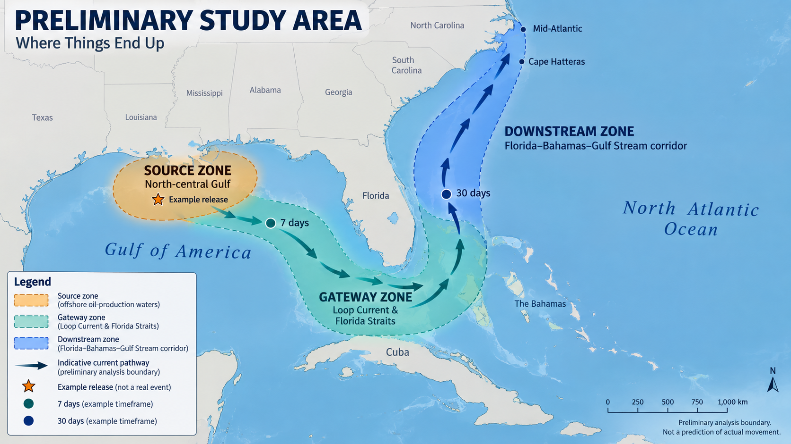

# DATA3001 Group Project — Where Things End Up

## Current Project Direction

 **Where Things End Up** is selected as the project direction.

The project will use historical surface-drifter trajectories to investigate where a near-surface release is likely to travel after a specified period. The intended output is a **probability distribution of possible destinations**, presented as a destination-likelihood map, rather than one deterministic route for one object.

This README records the group's current working plan before the formal project proposal. The geographical boundary, modelling details and evaluation design will be finalised after the expanded region has been checked against the available data.

## Preliminary Study Area

The proposed study area is a connected surface-transport corridor extending from selected offshore oil-production waters in the **north-central Gulf of America**, through the **Loop Current, Florida Straits and the Bahamas**, and into the **Gulf Stream corridor along the U.S. East Coast**.

*Figure 1. Preliminary project scope. The coloured areas represent a proposed source zone, transport gateway and downstream study zone. The arrows indicate the transport pathway to be investigated; they are not a prediction of an actual spill or a guaranteed route. The final analysis boundary will be determined after checking drifter coverage.*

The study area is organised into three functional zones:

1. **Source zone — North-central Gulf:** selected offshore waters associated with oil-production activity and used to define representative release scenarios.
2. **Gateway zone — Loop Current and Florida Straits:** the potential connection between the Gulf, southern Florida and the Bahamas.
3. **Downstream zone — Florida–Bahamas–Gulf Stream corridor:** the offshore pathway extending northward along the U.S. East Coast.

The project does not currently intend to model every location in the Gulf or the entire North Atlantic. The final source zone and downstream boundary must be supported by sufficient historical drifter observations.

## Motivating Scenario

A representative case study will consider a hypothetical near-surface release close to an offshore oil-production area in the Gulf. The project will estimate where material released near that location could be found after **7 days** and **30 days**.

Possible outcomes include:

- remaining within the Gulf;
- approaching a coastal area;
- entering the Loop Current or Florida Straits;
- reaching the Florida–Bahamas region;
- continuing into the Gulf Stream corridor; or
- leaving the defined study area.

The project will estimate the probabilities of these outcomes from historical observations. It will not assume in advance that a release in the Gulf must reach Florida or the U.S. East Coast.

## Preliminary Research Aim

The main aim is to develop a data-driven representation of destination probabilities for near-surface releases within the selected transport corridor.

A preliminary research question is:

> For a near-surface release originating in a selected offshore area of the north-central Gulf of America, what is the probability distribution of its location after 7 and 30 days?

Supporting questions include:

- Which release areas have sufficient historical drifter coverage for reliable analysis?
- What proportion of the predicted distribution remains in the Gulf or enters the Florida Straits–Gulf Stream system?
- How do destination patterns change between the 7-day and 30-day horizons?
- How far can the analysis be extended along the U.S. East Coast before the available observations become insufficient?

## Why the Project Matters

Understanding where floating material is likely to travel has several practical applications:

- **Spill-hazard assessment:** estimating which offshore or coastal areas may be exposed following a surface release.
- **Maritime search-area reasoning:** identifying historically plausible destination areas for life rafts or other floating objects.
- **Floating-object recovery:** supporting the search for containers, debris and other objects lost at sea.
- **Regional connectivity:** describing the surface connection between the Gulf, Florida Straits, the Bahamas and the U.S. East Coast.

The project is intended to provide a historical and probabilistic surface-transport baseline. It is not an operational oil-spill or search-and-rescue forecasting system. Real incidents would also require real-time currents, winds, waves, tides, object-specific windage and, for oil, weathering and chemical processes.

## Preliminary Development Roadmap

### Stage 1 — Verify the expanded study area

- Examine the spatial and temporal coverage of historical drifter observations across the proposed corridor.
- Identify candidate Gulf source locations with enough valid 7-day and 30-day trajectory segments.
- Determine whether the north-central Gulf, Florida Straits and downstream Gulf Stream corridor are sufficiently connected in the observed data.
- Refine the study boundary if parts of the proposed region have inadequate support.

### Stage 2 — Build a single-release-location pilot

- Select one well-supported origin location in the Gulf source zone.
- Collect multiple historical drifter segments that begin near that location.
- Observe where those drifters are located after 7 and 30 days.
- Estimate a destination-probability distribution for each time horizon.
- Produce preliminary 7-day and 30-day destination-likelihood maps.

This stage concerns **one release location supported by many historical trajectories**. It is not an attempt to learn a probability distribution from one drifter alone. Individual held-out drifters may later be used as examples for evaluating the predicted distribution.

### Stage 3 — Extend to a regional transition model

- Divide the supported study area into spatial cells or regions.
- Estimate movement probabilities between origin and destination areas.
- Represent movement out of the study boundary explicitly.
- Connect the local destination model to a regional transition representation.

The transition model will describe how destination probabilities vary between different starting areas, rather than providing only one case-study map.

### Stage 4 — Expand along the transport corridor

- Begin with the Gulf source zone and Florida–Bahamas gateway.
- Extend the supported model northward along the U.S. East Coast Gulf Stream corridor.
- Compare different release locations and identify areas associated with retention, coastal exposure, downstream transport or exit from the region.
- Determine whether an additional time horizon is needed if 30 days is insufficient to observe meaningful downstream transport.

### Stage 5 — Evaluate and communicate the results

- Evaluate predictions using drifter trajectories that were not used to estimate the model.
- Quantify uncertainty and identify locations where sparse observations make the estimates unreliable.
- Produce clear maps showing likely destinations and the evidence supporting each result.
- Distinguish observed findings from assumptions, examples and possible real-world applications.

## Expected Project Outputs

The current plan aims to produce:

- a final study-region and data-coverage map;
- 7-day and 30-day destination-likelihood maps for selected release locations;
- a regional surface-transport or transition representation;
- an assessment of movement toward the Florida Straits and Gulf Stream corridor;
- uncertainty and data-support summaries; and
- a reproducible workflow that can be applied to another region when suitable data are available.

The workflow may be reusable across regions, but the fitted probabilities will remain specific to the observations available in each region.

## Immediate Objective: Project Proposal

The next group deliverable is a concise **three-A4-page project proposal** covering:

1. Research questions and objectives
2. Data, region and data description
3. Why the problem is important or significant
4. Introduction, background and existing studies or solutions
5. Proposed method
6. Initial analysis and visualisation
7. Timeline and plan

Before drafting the final proposal, the team should review this working plan, correct any disagreements about scope, and confirm the project direction. Initial data analysis will then be used to replace unsupported assumptions with evidence.

## Decisions to Finalise as a Team

- the exact Gulf source area and final geographical boundary;
- the representative release location used for the first case study;
- whether 7 and 30 days are sufficient for both local and downstream analysis;
- the operational definition of a valid trajectory segment;
- the regional representation and baseline modelling approach;
- the evaluation criteria and minimum data-support threshold; and
- the division of responsibilities and proposal timeline.

## Preliminary Data Sources and Context

- [NOAA Global Drifter Program](https://www.aoml.noaa.gov/phod/gdp/)
- [NOAA explanation of the Loop Current](https://oceanservice.noaa.gov/facts/loopcurrent.html)
- [BOEM Gulf of America GIS data and infrastructure maps](https://www.boem.gov/oil-gas-energy/mapping-and-data/goar-geographic-information-system-gis-data-and-maps)

Older scientific publications and datasets may use the name **Gulf of Mexico** for the same body of water.
