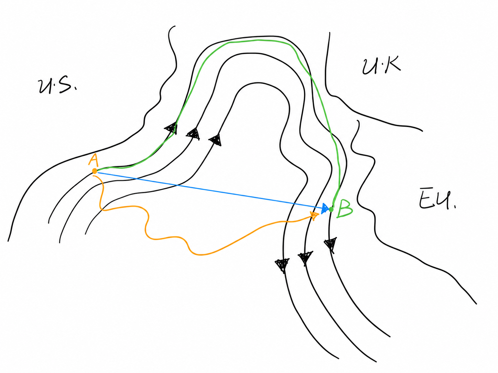
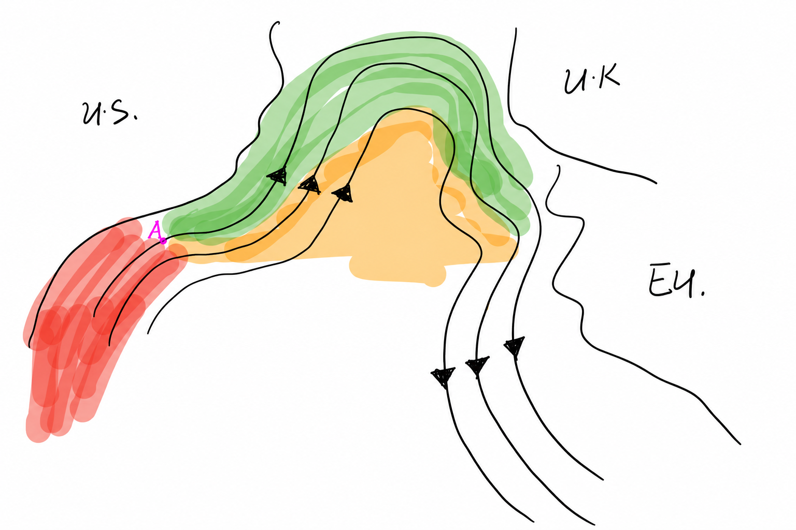

# DATA3001 Group Project

## Project Status

**Current stage:** Week 2 — confirmed project direction and proposal preparation

The group has selected **Where Things End Up** as the project direction. The project will study probabilistic surface transport in the **Florida–Bahamas–Gulf Stream corridor in the western North Atlantic**.

The immediate objective is to prepare the three-page project proposal. Before submission, the group will refine the research question, document regional data adequacy, review relevant literature, establish a defensible baseline method, and produce initial analysis and visualisations.

## Project Direction: Where Things End Up

The project asks where near-surface water, and materials transported with it, are likely to move after release from a selected location. Examples that motivate the problem include floating debris, containers, life rafts, and surface pollutants.

The target is a **probability distribution of possible destinations**, rather than one exact trajectory for one object. The proposed product is a surface-transport operator that can be used to generate destination-likelihood maps for selected release locations and lead times.

### Preliminary Research Question

> For near-surface releases originating in the Florida–Bahamas–Gulf Stream corridor, what is the probability distribution of their destinations after 7 and 30 days, and which release areas are most associated with coastal retention, Gulf Stream entrainment, or exit from the study region?

### Current Objectives

1. Assess the spatial and temporal coverage of historical drifter observations within the selected region.
2. Estimate probabilistic transport relationships between locations in the region.
3. Construct a surface-transport operator, initially using a transition-matrix representation.
4. Produce destination-likelihood maps for a small set of representative release locations.
5. Quantify uncertainty and test whether the conclusions are sensitive to grid resolution, season, and drogue status.

## Study Region

The preliminary study region is the **Florida–Bahamas–Gulf Stream transport corridor in the western North Atlantic**:

- **Latitude:** 22.5°N to 42.5°N
- **Longitude:** 82.5°W to 62.5°W

This rectangular region includes the Florida Straits and the Bahamas, the southeastern and Mid-Atlantic coast of the United States, the upstream Gulf Stream, the separation region near Cape Hatteras, and part of the early downstream Gulf Stream.

The interior of the Gulf of America and the trans-Atlantic continuation towards Europe and Iceland are outside the current project boundary. They may provide upstream or downstream context, but including them in the main model would add substantially different circulation regimes and expand the scope beyond the current ten-week project.

The analysis code should accept the region bounds as parameters so that the same workflow can be rerun for another region. This means the **workflow is region-independent**, while the fitted transport probabilities remain specific to the data available in each region.

## Ocean Currents and Transport Pathways

Surface currents create dominant transport pathways that influence where floating objects or materials are likely to move.

*Figure 1. Conceptual illustration of transport between points A and B under an assumed dominant surface-current pattern. The green path is more consistent with the sketched flow, while the blue and orange paths are less consistent with it. This is an explanatory sketch rather than a geographic or dynamical map.*

The highway analogy illustrates a dominant direction of transport, but ocean currents are not fixed lanes. Actual trajectories spread because currents vary across space and time. Wind, waves, tides, eddies, coastal geometry, and the properties of a drifting object can also affect movement.

*Figure 2. Conceptual illustration of a future-location distribution from release point A. Green represents relatively high likelihood, yellow represents lower likelihood, and red represents very low likelihood under the assumed current pattern. The colours are illustrative and do not represent observed data, calibrated probabilities, or the output of a fitted model.*

## Data and Preliminary Data-Adequacy Check

The primary source is the NOAA Global Drifter Program hourly dataset. It provides quality-controlled hourly positions and related variables for surface drifters, including drogue status.

A preliminary regional audit of the proposed 22.5°N–42.5°N, 82.5°W–62.5°W box found:

- **1,022** distinct drifters entering the region;
- **929** drifters with at least seven consecutive complete days inside the region; and
- **738** drifters with at least thirty consecutive complete days inside the region.

These figures indicate that the region is a viable starting point, but they do not by themselves establish that every spatial grid cell has sufficient transition data. The proposal will therefore include a spatial coverage map, transition counts by origin cell, temporal coverage, and a clear validity definition.

## Significance and Scope

The selected region connects several practically important transport environments: the Florida Straits and Bahamas, the U.S. southeastern coast, the Cape Hatteras shelf–open-ocean exchange zone, and the downstream Gulf Stream.

The work may provide historical and climatological insight into surface-water pathways relevant to spill planning, floating debris, and search-area reasoning. It is not intended to be an operational oil-spill or search-and-rescue forecast. Operational systems require real-time winds and currents, tides, object-specific windage, oil weathering, and other information that is not represented by historical drifter positions alone.

## Proposed Method

The initial baseline will use a **grid-based Markov transition matrix**, or a closely related surface-transport operator:

1. Divide the study region into spatial cells, beginning with a 1° grid.
2. Extract transitions from an origin cell at time `t` to a destination cell after a fixed lag.
3. Estimate conditional transition probabilities between cells.
4. Preserve departures from the study region using explicit outside-region states rather than discarding them.
5. Propagate an initial release distribution forward to produce 7-day and 30-day destination probabilities.

Candidate transition lags and grid resolutions will be compared using held-out data. Training and testing will be separated by drifter ID to prevent observations from the same trajectory appearing in both sets. The main analysis will begin with drogued drifters, which more closely follow near-surface water movement, and use undrogued observations as a sensitivity analysis where the data support it.

Potential later extensions include seasonal operators, bootstrap uncertainty estimates, and continuous-space probability models. These extensions will be attempted only after the baseline operator is validated.

## Initial Analysis and Visualisation Plan

The proposal will include initial evidence rather than conceptual diagrams alone. Planned outputs are:

- a map of the final regional boundary;
- drifter-track and observation-density maps;
- counts of valid 7-day and 30-day transitions by origin cell;
- a drogue-status and temporal-coverage summary; and
- at least one preliminary destination-likelihood map from a selected release location.

The conceptual figures above will remain clearly labelled as illustrations until they are replaced or supplemented by data-derived results.

## Project Proposal Requirements

The project proposal is a concise **three-A4-page outline**. It must prioritise substance and remove unnecessary background. The submission is expected to cover:

1. Research questions and objectives
2. Data, region, and data description
3. Why the problem is important or significant
4. Introduction, background, and existing studies or solutions
5. Proposed method
6. Initial analysis and visualisation
7. Timeline and plan

## Immediate Plan

### Week 2: Define and verify

- confirm the research question, region bounds, lead times, and project claims;
- reproduce the regional data-adequacy statistics from the hourly dataset;
- create the region, track-density, transition-coverage, and temporal-coverage figures;
- review existing drifter-based transition-matrix and surface-transport studies; and
- define the modelling dataset, outside-region treatment, and train/test split.

### Week 3: Build preliminary evidence

- implement the baseline transition operator;
- compare candidate grid resolutions and transition lags;
- generate preliminary 7-day and 30-day destination maps;
- evaluate the model on held-out drifters; and
- document limitations, uncertainty, and possible sampling bias.

### Week 4: Complete the proposal

- draft the seven required proposal sections;
- select only the strongest preliminary figures and results;
- assign and record ownership of the remaining project tasks;
- check that every claim is supported by data or literature; and
- edit the proposal to fit the three-page limit before final review and submission.

## Current Decisions and Open Items

### Confirmed

- Project direction: **Where Things End Up**
- Region: **Florida–Bahamas–Gulf Stream corridor in the western North Atlantic**
- Preliminary bounds: **22.5°N–42.5°N, 82.5°W–62.5°W**
- Primary horizons: **7 days and 30 days**
- Baseline product: **surface-transport operator and destination-likelihood maps**

### To Be Finalised Through Initial Analysis

- final grid resolution and transition lag;
- exact release locations used as case studies;
- minimum transition-support threshold for each origin cell;
- whether seasonal and drogue-status comparisons have sufficient support; and
- final evaluation and uncertainty metrics.
