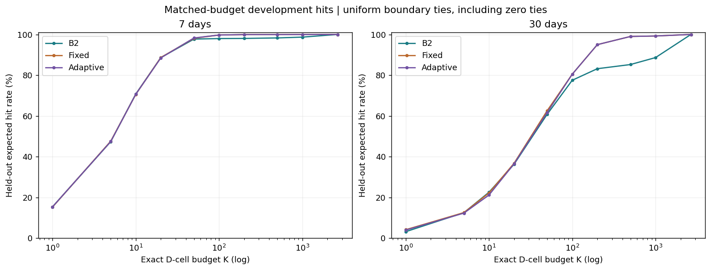
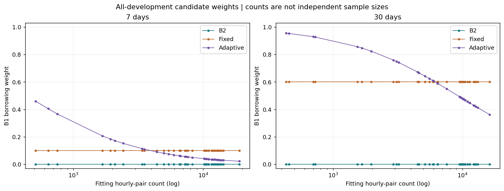
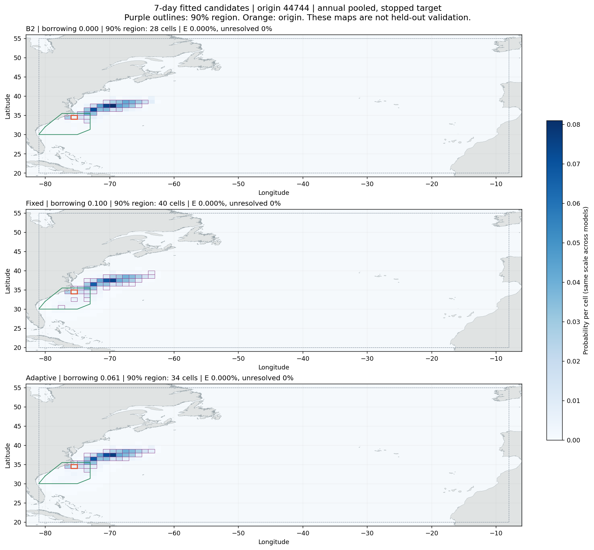
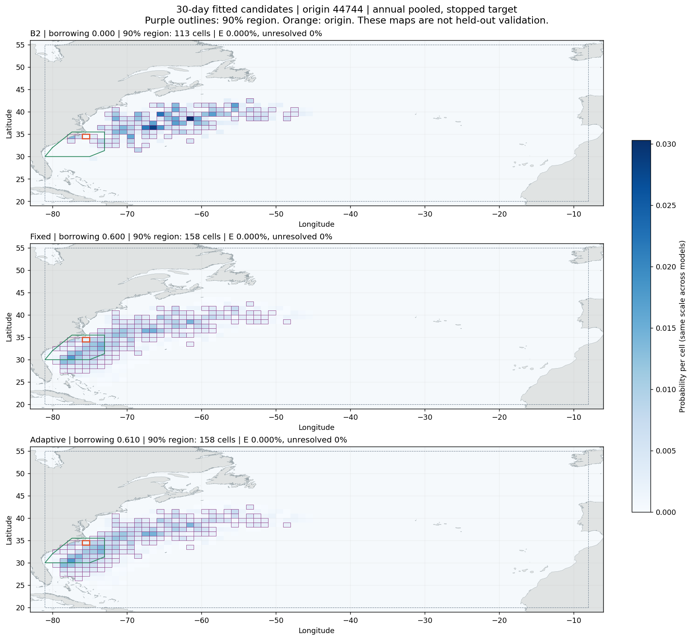

# Stage 2 — Independent Adaptive B2/B1 Experiment

**Status, 30 October 2026:** approved E1 development, execution and audit are complete. Results are submitted for user review; this document does not declare user-approved S2 closure.

**Main finding:** this adaptive rule reduced the mean 90% prediction-region size relative to fixed borrowing, but also reduced its actual hit rate. Neither horizon established a dependable Brier advantage over Fixed under the reported paired intervals. The prespecified joint goal was not achieved at either horizon.

## 1. Identity and scope

- Approved specification: [E1](adaptive_b2_b1_plan.md); configuration: [adaptive_b2_b1.json](../configs/adaptive_b2_b1.json).
- Primary run: `adaptive_b2_b1_20261030T044950_931787Z` ([sealed report](../results/runs/adaptive_b2_b1_20261030T044950_931787Z/REPORT.md), [browser view](../results/runs/adaptive_b2_b1_20261030T044950_931787Z/review.html)).
- Independent replay: `adaptive_b2_b1_20261030T045122_466415Z`.
- Frozen S1 comparator: `empirical_b2_20261029T121555_976173Z`. Fresh B2 probabilities and scores were generated from counts, then checked against S1 after computation; historical forecasts were not fitting or tuning inputs.
- Final cleaned v7; annual pooled; 1-degree origin and destination cells; direct 7/30-day stopped first-exit predictions; equal eligible hourly-pair weights. Existing R/D indexes, qualification and whole-ID boundaries were retained. No raw final-test trajectories were read.

The two horizons use different eligible populations. These are development comparisons on previously examined data, not independent final-test results.

## 2. Estimators and selection

For each fitting set and horizon, B2 uses `p_ij=N_ij/N_i`. B1 uses `q_j=sum_i N_ij/sum_i N_i`, pooling only eligible fitting-ID outcomes from R and including the target origin. Both blends use `(1-lambda_i)*p_ij + lambda_i*q_j`.

- Fixed uses `lambda_i=a` for every supported origin.
- Adaptive uses `lambda_i=m*a/((1-a)*N_i+m*a)`, where m is that fitting set's median positive origin-row count.
- Both families search a in `{0, 0.05, ..., 1}`. Endpoints explicitly give B2 and B1 on the common supported mask. No B1 fallback is issued for an unsupported origin.
- Each outer holdout is excluded from every inner fit, B1 reference, support median and parameter choice. The other four original fold groups provide four inner validation groups. Inner equal-pair standard Brier selects parameters; outer whole-ID predictions assess the complete selection procedure.

N_i is an hourly-pair count, not an independent sample size. This is a regularized point estimator. It does not provide validated Bayesian credible intervals or new transport observations.

## 3. Matched held-out results

| Days | Model | Standard Brier | Mean 90% region cells | Actual region-hit rate |
|---|---|---:|---:|---:|
| 7 | B2 | 0.929001 | 18.23 | 87.44% |
| 7 | Fixed | 0.928607 | 25.64 | 93.29% |
| 7 | Adaptive | 0.928765 | 20.94 | 89.79% |
| 30 | B2 | 0.994751 | 62.61 | 66.37% |
| 30 | Fixed | 0.988819 | 126.41 | 86.43% |
| 30 | Adaptive | 0.988806 | 122.19 | 85.84% |

All three models were scored on exactly the same 303,288 eligible pairs from 385 IDs at 7 days and 268,998 pairs from 337 IDs at 30 days. There were zero unsupported held-out pairs. Every mean is weighted by the original eligible-pair multiplicities. There were no observed or predicted E outcomes; exit calibration remains unestablished.

The 90% region is defined by predicted probability, retaining cutoff ties. Its actual hit rate need not equal 90%. E remains a physical outcome but is never counted as a geographic cell. Cell count is not geographic area. Full values and denominators: [summary.csv](../results/runs/adaptive_b2_b1_20261030T044950_931787Z/summary.csv).

## 4. Primary contrast: Adaptive minus Fixed

| Days | Measure | Difference | Conditional paired 95% interval |
|---|---|---:|---|
| 7 | Brier | +0.000157 | [-0.000395, +0.000967] |
| 7 | Mean region cells | -4.701 | [-5.049, -4.394] |
| 7 | Actual hits, percentage points | -3.497 | [-4.086, -2.994] |
| 30 | Brier | -0.000013 | [-0.000319, +0.000341] |
| 30 | Mean region cells | -4.220 | [-4.792, -3.573] |
| 30 | Actual hits, percentage points | -0.586 | [-0.853, -0.295] |

At 7 days the region shrank by 18.33%, accompanied by lower actual coverage and a slightly worse Brier point estimate. At 30 days it shrank by only 3.34%, with lower actual coverage and a Brier improvement too small to distinguish from zero in the reported interval. Both Brier difference intervals span zero. The observed coverage loss is not merely an unreported side effect of smaller regions.

The intervals use 200 paired whole-development-ID bootstrap resamples, seed 20261030, with fitted forecasts fixed. They omit refitting, selection and research-adaptation uncertainty; they are exploratory and not multiplicity-adjusted. All reported bootstrap measures had 200 defined replicates. [Full differences](../results/runs/adaptive_b2_b1_20261030T044950_931787Z/paired_differences.csv).

Against B2, Adaptive's 30-day Brier difference is -0.005945, interval [-0.007911, -0.004317], but its mean region remains 95.16% larger. Thus this rule has not removed the near-doubling of prediction-region size that motivated the experiment. At 7 days its Brier difference from B2 is -0.000236, interval [-0.001217, +0.001048], with a 14.91% larger mean region.

## 5. Positive support and matched cell budgets

All positive-probability cells and a nominal 90% region are different objects. Fixed and Adaptive had exactly the same positive support for each evaluated row in this run. Their pair-weighted mean positive-cell counts were 123.65 at 7 days and 291.47 at 30 days, compared with B2's 41.06 and 110.94. No tails were clipped. Only the probability allocations and nominal regions changed.

The true-outcome zero-probability fraction fell from 2.0822% to 0.0676% at 7 days and from 17.4589% to 1.0941% at 30 days for both blends. This is support recovery, not a guarantee of concentrated or calibrated forecasts.

| Days | Exact D-cell budget | B2 hit rate | Fixed hit rate | Adaptive hit rate |
|---|---:|---:|---:|---:|
| 7 | 50 | 97.73% | 98.12% | 98.27% |
| 7 | 100 | 97.97% | 99.72% | 99.72% |
| 30 | 50 | 60.82% | 62.56% | 61.71% |
| 30 | 100 | 77.50% | 80.47% | 80.46% |

These examples are part of the prespecified full budget curve, not additional selection criteria. Adaptive has a small 7-day advantage at K=50 but a 30-day disadvantage there; the evidence does not show a consistent advantage over Fixed. Boundary ties use expected inclusion under uniform random selection. When K reaches zero-probability cells, the calculation represents an explicitly uninformed tie allocation rather than a new supported prediction. Exit cases would be excluded only from the D-cell budget diagnostic and retained in Brier; none occurred here.

## 6. Selected weights and candidate maps

Outer Fixed selections were 0.10–0.15 at 7 days and 0.65–0.70 at 30 days. Outer Adaptive a selections were 0.05 at 7 days and 0.60–0.70 at 30 days. These are tuning parameters; Adaptive's actual row weight also depends on N_i and m.

The separate all-development candidate selections were Fixed a=0.10 / 0.60 and Adaptive a=0.05 / 0.55 for 7/30 days. Adaptive's applied weights ranged from 0.0224 to 0.4597 at 7 days and 0.3618 to 0.9554 at 30 days. The fitted support medians were 8,277 and 7,556 pairs. All-development tuning scores are not independent validation scores.

Illustration origin 44744 was selected by the frozen fitting-support rule, without examining held-out scores. It has 6,685 pairs from 247 IDs at 7 days and 5,912 pairs from 223 IDs at 30 days. At this origin, Adaptive borrowing is 0.0612 / 0.6097. The corresponding candidate region sizes are B2/Fixed/Adaptive = 28/40/34 cells at 7 days and 113/158/158 at 30 days. These single-origin fitted maps differ from the held-out population averages above and must not replace them as evidence.

## 7. Engineering audit and limits

- 43 focused mathematical, S1 regression, architecture and import-layout tests passed before execution.
- Qualified counts were reconciled against 396 source-keyed label files and the v7 development inventory; all 3,224 development IDs retained their frozen fold membership.
- Independent arithmetic rebuilt all 26 fitting roles, every candidate score and selected parameter, held-out Brier, 90% regions and exact-budget tie hits. Maximum errors were 5.55e-17 for probabilities, 5.57e-16 for candidate Brier and 6.66e-16 for held-out Brier.
- Fresh B2 scores and all 12 B2 matrices reproduced frozen S1 within 1e-12; all 38 sealed S1 artifacts were verified unchanged.
- Complete execution took 58.73 seconds; the 58.10-second replay reproduced all 115 numerical tables within 1e-12. Both runs were below the approved 30-minute cap.
- Persisted counts, matrices, region hits and summaries were independently reconstructed after execution. All four figures were visually inspected. See the [post-run audit](../provenance/reviews/adaptive_b2_b1_20261030T044950_931787Z_audit.json).
- No canonical trajectory files were opened by either experiment, no final-test trajectories were accessed, and no guarded operation was denied. Input/code hashes remained unchanged during each run. S1 artifacts and stopped neighbour/continuous work were preserved.

The experiment tests one count-based weight schedule with one global empirical reference and a bounded search. It does not establish that every adaptive method fails, that B1 has no predictive value, or that B2 is universally preferable. It also does not validate long-horizon propagation, spatial accuracy, physical diffusion, object-specific forecasts or grounding.

**Recommendation for review:** retain B2 and Fixed as comparison evidence, and do not promote this Adaptive rule as an established improvement. No extra search, alternate support measure, spatial borrowing or next-stage experiment has been started. Scientific closure and any subsequent design change await the user's decision.
