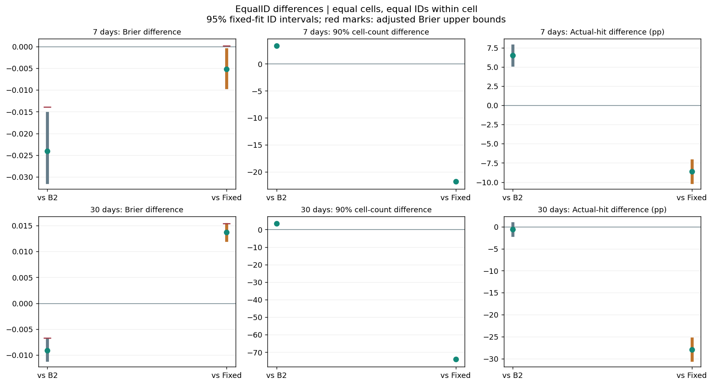

# Step 2 — E3 Equal-drifter Destination Estimation: Results

**Status:** independent development, primary execution, audit and fresh replay complete. All 199 numerical tables reproduced within absolute 1e-12. Scientific retention and Step 2 closure require user review.

**Primary run:** drifter_shrinkage_e3_20261030T074159_751985Z. **Fresh replay:** drifter_shrinkage_e3_20261030T074841_426052Z.

Read the [approved E3 v2 plan](drifter_shrinkage_e3_plan.md), [sealed primary report](../results/runs/drifter_shrinkage_e3_20261030T074159_751985Z/REPORT.md), [browser view](../results/runs/drifter_shrinkage_e3_20261030T074159_751985Z/review.html), and [primary verification](../provenance/runs/drifter_shrinkage_e3_20261030T074159_751985Z/verification.json).

## 1. Finding for Where Things End Up

Under the approved equal-cell, equal-drifter evaluation target, EqualID improves Brier relative to original B2 at both horizons. The paired, fixed-fit uncertainty screen supports those two development comparisons. It does **not** establish EqualID as an overall replacement for Fixed B2/B1.

- **7 days:** EqualID improves Brier and actual 90% region hits versus B2, while increasing region size. Against Fixed it has a lower Brier point estimate and a much smaller region, but loses 8.59 percentage points of actual hits. Its Brier advantage over Fixed does not pass the prespecified four-contrast adjusted screen.
- **30 days:** EqualID improves Brier versus B2 but does not improve region hits or size at the point level. Fixed has lower Brier and much higher actual hits than EqualID. The smaller EqualID region does not establish better destination prediction.

These conclusions refer to prediction starting at an arbitrary eligible time when the drifter is already in the origin cell. They do not concern first entry. Coordinates map to a 1-degree cell; the current model does not distinguish positions within that cell.

## 2. What changed, and what stayed fixed

Use the same cleaned v7 data, qualified hourly pairs, annual pooling, 1-degree geometry, direct 7/30-day stopped outcomes and original whole-ID splits. The final-test pool remains locked.

For fitting ID d in origin i, let n_idj be its count to destination j and n_id its total local count. EqualID estimates:

**P_EqualID(i,j) = (1/M_i) sum_d n_idj/n_id.**

Each represented drifter contributes 1/M_i of the row. All within-ID endpoint frequencies are retained. Raw B2 still normalises pair counts. Fixed still blends raw B2 and raw B1, but selects its constant weight afresh using the new inner-validation Brier.

The held-out score averages eligible times within each ID/cell, then IDs within cell, then evaluable origin cells equally. The same weights apply to Brier, mean 90% cell count and actual hits. Unsupported rows are unavailable for all models. Score aggregation is conditional on available support, and availability is reported separately.

This is an explicit change of sampling target from S1/E1/E2. The new B2 score differs from the historical score because the evaluation weights changed, not because its fitted probability formula changed. Historical runs remain unchanged.

The standard multiclass Brier formula is unchanged: **BS=1+sum_j p_j^2-2*p_y**, with destinations including D and first-exit E. No spatial loss, tail deletion, probability floor, neighbour information, new predictor or gamma search was used.

## 3. Main results under the approved target

| Horizon | Model | Brier, lower is better | Mean 90% D-cell count | Actual hits |
|---|---|---:|---:|---:|
| 7 days | B2 | 0.981297 | 17.56 | 74.84% |
| 7 days | EqualID | 0.957266 | 20.91 | 81.37% |
| 7 days | Fixed | 0.962457 | 42.71 | 89.96% |
| 30 days | B2 | 1.017814 | 56.57 | 50.28% |
| 30 days | EqualID | 1.008698 | 59.93 | 49.68% |
| 30 days | Fixed | 0.994931 | 133.86 | 77.59% |

Source: [primary summary](../results/runs/drifter_shrinkage_e3_20261030T074159_751985Z/summary.csv). Counts above are weighted means, not integer sizes for one specific origin.

The common evaluated population has 37 origin cells at each horizon. At 7 days it includes 385 distinct IDs, 4,451 ID-cell units and 303,288 hourly pairs; at 30 days, 337 IDs, 3,974 ID-cell units and 268,998 pairs. All eligible held-out cases have common training support. The remaining 17 entries in the fixed 54-cell origin index have no eligible evaluation cases; their performance is not established.

Predicted 90% regions issue approximately 90.1–91.2% mass after cutoff ties, but observed hits are lower. In particular, even Fixed's 30-day actual hits are only 77.59%. No model has demonstrated nominal 90% coverage across both horizons.

## 4. Differences and conditional uncertainty

All differences below are EqualID minus the stated reference. Intervals use 5,000 paired positive whole-ID multiplier resamples with fitted models held fixed.

| Horizon | Reference | Brier difference | Ordinary 95% interval | Adjusted one-sided upper bound |
|---|---|---:|---|---:|
| 7 days | B2 | -0.024030 | [-0.031201, -0.015363] | -0.013953 |
| 7 days | Fixed | -0.005191 | [-0.009388, -0.000660] | +0.000195 |
| 30 days | B2 | -0.009117 | [-0.010979, -0.006991] | -0.006721 |
| 30 days | Fixed | +0.013767 | [+0.012166, +0.015247] | +0.015430 |

The adjusted bound is the 98.75th percentile for the four prespecified Brier contrasts. At 7 days versus Fixed, the ordinary interval excludes zero, but the adjusted bound does not; the locked decision is **point improvement with remaining uncertainty**, not confirmed superiority.

| Horizon | Reference | Mean cell-count change | Actual-hit change |
|---|---|---:|---:|
| 7 days | B2 | +3.35 | +6.53 percentage points |
| 7 days | Fixed | -21.81 | -8.59 percentage points |
| 30 days | B2 | +3.36 | -0.60 percentage points |
| 30 days | Fixed | -73.93 | -27.91 percentage points |

EqualID uses about 51% fewer cells than Fixed at 7 days and 55% fewer at 30 days, but both reductions accompany lower actual hits. This is not the earlier objective of a smaller region with no quality trade-off.

Source: [paired differences](../results/runs/drifter_shrinkage_e3_20261030T074159_751985Z/paired_differences.csv). The 30-day hit difference versus B2 has an ordinary interval spanning zero; report its negative point estimate without claiming established population deterioration.

The intervals omit refitting variability, overlapping training-set dependence and earlier research adaptation. They are conditional development evidence, not final-test confirmation, complete calibration evidence or Bayesian credible intervals.

## 5. Mechanism and support limits

Per-origin Brier improves for EqualID versus B2 in 36 of 37 cells at 7 days and 32 of 37 at 30 days. Against Fixed, the corresponding counts are 31 and 6. These are descriptive counts, not additional significance tests or a reason to select favourable cells.

The Brier decomposition clarifies the change. Relative to B2, EqualID reduces the mean squared-probability concentration term by 0.035143 at 7 days and 0.012830 at 30 days. Mean probability assigned to the realised cell also decreases, by 0.005556 and 0.001857. The concentration-term reduction outweighs that loss, producing the net Brier improvement. This is not evidence that every realised endpoint receives more probability or that full calibration has been established.

EqualID has exactly B2's positive destination support. Under the primary weights:

| Horizon | B2 / EqualID true outcomes with zero probability | Fixed true outcomes with zero probability |
|---|---:|---:|
| 7 days | 6.35% | 0.15% |
| 30 days | 31.43% | 1.49% |

Thus balancing local ID contributions cannot solve missing local endpoint support. The 30-day results expose a substantial remaining prediction limitation. Zero-probability truths were scored normally; they were not removed or classified as unresolved.

Source: [per-cell results](../results/runs/drifter_shrinkage_e3_20261030T074159_751985Z/cell_summary.csv), [main diagnostics](../results/runs/drifter_shrinkage_e3_20261030T074159_751985Z/summary.csv) and [contribution figure](../results/runs/drifter_shrinkage_e3_20261030T074159_751985Z/drifter_contributions.png).

## 6. Fixed weights and secondary sampling sensitivity

Fixed's selected B1 weights across the five outer fits are:

- 7 days: 0.50, 0.50, 0.50, 0.50, 0.45.
- 30 days: 0.85, 0.90, 0.80, 0.85, 0.80.
- Illustrative all-development refit: 0.45 at 7 days; 0.80 at 30 days.

These follow the approved new objective and can legitimately differ from E1/E2. EqualID has no selected gamma or additional hyperparameter.

For the same newly fitted predictions, the secondary original-pair score is:

| Horizon | Model | Pair-weighted Brier | Mean 90% cells | Actual hits |
|---|---|---:|---:|---:|
| 7 days | B2 | 0.929001 | 18.23 | 87.44% |
| 7 days | EqualID | 0.947769 | 21.72 | 88.57% |
| 7 days | Fixed | 0.938240 | 42.03 | 95.52% |
| 30 days | B2 | 0.994751 | 62.61 | 66.37% |
| 30 days | EqualID | 0.995560 | 65.89 | 62.07% |
| 30 days | Fixed | 0.989841 | 133.55 | 86.91% |

The Brier comparison against B2 reverses under this alternative population. This must be disclosed: EqualID's benefit is for the **prespecified new target**, not universal superiority under every sampling scheme. These secondary values did not select a model or parameter. New Fixed predictions are not the old pair-tuned Fixed procedure.

Sources: [selected parameters](../results/runs/drifter_shrinkage_e3_20261030T074159_751985Z/selected_parameters.csv) and [secondary summary](../results/runs/drifter_shrinkage_e3_20261030T074159_751985Z/pair_weighted_summary.csv).

## 7. Visual interpretation

The support-only selected illustration origin is 44744, with 247 fitting IDs at 7 days and 223 at 30 days. See the [7-day maps](../results/runs/drifter_shrinkage_e3_20261030T074159_751985Z/candidate_comparison_7d.png), [30-day maps](../results/runs/drifter_shrinkage_e3_20261030T074159_751985Z/candidate_comparison_30d.png) and [matched-budget curves](../results/runs/drifter_shrinkage_e3_20261030T074159_751985Z/budget_hit_curves.png).

Maps retain every positive probability and share a colour scale within each horizon. The 30-day example has 113 B2 cells versus 109 EqualID cells, but overall EqualID's mean region is larger. This illustrates why one visually appealing origin cannot establish aggregate improvement. Candidate maps are all-development refits; held-out results come from the nested outer predictions.

All five figures were visually inspected. No observed or predicted exits occur in this empirical population; synthetic exit semantics are tested, but empirical exit calibration is unvalidated.

## 8. Engineering review

- 20 E3 semantic tests and 56 relevant S1/E1/E2, region and architecture regressions passed.
- All 26 fitting roles, 1,150 candidate identities and 968,875 candidate ID-cell scores were independently reconstructed.
- 65,637 grouped outer model/cases were audited; every original held-out pair is retained for each model.
- Maximum independent numerical error: 9.095e-13, below the unchanged absolute 1e-12 threshold.
- All 5,000 multiplier replicates were independently checked; maximum resampling difference 5.684e-14.
- Raw B2 held-out predictions reproduce S1; matched-parameter B1/B2/Fixed formulas reproduce historical controls. Prior S1/E1/E2 sealed artifacts passed hash checks.
- Inputs, code and outer-freeze hashes remained unchanged. No raw trajectory or final-test trajectory was read; no access was denied.
- Primary elapsed time: 181.85 seconds; fresh replay: 186.82 seconds. All 199 numerical tables matched within absolute 1e-12, including candidates, selected parameters, forecasts, summaries and multiplier results. See the [replay receipt](../provenance/runs/drifter_shrinkage_e3_20261030T074841_426052Z/verification.json).

The first preflight stopped on a 1.464e-12 discrepancy from sequential floating-point summation in the independent audit. Stable summation corrected that arithmetic issue; no model, score, tolerance or grid changed. The failed preflight remains recorded as drifter_shrinkage_e3_preflight_20261030T074018_980200Z. The corrected preflight drifter_shrinkage_e3_preflight_20261030T074122_066931Z passed with maximum candidate error 2.842e-14. One primary experiment and one fresh replay were completed.

## 9. Decision submitted for review

Retain EqualID as a useful empirical estimator for the confirmed equal-drifter target, especially for the 7-day comparison with raw B2. Do not declare it a universal replacement for Fixed: 7-day coverage trade-offs and adjusted Brier uncertainty remain; at 30 days Fixed is clearly stronger on the measured probability and hit metrics.

The experiment is a bounded test of contribution balancing. It does not establish that every long record is harmful, every drifter is independent, or every spill/object is represented by these drifters. It provides no new physical spreading, weathering, windage or subcell-position model.

No extra search or combined EqualID/B1 model was run. Step 2 closure, model retention for applications and any Step 3 spatial-information experiment await discussion and user approval.
