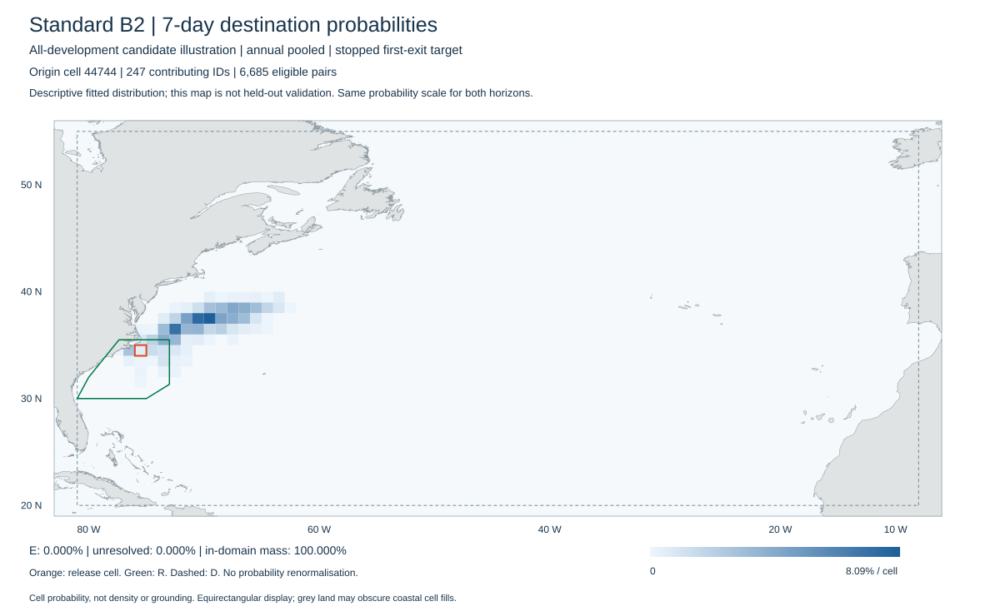
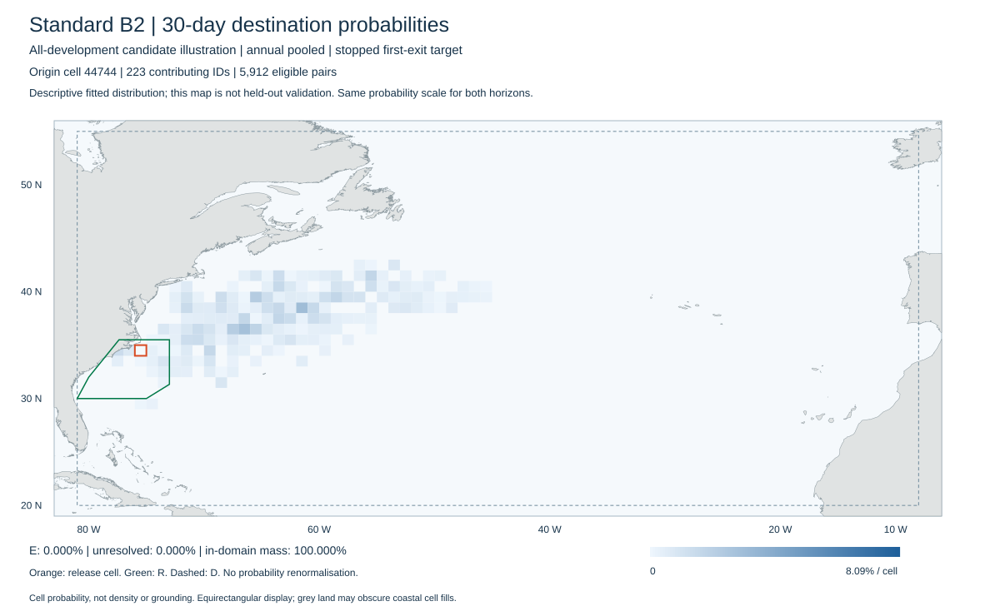

# Step 1 — Empirical Transition Matrix: Method, Assumptions and Results

**Status:** completed and accepted by the user on 29 October 2026. Standard B2 is frozen as the baseline for subsequent stages. Step 2 has entered planning; its method and engineering execution have not been approved.

**Frozen experiment:** empirical_b2_20261029T121555_976173Z. Numerical replay: empirical_b2_20261029T121658_676902Z.

This is the current scientific closing record for S1. It supplements the [approved E2 plan](empirical_b2_plan.md), [original run report](../results/runs/empirical_b2_20261029T121555_976173Z/REPORT.md) and [engineering audit](../provenance/reviews/empirical_b2_20261029T121555_976173Z_audit.json). Those sealed records retain their creation-time “closure pending” status; the subsequent approval in the [stage ledger](research_stage_ledger.md) closes S1 without rewriting historical artifacts.

## 1. Research question and fixed scope

Given a release cell in R, what empirical probabilities can we assign to the destination state at 7 or 30 days using cell-only historical frequencies, and what support and limitations accompany those probabilities?

| Element | S1 definition |
|---|---|
| Data | Final cleaned release per-drifter-cleaned-20261017-v7 |
| Development population | 3,224 drifter IDs; the 517 final-test IDs remain locked |
| Release region R | Frozen southern Gulf Stream Corridor polygon; its bounding box is not the membership rule |
| Transport domain D | Frozen domain approximately 81°W–8°W, 20°N–55°N |
| Spatial resolution | Fixed 1° cells |
| Conditioning | Release cell and requested horizon; annual-pooled |
| Target | Destination of the stopped process, including first observed exit from D |
| Estimator | Standard B2 empirical count normalisation |
| Evaluation | Standard multiclass Brier, whole-ID development validation |

The 7-day and 30-day estimates are separate. S1 does not fit a daily operator or simulate trajectories. Available velocity, season, drogue state, environmental variables and previous motion do not condition B2. There is no smoothing, prior, neighbour borrowing or spatial/composite loss.

## 2. Mathematical method and background assumptions

### 2.1 State and outcome

Let \(C_t\) be the 1° cell containing a qualified release location at time \(t\), and let \(h\in\{7,30\}\) days. The destination state space contains 2,664 frozen D cells and the physical exit state \(E\).

For a qualified release–horizon pair, the outcome is

$$
Y_t^{(h)} =
\begin{cases}
E, & \text{if a first observed exit from D occurs within the horizon},\\
\operatorname{cell}(X_{t+h}), & \text{otherwise}.
\end{cases}
$$

Once an observed exit occurs, the stopped outcome stays E even if the drifter later returns. This is different from unrestricted endpoint occupancy. Missing follow-up, a gap or loss of contact is not automatically an exit. Existing qualification rules determine whether an outcome is usable; a known eligible exit can remain usable even if the track ends before the nominal horizon.

B2 uses the fixed-horizon, current-cell approximation

$$
\Pr_{\mathrm{B2}}\!\left(Y_t^{(h)}=j\mid C_t=i,\mathcal H_t,z_t\right)
=P_{ij}^{(h)},
$$

where \(\mathcal H_t\) denotes earlier motion and \(z_t\) denotes additional available initial conditions. Their omission is a modelling choice. It does not prove that the real ocean process becomes Markovian after aggregation to 1° cells.

### 2.2 Count estimator

For a fitting set of drifter IDs \(\mathcal T\), count every qualified hourly pair once:

$$
N_{ij}^{(h)}
=\sum_{d\in\mathcal T}\sum_t
\mathbf1\{\text{pair }(d,t,h)\text{ is eligible},\ C_{d,t}=i,\ Y_{d,t}^{(h)}=j\}.
$$

Write \(N_i^{(h)}=\sum_jN_{ij}^{(h)}\). For a supported row,

$$
\widehat P_{ij}^{(h)}
=\frac{N_{ij}^{(h)}}{N_i^{(h)}},
\qquad N_i^{(h)}>0.
$$

Thus a row estimates an empirical conditional distribution of the qualified outcomes. Under a categorical working likelihood, the same proportions maximise \(\sum_jN_{ij}^{(h)}\log p_j\) subject to \(p_j\geq0\) and \(\sum_jp_j=1\), using the usual \(0\log0=0\) convention. This is an interpretation of the count estimator, not a claim that overlapping hourly observations are independent. The implementation directly calculates the proportions and uses no iterative optimiser.

The exported tables have 54 R-intersection source rows and 2,665 physical destination columns. They are R-to-D fixed-horizon forecast tables, not square D-to-D propagation operators. No cross-horizon composition or common-kernel power identity is imposed. Sparse storage omits zero entries; the source/destination indexes and support masks are part of the matrix definition.

### 2.3 Assumptions and interpretation boundaries

| Working assumption or design choice | Meaning and practical boundary |
|---|---|
| Cell-only state | Releases in one cell share a destination distribution at a given horizon. Subcell position, velocity and motion history are averaged over their sampled mixture. |
| Annual pooling | One distribution pools the retained calendar periods. It describes that mixture; it does not establish physical stationarity or equal seasonal behaviour. |
| Transferability of eligible samples | Applying the estimate to another release assumes the retained, qualified drifter windows are representative enough for that use. Qualification and observation coverage can affect the sampled distribution. |
| Equal-pair weighting | Each eligible hourly pair has weight one. IDs with more eligible pairs contribute more to the estimate; the estimand is not an equally weighted average over drifters. |
| Discrete stopped target | Outcomes are cell membership or observed exit. The model does not identify exact locations, continuous exit times, grounding or transport outside D. |
| Cluster-based uncertainty | Whole-ID resampling retains within-ID dependence. It treats IDs as the resampling units; it does not model all possible shared environmental dependence between different IDs. |

### 2.4 Unsupported rows and empirical zeros

If \(N_i^{(h)}=0\), the row cannot be estimated by frequency normalisation. It receives an unsupported flag and unresolved mass one; the physical distribution is undefined. No uniform row, self-loop or B1 fallback is inserted.

If \(N_i^{(h)}>0\) but \(N_{ij}^{(h)}=0\), the row is supported and destination j receives probability zero. This means the transition was not observed in the fitting sample, not that it is physically impossible.

Unresolved is bookkeeping for unavailable model support, not a physical outcome. Every row satisfies physical probability mass plus unresolved mass equal to one within \(10^{-12}\). Unexplained numerical deficits are errors, not unresolved probability.

## 3. Loss function: standard Brier evaluation

### 3.1 Formula and meaning

Let \(p=(p_1,\ldots,p_K)\) be a complete forecast over the \(K=2,665\) physical outcomes, including E, and let y be the observed outcome. The score is

$$
\operatorname{BS}(p,y)
=\sum_{j=1}^{K}\left(p_j-\mathbf1\{j=y\}\right)^2
=1-2p_y+\sum_{j=1}^{K}p_j^2.
$$

Lower is better. We use the unnormalised multiclass convention, with range 0–2: no division by K, square root, spatial-distance term or failure-penalty term. For example, probabilities \((0.25,0.75)\) with the second outcome observed give \(0.25^2+(0.75-1)^2=0.125\).

Brier is an evaluation loss in this experiment. B2 is fitted by count normalisation; the held-out Brier score is not used to adjust the matrix or select parameters.

### 3.2 Why this evaluates a probability distribution

For a true categorical distribution q,

$$
\mathbb E_{Y\sim q}\!\left[\operatorname{BS}(p,Y)\right]
=\|p-q\|_2^2+1-\|q\|_2^2.
$$

For fixed q, the expected score is uniquely minimised at \(p=q\). This is the strictly proper scoring principle: it rewards the correct probability distribution in expectation, including a multimodal distribution. See [Gneiting and Raftery (2007), Strictly Proper Scoring Rules, Prediction, and Estimation](https://doi.org/10.1198/016214506000001437). The identity above also gives the finite-state argument directly.

This property assumes a complete forecast and evaluation on the stated case population. It does not guarantee that one realised outcome or a finite validation sample ranks distributions correctly. It also does not prevent bias from selectively excluding difficult cases.

Brier measures squared probability error. It gives no additional penalty merely because a wrong cell is geographically farther away. Spatial scoring and a linear/quadratic combination were explicitly deferred.

### 3.3 Denominators, missing scores and weighting

Let \(\mathcal Q_h\) be all eligible held-out cases at horizon h, and let \(\mathcal V_h\subseteq\mathcal Q_h\) contain cases whose fitting fold provides a supported origin row. With grouped count weight \(w_r\),

$$
\overline{\operatorname{BS}}_h
=\frac{\sum_{r\in\mathcal V_h}w_r\operatorname{BS}_r}
        {\sum_{r\in\mathcal V_h}w_r},
\qquad
\operatorname{Availability}_h
=\frac{\sum_{r\in\mathcal V_h}w_r}
        {\sum_{r\in\mathcal Q_h}w_r}.
$$

Grouped rows are an exact compression of the hourly cases. Fold means are not given equal weight independently of their case counts.

Unsupported forecasts have missing Brier and are included in the separately reported unsupported counts and proportions. The mean score is explicitly conditional on available support when failures occur. A supported forecast with \(p_y=0\) still receives its ordinary Brier, \(1+\sum_jp_j^2\); it is not unresolved and does not necessarily score 2.

## 4. Evaluation design and reproducibility

The five folds assign entire drifter IDs. Each fit uses four folds, and predicts the remaining fold before scoring its outcomes. All eligible held-out cases are accounted for exactly once. There is no inner validation search or post-result tuning.

Two additional matrices fit all development IDs for later use as baseline candidates. Their fitting data are not presented as independent validation. All twelve matrices retain counts, fitting roles, state indexes and row support.

The 95% intervals are the 2.5/97.5 percentiles of 200 whole-ID bootstrap resamples, seed 20261029. Folds and fitted predictions remain fixed. These intervals reflect held-out sampling variability conditional on those fits; they omit refitting and research-selection uncertainty.

The independent run reused verified qualification/count assets and the fixed ID assignments. It regenerated all probabilities, forecasts and scores. No historical fitted matrix or score was used as an input or acceptance target. Reusing previously examined development data does not create a new independent test dataset.

## 5. Results and evaluation summary

### 5.1 Held-out development results

| Horizon | Eligible hourly pairs | Distinct IDs | Standard Brier | Fixed-fit 95% interval | Unsupported pairs | True-outcome zero-probability pairs |
|---|---:|---:|---:|---|---:|---:|
| 7 days | 303,288 | 385 | 0.929001 | [0.921631, 0.937923] | 0 (0%) | 6,315 (2.0822%) |
| 30 days | 268,998 | 337 | 0.994751 | [0.991777, 0.998311] | 0 (0%) | 46,964 (17.4589%) |

Every eligible held-out case was evaluable, so the supported-case and all-eligible-case denominators coincide in this run. The horizons have different eligible populations; their scores alone do not quantify a causal horizon effect or establish superiority over another model. Brier is not an accuracy percentage.

Observed E outcomes and mean predicted E probabilities were zero at both horizons. This gives no empirical validation of exit calibration. E remains a declared destination state.

### 5.2 Support in the all-development matrices

| Horizon | Indexed R rows | Supported rows | Unsupported rows | Unsupported rows with positive R area | Boundary-only R rows |
|---|---:|---:|---:|---:|---:|
| 7 days | 54 | 37 | 17 | 4 | 13 |
| 30 days | 54 | 37 | 17 | 4 | 13 |

The unsupported rows are different from unsupported forecasts on observed held-out cases. Here, all 17 unsupported index rows had no corresponding eligible held-out release case. Supported rows also vary in evidence: unique fitting-ID counts range from 7–247 for 7 days and 5–223 for 30 days.

The larger 30-day zero-probability fraction documents an empirical support limitation at that horizon. It identifies a question for regularisation research, not proof that any particular smoothing method will improve performance.

Sources: [summary](../results/runs/empirical_b2_20261029T121555_976173Z/summary.csv), [bootstrap intervals](../results/runs/empirical_b2_20261029T121555_976173Z/bootstrap_intervals.csv), [candidate support](../results/runs/empirical_b2_20261029T121555_976173Z/candidate_support_summary.csv), [full row support](../results/runs/empirical_b2_20261029T121555_976173Z/row_support.csv), [cell-level evaluation](../results/runs/empirical_b2_20261029T121555_976173Z/cell_summary.csv).

## 6. Visualisations and their interpretation

Both maps show the all-development candidate from origin cell 44744. The cell was selected by the largest minimum number of contributing IDs across the two horizons, breaking ties by increasing cell ID. Held-out scores and visual appearance were not selection criteria.

| Map | Fitting pairs at this origin | Distinct fitting IDs | Observed destination cells |
|---|---:|---:|---:|
| 7 days | 6,685 | 247 | 65 |
| 30 days | 5,912 | 223 | 169 |

The 7-day example places much of its visible probability along the northeastward corridor from the release cell.

The 30-day example spans more destination cells and shows a broader northeastward distribution. This is descriptive endpoint spread, not a measured diffusion coefficient, a trajectory prediction or evidence of spatial forecast accuracy.

The maps share a colour scale and show probability per cell, not area-normalised density. Orange marks the release cell, green marks R and the dashed boundary marks D. E and unresolved probabilities are displayed separately; the geographic probabilities are not renormalised. Grey land may obscure coastal cell fills. These are fitted candidate illustrations, not held-out validation plots. An [HTML view of the original experiment](../results/runs/empirical_b2_20261029T121555_976173Z/review.html) is also available.

The user observed agreement with earlier scores and visualisations. With matching input definitions and a deterministic frequency estimator, agreement is expected consistency evidence; it is not an additional independent test of physical validity.

## 7. Completion decision and frozen baseline

S1 is complete within the approved scope: the empirical matrices exist, their scientific definitions are explicit, their implementation and development evaluation are reproducible, and their support limitations are disclosed.

- 49 relevant tests passed, including exact scoring, unsupported rows, ID isolation and boundary semantics.
- All 12 matrices reconciled with fitting counts. The independent Brier calculation differed by at most \(6.661338147750939\times10^{-16}\).
- The fresh replay matched 27 numerical tables within \(10^{-12}\).
- Input and source identities were checked; no final-test trajectories were read.
- The final report, maps, matrices and provenance remain sealed. No predictive improvement or universal geographic support was required for closure.

Freeze the recorded data, target, grid, horizons, weighting, folds, Brier convention and run identity as the S1 reference. The [engineering plan](empirical_b2_plan.md) remains the unchanged approved implementation specification; the [audit](../provenance/reviews/empirical_b2_20261029T121555_976173Z_audit.json) records the checks.

The main unresolved scientific limits are sparse support and empirical zeros, unvalidated exit probabilities, the absence of a geographic-error assessment, and the restriction to development drifters under the stated qualification and pooling assumptions. Completion does not establish final-test, operational, seasonal, year-scale or object-specific accuracy.

## 8. Entry to Step 2

Step 2 is now in planning: regularisation / Bayesian transition-matrix estimation. The initial question is whether a controlled extension can improve the empirical baseline's support and probability estimates under a comparable evaluation.

No prior, shrinkage formula, parameter range, unsupported-row fallback or new experiment has been approved. The next task is to define the smallest useful comparison and its assumptions, then obtain approval before implementation. S1 remains frozen regardless of the next model's results.
