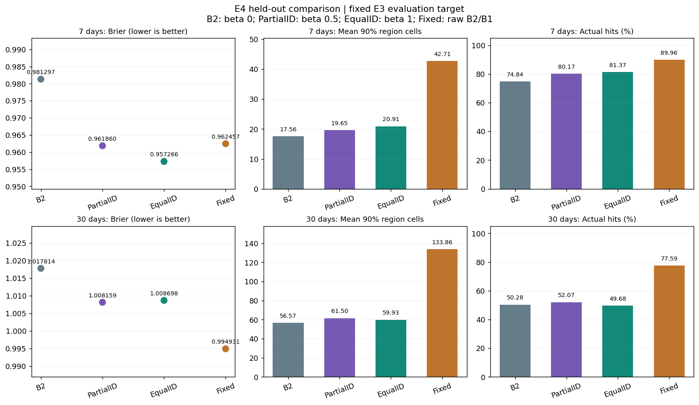
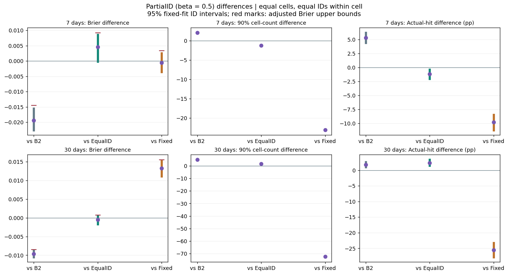

# Step 2 — E4 Partial Drifter Contribution Weighting: Results

**Status:** independent development, primary execution, audit and fresh full replay complete. All 231 numerical tables reproduced within absolute 1e-12. Scientific retention and Step 2 closure await user review.

**Primary:** `partial_weighting_e4_20261030T082826_141410Z`. **Replay:** `partial_weighting_e4_20261030T083247_155679Z`. Read the [approved E4 v1 plan](partial_weighting_e4_plan.md), [sealed report](../results/runs/partial_weighting_e4_20261030T082826_141410Z/REPORT.md), [visual comparison](../results/runs/partial_weighting_e4_20261030T082826_141410Z/review.html) and [primary audit](../provenance/runs/partial_weighting_e4_20261030T082826_141410Z/verification.json).

## 1. Finding for Where Things End Up

PartialID (beta = 0.5) improves primary Brier relative to original B2 at both 7 and 30 days, with conditional development support under the prespecified six-comparison screen. Actual nominal-90% region hits also increase at the point level, accompanied by larger regions.

It does not establish the intended intermediate weighting as better than both endpoints. At 7 days its Brier point estimate and actual hits are worse than EqualID's; at 30 days its Brier is slightly lower than EqualID's but the paired interval spans zero. PartialID cannot replace Fixed on the measured combination of probability quality and hits: the 7-day Brier advantage is uncertain and costs 9.78 percentage points of coverage; at 30 days Fixed has lower Brier and substantially higher hits.

This is an informative partial improvement over raw B2, not a uniform win or a final model selection. No beta was chosen from outer results, no extra grid was tried, and no PartialID/B1 combination was fitted.

## 2. Model, target and assumptions

Keep every qualified hourly pair from final cleaned v7 data, annual pooling, 1-degree cells and direct 7/30-day stopped outcomes. For fitting ID d within origin i and horizon h, n_idj is its count to outcome j and n_id is its local pair total. The estimate is:

**P_beta(i,j) = sum_d[n_idj * n_id^(-beta)] / sum_d[n_id^(1-beta)].**

- Beta 0 is original pair-weighted B2.
- Beta 0.5 is PartialID: a drifter's total local contribution is proportional to sqrt(n_id).
- Beta 1 is EqualID: equal total local contribution per represented drifter.
- Fixed retains raw B2 and raw whole-R B1, selecting one blend weight by inner Brier for each horizon/role.

For 90 versus 10 local pairs the contribution ratios are 9:1, 3:1 and 1:1. Internal endpoint frequencies, all hourly pairs and their integer multiplicities are retained. Beta 0.5 is not a 50/50 probability mixture of B2 and EqualID.

Evaluation is unchanged from E3: average eligible times within each held-out ID/cell, IDs equally within cell, then cells equally. This same target governs inner Fixed selection and every model's metrics. Partial training weighting deliberately differs from that equal-ID evaluation population; its value must be judged out of sample. Original pair-weighted scores remain secondary only. E3 controls were freshly rebuilt and reproduced after the outer freeze.

The question starts at an arbitrary qualified time when an object is already in its origin cell, not first entry. The model returns a 1-degree distribution at 7 or 30 days; it does not condition on subcell position, current velocity, date, environment or object type. E is first observed exit from D even after re-entry; U denotes unavailable support, not beaching. This drifter proxy does not establish spill weathering, physical diffusion or object-specific transfer.

## 3. Primary held-out comparison

| Days | Model | Brier (lower is better) | Mean 90% D cells | Actual hits |
|---|---|---:|---:|---:|
| 7 | B2 | 0.981297 | 17.56 | 74.84% |
| 7 | PartialID | 0.961860 | 19.65 | 80.17% |
| 7 | EqualID | 0.957266 | 20.91 | 81.37% |
| 7 | Fixed | 0.962457 | 42.71 | 89.96% |
| 30 | B2 | 1.017814 | 56.57 | 50.28% |
| 30 | PartialID | 1.008159 | 61.50 | 52.07% |
| 30 | EqualID | 1.008698 | 59.93 | 49.68% |
| 30 | Fixed | 0.994931 | 133.86 | 77.59% |

Source: [summary.csv](../results/runs/partial_weighting_e4_20261030T082826_141410Z/summary.csv). Mean cell counts use the fixed E3 evaluation weights; they are not integer sizes of one map or area in square kilometres. Standard Brier is `1 + sum(p_j^2) - 2*p_y`, not percentage accuracy.

At each horizon 37 origin cells are evaluated. The populations contain 385 IDs/4,451 ID-cell units/303,288 hourly pairs at 7 days and 337 IDs/3,974 units/268,998 pairs at 30 days. All eligible cases have common training support. Seventeen of the 54 indexed origin cells have no eligible evaluation cases; their predictive performance remains unknown. Distinct IDs do not imply complete independence from shared ocean conditions.

PartialID's issued region masses are 90.94% and 90.59%; the actual hits are 80.17% and 52.07%. Nominal 90% probability does not establish nominal 90% observed coverage. No observed/predicted E occurs in this empirical population; exit handling is tested synthetically but empirical exit calibration is unvalidated. Supported forecasts have U = 0.

## 4. Paired comparisons and uncertainty

All differences are PartialID minus the named reference. The ordinary intervals use 5,000 paired positive whole-ID multiplier replicates, with fits and cell membership fixed. The adjusted one-sided upper percentile is 99.1667% for six prespecified Brier contrasts.

| Days | Reference | Brier difference | Ordinary 95% interval | Adjusted upper bound |
|---|---|---:|---|---:|
| 7 | B2 | -0.019437 | [-0.022588, -0.015523] | -0.014494 |
| 7 | EqualID | +0.004594 | [-0.000217, +0.008578] | +0.009292 |
| 7 | Fixed | -0.000597 | [-0.003616, +0.002593] | +0.003414 |
| 30 | B2 | -0.009655 | [-0.010517, -0.008694] | -0.008493 |
| 30 | EqualID | -0.000539 | [-0.001726, +0.000537] | +0.000774 |
| 30 | Fixed | +0.013228 | [+0.011102, +0.015166] | +0.015562 |

Only the Brier comparisons with B2 pass the declared directional screen. Neither horizon establishes Brier superiority over EqualID; the positive 7-day point difference is not proof of population-level deterioration because its ordinary interval also spans zero. Against Fixed, the 7-day advantage is uncertain; the 30-day point result is worse and its ordinary interval is entirely positive.

| Days | Reference | Mean cell-count change | Relative cell-count change | Hit change (percentage points) |
|---|---|---:|---:|---:|
| 7 | B2 | +2.09 | +11.92% | +5.34 |
| 7 | EqualID | -1.25 | -6.00% | -1.20 |
| 7 | Fixed | -23.06 | -53.99% | -9.78 |
| 30 | B2 | +4.93 | +8.71% | +1.79 |
| 30 | EqualID | +1.57 | +2.62% | +2.39 |
| 30 | Fixed | -72.36 | -54.06% | -25.52 |

At 30 days PartialID gains 2.39 hit percentage points versus EqualID while using 1.57 additional cells; the ordinary hit-difference interval is [+1.44, +3.40] percentage points. At 7 days it loses 1.20 hit points versus EqualID, with interval [-2.02, -0.39], while reducing cells by about 6%. These are descriptive application comparisons, not multiplicity-adjusted non-inferiority conclusions.

Against Fixed, PartialID's regions are roughly 54% smaller at both horizons but lose 9.78 and 25.52 hit percentage points. This does not meet a smaller-region/no-quality-loss objective. All six comparisons have a disclosed region/hit trade-off; none has the prespecified descriptive joint benefit.

The resampling screen omits refitting variability, dependence from overlapping training sets and prior research adaptation. It does not model cross-ID shared ocean conditions. These are conditional development findings, not final-test validation, Bayesian credible intervals or full calibration claims.

## 5. What the mechanism did and did not fix

PartialID improves per-origin Brier versus B2 in 37/37 cells at 7 days and 36/37 at 30 days. Versus EqualID the counts are 5/37 and 20/37; versus Fixed, 25/37 and 6/37. These are descriptive counts, not independent tests or a reason to cherry-pick origins.

Relative to B2, the Brier concentration term mean(sum p_j^2) falls by 0.023403 at 7 days and 0.011285 at 30 days; mean probability assigned to the realised outcome also falls by 0.001983 and 0.000815. The concentration reduction outweighs the latter loss, explaining the net Brier improvement. It does not mean every realised endpoint receives more probability.

At 30 days versus EqualID, PartialID increases mean p_y by 0.001042 and the concentration term by 0.001546, yielding the small net Brier point gain of 0.000539. The gain remains statistically uncertain under the declared screen.

All three beta arms have exactly the same strictly positive support and zero-probability truth indicators. Weighted actual outcomes assigned zero probability remain 6.35% at 7 days and 31.43% at 30 days, compared with Fixed's 0.15% and 1.49%. Reweighting local observations cannot create support for previously unseen local destinations. These failures were scored, not dropped or relabelled U.

K90 need not lie between the two endpoint models when beta lies between 0 and 1: probability rankings and the cumulative 90% cutoff can change nonlinearly. The 30-day PartialID mean is larger than both B2 and EqualID; the independent region audit confirms this is not a weighting or counting error.

## 6. Secondary original-pair sensitivity

| Days | Model | Brier (lower is better) | Mean 90% D cells | Actual hits |
|---|---|---:|---:|---:|
| 7 | B2 | 0.929001 | 18.23 | 87.44% |
| 7 | PartialID | 0.933394 | 20.25 | 89.33% |
| 7 | EqualID | 0.947769 | 21.72 | 88.57% |
| 7 | Fixed | 0.938240 | 42.03 | 95.52% |
| 30 | B2 | 0.994751 | 62.61 | 66.37% |
| 30 | PartialID | 0.992651 | 67.74 | 66.65% |
| 30 | EqualID | 0.995560 | 65.89 | 62.07% |
| 30 | Fixed | 0.989841 | 133.55 | 86.91% |

These use the same E4 forecasts under a different reporting population and did not select parameters. PartialID is worse than B2 on pair-weighted Brier at 7 days but better at 30 days. The primary conclusion must remain tied to the approved E3 target; historical scalars cannot be substituted to improve a narrative.

Fixed's outer-fold weights reproduce E3: 7 days [0.50, 0.50, 0.50, 0.50, 0.45]; 30 days [0.85, 0.90, 0.80, 0.85, 0.80]. All-development weights are 0.45/0.80. These illustrative final fits do not replace nested held-out evaluation.

## 7. Visual comparison

The support-selected illustration origin is 44744, with 247 fitting IDs/6,685 pairs at 7 days and 223 IDs/5,912 pairs at 30 days. Its [7-day maps](../results/runs/partial_weighting_e4_20261030T082826_141410Z/candidate_comparison_7d.png) have K90 = 28, 28, 28 and 55 for B2, PartialID, EqualID and Fixed. Its [30-day maps](../results/runs/partial_weighting_e4_20261030T082826_141410Z/candidate_comparison_30d.png) have K90 = 113, 112, 109 and 154. These are all-development examples; their counts can differ from aggregate held-out patterns.

All maps retain every positive probability, use a common colour scale within each horizon and distinguish the origin, 90% outlines and E/U. Seven figures were visually checked for labels, clipping and comparative scales, including [contribution changes](../results/runs/partial_weighting_e4_20261030T082826_141410Z/drifter_contributions.png), [all-origin Brier differences](../results/runs/partial_weighting_e4_20261030T082826_141410Z/per_cell_brier_differences.png) and [matched-budget curves](../results/runs/partial_weighting_e4_20261030T082826_141410Z/budget_hit_curves.png).

Matched-budget curves use expected inclusion across cutoff ties, including zero-probability ties when a requested budget exceeds positive support. Their large-budget hits do not demonstrate that the probability model repaired empirical zeros; including every D cell is not a calibrated forecast. These diagnostics never select beta or a.

## 8. Engineering audit and reproducibility

- 28 E4 semantic tests and 76 related regression tests passed. The new estimator preserves all count multiplicities, local-only weight construction and the unchanged evaluation target.
- Preflight `partial_weighting_e4_preflight_20261030T082802_819719Z` passed in 3.57 seconds; projected full execution 528.67 seconds, below the 30-minute cap.
- All 26 fitting roles, 1,200 declared candidate identities and 1,011,000 candidate ID-cell records were independently reconstructed.
- All 87,516 grouped outer model/cases and the 5,000 uncertainty replicates were independently checked, including region additions/removals and their aggregate differences.
- Maximum independent numerical error was 9.095e-13, below the unchanged absolute 1e-12 tolerance. Maximum candidate error was 2.842e-13; maximum resampling error was 5.684e-14.
- All 158 E3 control tables reproduced, including selected Fixed parameters, B2/EqualID/Fixed forecasts and their primary/secondary scores. Historical S1/E1/E2/E3 sealed artifacts were verified unchanged.
- Primary runtime was 221.04 seconds. Source/input identities and outer forecasts stayed unchanged; raw and final-test trajectory reads and denied operations were zero.
- Fresh replay completed in 219.61 seconds and reproduced all 231 numerical tables within absolute 1e-12. Both runs' 251 sealed output hashes and live source hashes were rechecked. See the [replay receipt](../provenance/runs/partial_weighting_e4_20261030T083247_155679Z/verification.json) and [post-run review](../provenance/reviews/partial_weighting_e4_20261030T082826_141410Z_audit.json).

## 9. Decision submitted for review

Retain E4 as evidence that moderating long-record influence can improve the original B2 under the approved equal-ID/equal-cell target. Do not claim that beta 0.5 is the optimal weight or that it outperforms full EqualID at both horizons. In particular, the small 30-day Brier gain over EqualID is inconclusive and does not overcome the large coverage gap to Fixed.

The next scientific decision is whether these bounded contribution-weighting results are sufficient to close this Step 2 line of investigation and turn to missing-destination information in a separately defined stage. No automatic beta refinement, model combination, final-test access or Step 3 execution follows this experiment.
