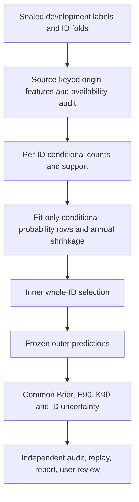

# Step 4 — Time and Environmental Conditioning: Architecture and Planning Log

**Date:** 2 November 2026 (Australia/Sydney).  
**Authority:** the user approved the research direction and requested architecture/planning documentation. **Implementation, data extraction, fitting and execution are not yet approved.** Mathematical and engineering choices below are proposals for review.

## 1. Decision log and research objective

| Date | Decision and authority | Consequence |
|---|---|---|
| 2026-11-02 | User agreed to redirect effort from diminishing spatial-weight refinements to new conditioning information | Step 4 planning begins; retain completed Step 2/3 evidence and controls |
| 2026-11-02 | User prioritised season, then SST if seasonality is supported, then initial direction/speed, and finally wind/current information | Separate rounds with a scientific question, bounded candidate family, audit and review after each |
| 2026-11-02 | User requested detailed technical planning in the log and a concise Chinese explanation in chat | This architecture log and the E1 engineering proposal are the review artifacts |
| 2026-11-02 | User requested the first seasonal engineering contract | [S4-E1-SEA-001 review draft](seasonal_conditioning_s4_e1_contract.md) consolidates interfaces, scientific definitions, conformance, resource gates and delivery requirements; execution remains unapproved |

**Where Things End Up:** predict the stopped destination distribution 7 or 30 days after an arbitrary qualified release time in the specified 1-degree origin cell. Ask whether information available about that release improves the distribution, not whether a more elaborate model can be constructed.

The new target family is `P_h(destination | origin_cell, departure_season, approved_origin_features)`. Feature sets differ between experiments, while outcome states, targets and evaluation cases stay comparable. A matrix is indexed by its conditioning state; it is not one universal annual row after conditioning is added.

Step 3 E5 actual-coordinate displacement remains an uncompleted scientific comparison deferred for computational cost. Its O1 capacity failure is not evidence of poor prediction, and O2 remains an unexecuted proposal. Step 4 does not depend on completing it. No retrospective scientific closure, best-model declaration or ledger rewrite is implied.

## 2. Contract and verified local starting point

The English contract hash was verified during planning: `6cfa91471a1399a9c3a1a8edfeb2e18cea17e0f4031ef0f8ca604ca4565a2446`, [Data Contract v1.0](contract/data_contract_v1.0.xlsx). Relevant clauses are 07 (UTC seasons), 10 (whole-ID splits and later temporal stress tests), 16 (seasonal support), 20 (cell-level release prior), 23 (missing covariates do not invalidate position pairs), 26 (feature availability), 27 (annual shrinkage), and 28 (cluster uncertainty). Later approved direct-horizon and equal-ID evaluation amendments remain in force.

Planning inspected existing source, documents, manifests and Parquet schemas only. No seasonal support result, new forecast or predictive significance result was calculated.

- Release remains `per-drifter-cleaned-20261017-v7`; 3,224 development IDs and 517 locked test IDs.
- Existing qualified release labels contain `origin_time_UTC`, `departure_season`, `origin_source_obs`, horizon, origin/destination cells and qualification evidence. Their source cache is sealed development-only. E1 can use these labels without reopening canonical trajectories or recomputing geometry.
- Current direct-horizon training uses raw eligible pair frequencies. Primary evaluation averages times within ID/origin, then IDs within origin, then origins equally.
- The common 7/30-day populations are 303,288/268,998 qualified times, with 385/337 evaluation IDs and 37 evaluated origins. Reconcile against source keys; do not force counts by filtering. Seventeen indexed origins have no evaluation cases.
- Active schema lists `sst` in Kelvin and `ve`/`vn` in m/s. Schema presence is not evidence of origin-time availability or quality.
- [Current data layout](data_layout.md) documents cleaned/reconstructed temperatures, intentionally unavailable values and unresolved temperature comparisons. These release-wide counts are not E2-specific eligibility counts and must not be substituted for an origin-key audit.

Distinguish two uses of “pooled”: E1 changes **annual pooling** by adding departure-season conditioning, but retains the approved **pooled drifter-regime scenario**. It does not silently switch to fixed-drogued or undrogued targets.

## 3. Staged roadmap and advancement rules

| Round | Question | Initial scope | Gate |
|---|---|---|---|
| S4 E1: season | Does departure season improve prediction beyond matched annual models? | UTC DJF/MAM/JJA/SON; annual shrinkage; direct 7/30-day estimation | Audit seasonal support, held-out Brier and H90/K90; submit results before the next round |
| S4 E2: origin SST | Does origin temperature add information beyond season and location? | Original/reconstructed origin temperature with provenance; compare season-only with season-plus-SST | Prioritise only for a horizon with supported E1 seasonal predictive information, as the user requested; separate E2 plan and approval |
| S4 E3: initial movement | Does known initial direction/speed add useful information? | A small vector/category representation at t0; compare matched with/without-motion forecasts | Availability/source audit, separate finite feature plan and approval; may be proposed if E2 is deferred |
| S4 E4: wind/current | Do environmental fields improve prediction beyond retained initial information? | Audit a specific product, its issue/valid times and target-object relevance before modelling | Separate acquisition, storage, availability and validation plan; no downloads now |

Each round records one of: added predictive information, useful quality-preserving candidate, trade-off, no supported gain, insufficient support, or engineering incomplete. “No supported gain” is not a reason for unlimited bins/features/weights. A completed negative experiment can finish that round.

The SST sequencing rule is a research-priority decision, not a theorem that SST cannot help without a detectable seasonal effect. Seasonal evidence also does not establish SST as its cause. The test is incremental prediction after conditioning on season/location.

Wind/current are physically relevant hypotheses. Their relative predictive value and availability for this target are not yet established. Drifter velocity is not automatically a pure Eulerian current observation, and fitting historical drifters does not validate arbitrary-object windage.

## 4. Fixed boundaries and deliberately limited changes

Retain 1-degree states, the frozen release R/transport D, absorbing first observed exit E, exact horizons, v7 qualification, complete eligible pair multiplicities, common B2-supported evaluation mask, standard unhalved multiclass Brier and fixed 90% probability regions including cutoff ties.

Step 4 E1 uses the **completed cell-conditioned direct-horizon framework**. Actual coordinates may verify source/cell integrity but do not condition E1 predictions. This is explicit: it does not provide the exact-point forecasts proposed in E5. It does not translate new paths, change path/land qualification, introduce recursive propagation, learn diffusivity or reopen MDN work.

For direct 30-day predictions, departure season labels the entire empirical start-to-30-day outcome, including paths crossing a season boundary. This does not assert that physical conditions remain fixed for 30 days. Calendar-updated short-step propagation, year-long skill and arbitrary integer-day forecasts remain separate work.

An additional predictor changes the input specification, not the sample eligibility by default. Missing SST/velocity must not silently remove hard examples. A declared parent-model prediction for missing/unavailable features preserves cases, while availability, fallback and supported-subset diagnostics remain visible.

## 5. Technical architecture and ownership

The inference-facing predictor table contains source key, origin cell/time, horizon and the approved origin features. Destination labels are held in a separate target table. Join for training or scoring only after assigning whole-ID roles. Do not pass a held-out future track/endpoint to the predictor.

The common feature provenance schema records `feature_name`, value/unit, source product/hash, origin valid time, availability time or explicitly unknown status, observed/reconstructed/missing status, any fitting-role-dependent transform and supported application scenario. Season is deterministically known from t0. A retrospective processed SST/velocity field with unknown availability remains a retrospective feature, not a certified live input.

E1 uses source-key rows for reconciliation and compact counts keyed by `(id, horizon, origin, season, destination)` for fitting/scoring. Original denominators by `(id, horizon, origin)` are retained separately. There is no query-by-donor Cartesian computation. Derived columns and counts live only under the new immutable run namespace.

| Responsibility | Reuse / proposed location |
|---|---|
| Read guards, hashes, immutable outputs | Existing `modelling/common/runtime.py`, `qualified_count_inputs.py`, `paths.py` |
| Whole-ID fold assignments | Existing sealed fold map and role checks; do not generate a new split |
| Region definition | Existing `modelling/common/prediction_regions.py` |
| Equal-ID/equal-origin scores and uncertainty primitives | Existing verified E3/S3 functions; retain their signatures and scientific semantics |
| S4 E1 input adapter | Proposed `modelling/baselines/seasonal_conditioning_s4_e1_inputs.py`: origin-time/season checks, atomic-to-grouped reconciliation, feature/support tables |
| S4 E1 estimators and selection | Proposed `seasonal_conditioning_s4_e1.py`: annual/seasonal rows, finite grids, support fallback, selection identities |
| S4 E1 orchestration | Proposed `run_seasonal_conditioning_s4_e1.py`: proposal receipt, source fingerprints, guards, budgets, freeze and replay |
| Independent audit | Proposed `seasonal_conditioning_s4_e1_audit.py`: separate counts, probabilities, weights, scores and decisions |
| Presentation | Proposed `seasonal_conditioning_s4_e1_report.py`: English report/HTML, matched maps, seasonal support and uncertainty |
| Configuration/tests | Proposed `configs/seasonal_conditioning_s4_e1.json`, `tests/test_modelling_seasonal_conditioning_s4_e1.py` |

These files do not exist by virtue of this plan. Keep E1-specific logic local initially; promote a helper into `common/` only when a later round genuinely shares it. Reuse numerical functions rather than launching historical runners. Do not alter old hashed source merely to accommodate the new feature dimension. No generic model factory, automatic all-subset search or parallel geometry framework is needed.

## 6. Later feature rounds: requirements to settle before implementation

### E2: origin temperature

First reconcile origin source keys with the current v7 `sst`, source/replacement provenance and unresolved quality evidence. Use Kelvin consistently, or an explicitly documented exact K-to-C transform. Native error flags describe native measurements and cannot be assigned to reconstructed temperatures as if they were recalculated uncertainties.

Audit native versus reconstructed observations, unresolved-quality cases, missingness, within-origin/season variation and independent-ID support. Retain every evaluation case through declared parent fallback. The missing/quality/provenance flags are audit fields initially; adding them as predictors would be another explicit feature choice.

Compare season-only against season-plus-SST with the same fitting/evaluation framework. Candidate encoding should be small: coarse training-fitted temperature categories or a training-fitted within-origin/season anomaly, not both multiplied into an unrestricted search. Exact encoding, fallback hierarchy and grid are **not locked here**. Fit bin edges/climatologies on training IDs only, including within every inner role. A temperature tied to daily external analysis is not an instantaneous drifter sensor measurement. NOAA describes OISST as a [daily multi-source gridded analysis](https://www.ncei.noaa.gov/products/optimum-interpolation-sst).

Check what information was available at t0: a same-day final product can be issued later, and reconstruction may involve observations surrounding t0. If availability cannot be established, explicitly label the result retrospective. Do not read observed future temperature along the target path or use future environmental truth as forcing.

### E3: initial velocity/direction

Use the historical M1vcat evidence as motivation, not as a directly comparable current result. First inspect how `ve`/`vn` were produced and whether they use observations after t0. A causal past-only estimate is possible only with adequate past data and an explicitly reviewed construction; do not silently replace official velocity or infer unavailable motion for a newly released object.

Represent direction as vector components or circular categories, with an explicit low-speed/undefined-direction rule. Avoid ordinary linear arithmetic on compass angles. Separate the contribution of season, movement and their combination using a small predeclared comparison. Keep direct 7/30-day outcome targets; do not simultaneously add recursive motion propagation or latent states.

The operating scenario must state whether initial motion is measured/supplied. If it is unavailable, issue the retained non-motion forecast. Demonstrated drifter-input gains alone do not establish performance for an object with no motion observation.

### E4: wind and current fields

Before acquisition, specify the product/version, vector/depth convention, spatial/time matching, masks, missingness, issue time, data licence and storage budget. Distinguish initial observed conditions, retrospective reanalysis and an actually available forecast sequence. Future realised forcing is not available at release time. Decide whether the task remains direct conditional prediction or changes to a forced rollout; the latter requires a separate scope review.

## 7. Model selection, uncertainty and stopping

Feature choice, bins, imputations, seasonal strength, thresholds and other fitted transforms belong inside the inner whole-ID folds. Outer results evaluate the declared procedure. The final test remains locked. [Nested-CV guidance](https://scikit-learn.org/stable/auto_examples/model_selection/plot_nested_cross_validation_iris.html) explains why tuning and evaluation cannot share the same scores. Repeated use of these development data across the research history still limits claims; nested CV does not erase prior adaptation.

Feature retention is based on held-out predictive improvement, quality trade-offs and support, not a correlation with arbitrary numeric cell IDs, a training feature-importance ranking or an hourly-pair chi-square p-value treating repeated records as independent.

Report feature usefulness separately from model replacement. A feature may improve Brier yet fail the H90/K90 requirement. Conversely, a nonsignificant result under sparse support is not proof of no physical difference. Keep a compact candidate family, the unconditioned parent, predeclared horizons/contrasts and a bounded execution plan. Do not expand the search after inspecting outer failures.

Whole-ID evaluation supports new-ID prediction under the sampled historical conditions. It does not establish forecasting a future year or independence from shared ocean forcing. Report year/ID composition; any later temporal stress test needs a separately frozen cutoff and label-overlap treatment.

## 8. Deliverables and next checkpoint

The next review artifact is the [S4 E1 detailed seasonal engineering proposal](seasonal_conditioning_s4_e1_plan.md). It specifies formulas, controls, finite grids, data/role boundaries, primary weights, uncertainty, resource limits, acceptance and exact deliverables.

After execution approval, each round will append a dated result/review entry here, linking its immutable run and stating what was supported, rejected or left unknown. Add a closure or next-round decision only when the user approves it. E2/E3/E4 remain architecture reservations until their own plans are reviewed.

**Current checkpoint:** direction documented; [S4-E1-SEA-001 engineering contract](seasonal_conditioning_s4_e1_contract.md) drafted for review. The original E1 proposal remains an unchanged planning snapshot. No new extraction, model code, experiment, external data acquisition or Git operation performed.
