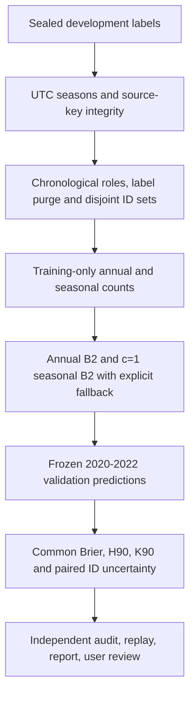

# Step 4 — Time and Environmental Conditioning: Architecture and Planning Log

**Current decision, 5 November 2026.** The seasonal predictor review has concluded. The completed E4 heading model is held fixed. The next candidate is scalar speed from the hour ending at departure. The speed-only E5 design awaits engineering confirmation. [E5 review plan](departure_speed_s4_e5_plan.md)

**Date:** 2 November 2026 (Australia/Sydney).  
**Authority:** the user approved [contract v2](seasonal_conditioning_s4_e1_contract.md), independent implementation and bounded pilot/primary/replay execution. The [approval receipt](../provenance/reviews/seasonal_conditioning_s4_e1_v2_approval.json) binds its frozen hash. E1 engineering is complete and [results](seasonal_conditioning_s4_e1_results.md) await review. Later rounds, model replacement and stage closure are not authorised.

## 1. Decision log and research objective

| Date | Decision and authority | Consequence |
|---|---|---|
| 2026-11-02 | User agreed to redirect effort from diminishing spatial-weight refinements to new conditioning information | Step 4 planning begins; retain completed Step 2/3 evidence and controls |
| 2026-11-02 | User prioritised season, then SST if seasonality is supported, then initial direction/speed, and finally wind/current information | Separate rounds with a scientific question, bounded candidate family, audit and review after each |
| 2026-11-02 | User requested detailed technical planning in the log and a concise Chinese explanation in chat | This architecture log and the E1 engineering proposal are the review artifacts |
| 2026-11-02 | User requested the first seasonal engineering contract | [S4-E1-SEA-001 review draft](seasonal_conditioning_s4_e1_contract.md) consolidates interfaces, scientific definitions, conformance, resource gates and delivery requirements; execution remains unapproved |
| 2026-11-02 | User confirmed 2012–2019 training / 2020–2022 validation, label-cutoff and whole-ID exclusions, annual B2 versus c=1 seasonal B2, and explicit annual fallback | Contract v2 supersedes v1 grids/nested CV/extra models; revise for review only, without development or execution |
| 2026-11-02 | User approved contract v2 and requested independent implementation, resource pilot, bounded complete experiment and visual review | Pilot passed; primary and fresh replay completed; submit evidence without automatic model replacement or later-round execution |

**Where Things End Up:** predict the stopped destination distribution 7 or 30 days after an arbitrary qualified release time in the specified 1-degree origin cell. Ask whether information available about that release improves the distribution, not whether a more elaborate model can be constructed.

The new target family is `P_h(destination | origin_cell, departure_season, approved_origin_features)`. Feature sets differ between experiments, while outcome states, targets and evaluation cases stay comparable. A matrix is indexed by its conditioning state; it is not one universal annual row after conditioning is added.

Step 3 E5 actual-coordinate displacement remains an uncompleted scientific comparison deferred for computational cost. Its O1 capacity failure is not evidence of poor prediction, and O2 remains an unexecuted proposal. Step 4 does not depend on completing it. No retrospective scientific closure, best-model declaration or ledger rewrite is implied.

## 2. Contract and verified local starting point

The English contract hash was verified during planning: `6cfa91471a1399a9c3a1a8edfeb2e18cea17e0f4031ef0f8ca604ca4565a2446`, [Data Contract v1.0](contract/data_contract_v1.0.xlsx). Relevant clauses are 07 (UTC seasons), 10 (whole-ID splits and later temporal stress tests), 16 (seasonal support), 20 (cell-level release prior), 23 (missing covariates do not invalidate position pairs), 26 (feature availability), 27 (annual shrinkage), and 28 (cluster uncertainty). Later approved direct-horizon and equal-ID evaluation amendments remain in force.

Initial planning inspected source, documents, manifests and schemas. The subsequent [temporal support audit](../provenance/reviews/seasonal_temporal_support_20261102/README.md) verified source hashes and counted qualified cases; it produced no fitted model, forecast or predictive result. Under v2 exclusions, training has 130,731/113,708 pairs and 159/138 IDs; validation has 33,971/30,128 pairs and 45/42 IDs at 7/30 days. These are reconciliation expectations, not evidence of predictive adequacy in every cell/season.

- Release remains `per-drifter-cleaned-20261017-v7`; 3,224 development IDs and 517 locked test IDs.
- Existing qualified release labels contain `origin_time_UTC`, `departure_season`, `origin_source_obs`, horizon, origin/destination cells and qualification evidence. Their source cache is sealed development-only. E1 can use these labels without reopening canonical trajectories or recomputing geometry.
- Current direct-horizon training uses raw eligible pair frequencies. Primary evaluation averages times within ID/origin, then IDs within origin, then origins equally.
- The full sealed 7/30-day inventory before v2 temporal exclusions contains 303,288/268,998 qualified times, 385/337 IDs and 37 observed origins. These are source-reconciliation totals, not the v2 validation roster. Reconcile keys rather than forcing counts by filtering. Seventeen indexed origins have no qualified cases in this full inventory.
- Active schema lists `sst` in Kelvin and `ve`/`vn` in m/s. Schema presence is not evidence of origin-time availability or quality.
- [Current data layout](data_layout.md) documents cleaned/reconstructed temperatures, intentionally unavailable values and unresolved temperature comparisons. These release-wide counts are not E2-specific eligibility counts and must not be substituted for an origin-key audit.

Distinguish two uses of “pooled”: E1 changes **annual pooling** by adding departure-season conditioning, but retains the approved **pooled drifter-regime scenario**. It does not silently switch to fixed-drogued or undrogued targets.

## 3. Staged roadmap and advancement rules

| Round | Question | Initial scope | Gate |
|---|---|---|---|
| S4 E1: season | Does departure season improve later-period prediction beyond annual B2? | UTC DJF/MAM/JJA/SON; c=1 with missing-season annual fallback; 2012–2019 training / 2020–2022 validation; direct 7/30-day estimates | Audit chronological/ID separation, support, Brier and H90/K90; submit results before the next round |
| S4 E2: origin SST | Does origin temperature add information beyond season and location? | Original/reconstructed origin temperature with provenance; compare season-only with season-plus-SST | Prioritise only for a horizon with supported E1 seasonal predictive information, as the user requested; separate E2 plan and approval |
| S4 E3: initial movement | Does known initial direction/speed add useful information? | A small vector/category representation at t0; compare matched with/without-motion forecasts | Availability/source audit, separate finite feature plan and approval; may be proposed if E2 is deferred |
| S4 E4: wind/current | Do environmental fields improve prediction beyond retained initial information? | Audit a specific product, its issue/valid times and target-object relevance before modelling | Separate acquisition, storage, availability and validation plan; no downloads now |

Each round records one of: added predictive information, useful quality-preserving candidate, trade-off, no supported gain, insufficient support, or engineering incomplete. “No supported gain” is not a reason for unlimited bins/features/weights. A completed negative experiment can finish that round.

The SST sequencing rule is a research-priority decision, not a theorem that SST cannot help without a detectable seasonal effect. Seasonal evidence also does not establish SST as its cause. The test is incremental prediction after conditioning on season/location.

Wind/current are physically relevant hypotheses. Their relative predictive value and availability for this target are not yet established. Drifter velocity is not automatically a pure Eulerian current observation, and fitting historical drifters does not validate arbitrary-object windage.

## 4. Fixed boundaries and deliberately limited changes

Retain 1-degree states, frozen release R/transport D, absorbing first observed exit E, exact horizons, v7 qualification, complete pair multiplicities within the declared temporal/ID roles, common annual-B2-supported validation mask, standard unhalved multiclass Brier and fixed 90% regions including cutoff ties. The v2 temporal cohort changes from older development CV; historical scores are not direct comparison targets.

Step 4 E1 uses the **completed cell-conditioned direct-horizon framework**. Actual coordinates may verify source/cell integrity but do not condition E1 predictions. This is explicit: it does not provide the exact-point forecasts proposed in E5. It does not translate new paths, change path/land qualification, introduce recursive propagation, learn diffusivity or reopen MDN work.

For direct 30-day predictions, departure season labels the entire empirical start-to-30-day outcome, including paths crossing a season boundary. This does not assert that physical conditions remain fixed for 30 days. Calendar-updated short-step propagation, year-long skill and arbitrary integer-day forecasts remain separate work.

An additional predictor changes the input specification, not the sample eligibility by default. Missing SST/velocity must not silently remove hard examples. A declared parent-model prediction for missing/unavailable features preserves cases, while availability, fallback and supported-subset diagnostics remain visible.

## 5. Technical architecture and ownership

The inference-facing predictor table contains source key, origin cell/time, horizon and the approved origin features. Destination labels are held in a separate target table. Join for training or scoring only after assigning whole-ID roles. Do not pass a held-out future track/endpoint to the predictor.

The common feature provenance schema records `feature_name`, value/unit, source product/hash, origin valid time, availability time or explicitly unknown status, observed/reconstructed/missing status, any fitting-role-dependent transform and supported application scenario. Season is deterministically known from t0. A retrospective processed SST/velocity field with unknown availability remains a retrospective feature, not a certified live input.

E1 uses source-key rows for reconciliation and compact counts keyed by `(id, horizon, origin, season, destination)` for fitting/scoring. Original denominators by `(id, horizon, origin)` are retained separately. There is no query-by-donor Cartesian computation. Derived columns and counts live only under the new immutable run namespace.

| Responsibility | Reuse / proposed location |
|---|---|
| Read guards, hashes, immutable outputs | Existing `modelling/common/runtime.py`, `qualified_count_inputs.py`, `paths.py` |
| Chronological whole-ID roles | Derive from original qualified keys; exclude labels unavailable before 2020 and all validation IDs from both training horizons; no historical fold map |
| Region definition | Existing `modelling/common/prediction_regions.py` |
| Equal-ID/equal-origin scores and uncertainty primitives | Existing verified E3/S3 functions; retain their signatures and scientific semantics |
| S4 E1 input adapter | Proposed `modelling/baselines/seasonal_conditioning_s4_e1_inputs.py`: origin-time/season checks, atomic-to-grouped reconciliation, feature/support tables |
| S4 E1 estimators and scoring | Proposed `seasonal_conditioning_s4_e1.py`: two untuned estimators, support fallback, grouped scores and uncertainty; no selector |
| S4 E1 orchestration | Proposed `run_seasonal_conditioning_s4_e1.py`: proposal receipt, source fingerprints, guards, budgets, freeze and replay |
| Independent audit | Proposed `seasonal_conditioning_s4_e1_audit.py`: separate counts, probabilities, weights, scores and decisions |
| Presentation | Proposed `seasonal_conditioning_s4_e1_report.py`: English report/HTML, matched maps, seasonal support and uncertainty |
| Configuration/tests | Proposed `configs/seasonal_conditioning_s4_e1.json`, `tests/test_modelling_seasonal_conditioning_s4_e1.py` |

These files do not exist by virtue of this plan. Keep E1-specific logic local initially; promote a helper into `common/` only when a later round genuinely shares it. Reuse numerical functions rather than launching historical runners. Do not alter old hashed source merely to accommodate the new feature dimension. No generic model factory, automatic all-subset search or parallel geometry framework is needed.

## 6. Later feature rounds: requirements to settle before implementation

### E2: origin temperature

First reconcile origin source keys with the current v7 `sst`, source/replacement provenance and unresolved quality evidence. Use Kelvin consistently, or an explicitly documented exact K-to-C transform. Native error flags describe native measurements and cannot be assigned to reconstructed temperatures as if they were recalculated uncertainties.

Audit native versus reconstructed observations, unresolved-quality cases, missingness, within-origin/season variation and independent-ID support. Retain every evaluation case through declared parent fallback. The missing/quality/provenance flags are audit fields initially; adding them as predictors would be another explicit feature choice.

Compare season-only against season-plus-SST with the same fitting/evaluation framework. Candidate encoding should be small: coarse training-fitted temperature categories or a training-fitted within-origin/season anomaly, not both multiplied into an unrestricted search. Exact encoding, fallback hierarchy and grid are **not locked here**. Fit bin edges/climatologies on training IDs only, including within every inner role. A temperature tied to daily external analysis is not an instantaneous drifter sensor measurement. NOAA describes OISST as a [daily multi-source gridded analysis](https://www.ncei.noaa.gov/products/optimum-interpolation-sst).

Check what information was available at t0: a same-day final product can be issued later, and reconstruction may involve observations surrounding t0. If availability cannot be established, explicitly label the result retrospective. Do not read observed future temperature along the target path or use future environmental truth as forcing.

### E3: initial velocity/direction

Use the historical M1vcat evidence as motivation, not as a directly comparable current result. First inspect how `ve`/`vn` were produced and whether they use observations after t0. A causal past-only estimate is possible only with adequate past data and an explicitly reviewed construction; do not silently replace official velocity or infer unavailable motion for a newly released object.

Represent direction as vector components or circular categories, with an explicit low-speed/undefined-direction rule. Avoid ordinary linear arithmetic on compass angles. Separate the contribution of season, movement and their combination using a small predeclared comparison. Keep direct 7/30-day outcome targets; do not simultaneously add recursive motion propagation or latent states.

The operating scenario must state whether initial motion is measured/supplied. If it is unavailable, issue the retained non-motion forecast. Demonstrated drifter-input gains alone do not establish performance for an object with no motion observation.

### E4: wind and current fields

Before acquisition, specify the product/version, vector/depth convention, spatial/time matching, masks, missingness, issue time, data licence and storage budget. Distinguish initial observed conditions, retrospective reanalysis and an actually available forecast sequence. Future realised forcing is not available at release time. Decide whether the task remains direct conditional prediction or changes to a forced rollout; the latter requires a separate scope review.

## 7. Model selection, uncertainty and stopping

E1 v2 has no fitted hyperparameters to select: fix c=1 and the chronological cutoff before scoring, compare only annual and seasonal B2, and preserve the final-test lock. It requires no nested CV, old-model retuning or all-development refit. Report point improvement separately from conditional uncertainty support; two horizons x three metrics give six predeclared directional screens. A later round that introduces tunable features, bins or weights must specify training-internal temporal/ID selection separately; it cannot tune on E1 validation scores and call them untouched evidence. Repeated development-data use still limits claims.

Feature retention is based on held-out predictive improvement, quality trade-offs and support, not a correlation with arbitrary numeric cell IDs, a training feature-importance ranking or an hourly-pair chi-square p-value treating repeated records as independent.

Report feature usefulness separately from replacement. A feature may improve Brier yet fail H90/K90 requirements. Nonsignificance under sparse support does not prove no physical difference. Keep the two fixed models, declared horizons/contrasts and bounded execution plan. Do not add smoothing or change the cutoff after inspecting validation failures.

E1 v2 tests new-ID prediction in 2020–2022 using only permitted pre-2020 training outcomes. This historical forward backtest does not certify post-2022 performance or independence from shared forcing. Report year/ID composition, boundary exclusions and fallback weight. Testing whether pre-2012 training helps is a separate later comparison, not part of E1 v2.

## 8. Deliverables and next checkpoint

The active review artifact is [S4 E1 contract v2](seasonal_conditioning_s4_e1_contract.md). The [v1 proposal](seasonal_conditioning_s4_e1_plan.md) and [v1 contract snapshot](seasonal_conditioning_s4_e1_contract_v1.md) are superseded historical designs. V2 specifies chronological roles, two formulas, common weights, fallback, six conditional screens and acceptance, training-only illustrations, and a 600/900/900-second preparation/primary/replay budget (40 minutes total). Caps are not runtime promises.

After execution approval, each round will append a dated result/review entry here, linking its immutable run and stating what was supported, rejected or left unknown. Add a closure or next-round decision only when the user approves it. E2/E3/E4 remain architecture reservations until their own plans are reviewed.

**Current checkpoint:** E1 v2 engineering complete; [results and analysis](seasonal_conditioning_s4_e1_results.md) and [visual comparison](../results/deliverables/seasonal_conditioning_s4_e1/review.html) await user review. The contract text remains the immutable approved snapshot; its separate receipt records execution authority.

## 9. E1 v2 execution evidence, 2 November 2026

The complete-roster pilot passed. The primary run `seasonal_conditioning_s4_e1_primary_20261102T005104_943407Z` and fresh replay agree on 34 scientific artifacts, including byte-identical versions of all ten figures. Measured execution totals 89.61 seconds; conservative budget accounting totals 121 seconds of the approved 2,400-second limit. The [final audit](../provenance/reviews/seasonal_conditioning_s4_e1_v2_audit.json) records lineage, resources, access isolation and verification.

At 7/30 days, c=1 raises Brier by 0.058955/0.082656 and reduces H90 by 22.2551/23.9703 percentage points, while reducing K90 by 5.441150/26.008828 cells. Neither horizon meets quality-preserving improvement. Seasonal fallback is 41 cases (2.7778% primary weight) at 7 days and zero at 30 days. Engineering completion is distinct from model acceptance; no stage closure or next feature round is inferred.

## 10. E2 validation-policy comparison, 3 November 2026

The user approved [S4 E2 temporal validation](temporal_validation_s4_e2_plan.md) and explicitly required existing-model validation rather than a new estimator. This experiment occupies the E2 identifier; the earlier SST subsection is a deferred architecture reservation, not an executed temperature experiment. The original seasonal contract and earlier results remain unchanged.

The implementation reuses `local_endpoint_adaptive_s3_e2.fit_bases` and `vector` for B2, Fixed, Adaptive, LocalEndpoint and LocalEndpointAdaptive. No legacy estimator implementation was edited. New modules under `src/data3001/modelling/baselines/` have separate responsibilities:

| Module | Responsibility |
|---|---|
| `temporal_validation_s4_e2_inputs.py` | Verify sealed qualified labels; apply the 2001–2022 origin-time scope; build source-keyed outer/inner roles, cross-horizon ID exclusions and label cutoffs |
| `temporal_validation_s4_e2.py` | Adapt existing candidates to inner Brier selection, pool repeated ID/origin units correctly, freeze outer forecasts, calculate matched scores and shared-ID uncertainty |
| `temporal_validation_s4_e2_audit.py` | Independently reconstruct roles, raw counts, existing formulas, squared errors, regions, selection and uncertainty; reuse audited region/score values for identical forecasts |
| `run_temporal_validation_s4_e2.py` | Enforce source/approval fingerprints, input guards, cumulative stage budgets, pilot gate, pre-score freeze, immutable run outputs and fresh replay |
| `temporal_validation_s4_e2_report.py` | English local HTML, all-family comparisons, paired intervals and training-support-selected probability maps |

`configs/temporal_validation_s4_e2.json` freezes the three outer periods, two internal selection policies, existing parameter grids, 10,000 shared-ID draws, approved equivalence margins and 300/1800/1800-second cumulative stage caps. `tests/test_modelling_temporal_validation_s4_e2.py` checks boundaries, repeated-ID weighting, legacy-score agreement, B2 equality, selection, uncertainty and repeatable figures.

All outer models are rebuilt from the same permitted training inventory within their block. Internal G/T case populations differ by design; their raw CV scores are not matched outcomes. Forecasts and selections for all blocks precede outer scoring. Unsupported cases remain explicitly counted, and all observed inner/outer validation cases in this execution have B2 support. Whole-ID isolation and the locked final-test boundary are retained.

The first pilot exposed redundant per-case audit work and was stopped. Its source identity, files and 197.22 seconds of cost remain recorded. The audit reuse change preserves all 97 pre-score scientific artifacts byte-for-byte; a new frozen source identity and successful complete-roster pilot preceded formal execution. Both pilots together stay within 300 seconds; total charged execution, including primary and replay, is 415.22 seconds within 3,900 seconds.

**Current checkpoint:** E2 engineering complete. [Results and limitations](temporal_validation_s4_e2_results.md), [visual review](../results/deliverables/temporal_validation_s4_e2/review.html) and [closeout audit](../provenance/reviews/temporal_validation_s4_e2_audit.json) await user review. The policy comparison does not establish ocean stationarity or a change point; it does not approve a new history cutoff or subsequent feature experiment. Forward outer validation remains the proposed main evidence for future-period prediction, with calendar-mixed whole-ID CV retained as a diagnostic comparison.

## 11. E3 seasonal information test, 5 November 2026

E3 uses E2 block C and its two internal temporal splits. Existing E1 count estimates provide the annual and season-specific distributions. The new selection module solves a bounded one-dimensional Brier minimization on the pooled inner held-out roster. The matching module receives training origin keys, times and IDs, builds feasible year-specific placements and solves a minimum-cost one-to-one assignment for each replicate. Endpoints are attached after selection of donor keys. Each nonempty row receives 200 draws. Compact manifests identify every chosen source observation through its template offsets, donor ID, year and anchor hour. The scoring module averages matched losses after scoring each draw. Whole-ID multipliers give the paired centered Brier bounds and descriptive diagnostic intervals.

The complete-roster pilot, primary run and fresh replay used 302 seconds of charged budget in total. All 611 pre-score artifacts had identical hashes in the three runs. Replay compared 628 scientific artifacts, including five byte-identical figures. Neither horizon passed the primary Brier benefit test. The informative-subset gate limits the mechanism interpretation to a subset of the validation population. [Plan](seasonal_information_s4_e3_plan.md) · [Results](seasonal_information_s4_e3_results.md) · [Audit](../provenance/reviews/seasonal_information_s4_e3_audit.json)

## 12. Departure-season decision and next predictor

The user concluded the departure-season investigation for now and moved to the next predictor-selection discussion. Annual-pooled models remain the working forecasts. Season stays available for error summaries. Under the agreed ordering, SST stays deferred because the seasonal comparison did not establish a predictive gain at either horizon. Wind and current fields remain later candidates. The original round numbers in section 3 describe the early roadmap. **E4 is the proposed identifier for the initial-motion study**, following the completed E2 temporal-validation and E3 seasonal-information rounds. [Seasonal results](seasonal_information_s4_e3_results.md)

**Research question.** For two objects at the same 1° origin, does knowing the direction or speed of travel immediately before release improve the 7- or 30-day destination distribution? The historical M1vcat study gives a reason to test this question. Adding a velocity category to iterative M1 reduced Brier by 0.005481 at 7 days and 0.000536 at 30 days, with higher hits and larger regions. That study weighted observation pairs, used calendar-mixed whole-ID folds, and carried the joint position/velocity state through propagation. E4 asks about a direct forecast on later drifters. [Historical M1vcat report](../results/runs/markov_vcat_cv_20261026T155955_651594Z/REPORT.md)

**Input proposed for review.** The cleaned release has east/north interval displacement components (`interval_net_ve`, `interval_net_vn`) and elapsed time since the preceding observation. Evaluate the immediately preceding one-hour interval, ending at the arbitrary forecast time. Its previous position may be outside the origin cell. Verify both position sources, time order, position quality, gaps and plausible usable direction, including the distinction between missing motion and zero motion. Archived positions are processed estimates, so record what can actually be known by release time. The native hourly velocity fields also come from a processed product. An externally supplied initial vector is a distinct use scenario. For a newly reported release with only a cell and release time, issue the annual forecast. [Preparation code](../src/data3001/preprocessing/prep_core.py) · [Local feature review](../configs/feature_review.csv) · [NOAA product methods](https://www.aoml.noaa.gov/phod/gdp/hourly_data_release_notes.php)

**Read-only feasibility check, 5 November.** In each sealed E3 role separately, take the union of distinct (ID, UTC departure time) keys across 7 and 30 days. For each eligible case, look for the same ID at exactly t₀ minus one hour. The table counts time-key matches only. Prior positions outside the qualifying origin roster can also supply a predecessor. Timestamp presence alone does not establish coordinate quality, a usable displacement or live availability. [Training keys](../results/deliverables/seasonal_information_s4_e3/matched_training_keys.parquet) · [Validation roster and weights](../results/deliverables/seasonal_information_s4_e3/outer_roster.parquet)

| Role | Days | Cases with a preceding hourly key / eligible cases | Original evaluation weight with such a key |
|---|---:|---:|---:|
| 2001–2019 training | 7 | 264,532 / 265,393 | — |
| 2001–2019 training | 30 | 234,414 / 235,177 | — |
| 2020–2022 validation | 7 | 33,847 / 33,971 | 96.89% |
| 2020–2022 validation | 30 | 30,019 / 30,128 | 97.25% |

**Proposed comparison.** Retain annual B2. First compare it with a direction-only adjustment, giving greater weight to same-cell observations moving in a similar direction while retaining support from the annual row. Audit speed as a separate candidate so its contribution is identifiable. Consider combining them only after reviewing the separate contrasts. Use identical cases, fallback, direct stopped outcomes, inner forward tuning restricted to 2001–2019, common 2020–2022 validation, equal ID/origin scoring, paired Brier, actual hits and geographic cell count at 90% probability. The next engineering review should fix the direction measure, low-speed rule, weighting family, multiplicity, and resource limits before fitting. This entry records a candidate for review.

The [E4 direction-only method for review](departure_direction_s4_e4_method.md) specifies a positive cosine weighting rule, an explicit low-speed screen and one training-selected adjustment strength per horizon. It includes a worked example and the prospective scoring criteria.

The user confirmed the maximum 3:1 aligned/opposite ratio and the fitting-period bottom-decile speed screen. The [E4 engineering plan](departure_direction_s4_e4_plan.md) specifies feature provenance, role-specific thresholds, the two inner forward windows, the analytic choice of each horizon's λ, the paired outer comparison and resource gates. Its current status is review draft.

## 13. E4 departure-heading execution, 5 November 2026

The user approved E4. Source-keyed feature extraction verifies the predecessor interval and maps both position-quality sidecars on development drifters. Each role estimates its own positive-speed decile, then builds annual counts and usable donor vector sums by origin, horizon and destination. Inner-only analytic selection fixes both λ values before the final fit. The outer runner freezes each source-keyed heading-adjusted vector, annual reference and tie-inclusive region before joining validation labels. The report includes full-roster scores, whole-ID paired intervals and fallback exposure under both raw-pair and original evaluation weights.

The complete input pilot passed. Fresh replay matched 453 scientific artifacts and four figures. Both weights reached 1. The 7-day forecast passed the paired Brier benefit criterion and the point-level quality screen. At 30 days the point estimates improved but the Brier benefit remains uncertain. [Results](departure_direction_s4_e4_results.md) · [Closeout audit](../provenance/reviews/departure_direction_s4_e4_audit.json)

## 14. E5 scalar-speed design, 5 November 2026

The user accepted moving from E4 heading refinement to a separate test of speed magnitude. E5 uses the sealed E4 past-hour feature and temporal roles. Annual B2 is the primary comparison and frozen E4 heading results supply descriptive context. Valid low and zero speeds enter the scalar predictor. Each fitting role estimates its own interquartile speed range. The proposed voting curve ranges continuously from 1.5 to 0.5, with missing-speed donors retaining one vote. Two inner forward windows choose one adjustment strength per horizon. The proposed decision uses full-roster paired Brier, H90, K90 and a separately reported low-speed stratum. A combined direction/speed model requires a later incremental comparison. [Full E5 design and gates](departure_speed_s4_e5_plan.md)
