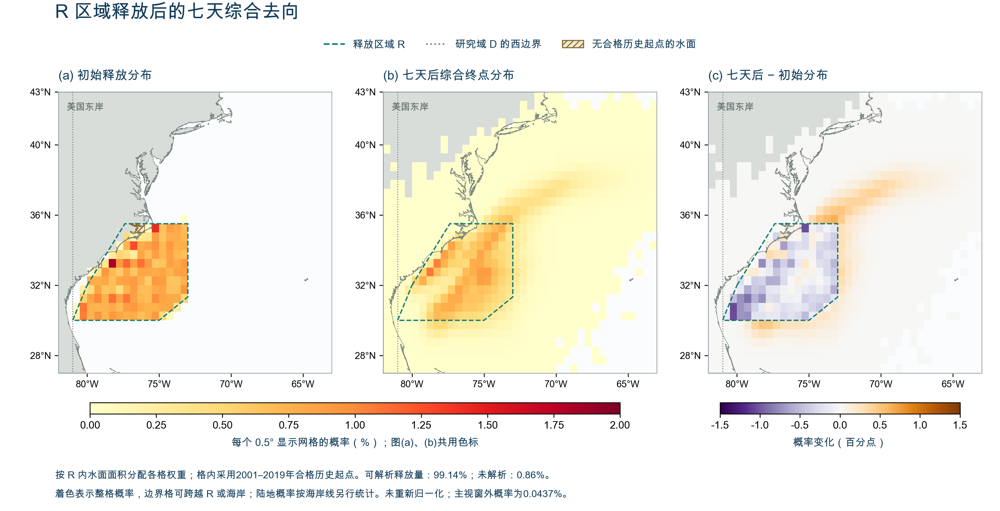
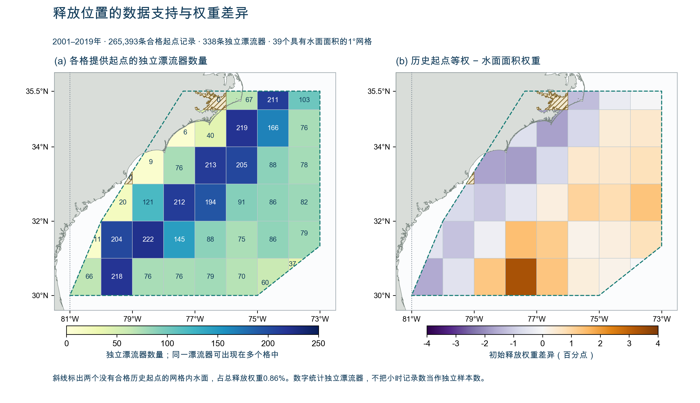
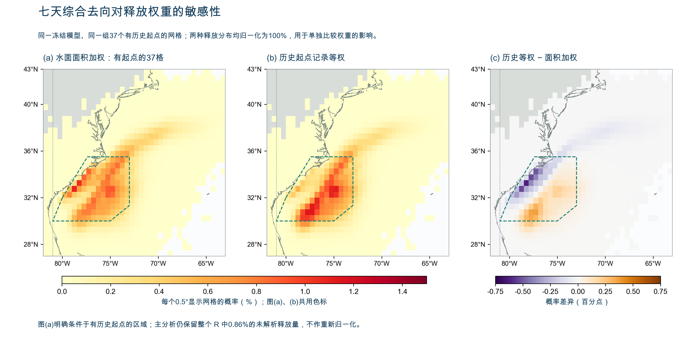

# R 区域七天综合去向：计算结果与复现

2026-11-21。使用冻结的22成分混合密度网络完成区域释放分析。结果供共同审阅，尚未写入W12正文。模型权重、原始实验结果、全部现有正文和四例图均保持不变；未训练模型，未打开独立最终测试。

## 1. 实际结果

主分析将单位总释放量按各1°网格在R内的水面面积分配，格内采用2001–2019年最终模型训练配对的合格起点记录，每条记录等权。对应265,393条起点记录、338条独立漂流器。

| 七天后的去向 | 占总释放量 |
|---|---:|
| R内水面 | 67.41% |
| D内但R外的水面 | 31.44% |
| D内陆地 | 0.26% |
| D外 | 0.03% |
| 未解析的释放部分 | 0.86% |
| 合计 | 100.00% |

精确结果见[去向比例表](region_probabilities.csv)。这是所设释放条件下的模型预测，第七天的位置用于分类。



七天后的分布在R内仍占主要部分，并从东北侧向外海延伸。西侧32.5–33.5°N附近及R内中东部存在较高概率的显示网格。南侧也有终点概率，不能将全部R外去向描述为东北方向。

为解释R外的31.44%，按经纬度将D内、R外水面分成四个互不重叠的子区域：

| 子区域 | 定义 | 占总释放量 |
|---|---|---:|
| 北侧，含东北侧 | 纬度≥35.5°N | 17.95% |
| 东侧 | 73°W以东，纬度<35.5°N | 5.92% |
| 南侧 | 纬度<30°N，73°W以西 | 6.04% |
| 其余R边缘外水面 | 实际R多边形以外的其余D内水面 | 1.53% |

东侧包含经度恰好为73°W的边界。上述分类描述终点位置，不描述途中经过的路线。[精确分区结果](outside_R_water_subregions.csv)

## 2. 释放权重与数据支持

R内水面面积为334,501.7733 km²，分布在39个1°网格中。37格有合格训练起点，独立漂流器数介于6–222，中位数82。不同格的漂流器可以重复出现，因此各格数量不能相加作为独立样本总量。

以下两格没有合格起点，无法按约定建立格内历史释放分布。保留其面积权重，合计0.8605277291%，不转移给其他网格。这是释放分布的资料缺口，不是断言网络无法输出这些坐标的预测。

| 网格经纬度范围 | R内水面面积（km²） | 占总释放量 |
|---|---:|---:|
| 80–79°W，33–34°N | 431.8619 | 0.1291% |
| 77–76°W，35–36°N；R仅到35.5°N | 2,446.6186 | 0.7314% |

有起点但独立漂流器少于20的三格分别有6、9、11条漂流器，占主分析总释放权重4.4464%。这些格保留在预测中，支持图展示其数量。



逐格信息见[释放网格表](release_cells.csv)，逐起点位置与三种权重见[起点表](release_origins.parquet)。所有起点均在实际R多边形的水面上，按原1°半开网格规则核对成员关系，未发现重复起点键。

设网格c的R内水面面积为A_c，全部R水面面积为A，合格起点数量为n_c。该格权重为A_c/A，每条历史起点的主分析权重为A_c/(A n_c)。对有起点的格，按此权重合并冻结模型给出的七天终点分布；无起点格的权重进入未解析类别。各去向与未解析权重之和为1。

## 3. 释放权重敏感性

另计算“所有合格历史起点记录等权”的释放方式。为单独比较权重变化，在同样37个有起点的网格上，将面积权重明确归一化为100%，与历史起点等权比较。该条件化对照单独保存；第1节主结果仍以完整R总释放量为分母并保留0.86%未解析部分。

| 七天后的位置 | 37格面积加权 | 历史起点等权 | 历史等权减面积加权 |
|---|---:|---:|---:|
| R内水面 | 67.99% | 69.04% | +1.05个百分点 |
| D内、R外水面 | 31.71% | 30.82% | −0.89个百分点 |
| 北侧水面，含东北侧 | 18.10% | 14.09% | −4.01个百分点 |
| 东侧水面 | 5.97% | 7.00% | +1.03个百分点 |
| 南侧水面 | 6.09% | 8.17% | +2.08个百分点 |

后三行属于第二行的子区域，不与前两行相加。两种权重下都出现R内分布和向东北侧延伸的分布；局部高概率位置及北侧、南侧的比例有明显变化。区域去向需要与释放假设一起报告。



## 4. 模型、计算与核验

- 模型来自[最终模型决定](../../../work_place/docs/final_mdn_model.md)，明确加载冻结的22成分、七天、2001–2019年全训练拟合权重。原默认选择接口仍指向历史一个成分模型，本分析不使用该默认接口。
- 起点来自最终训练配对的坐标文件。网络仅接收经纬度；日期用于界定历史起点来源。本分析未用训练终点评估区域预测准确率。
- 海岸线采用登记的高分辨率海岸几何，与原区域水面面积规则一致。先判D外，再将D内分为陆地、R内水面和其余水面。四类互斥，无裁陆、截尾或海上重新归一化。
- 每个有起点的源网格使用8条独立扰乱的Sobol序列。四个抽样维度依次选择历史起点、混合成分和两个正态变换变量；以原模型的地球椭球位移转换得到经纬度。最终每格每次262,144个终点，共77,594,624个数值积分终点；它们不是新增观测。
- 以每格65,536个终点作嵌套粗计算。主要去向比例在两级计算间的最大变化为0.00534个百分点，最终重复计算平均值的最大数值标准误为0.00154个百分点。两者只衡量给定模型和释放分布下的数值误差。
- 独立复算39格的水面面积，最大差为1.82×10⁻¹² km²；面积权重最大差为8.33×10⁻¹⁷。概率总量最大偏差为3.33×10⁻¹⁶。
- 用原有公开抽样接口另生成303,104个终点，对四类去向进行独立随机核验。结果与主计算在抽样误差内一致。冻结模型还复现了原四例保存参数。
- 输入和模型校验值在运行前后保持一致，全部正文和原四例图的校验值保持一致。输入来源、脚本版本和环境版本均已记录。

核验产物：[完整核验](verification.json) · [来源与文件校验](provenance.json) · [汇总结果](summary.json) · [逐次计算](numerical_replicates.csv)。本次增加的是冻结模型的区域应用汇总，模型准确率仍依据此前开发验证结果。

## 5. 图表定义

三张图均有同名PNG与PDF。主图的(a)、(b)共享概率色标，(c)以百分点表示七天后减初始的变化。敏感性图的两种释放方式也共享色标，差值为历史起点等权减共同支持区域内的面积加权。

0.5°网格仅用于显示，颜色是整格概率，不是单位面积密度。边界显示格可能跨越R或海岸，整格着色不说明格内每处概率相同。R内、陆地及D外的比例均按预测点与实际几何的关系计算，未用网格中心代替。初始位置恰好在R边界的记录保留，按半开显示网格分箱。

主视窗为82–63°W、27–43°N；主分析七天后视窗外概率为0.043656%。完整显示表覆盖85–55°W、20–45°N，表外概率也单独保存。全部数值统计使用完整分布。

地图结果见[逐显示格概率表](display_grid.parquet)。最高终点概率、最大增加和最大减少的显示格分别存于三个描述性排序表；这些排序未用于选择模型或剔除起点。

## 6. 复现

从DATA3001工作区根目录运行，使用现有研究环境和冻结资产：

```bash
PYTHONDONTWRITEBYTECODE=1 work_place/.venv/bin/python 'Final Report/figures/W12_regional_distribution/run_analysis.py'
PYTHONDONTWRITEBYTECODE=1 work_place/.venv/bin/python 'Final Report/figures/W12_regional_distribution/verify_analysis.py'
PYTHONDONTWRITEBYTECODE=1 work_place/.venv/bin/python 'Final Report/figures/W12_regional_distribution/render_figures.py'
```

脚本分别负责区域计算、独立核验和绘图；不调用训练函数。重跑只更新本文件夹中的补充分析结果。`integration_by_cell.npz`保留各源网格、两级计算和八次重复的中间统计，方便核对不同权重的汇总，无需保存数千万个抽样点。

下一步共同确认结果解释、图表取舍和篇幅后，再更新W12正文。外部地区向R的输入、长期递推以及模型估计误差仍属于另行研究的问题。
