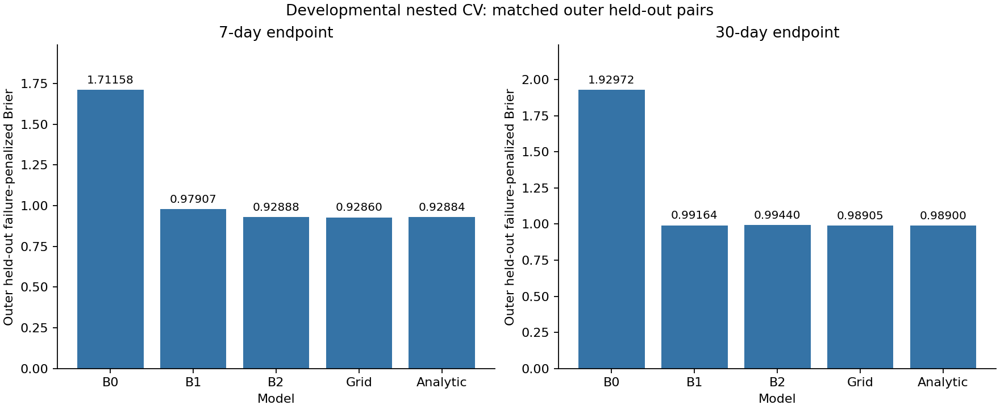
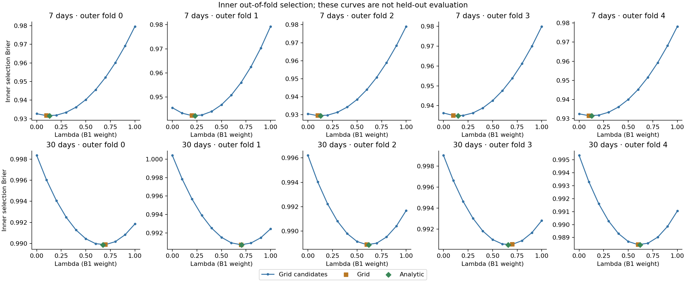

# Developmental nested-CV B1/B2 blend review

Run: `baseline_blend_cv_20261022T160806_056571Z`. Dataset release: `per-drifter-cleaned-20261017-v7`.

This is a developmental nested cross-validation experiment on the development
population. It is not a final-test result. Whole instrument IDs stay together
throughout the outer evaluation and inner weight selection. The final-test
partition was not used. These are nonseasonal pooled endpoint forecasts at
7 and 30 days only; they do not validate seasonal or longer-horizon prediction.
The release input is a 1-degree origin cell with the historical within-cell
release prior. It is not an exact point release, a uniform whole-region wet-area
release, or a rescue deployment forecast.

## Outer held-out comparison

Every model is evaluated on the same eligible outer held-out endpoint pairs.
Pair-count multiplicities retain equal eligible-pair weighting. Scores below
combine all outer held-out folds; IDs are the independent sampling units.
Brier and log loss are losses, so smaller is better. Coverage and set hit rates
are distinct quantities and must not be called predictive accuracy.

| Horizon (days) | Model | Eligible pairs | Independent IDs | Complete forecast coverage | Failure-penalized Brier | Ordinary Brier | Log loss | 90% set hit rate | 90% set availability | Mean 90% set geographic cells | Zero-probability pairs | Top-category hit rate |
| --- | --- | --- | --- | --- | --- | --- | --- | --- | --- | --- | --- | --- |
| 7 | Analytic | 308312 | 387 | 100.00% | 0.928845 | 0.928845 | infinity | 93.85% | 100.00% | 27.696891 | 182 | 14.89% |
| 7 | B0 | 308312 | 387 | 100.00% | 1.711584 | 1.711584 | infinity | 14.42% | 100.00% | 1.000000 | 263851 | 14.42% |
| 7 | B1 | 308312 | 387 | 100.00% | 0.979067 | 0.979067 | infinity | 89.40% | 100.00% | 49.355377 | 182 | 2.71% |
| 7 | B2 | 308312 | 387 | 100.00% | 0.928878 | 0.928878 | infinity | 87.48% | 100.00% | 18.345634 | 6196 | 14.91% |
| 7 | Grid | 308312 | 387 | 100.00% | 0.928597 | 0.928597 | infinity | 93.09% | 100.00% | 25.387669 | 182 | 14.89% |
| 30 | Analytic | 287004 | 358 | 100.00% | 0.989005 | 0.989005 | infinity | 86.20% | 100.00% | 128.407984 | 2756 | 3.92% |
| 30 | B0 | 287004 | 358 | 100.00% | 1.929715 | 1.929715 | infinity | 3.51% | 100.00% | 1.000000 | 276918 | 3.51% |
| 30 | B1 | 287004 | 358 | 100.00% | 0.991638 | 0.991638 | infinity | 85.68% | 100.00% | 138.937607 | 2756 | 2.83% |
| 30 | B2 | 287004 | 358 | 100.00% | 0.994400 | 0.994400 | infinity | 67.20% | 100.00% | 64.864173 | 47756 | 3.09% |
| 30 | Grid | 287004 | 358 | 100.00% | 0.989051 | 0.989051 | infinity | 86.13% | 100.00% | 128.792285 | 2756 | 3.91% |

- 7 days: the smallest outer held-out failure-penalized Brier is 0.928597 (Grid).
- 30 days: the smallest outer held-out failure-penalized Brier is 0.989005 (Analytic).

- At 7 days, the Analytic blend changes penalized Brier by -0.000033 versus B2 (0.004% relative reduction). Both paired fixed-prediction intervals include zero. The 90% set hit rate changes from 87.48% (B2) to 93.09% / 93.85% (Grid / Analytic), while mean geographic set size changes from 18.35 to 25.39 / 27.70 cells. Better set hit rate therefore comes with a broader forecast region. The blends still assign zero probability to 182 eligible realized endpoint pairs (Analytic), so log loss remains infinite.
- At 30 days, the Analytic blend changes penalized Brier by -0.005395 versus B2 (0.543% relative reduction). Review the paired fixed-prediction intervals below for uncertainty. The 90% set hit rate changes from 67.20% (B2) to 86.13% / 86.20% (Grid / Analytic), while mean geographic set size changes from 64.86 to 128.79 / 128.41 cells. Better set hit rate therefore comes with a broader forecast region. The blends still assign zero probability to 2,756 eligible realized endpoint pairs (Analytic), so log loss remains infinite.

The failure-penalized Brier retains every eligible pair and scores unresolved
forecast mass as an explicit failure category. Ordinary Brier and log loss are
unavailable if any forecast in that summary is incomplete. A zero probability
on a realized endpoint gives infinite log loss; the report does not clip it.
The `outer_scores.csv` file retains log-loss bounds for incomplete forecasts.

The nominal 90% prediction set ranks physical outcome categories by probability,
includes all categories tied at the cutoff, and can therefore exceed 90% mass.
OUTSIDE (-2) is a physical category. Unresolved mass is separate. If known
probability mass is below 90%, the set is unavailable. Availability and hit-rate
denominators follow the saved scorer outputs; consult `outer_summary.csv` for
mean set mass and cell counts.

## What the five models mean

- B0 puts all mass on the release-origin cell.
- B1 uses the outer-training endpoint marginal for the chosen horizon, pooled over the historical eligible R-origin mixture.
- B2 also conditions on the release-origin cell; an unsupported origin retains
  unresolved mass rather than silently receiving a fallback distribution.
- Grid and Analytic use `(1 - lambda) * B2 + lambda * B1`. The Grid method
  chooses from 0, 0.1, ..., 1.0. Analytic minimizes the same inner out-of-fold
  quadratic failure-penalized Brier continuously over [0, 1].

The analytic optimum cannot have worse loss than the grid optimum on the same
inner tuning cases, up to numerical tolerance. That guarantee does not apply
to the independent outer held-out folds. A smaller inner loss can lose outside
the tuning sample.

## Weights selected inside each outer training population

These weights were selected without using the corresponding outer held-out IDs.

| Outer fold | Horizon (days) | Method | Lambda | Inner selection Brier |
| --- | --- | --- | --- | --- |
| 0 | 7 | Analytic | 0.130971 | 0.931599 |
| 0 | 7 | Grid | 0.100000 | 0.931660 |
| 1 | 7 | Analytic | 0.230718 | 0.942293 |
| 1 | 7 | Grid | 0.200000 | 0.942352 |
| 2 | 7 | Analytic | 0.128329 | 0.929423 |
| 2 | 7 | Grid | 0.100000 | 0.929475 |
| 3 | 7 | Analytic | 0.149412 | 0.934920 |
| 3 | 7 | Grid | 0.100000 | 0.935072 |
| 4 | 7 | Analytic | 0.127399 | 0.931480 |
| 4 | 7 | Grid | 0.100000 | 0.931526 |
| 0 | 30 | Analytic | 0.674272 | 0.989871 |
| 0 | 30 | Grid | 0.700000 | 0.989884 |
| 1 | 30 | Analytic | 0.703231 | 0.990734 |
| 1 | 30 | Grid | 0.700000 | 0.990734 |
| 2 | 30 | Analytic | 0.617722 | 0.988885 |
| 2 | 30 | Grid | 0.600000 | 0.988891 |
| 3 | 30 | Analytic | 0.657888 | 0.990517 |
| 3 | 30 | Grid | 0.700000 | 0.990552 |
| 4 | 30 | Analytic | 0.619367 | 0.988443 |
| 4 | 30 | Grid | 0.600000 | 0.988449 |

## Final-development weights

These weights use base out-of-fold predictions from all development IDs for
tuning, then accompany bases fitted on all development IDs. Their tuning loss
is not an independent evaluation. The interactive observed panel deliberately
shows outer held-out folds only.

| Horizon (days) | Method | Lambda | All-development tuning Brier |
| --- | --- | --- | --- |
| 7 | Analytic | 0.090942 | 0.928371 |
| 7 | Grid | 0.100000 | 0.928376 |
| 30 | Analytic | 0.585254 | 0.988851 |
| 30 | Grid | 0.600000 | 0.988854 |

## Paired uncertainty

The intervals below resample whole IDs and preserve all eligible-pair
multiplicities for each sampled ID. They are conditional on the fixed saved
outer predictions. They do not refit base models or repeat weight selection,
so they do not capture training or tuning variability. Negative deltas favor
the first model named in a comparison; verify the comparison label and saved
scope when interpreting each row.

| Horizon (days) | Comparison | Brier difference | Interval lower | Interval upper | Replicates | Scope |
| --- | --- | --- | --- | --- | --- | --- |
| 7 | Grid - B2 | -0.000281 | -0.001302 | 0.000590 | 200 | Paired ID bootstrap within fixed outer folds; conditional on saved OOF predictions; no refitting |
| 7 | Analytic - B2 | -0.000033 | -0.001210 | 0.001047 | 200 | Paired ID bootstrap within fixed outer folds; conditional on saved OOF predictions; no refitting |
| 7 | Analytic - Grid | 0.000248 | 0.000025 | 0.000498 | 200 | Paired ID bootstrap within fixed outer folds; conditional on saved OOF predictions; no refitting |
| 30 | Grid - B2 | -0.005349 | -0.006877 | -0.003794 | 200 | Paired ID bootstrap within fixed outer folds; conditional on saved OOF predictions; no refitting |
| 30 | Analytic - B2 | -0.005395 | -0.006897 | -0.003864 | 200 | Paired ID bootstrap within fixed outer folds; conditional on saved OOF predictions; no refitting |
| 30 | Analytic - Grid | -0.000047 | -0.000109 | 0.000002 | 200 | Paired ID bootstrap within fixed outer folds; conditional on saved OOF predictions; no refitting |

## Probability maps and diagnostic plots

Open [the interactive comparison](comparison.html) for matched forecast and
held-out observed endpoint maps. Model, horizon, origin, and outer fold change
together. Both maps use one explicit percentage color scale and 1-degree
cells; there is no spatial interpolation. Off-map mass, OUTSIDE probability,
and unresolved mass remain separate from the visible cells. Colors do not
represent shares of a common color total.

The initial origin in each fold maximizes the minimum outer-training
independent-ID support across 7 and 30 days, breaking ties by ascending cell
ID. This choice uses no held-out performance. Defaults: {"0": 44744, "1": 44744, "2": 44744, "3": 44744, "4": 44744}.

## Evidence and preservation

`report_sources.json` records SHA-256 hashes of the saved run inputs and
checksum-verified project geometry assets. Report generation reads the saved development counts,
fold assignments, model distributions, and score summaries. It does not access
raw tracks or final-test labels. Canonical data and historical model runs are
not modified. Display values are rounded; saved scoring outputs retain their
original precision. Land is clipped to bounds [-84, 21, -42, 47] and simplified
by 0.035 degrees with topology preservation for display only. The release-region
boundary is not simplified. Coordinates are rounded to four decimal places for
compact display; zero-area display fragments are removed and ring winding is
set after rounding. These operations never change scientific classification.

- `development_counts.parquet`: `88dee6e59425d8dd220edd59ee9aac4dc20a31f9a225436b0e59c0be91a2adc1`
- `outer_scores.csv`: `00e4ba8180e12fdf7d6db125a0490dff1f06a17a556d28c423fdd2a7e28a8bb1`
- `outer_summary.csv`: `da3cb0b34a05cd5993dabf9a30434dff7458cfd298c5b4249bfc81bdb4c8dc7a`
- `outer_fold_summary.csv`: `b9c3e6dd46426352454bb49e102889d7998c926e38c0d816b7eb3fdef184ee79`
- `lambda_selection.csv`: `f33da6a5a8c35988d88c46660cc0bc12203f2c1c9c3ce096ba292d85eeebb068`
- `lambda_grid_scores.csv`: `13279bac310ae30ba8a5171b6267ac8cfa75145be1de56756ea4e541086e21eb`
- `final_lambda_selection.csv`: `174de2da8c8a4f6b0976ef0fee59cde55aa571e78d3f6631cf132184a6cfa7dd`
- `final_lambda_grid_scores.csv`: `0b018528a2e3641e56e8d9fd1a6505d99b5e19fab033469f68d101f3a466c107`
- `outer_models.json`: `c2b683e8cfc15613a23ecc8fe8f25fa18c29cf021f97c434963082a839a45deb`
- `final_models.json`: `fe1b4d2d5c7341f52d778db69588838468a37190e4e7b8531881ee55d5e2e644`
- `training_support.csv`: `99c72f75995050781409b4ef1734138a3183746a2849bb6c4c05dda466eaa741`
- `bootstrap_differences.csv`: `2cf30f500d3537a4cfdb48abb049281938b3f57eb7f9a68a947f49235c67f4f3`
- `outer_folds.csv`: `d111ca23373475cac9422de6557f01ca0705e654af0b3670d383ec8c0b0a2201`
- `run.json`: `06000c81164da408fbd1d468665def42e1a6a686acc5e8c4308ae25bad61613e`
- `land_mask_intermediate`: `386cf972d1cf2cf4a3645ad8c902a81d0e42d2fd01c47a1f9e292a3424f0bb73`
- `release_R`: `2ce35bd03e941e57f1c98130dbf069419503624626c36f4739e9c8dd94d0ad9a`
