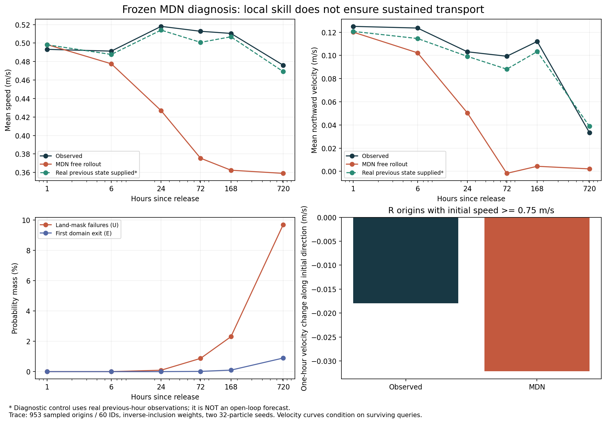

# Continuous-model diagnostic audit

The current MDN has measurable one-hour skill, but does not sustain the observed
transport adequately in free rollouts. The evidence supports investigating excessive
velocity damping, weak location-dependent mean corrections, training convergence,
and coastal boundary handling before imposing a narrower forecast.

Model run: `continuous_cv_20261028T143556_027911Z`. Diagnostic run: `continuous_diagnostics_20261029T054731_635202Z`.
No model was refitted, no training weights or features were changed, and final test
was not opened. Canonical inputs and existing results remain unchanged.

## 1. Evidence and coverage

- All 4,598,829 eligible hourly transitions from 440 historical-validation IDs were
  scored for one-step diagnostics. R and speed bands are descriptive strata.
- Free rollouts use 953 origins from 60 IDs in the common
  complete 7/30-day cohort. Up to 16 origins per ID are sampled without replacement,
  before examining errors; inverse inclusion weights recover the cohort's pair target.
- Each Gaussian/MDN free rollout uses two independent 32-particle seeds. Both use
  gamma=0, the selected 30-day configurations. This is an exploratory path diagnosis,
  not a new model-selection round or an exact reproduction of the full 7-day cohort.
- Observed-state controls receive the actual state one hour before each diagnostic
  horizon, then make one step. They intentionally use intervening observations and
  must never be presented as usable release-time forecasts.
- All trace-selected observed paths were verified hour by hour for ID, time and
  in-domain eligibility. Whole IDs remain the unit of uncertainty assessment.

## 2. One-step velocity learning

Speed bands: 0 < 0.25 m/s; 1 = [0.25,0.75) m/s; 2 >= 0.75 m/s.
RMSE is the Euclidean velocity-vector RMSE. Persistence holds the current velocity.
Parallel change projects the velocity increment onto the INITIAL direction; it is
not identical to a change in speed magnitude, because turning also changes it.

| scope | speed_band | pairs | IDs | velocity_RMSE_m_s | persistence_velocity_RMSE_m_s | predicted_parallel_dv | observed_parallel_dv |
| --- | --- | --- | --- | --- | --- | --- | --- |
| D_outside_R | 0 | 2592513 | 428 | 0.079879 | 0.081351 | -0.0087405 | -0.0081902 |
| D_outside_R | 1 | 1815908 | 433 | 0.11119 | 0.11606 | -0.021959 | -0.020321 |
| D_outside_R | 2 | 121469 | 361 | 0.18499 | 0.18933 | -0.034044 | -0.032446 |
| R | 0 | 21188 | 60 | 0.098569 | 0.099152 | -0.0055214 | -0.0074484 |
| R | 1 | 34952 | 64 | 0.12467 | 0.12636 | -0.018483 | -0.015577 |
| R | 2 | 12799 | 70 | 0.16738 | 0.16874 | -0.032158 | -0.017984 |

The MDN's vector RMSE is slightly below persistence in every reported stratum;
therefore the claim that it learns no useful velocity information is unsupported.
However, fast R origins have a predicted-minus-observed parallel-change bias of
-0.01417 m/s per one-hour transition, with a frozen-model whole-ID
95% bootstrap interval [-0.01807, -0.01027] across 70 IDs.
This supports an excessive along-direction damping diagnosis in this stratum,
not a universal assertion that every flow should preserve its speed.

Local derivatives also show nonzero learned velocity corrections. Subtracting the
identity contribution in the propagation formula is essential: a next-velocity
derivative near one does not by itself prove the network learned velocity well.
Location derivatives of the conditional mean velocity are small on sampled R
states; this does not prove that location is irrelevant to mixture weights,
covariances, or other regions. No causal feature importance is claimed.

## 3. Single-step control versus free propagation

| hour | observed_speed_m_s | control_expected_speed_m_s | predicted_speed_m_s | observed_vn_m_s | predicted_vn_m_s |
| --- | --- | --- | --- | --- | --- |
| 1 | 0.49319 | 0.49816 | 0.49837 | 0.12504 | 0.12007 |
| 6 | 0.49129 | 0.48769 | 0.47756 | 0.1236 | 0.10223 |
| 24 | 0.51807 | 0.51403 | 0.4269 | 0.10312 | 0.050411 |
| 72 | 0.51274 | 0.50079 | 0.37545 | 0.099258 | -0.0017844 |
| 168 | 0.51044 | 0.50678 | 0.36246 | 0.11202 | 0.0043343 |
| 720 | 0.47606 | 0.46915 | 0.35903 | 0.033389 | 0.0020878 |

Control expected speeds use 128 samples; free-rollout speeds are averages of
sampled speed magnitudes, not the magnitude of a mean vector. This avoids mistaking
directional cancellation for speed decay. Velocity summaries use the same origins
with surviving simulated particles for the observed, control and free-run values;
failure mass is reported separately and never renormalized away in forecast scores.
Survivor conditioning remains a limitation of these physical-state summaries.

The observed-state control remains much closer to observed velocities than the
free-running model. Thus locally reasonable predictions do not preserve the observed
long-run dynamics. This is consistent with feedback of generated-state errors and
insufficient sustained dynamics; it does not alone distinguish model capacity,
state insufficiency, training objective, or state-distribution shift as the cause.

## 4. Completeness and current training influence

| metric | value |
| --- | --- |
| IDs | 2100 |
| pairs | 2.0609e+07 |
| R_pair_fraction | 0.012081 |
| next_hour_eligibility | 0.99945 |
| fraction_in_segments_ge_24h | 0.99875 |
| fraction_in_segments_ge_168h | 0.98862 |
| fraction_in_segments_ge_720h | 0.94903 |
| top_1_ID_training_share | 0.0029151 |
| top_10_ID_training_share | 0.025217 |
| top_100_ID_training_share | 0.17997 |

About 94.90% of training pairs already belong
to uninterrupted eligible segments of at least 720 hours. This measures continuity
of the processed hourly product, not original satellite measurement frequency or
measurement accuracy. Long trajectories already contribute more under equal-pair
training. There is no evidence here that an additional completeness bonus would
repair the observed velocity bias.

Only 1.21% of D-origin training transitions start in R.
D coverage is necessary for later transport, so this is not a recommendation to
discard outside-R data. It motivates checking learning curves and state-stratified
errors. Any quality weighting needs an independently justified quality variable,
a defined sampled population, and a separate sensitivity experiment under Contract
03/12. Sampling schemes with importance correction can change optimization without
silently changing the main equal-pair objective.

## 5. Dispersion and unresolved outcomes

| model | reason | particle_events |
| --- | --- | --- |
| G_l2_0 | 1 | 196 |
| G_l2_0 | 2 | 8029 |
| MDN3_l2_0 | 1 | 761 |
| MDN3_l2_0 | 2 | 8748 |

Every unresolved particle in this sampled diagnostic is a finite generated point
rejected by the frozen land mask; direct mask checks confirmed this. There were no
nonfinite/invalid-latitude failures in these traces. This is a simulated geometry
failure, not evidence of an observed beaching event. Do not generalize the absence
of numerical failures to all possible releases.

Weighted MDN land-failure mass at 30 days is
9.70%; it is
9.47--
9.93%
across the two MC seeds. These are weighted subset diagnostics, not replacements
for the earlier full-cohort U estimate. The existing full comparison remains the
source for B2-versus-MDN performance.

A wide map can combine a displaced centre, genuine uncertainty, wrong directions,
and artificial tails. Minimizing nonzero cell count is not a proper objective.
Do not clip trajectories to the observed validation envelope, resample away land
failures, or renormalize remaining geographic mass and call that improved accuracy.

## 6. Proposed implementation gate

1. Keep B2 and the frozen Gaussian/MDN outputs as controls, along with identical
   features, annual pooling, source data and locked final test.
2. First test training adequacy and velocity-dynamics learning: longer training
   with held-ID stopping and a small declared capacity comparison. All six MDN CV
   fits hit the original eight-epoch ceiling; the last held NLL still decreased.
   This suggests training is not proven sufficient, not that more epochs must help.
3. Then compare one-hour training against declared multi-hour kernels on common
   7/30-day releases. Longer lags require full hourly first-exit labels and an explicit
   exit treatment; they cannot simply skip the original absorbing boundary checks.
4. Consider a short multi-step probabilistic training comparison if one-step skill
   still fails to sustain trajectories. Preserve multimodal targets and separate
   mean drift, uncertainty, and boundary errors.
5. Evaluate boundary-aware transition distributions separately if land failures
   persist. Rejection/redraw or truncation is a model change requiring probability
   normalization and re-evaluation, not a graphical cleanup.
6. Completeness/quality weights and covariance-scale calibration are separate
   later challengers, selected using training-internal whole-ID CV with shared
   evaluation weights, probability-region coverage/area, S, and visible E/U mass.

This audit authorizes no new weights, predictors, truncation, or long-lag policy.
It supplies the evidence for freezing the next engineering comparison with the user.

