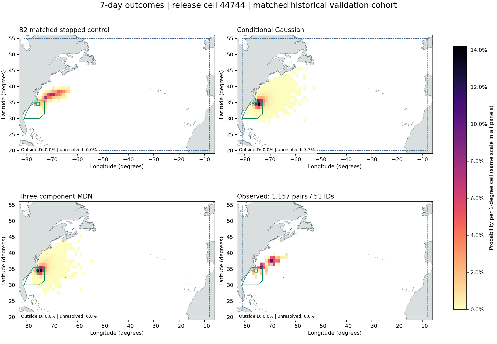
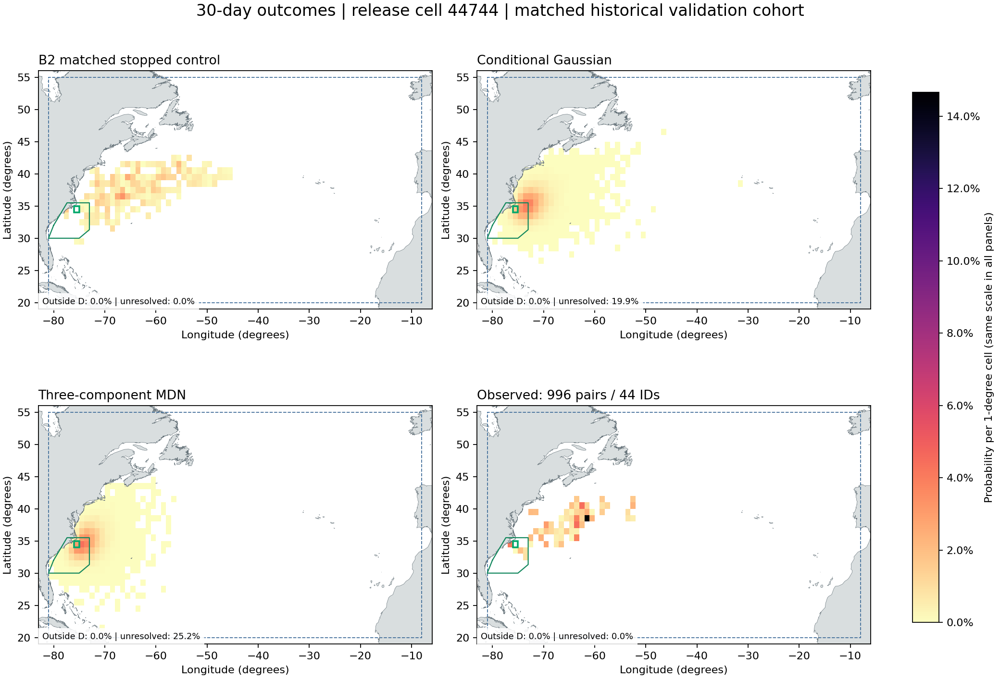

# Continuous hourly transport: first development comparison

Source run: `continuous_cv_20261028T143556_027911Z`. Fixed 1-hour transition, 168/720 free-running steps;
annual pooled, inputs lon/lat/ve/vn only. No final-test access, no source edits,
no grounding/seasonal/365-day or arbitrary-object claim. This is a bounded first
experiment, not evidence of globally optimal parameters or step length.

## Model and selection

In a fixed invertible chart, learn the joint four-dimensional residual
`r = (x_next - x - 3600 J(x)v, v_next - v)` given current position and velocity.
`q(r|s) = sum_k pi_k(s) Normal_4(mu_k(s), L_k L_k^T + 0.03^2 I)` in fit-standardized units.
K=1 is the Gaussian control; K=3 is MDN. Two tanh layers of width 32 predict
continuous conditional parameters. No future observed velocity is fed into a
rollout. The velocity distribution is carried jointly with displacement.

Unlike the earlier cell tables, this network learns a function of exact location
and continuous velocity. Two releases in the same cell can receive different
next-hour distributions. Repeated samples give a distribution of trajectories;
only their displayed outcomes are binned to the 1-degree grid. At inference the
starting velocity must be supplied; location-only initialization is not part of
this implementation. Mixture components are statistical components, not named
ocean currents or persistent physical regimes.

Minimize equal-pair negative log likelihood plus gamma times squared weights.
Gamma candidates 0 and 0.0001 are evaluated in both families. Three whole-ID folds
inside 2,674 historical training IDs select checkpoints by held joint NLL and
gamma by free-rollout S separately for 7/30d. Scaling is fit-only. Final candidates
are refitted on all 2,674 training IDs for the median chosen CV epoch count.
Of those assigned training IDs, 2,100 contribute eligible one-hour D transitions
(20,609,216 pairs); the others have no qualified D pair and do not enter the loss.
The comparison uses the separate 550 historical validation IDs, of which only
eligible R visitors contribute outcomes. These validation IDs were used earlier
in project development: this is not pristine confirmatory or final-test evidence.
CV scores also include epoch/parameter selection and are tuning evidence.

| family | horizon_days | candidate | CV_S | gamma | components |
| --- | --- | --- | --- | --- | --- |
| G | 7 | G_l2_0 | 0.970716 | 0 | 1 |
| G | 30 | G_l2_0 | 1.02302 | 0 | 1 |
| MDN3 | 7 | MDN3_l2_1e4 | 0.976346 | 0.0001 | 3 |
| MDN3 | 30 | MDN3_l2_0 | 1.02694 | 0 | 3 |

10/12 CV fits reached the eight-epoch
ceiling. Inspect per-epoch histories before claiming convergence; computational
budget and fixed small capacity limit the conclusion.

## Matched outcomes

At 7 days, S is 0.978846 for Gaussian, 0.972575 for MDN and 0.924456 for matched B2. The lowest point estimate on this cohort is B2 matched stopped control. Read the whole-ID intervals before asserting a stable difference. At 30 days, S is 1.029394 for Gaussian, 1.028137 for MDN and 0.996241 for matched B2. The lowest point estimate on this cohort is B2 matched stopped control. Read the whole-ID intervals before asserting a stable difference.

| horizon_days | model | pairs | IDs | S | cohort90_hit_pct | cohort90_available_pct | U_mass_pct | E_mass_pct |
| --- | --- | --- | --- | --- | --- | --- | --- | --- |
| 7 | B2 matched stopped control | 65098 | 72 | 0.924456 | 88.9951 | 100 | 0 | 0 |
| 7 | G | 65098 | 72 | 0.978846 | 67.8884 | 94.327 | 3.50486 | 0.0793035 |
| 7 | MDN3 | 65098 | 72 | 0.972575 | 68.1096 | 94.4791 | 3.0828 | 0.12318 |
| 30 | B2 matched stopped control | 56493 | 60 | 0.996241 | 65.6453 | 100 | 0 | 0 |
| 30 | G | 56493 | 60 | 1.02939 | 50.9001 | 74.8748 | 8.93136 | 0.289361 |
| 30 | MDN3 | 56493 | 60 | 1.02814 | 51.4117 | 71.3823 | 9.6731 | 0.956645 |

The main percentage above is a **release-cell cohort** diagnostic: average the
conditional forecasts over the matching initial coordinates/velocities in each
release cell, form its 90% set without seeing outcomes, then count that cohort's
observed hits. This uses many more than 32 particles per cohort, matching the maps.
It does not measure calibration of individual velocity-conditioned forecasts.
Unavailable cohort regions count as no hit. Small cohorts remain less reliable.
Individual 32-particle region diagnostics are retained separately in summary.csv;
their sparse numerical support must not be mistaken for the full model's support.

Lower S is better. It is a quadratic probability score, not percentage accuracy.
Unresolved U and first-exit E retain their mass. Land/nonfinite simulations become
U, not diagnosed grounding. Missing observed follow-up is not treated as exit.
B2 is re-fitted on the SAME stopped targets and training IDs; old endpoint-only
baseline scores are not copied into this table. Continuous models additionally
use D-origin transitions, whereas B2 uses direct R-origin 7/30-day pairs.
Neither held-out horizon contains an observed exit. Predicted exit mass remains
in the score, but sensitivity to true exits is not established by this cohort.

The 90% region hit rate means the fraction of eligible observed outcomes in the
issued nominal-90% set. Ties increase actual issued mass; read the mass/area columns
in summary.csv. Unavailable regions count as no hit in the all-case hit rate.
The common-available-region columns in the CSV compare area on identical cases;
the ordinary mean area uses each model's available sets and may use different cases.
32-particle regions are coarse numerical approximations, not precise limiting-law
calibration. Sampled zero is not a structural zero of an MDN density. Geographic
energy/squared-mean diagnostics use the common available in-D subset only; no
coordinate is invented for E or U. These are auxiliary, not the NLL training loss.

## Uncertainty and numerical audit

| horizon_days | comparison | delta_S | lower95 | upper95 | independent_IDs |
| --- | --- | --- | --- | --- | --- |
| 7 | MDN3 minus G | -0.00627079 | -0.0171259 | 0.00165561 | 72 |
| 7 | MDN3 minus B2 matched stopped control | 0.048119 | 0.0259442 | 0.0788486 | 72 |
| 30 | MDN3 minus G | -0.00125665 | -0.00550605 | 0.0024463 | 60 |
| 30 | MDN3 minus B2 matched stopped control | 0.0318963 | 0.0138798 | 0.0583491 | 60 |

Intervals resample whole validation IDs 1,000 times with frozen fits, retaining
equal-pair weighting. They exclude refitting and researcher adaptation. Nearby
hourly releases overlap; they are not independent instruments. Whole-ID isolation
does not establish spatial or temporal independence, or future-year skill. The S integration
uses collision counts to remove the finite-particle bias of squared probabilities.
`MC_half_diagnostics.csv` and `CV_MC_half_diagnostics.csv` compare independent
particle halves. Two halves are a sensitivity check, not a precise MC confidence
interval. No tuning decision is revised using historical validation scores.

| family | horizon_days | full_pick | half0_pick | half1_pick | rank_stable |
| --- | --- | --- | --- | --- | --- |
| G | 7 | G_l2_0 | G_l2_0 | G_l2_0 | True |
| G | 30 | G_l2_0 | G_l2_0 | G_l2_0 | True |
| MDN3 | 7 | MDN3_l2_1e4 | MDN3_l2_1e4 | MDN3_l2_0 | False |
| MDN3 | 30 | MDN3_l2_0 | MDN3_l2_0 | MDN3_l2_0 | True |

A ranking that changes between particle halves is not a numerically resolved
optimum. The full-ensemble choice is retained as specified, with this uncertainty
visible. In particular, a tiny gamma difference must not be described as a robust
improvement or confused with evidence that the entire model family is superior.

## Reading the maps

The default release cell 44744 was chosen by the largest independent-ID
support in historical TRAINING data (ties: pair count, then cell). Each forecast
uses the corresponding validation release's exact coordinates and velocity; the
panels average these conditional forecasts over the SAME cohort as observed.
This is not a single arbitrary release-point forecast. Every panel in each view
uses the same displayed probability scale; changing cell may change that scale.
Probability per cell is not probability density. E/U are displayed separately;
surviving geographic probabilities are never renormalized to 100%.
The network can issue a density in an unobserved or sparsely observed state;
numerical forecast availability is not evidence that such extrapolation is
accurate. Unlike the empirical table, a missing fitting cell does not itself
create U. U here records geometric/nonfinite simulation failure.

## Scope and reproducibility

Canonical data and the locked test are unchanged. The hourly cache retains source
indices and exact timestamps. One unmapped outside endpoint found in the resource
pilot was excluded before formal training to match the existing geometry rules;
the final cache has 25,208,045 eligible pairs, including 2,001 observed exits.
Hourly data are processed historical GDP estimates; interpolation-derived velocity
may reflect observations on both sides of a time stamp; see
[Elipot et al. (2016)](https://repository.library.noaa.gov/view/noaa/20401/noaa_20401_DS1.pdf).
No real-time readiness is
claimed. One-hour observed/generated exits do not resolve unobserved subhour exits.

Use the saved `.pt` checkpoints with `load_model` and `rollout` in
`data3001.modelling.run_continuous`; the run config records seeds, optimizer,
scalers, complete ID roles and input/source hashes. No test labels are needed.

Literature precedent: [Brolly (2023)](https://doi.org/10.1029/2023MS003718) uses an
MDN for oceanic transition densities. This experiment extends the target to joint
position/velocity increments; the paper does not validate this extension or our
dataset-specific results. [Gneiting and Raftery (2007)](https://doi.org/10.1198/016214506000001437)
provides the proper-score context. No claim that a neural model must outperform
the empirical baseline follows from either source.
