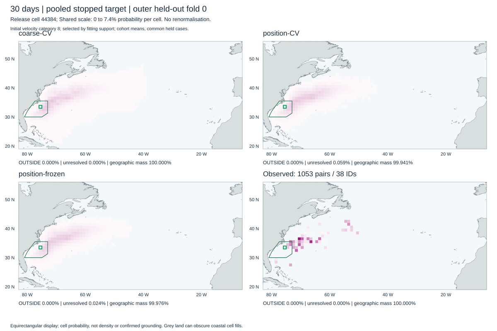

# 30-day schedule/lambda CV: does exact position help?

## Question and fair controls

Both coordinate-discarded and exact-position representations are independently optimised over the same nine schedules and eleven lambdas. Comparing only a newly tuned position model with an old frozen coarse model would confound coordinates with tuning opportunity. The primary contrast is position-CV minus coarse-CV. The matched-setting controls additionally compare representations at each procedure's selected settings. Frozen coarse/position models and direct B2 remain references. These are adaptive development comparisons, not final-test results: earlier outer outcomes influenced the research direction.

No path was eliminated by a manually fixed lambda. Within each original outer training pool, four whole-ID inner folds evaluate all99 candidates. StageA is a diagnostic at the historical training-CV reference lambda; it cannot prune paths. StageB jointly selects path/lambda by pooled inner-OOF S, refines numerically unresolved contenders, locks choices, then evaluates the untouched outer IDs. Complete fitting IDs are excluded across both R and the wider D. Existing fit-only speed medians and nine velocity labels remain fixed by role.

## Mathematical model and numerical computation

State is exact WGS84 position plus velocity category, or E/U. Each kernel is the existing affine law K[d,lambda]=(1-lambda)*L[d]+lambda*B[d], with the same missing-row fallback. Propagate the full joint state along an ordered sequence summing exactly30days, then marginalise velocity and bin positions at1degree. Future held-out observations are never inputs. Observed-hour exit/re-entry and synthetic geometry rules are unchanged; source E/U absorb and no unresolved mass is renormalised away.

Inner CV shares simulations through conditional component count stratification. For m ordered steps and k pooled labels, sample their positions uniformly among choose(m,k) orders. The exact mixing weights are choose(m,k)*lambda^k*(1-lambda)^(m-k). This identity holds even for noncommuting kernels, state-dependent rows, backoff L=B and absorbing dummy labels. It changes numerical integration, not the model, data features, origin weights or lambda search. Every lambda is scored. Different path/allocation layouts have separate keyed RNG streams; lambdas within one path share samples. Independent repeats support MC error estimation.

Each active stratum uses at least two samples and at least ceil(target*max_lambda binomial_weight). This bounds each category probability estimator's variance by its iid-target counterpart. It does not assert a corresponding universal bound for the nonlinear score. The issued distribution is a normalised weighted sum of stratum frequencies. Subtract the within-stratum squared-probability bias to obtain an unbiased estimate of the same S; ordinary issued S remains secondary. The final outer comparison uses the original independent-particle implementation at64particles x2repeats. Inner numerical targets32/64/128 and actual allocations are recorded.

Native inverse-geodesic displacements are cached without approximation. A conservative directional bound can certify transferred hourly paths inside the frozen rectangular D; any uncertified path receives the original full hourly scan. This is computational metadata, not new learned features. Cached/uncached forecasts and lambda-endpoint samplers are verified against the original implementation.

## Primary held-ID outcome

Lower S is better; S is not percentage accuracy. All268998 eligible30-day origins/337IDs remain in primary scoring. Analytic coarse scores have no particle bias; position scores use the unbiased collision estimate. Repeated particle runs do not double the statistical sample size. U/E remain visible. Smaller finite-particle regions do not establish greater sharpness or limiting-law calibration.

| model | eligible_pairs | independent_ids | S | mean_U_pct | mean_E_pct |
| --- | --- | --- | --- | --- | --- |
| B2-reference | 268998 | 337 | 0.994751 | NA | NA |
| coarse-CV | 268998 | 337 | 0.985255 | 1.46699e-06 | 1.11126e-10 |
| coarse-at-position-settings | 268998 | 337 | 0.985344 | 1.68513e-06 | 1.12735e-10 |
| coarse-frozen | 268998 | 337 | 0.985249 | 5.19138e-07 | 4.74254e-11 |
| position-CV | 268998 | 337 | 0.985134 | 0.511159 | 0.00670312 |
| position-at-coarse-settings | 268998 | 337 | 0.985239 | 0.519982 | 0.00644463 |
| position-frozen | 268998 | 337 | 0.985219 | 0.527484 | 0.00641559 |

## Paired whole-ID uncertainty

| comparison | delta_S | lower_95 | upper_95 |
| --- | --- | --- | --- |
| position-CV minus coarse-CV | -0.00012128 | -0.00121284 | 0.00125367 |
| position-CV minus position-frozen | -8.5095e-05 | -0.000235736 | 0.000103668 |
| position-CV minus coarse-frozen | -0.000115148 | -0.00122466 | 0.00125723 |
| position-CV minus coarse-at-position-settings | -0.000209689 | -0.00127705 | 0.00100037 |
| position-at-coarse-settings minus coarse-CV | -1.60157e-05 | -0.00107515 | 0.0013035 |

Intervals use200 paired whole-ID resamples within outer folds, conditional on fixed fits/choices. They exclude refitting, researcher adaptation and all selection uncertainty. Numerical integration error is a separate quantity. A crossing-zero interval does not establish equivalence or a reliable gain. Improved S accompanied by more U must be interpreted with failure/support diagnostics.

## Choices and reproducibility

```json
[
  {
    "outer_fold": 0,
    "family": "position-CV",
    "candidate": 58,
    "path": "R7",
    "lambda_value": 0.3,
    "S": 0.9857401474432371,
    "particles": 128,
    "numerically_unresolved": true,
    "near_candidates": [
      55,
      56,
      57,
      58
    ],
    "all_candidates_initially_scored": 99
  },
  {
    "outer_fold": 0,
    "family": "coarse-CV",
    "candidate": 56,
    "path": "R7",
    "lambda_value": 0.1,
    "S": 0.9853980533549059
  },
  {
    "outer_fold": 1,
    "family": "position-CV",
    "candidate": 58,
    "path": "R7",
    "lambda_value": 0.3,
    "S": 0.9875933312621948,
    "particles": 128,
    "numerically_unresolved": true,
    "near_candidates": [
      55,
      56,
      57,
      58
    ],
    "all_candidates_initially_scored": 99
  },
  {
    "outer_fold": 1,
    "family": "coarse-CV",
    "candidate": 36,
    "path": "D5",
    "lambda_value": 0.3,
    "S": 0.9883450844412038
  },
  {
    "outer_fold": 2,
    "family": "position-CV",
    "candidate": 61,
    "path": "R7",
    "lambda_value": 0.6,
    "S": 0.9849564165070355,
    "particles": 128,
    "numerically_unresolved": true,
    "near_candidates": [
      47,
      48,
      56,
      57,
      58,
      59,
      60,
      61
    ],
    "all_candidates_initially_scored": 99
  },
  {
    "outer_fold": 2,
    "family": "coarse-CV",
    "candidate": 46,
    "path": "D7",
    "lambda_value": 0.2,
    "S": 0.9849622299535916
  },
  {
    "outer_fold": 3,
    "family": "position-CV",
    "candidate": 57,
    "path": "R7",
    "lambda_value": 0.2,
    "S": 0.9855139685944184,
    "particles": 128,
    "numerically_unresolved": true,
    "near_candidates": [
      55,
      56,
      57
    ],
    "all_candidates_initially_scored": 99
  },
  {
    "outer_fold": 3,
    "family": "coarse-CV",
    "candidate": 46,
    "path": "D7",
    "lambda_value": 0.2,
    "S": 0.9858772499279642
  },
  {
    "outer_fold": 4,
    "family": "position-CV",
    "candidate": 59,
    "path": "R7",
    "lambda_value": 0.4,
    "S": 0.9848158204108304,
    "particles": 128,
    "numerically_unresolved": true,
    "near_candidates": [
      55,
      56,
      57,
      58,
      59
    ],
    "all_candidates_initially_scored": 99
  },
  {
    "outer_fold": 4,
    "family": "coarse-CV",
    "candidate": 55,
    "path": "R7",
    "lambda_value": 0.0,
    "S": 0.9841032619243922
  }
]
```

All initial grids, refined candidate sets, per-ID scores, role IDs/thresholds, source-case digests and immutable checkpoint receipts are saved. Completed runs are immutable. The canonical dataset and final test are untouched. The evidence concerns annual-pooled, known-initial-velocity30-day distributions, not seasonal/year/grounding or arbitrary-object performance.

Maps average individual forecasts over a fitting-support-selected cell/initial-velocity cohort in fold0. Observed endpoints are the identical held-out cohort. They are illustrative cohort distributions, not overall performance or a single-point forecast. All panels share a scale. Auxiliary Energy/100+squared ECEF-mean error/10000 values are issued-ensemble diagnostics on declared available subsets, not a new selection loss.

## Numerical uncertainty on the same outer cases

| comparison | delta_S | MC_SE | MC_only_lower_95 | MC_only_upper_95 |
| --- | --- | --- | --- | --- |
| position-CV minus coarse-CV | -0.00012128 | 4.19185e-05 | -0.000203441 | -3.91201e-05 |
| position-CV minus coarse-at-position-settings | -0.000209689 | 4.19185e-05 | -0.000291849 | -0.000127529 |
| position-CV minus coarse-frozen | -0.000115148 | 4.19185e-05 | -0.000197308 | -3.2988e-05 |
| position-CV minus position-frozen | -8.5095e-05 | 5.88964e-05 | -0.000200532 | 3.03419e-05 |
| position-at-coarse-settings minus coarse-CV | -1.60157e-05 | 4.19277e-05 | -9.81939e-05 | 6.61626e-05 |

MC intervals condition on fixed queries/fits and independent query streams; they are not whole-ID generalisation intervals.

## Failure causes across the complete propagated paths

| model | origin_particles | unsupported_U_pct | geometry_U_pct | translated_exit_pct | backoff_events_per100particles |
| --- | --- | --- | --- | --- | --- |
| position-CV | 34431744 | 0.142796 | 0.368364 | 0.00670312 | 0.000920662 |
| position-at-coarse-settings | 34431744 | 0.147805 | 0.372177 | 0.00644463 | 0.00116462 |
| position-frozen | 34431744 | 0.148947 | 0.378537 | 0.00641559 | 0.0012198 |

U and E absorb, so their first-event causes are counted once. Backoff may repeat; its events-per100 measure can exceed100. Full per-substep traces retain active particles and every original step audit counter.


