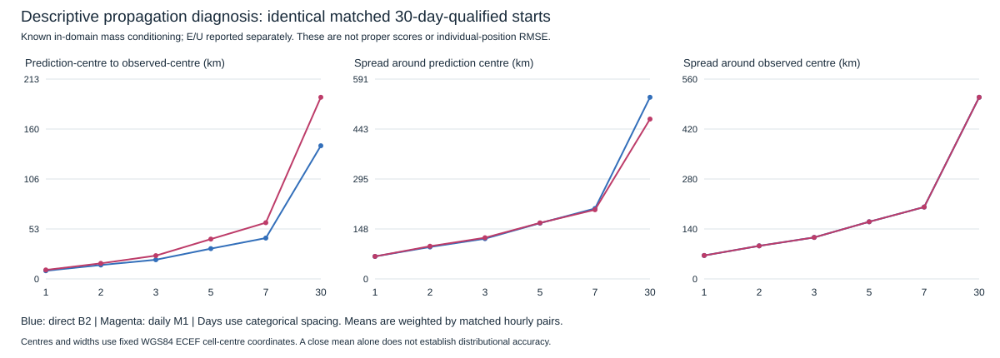
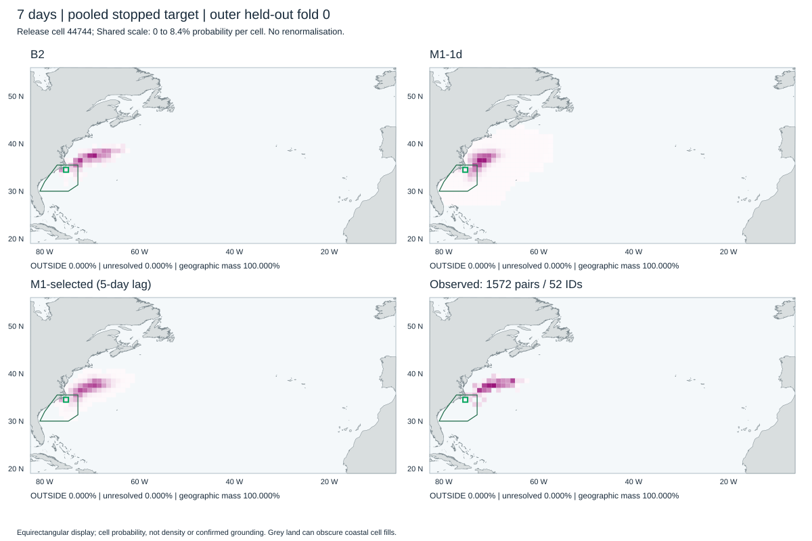
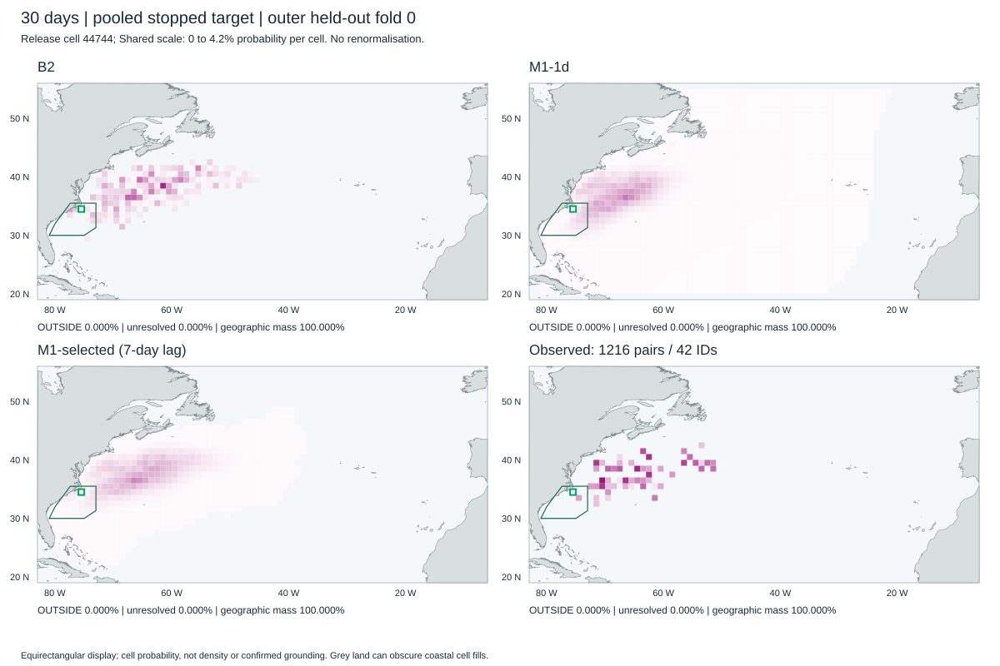

# M1 diagnosis and one bounded lag optimisation

**Status:** development-only benchmark analysis; no new predictor, canonical change, final-test access or annual/seasonal/grounding skill claim.

## What was tested

First locate deviations at days 1/2/3/5/7/30 using an identical retrospective 30-day-qualified set of source-keyed releases. Then compare one predeclared lag grid, 1/3/5/7 days, with exact independently fitted remainder kernels. All geographic definitions, pooled scenario and equal eligible-pair weights remain fixed. A daily self-transition is endpoint occupancy, not continuous within-cell residence.

The operator remains empirical: `P_tau[i,j] = N_tau[i,j] / sum_j N_tau[i,j]`; `p_h = e_i P_tau^(h//tau) P_r` when r=h%tau is nonzero. E (first observed exit) and U (unsupported model state) remain separate absorbers. No missing probability is renormalised into physical destinations. Linear/quadratic spatial scores evaluate forecasts; they do not train the frequency estimator.

## 1. Where daily forecasts deviate

The table below uses the same eligible source starts at every diagnostic horizon. B2 is fitted directly at each horizon using fitting IDs from that same retrospective cohort; M1 uses daily D-origin production counts. Cohort and information differences remain, so this diagnoses the deployed approximation rather than isolating a single physical cause.

| horizon_days | model | eligible_pairs | independent_ids | brier_failure_penalized | region90_hit_pct_available | mean_region90_cells |
| --- | --- | --- | --- | --- | --- | --- |
| 1 | B2 | 268998 | 337 | 0.580887 | 92.6301 | 4.00613 |
| 1 | M1-1d | 268998 | 337 | 0.583058 | 92.5825 | 4.08536 |
| 2 | B2 | 268998 | 337 | 0.763683 | 91.5419 | 6.11 |
| 2 | M1-1d | 268998 | 337 | 0.768251 | 92.2501 | 6.52498 |
| 3 | B2 | 268998 | 337 | 0.83958 | 90.0367 | 8.20383 |
| 3 | M1-1d | 268998 | 337 | 0.844462 | 92.9052 | 9.6387 |
| 5 | B2 | 268998 | 337 | 0.900615 | 88.6397 | 12.8796 |
| 5 | M1-1d | 268998 | 337 | 0.905412 | 90.2724 | 15.6234 |
| 7 | B2 | 268998 | 337 | 0.931795 | 86.9479 | 18.2083 |
| 7 | M1-1d | 268998 | 337 | 0.934572 | 88.8583 | 21.8455 |
| 30 | B2 | 268998 | 337 | 0.994751 | 66.3726 | 62.6083 |
| 30 | M1-1d | 268998 | 337 | 0.988099 | 83.3731 | 95.9059 |

| horizon_days | model | descriptive_available_pct | centre_bias_km | predicted_RMS_km | observed_RMS_km | unresolved_mass |
| --- | --- | --- | --- | --- | --- | --- |
| 1 | B2 | 100 | 8.66323 | 66.4945 | 65.7178 | 0 |
| 1 | M1-1d | 100 | 9.55958 | 66.528 | 65.7178 | 0 |
| 2 | B2 | 100 | 14.7946 | 94.3314 | 92.7066 | 0 |
| 2 | M1-1d | 100 | 16.5496 | 96.6389 | 92.7066 | 0 |
| 3 | B2 | 100 | 20.3929 | 118.944 | 116.35 | 0 |
| 3 | M1-1d | 100 | 24.7712 | 121.743 | 116.35 | 0 |
| 5 | B2 | 100 | 32.2241 | 164.887 | 160.292 | 0 |
| 5 | M1-1d | 100 | 42.3763 | 165.617 | 160.292 | 0 |
| 7 | B2 | 100 | 43.4807 | 208.205 | 201.574 | 0 |
| 7 | M1-1d | 100 | 59.8375 | 204.488 | 201.574 | 0 |
| 30 | B2 | 100 | 141.749 | 537 | 509.507 | 0 |
| 30 | M1-1d | 100 | 193.368 | 472.521 | 509.507 | 1.56355e-13 |

Centres and RMS spreads condition on the known geographic mass and use fixed WGS84 ECEF cell centres. They are descriptive group-distribution comparisons, not individual endpoint RMSE or replacement scoring criteria. They can be available when exact-U=0 formal spatial scores are NA. A close mean can conceal errors that cancel. A large number of positive-probability cells can consist mostly of negligible tail mass.

## 2. Controlled short-lag consistency screen

All phase/direct estimates below use matched three-day-qualified D-start windows from fitting IDs, evaluated on held-out R starts from that cohort. Direct fits 0->2/3. Phase-composed separately fits 0->1, 1->2, 2->3; Pooled-composed pools those phase counts into one daily row. Already absorbed E stays E in later phases even after geographical re-entry. This is a retrospective diagnostic with explicit phase/window weights, not a new production weighting policy.

| horizon_days | model | pairs | independent_ids | S |
| --- | --- | --- | --- | --- |
| 2 | Direct | 310556 | 388 | 0.757813 |
| 2 | Phase-composed | 310556 | 388 | 0.760698 |
| 2 | Pooled-composed | 310556 | 388 | 0.760664 |
| 3 | Direct | 310556 | 388 | 0.834799 |
| 3 | Phase-composed | 310556 | 388 | 0.838979 |
| 3 | Pooled-composed | 310556 | 388 | 0.838967 |

Differences can reflect coarse-state memory, phase-dependent sampling, qualification selection and estimation noise. They do not prove that physical ocean motion is non-Markovian. Per-cell total-variation differences and unresolved mass are retained in the source diagnosis run.

## 3. One optimisation: lag selection

Each original outer whole-ID fold has four inner whole-ID folds. Select a lag independently for day 7 and day 30 using inner-OOF pair-weighted S. Ties within 1e-12 choose the shortest lag. No cross-horizon weighting or spatial loss is introduced. All fitting counts and choices exclude the complete outer-held-out IDs. Fixed candidates and the selected procedure are scored on identical original eligible 7/30-day cases, not the retrospective diagnostic subset.

| outer_fold | horizon_days | lag_days |
| --- | --- | --- |
| 0 | 7 | 5 |
| 0 | 30 | 7 |
| 1 | 7 | 3 |
| 1 | 30 | 5 |
| 2 | 7 | 5 |
| 2 | 30 | 7 |
| 3 | 7 | 5 |
| 3 | 30 | 7 |
| 4 | 7 | 5 |
| 4 | 30 | 7 |

| horizon_days | model | eligible_pairs | independent_ids | brier_failure_penalized | zero_probability_pct | region90_hit_pct_available | mean_region90_cells | mean_unresolved_mass |
| --- | --- | --- | --- | --- | --- | --- | --- | --- |
| 7 | B0 | 303288 | 385 | 1.71002 | 85.5009 | 14.4991 | 1 | 0 |
| 7 | B1 | 303288 | 385 | 0.979073 | 0.0675925 | 89.0312 | 48.5073 | 0 |
| 7 | B2 | 303288 | 385 | 0.929001 | 2.08218 | 87.439 | 18.2258 | 0 |
| 7 | M1-1d | 303288 | 385 | 0.932844 | 0.00725383 | 89.0339 | 21.7658 | 0 |
| 7 | M1-3d | 303288 | 385 | 0.928298 | 0.0121996 | 89.4961 | 20.3353 | 0 |
| 7 | M1-5d | 303288 | 385 | 0.92681 | 0.0319828 | 89.5416 | 19.7138 | 0 |
| 7 | M1-7d | 303288 | 385 | 0.929239 | 1.98755 | 87.4367 | 18.3445 | 0 |
| 7 | M1-selected | 303288 | 385 | 0.927354 | 0.0319828 | 89.5429 | 19.9228 | 0 |
| 30 | B0 | 268998 | 337 | 1.92755 | 96.3773 | 3.6227 | 1 | 0 |
| 30 | B1 | 268998 | 337 | 0.991465 | 1.09406 | 85.1798 | 136.294 | 0 |
| 30 | B2 | 268998 | 337 | 0.994751 | 17.4589 | 66.3726 | 62.6083 | 0 |
| 30 | M1-1d | 268998 | 337 | 0.988099 | 0.153904 | 83.3731 | 95.9059 | 1.56355e-13 |
| 30 | M1-3d | 268998 | 337 | 0.986597 | 0.153904 | 86.1505 | 95.2011 | 2.54558e-17 |
| 30 | M1-5d | 268998 | 337 | 0.985908 | 0.153904 | 86.7895 | 95.0223 | 4.25848e-07 |
| 30 | M1-7d | 268998 | 337 | 0.985792 | 0.153904 | 87.4947 | 96.5537 | 1.12726e-08 |
| 30 | M1-selected | 268998 | 337 | 0.985785 | 0.153904 | 87.3493 | 96.2339 | 1.12726e-08 |

## 4. Paired held-out comparison

Lower S is better, not percentage accuracy. The intervals use 200 whole-held-out-ID resamples within fixed outer folds; they condition on fitted kernels and choices, excluding refitting/selection/source uncertainty. Comparisons are exploratory, not multiplicity-adjusted confirmation.

| horizon_days | comparison | delta_S | lower_95 | upper_95 |
| --- | --- | --- | --- | --- |
| 7 | M1-selected minus M1-1d | -0.00549016 | -0.00785547 | -0.00357318 |
| 7 | M1-selected minus B2 | -0.00164656 | -0.00313278 | 0.000373182 |
| 7 | M1-selected minus B1 | -0.0517187 | -0.0593522 | -0.0457472 |
| 30 | M1-selected minus M1-1d | -0.00231348 | -0.00356543 | -0.00119601 |
| 30 | M1-selected minus B2 | -0.00896535 | -0.0107289 | -0.0070913 |
| 30 | M1-selected minus B1 | -0.00568008 | -0.0071439 | -0.00416731 |

## 5. Illustrative before/after maps

Outer fold 0, release cell 44744; selected solely from fitting-ID support across the two horizons. Each figure shares one scale and matching held-out observations. Display land can cover parts of coastal cells. The figures show per-cell probability, not area density or confirmed grounding.

## 6. Handover and limitations

Full-development candidate lags: {7: 5, 30: 7}. These are chosen from fixed-candidate outer-OOF terms and then refitted on development IDs. Their final refits have no independent final-test score. Exact-remainder kernels and stable state indexes are saved under operators/; development_candidate.json records release semantics and selected lags.

Existing complete-forecast spatial rules are unchanged: a strictly positive U, even if tiny, makes that formal spatial score unavailable. Conditional centre/spread diagnostics must not be presented as a silently relaxed Energy Score. Failed and unsupported cases remain in S. Old daily scores are independently required to match the frozen prototype before this report can complete.

One lag comparison cannot fix all coarse-state effects. Review direction/subcell/phase evidence before choosing a small additional state or environmental predictor. Do not automatically add features or assume narrower maps are better. Final-test, year-scale, seasonal, object-specific and grounding performance remain unvalidated.

Sources: [Data Contract v1.0](../../../docs/contract/data_contract_v1.0.xlsx); [McAdam and van Sebille (2018)](https://doi.org/10.1002/2017JC013363); [O’Malley et al. (2021)](https://doi.org/10.1175/JTECH-D-20-0134.1).
