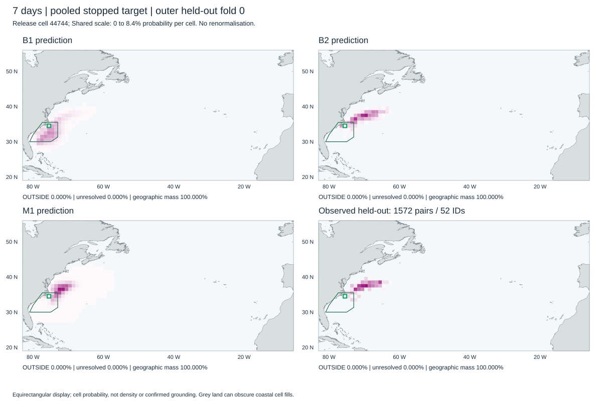
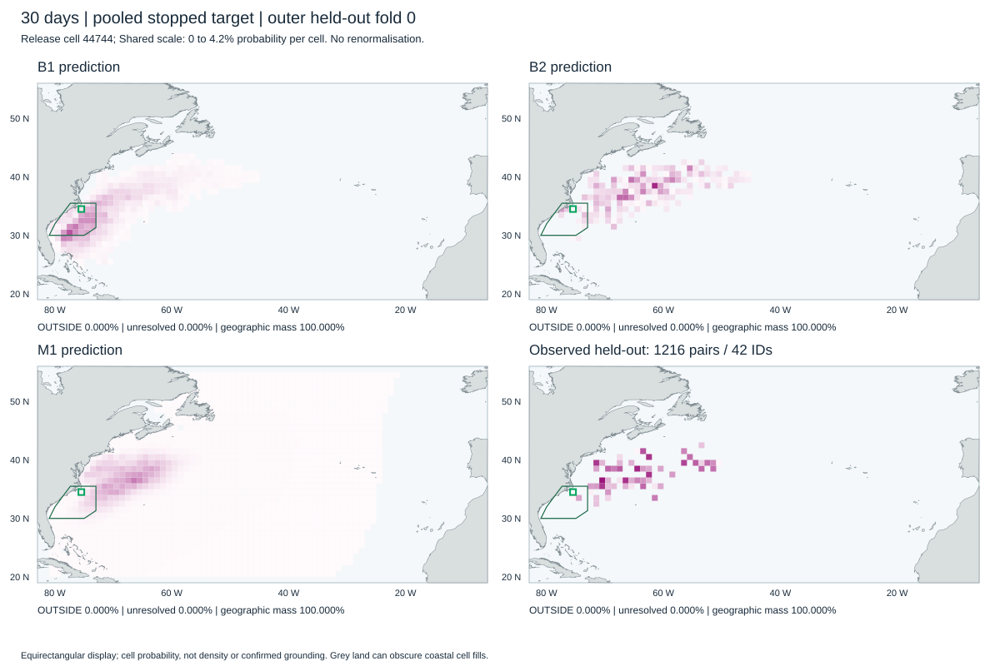

# M1: fixed one-day annual-pooled Markov prototype

**Status:** real development-only fitting and five whole-ID outer-fold evaluation. This is a fixed configuration, not an optimised-lag or final-test result.

## Question and inputs

From a selected Southern Gulf Stream release cell, predict the stopped outcome at day 7 or 30. Input cache: `markov_input_20261025T095949_830292Z`. Read 3,224 development IDs and 33,935,812 retained records during preparation. Fit all eligible D-origin transitions, including D-only instruments; evaluate releases in R.

R and D, exact UTC matching, 1-degree grid, equal valid-pair weights and interval eligibility follow Data Contract v1.0. D is 81-8 W, 20-55 N. Every hourly origin may contribute a one-day pair. Intermediate hourly observations validate first exit/path completeness; they are not future predictors.

## Mathematical method

`P[i,j] = N[i,j] / sum_j N[i,j]`; unsupported geographic rows send mass to U. First observed exit E and algorithmic support U remain separate and absorbing. `p_h = e_origin @ P^h` for this one-day kernel. No observed intermediate validation position is fed back. Predictors: current cell only. No velocity, SST, wind, seasonal or fixed-regime conditioning.

Five existing outer ID folds are reused. Each fit excludes the complete held-out IDs across R and D. No inner search is performed because lag=1 and epsilon=0 are fixed. B0/B1/B2 are newly fitted stopped-target controls. Old endpoint baseline scores are not a comparable leaderboard. M1 additionally uses downstream D information, so a difference is not attributable solely to iteration.

## Primary held-out scores

Lower S is better. S equals Brier for complete forecasts and otherwise treats U as an extra failed category: `S = 1 - 2*p_truth + sum(p_j^2) + u^2`. It is neither zero-one loss, percentage accuracy nor a worst-case physical completion bound. Complete-case Brier and common-complete scores are in summary.csv. All eligible cases remain in S.

| horizon_days | model | eligible_pairs | independent_ids | brier_failure_penalized | complete_forecast_pct | mean_unresolved_mass | max_unresolved_mass | zero_probability_pct |
| --- | --- | --- | --- | --- | --- | --- | --- | --- |
| 7 | B0 | 303288 | 385 | 1.71002 | 100 | 0 | 0 | 85.5009 |
| 7 | B1 | 303288 | 385 | 0.979073 | 100 | 0 | 0 | 0.0675925 |
| 7 | B2 | 303288 | 385 | 0.929001 | 100 | 0 | 0 | 2.08218 |
| 7 | M1 | 303288 | 385 | 0.932844 | 100 | 0 | 0 | 0.00725383 |
| 30 | B0 | 268998 | 337 | 1.92755 | 100 | 0 | 0 | 96.3773 |
| 30 | B1 | 268998 | 337 | 0.991465 | 100 | 0 | 0 | 1.09406 |
| 30 | B2 | 268998 | 337 | 0.994751 | 100 | 0 | 0 | 17.4589 |
| 30 | M1 | 268998 | 337 | 0.988099 | 0 | 1.56355e-13 | 6.18947e-12 | 0.153904 |

## Paired uncertainty

200 whole-held-out-ID resamples within folds, conditional on saved fits. These intervals exclude refitting, lag selection, structural and source-interpolation uncertainty. Exploratory comparisons are not multiplicity-adjusted confirmatory tests.

| horizon_days | comparison | delta_S | lower_95 | upper_95 |
| --- | --- | --- | --- | --- |
| 7 | M1 minus B2 | 0.00384359 | 0.000619096 | 0.00764907 |
| 7 | M1 minus B1 | -0.0462285 | -0.051961 | -0.0415701 |
| 7 | B2 minus B1 | -0.0500721 | -0.0588172 | -0.0430885 |
| 30 | M1 minus B2 | -0.00665187 | -0.00850712 | -0.00470023 |
| 30 | M1 minus B1 | -0.00336659 | -0.00403549 | -0.00256377 |
| 30 | B2 minus B1 | 0.00328527 | 0.00133341 | 0.0054975 |

## Linear and quadratic spatial evaluation

Brier is a quadratic probability score, not a geographic distance score. The added linear component is Energy Score: `ES = E||X-y|| - 0.5*E||X-Xprime||`. The quadratic component is `||mean(X)-y||^2`. Report components separately, plus the auxiliary reference `ES/100 + squared_mean_error/10000`. Its 100-km scale and equal weights are declared engineering references, not optimal values or a replacement primary criterion.

Coordinates are WGS84 ECEF cell-centre coordinates; distances are Euclidean chords in km, not geodesic distances. Conditioning is on a complete forecast with positive in-D mass and observed in-D outcome. The geometric score is conditional on remaining in D; exit probability is evaluated separately by the full categorical score. No invented coordinate for E/U. No redistribution of U. Fair spatial comparisons use the identical common eligible subset across all four models; NA means unavailable, not zero error. Always read the subset size and individual availability.

The corrected combination retains distributional propriety under its spatial assumptions. In contrast, direct expected linear-plus-squared distance can prefer a false midpoint to two real branches. Squared mean error alone cannot detect different spreads with the same mean. A new score does not guarantee convergence or alter the raw count estimate.

| horizon_days | model | spatial_individual_available_pct | spatial_common_pairs | energy_km_common | mean_squared_km2_common | linear_quadratic_reference_common |
| --- | --- | --- | --- | --- | --- | --- |
| 7 | B0 | 100 | 303288 | 211.829 | 87882.3 | 10.9065 |
| 7 | B1 | 100 | 303288 | 207.461 | 120672 | 14.1418 |
| 7 | B2 | 100 | 303288 | 123.908 | 48463.8 | 6.08546 |
| 7 | M1 | 100 | 303288 | 128.842 | 51642.4 | 6.45266 |
| 30 | B0 | 100 | 0 | NA | NA | NA |
| 30 | B1 | 100 | 0 | NA | NA | NA |
| 30 | B2 | 100 | 0 | NA | NA | NA |
| 30 | M1 | 0 | 0 | NA | NA | NA |

## Probability regions and exit

State regions may include the OUTSIDE category; geographic regions contain cells only. Ties can make actual selected mass exceed nominal 90%. Compare hit rates with actual issued mass, disclose unavailable regions and inspect wet area rather than equating cell count with area. Region hit rate alone is not accuracy. With zero observed exits, positive-event exit calibration is not established.

| horizon_days | model | region90_available_pct | region90_hit_pct_available | mean_region90_mass | mean_region90_cells | geo90_available_pct | geo90_hit_pct_available | mean_outside_probability | observed_outside_pairs |
| --- | --- | --- | --- | --- | --- | --- | --- | --- | --- |
| 7 | B0 | 100 | 14.4991 | 1 | 1 | 100 | 14.4991 | 0 | 0 |
| 7 | B1 | 100 | 89.0312 | 0.901433 | 48.5073 | 100 | 89.0312 | 0 | 0 |
| 7 | B2 | 100 | 87.439 | 0.908146 | 18.2258 | 100 | 87.439 | 0 | 0 |
| 7 | M1 | 100 | 89.0339 | 0.905197 | 21.7658 | 100 | 89.0339 | 0 | 0 |
| 30 | B0 | 100 | 3.6227 | 1 | 1 | 100 | 3.6227 | 0 | 0 |
| 30 | B1 | 100 | 85.1798 | 0.90108 | 136.294 | 100 | 85.1798 | 0 | 0 |
| 30 | B2 | 100 | 66.3726 | 0.905589 | 62.6083 | 100 | 66.3726 | 0 | 0 |
| 30 | M1 | 100 | 83.3731 | 0.901216 | 95.9059 | 100 | 83.3731 | 3.86714e-09 | 0 |

## Source-backed illustrative maps

Outer fold 0, origin 44744, chosen solely by the maximum minimum 7/30-day fitting-ID support, ties by ascending cell ID. Every panel in a figure shares a probability scale. Observed panels contain matching held-out IDs only. Display land is a simplified frozen GSHHG mask; scientific geometry is unchanged. The full D is displayed; very small probabilities can be visually faint.

## Observational support, not predictive accuracy

| horizon_days | eligible_pairs | independent_ids |
| --- | --- | --- |
| 7 | 303288 | 385 |
| 30 | 268998 | 337 |
| 90 | 212626 | 276 |
| 180 | 153058 | 200 |
| 365 | 91265 | 106 |

| horizon_days | departure_season | eligible_pairs | independent_ids |
| --- | --- | --- | --- |
| 7 | 0 | 71493 | 145 |
| 7 | 1 | 49814 | 122 |
| 7 | 2 | 85406 | 159 |
| 7 | 3 | 96575 | 179 |
| 30 | 0 | 59936 | 123 |
| 30 | 1 | 42766 | 104 |
| 30 | 2 | 78839 | 147 |
| 30 | 3 | 87457 | 162 |
| 90 | 0 | 43180 | 92 |
| 90 | 1 | 34243 | 87 |
| 90 | 2 | 69334 | 123 |
| 90 | 3 | 65869 | 129 |
| 180 | 0 | 33703 | 69 |
| 180 | 1 | 25225 | 62 |
| 180 | 2 | 48097 | 92 |
| 180 | 3 | 46033 | 89 |
| 365 | 0 | 22724 | 38 |
| 365 | 1 | 12345 | 30 |
| 365 | 2 | 28557 | 48 |
| 365 | 3 | 27639 | 57 |

Long-horizon labels are audited, not scored here. A zero/absent cell-season or small independent-ID count must remain an explicit limitation. Many hourly windows overlap. These counts do not certify 365-day performance.

## What is delivered and what remains

Delivered: per-ID qualified counts and reason accounting, five fitted operators/state indexes, matched stopped controls, frozen held-out forecasts/scores, linear/quadratic auxiliary metrics, maps and fixed-fit paired intervals. No canonical values/columns changed; final-test reads are zero.

Next: inspect incomplete support and direct-versus-composed/memory diagnostics; define the cross-horizon lag-selection rule before comparing 1/3/5/7 days and exact remainders. Then assess seasonal/shrinkage and fixed-regime extensions. No best lag, annual skill, grounding identification or universal oil/raft/container performance is claimed.

Sources: [Data Contract v1.0](../../../docs/contract/data_contract_v1.0.xlsx); [Gneiting and Raftery (2007)](https://doi.org/10.1198/016214506000001437).
