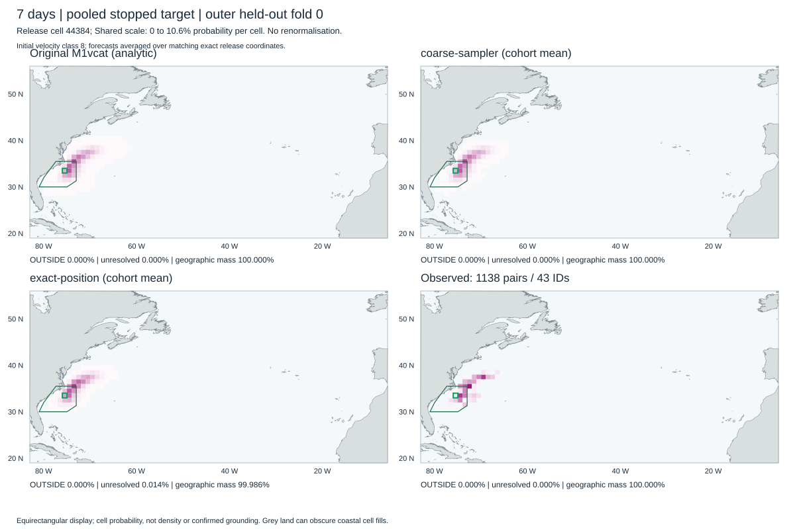
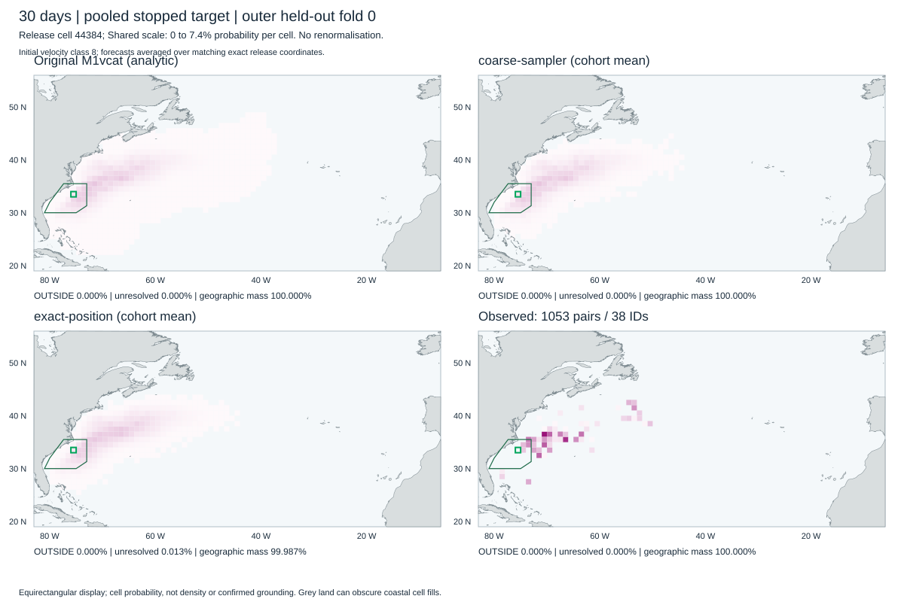

# M1vcat exact-position displacement refinement

## Research question and fixed comparison

Does retaining within-cell longitude/latitude during propagation improve 7/30-day destination-cell distributions? This round changes only the position propagation of the previous annual-pooled, drogue-pooled M1vcat. The same outer whole-ID fitting/held-out roles, fitting-only speed thresholds, nine velocity categories, lag/lambda choices, equal qualified-hourly-pair weights, stopped labels and 1-degree output grid are frozen. There is no hyperparameter retuning. No final-test trajectory was accessed. These repeatedly inspected development folds are not a new confirmatory evaluation.

## Exact mathematical change

For a source survivor donor (x_d,v_d)->(y_d,v'_d), compute WGS84 inverse-geodesic azimuth a_d and distance r_d from its actual origin x_d to endpoint y_d. At the current query/particle position x, set y=ForwardWGS84(x,a_d,r_d). Preserve y between iterations; map it to its 1-degree cell before the next step and carry the donor endpoint velocity class jointly. At the original source anchor, recover the exact observed endpoint. This is an empirical displacement model, not a continuous-velocity regression, MDN, kernel estimator or newly weighted neighbour model.

Sample each eligible fitting donor equally within its cell/class row. The source law is the unchanged (1-lambda)*local + lambda*cell-pooled mixture; an absent class uses the cell law, an absent cell uses U. E and U absorb. The coordinate-discarded sampler copies the native donor endpoint cell, so its law equals the old M1vcat analytically. Exact joint-law and all-row frequency checks are saved separately. At lambda=1 the position-refined model becomes its pooled displacement counterpart, not the old cell-only M1.

Source first-exit donors remain E. For source survivors, transfer each observed hourly displacement relative to the source origin to the particle anchor; any observed-hour exit from D becomes E even if the path later returns. A conservative WGS84 geodesic-ball proof accelerates paths strictly inside D without changing exit results. Synthetic land/nonfinite endpoints become U, not inferred grounding or dropped/renormalised mass. Intermediate path transfer is used for D exit only; no new coastal-fate model is introduced.

This tests the additional assumption that within-cell/class donor displacements transfer to a different exact anchor. It preserves coordinate offsets but does not learn a spatially varying velocity function within the cell. Source E risk remains coarse rather than being counterfactually reclassified. A positive or negative result should be interpreted under these limitations.

## Scores and numerical integration

The primary criterion is unchanged S=1-2*p(truth)+sum_k p_k^2, including U as an extra failed category. S is not percentage accuracy. For M independent particles, the collision estimator 1-2*n_truth/M+sum_k n_k*(n_k-1)/(M*(M-1)) is an unbiased integration estimate of the same limiting-law S. The ordinary S of the actually issued finite ensemble is reported alongside it. Its upward finite-M bias must not be mistaken for a model effect. Two independent 32-particle repeats are run, coupled between coarse/precise models with common random inputs. The repeat range reports Monte Carlo variation; two repeats alone do not provide a precise Monte Carlo confidence interval.

Lower S is better. Old-exact is the previous analytic operator. The coordinate-discarded coarse sampler is its numerical control. Old-exact footprint and mass diagnostics remain in the parent report; NA below does not mean zero.

| horizon_days | model | eligible_pairs | independent_ids | S_estimate | S_issued | repeat_range | U_mass_pct | E_mass_pct | issued90_hit_pct | issued90_available_pct | issued90_cells |
| --- | --- | --- | --- | --- | --- | --- | --- | --- | --- | --- | --- |
| 7 | coarse-sampler | 303288 | 385 | 0.921836 | 0.950927 | 4.48113e-05 | 0 | 0 | 76.4359 | 100 | 16.0044 |
| 7 | exact-position | 303288 | 385 | 0.914248 | 0.942757 | 0.000249969 | 0.328133 | 0.000788236 | 76.4036 | 99.1678 | 14.0593 |
| 7 | old-exact | 303288 | 385 | 0.921873 | 0.921873 | 0 | NA | NA | NA | NA | NA |
| 30 | coarse-sampler | 268998 | 337 | 0.985336 | 1.01614 | 8.7691e-06 | 0 | 0 | 33.0476 | 100 | 26.4858 |
| 30 | exact-position | 268998 | 337 | 0.985268 | 1.01602 | 0.000161636 | 0.530046 | 0.00654048 | 33.745 | 98.7097 | 26.0748 |
| 30 | old-exact | 268998 | 337 | 0.985249 | 0.985249 | 0 | NA | NA | NA | NA | NA |

## Fixed-fit paired-ID uncertainty

| horizon_days | comparison | delta_S | lower_95 | upper_95 |
| --- | --- | --- | --- | --- |
| 7 | exact-position minus coarse-sampler | -0.00758707 | -0.0105808 | -0.00470992 |
| 7 | exact-position minus old-exact | -0.00762455 | -0.0106629 | -0.00472378 |
| 7 | coarse-sampler minus old-exact | -3.7475e-05 | -0.000294534 | 0.000174438 |
| 30 | exact-position minus coarse-sampler | -6.72972e-05 | -0.00109148 | 0.00121663 |
| 30 | exact-position minus old-exact | 1.93668e-05 | -0.000995141 | 0.00130591 |
| 30 | coarse-sampler minus old-exact | 8.66641e-05 | -3.08508e-05 | 0.000200353 |

Intervals resample complete held-out IDs within old outer folds, conditional on fixed fits and settings. Particle repeats are averaged before resampling. Intervals do not account for refitting, researcher adaptation or all Monte Carlo uncertainty. Interpret any small improvement together with coarse-control error and repeat spread.

## Probability-region and spatial interpretation

Issued nominal-90% regions include cutoff ties and never renormalise U; if resolved mass is below 90%, the region is unavailable and the case remains in S. More or fewer sampled cells does not by itself establish a sharper limiting-law forecast. Zero sampled probability is not proven structural zero. No U sample is not proof that the limiting law has zero U. Formal limiting-law spatial completeness is unverified for particle forecasts, so no formal common-complete spatial superiority is claimed. Separately labelled issued-ensemble diagnostics retain the original Energy/100 km + squared ECEF cell-centre mean error/10000 reference. E/U receive no invented coordinates. These diagnostics use their own availability counts and are not a replacement selection loss.

## Traceability and reusable candidate

The compact cache retains native source keys, timestamps, exact positions/velocity atoms, per-ID ranges and qualified donor indices. Every ID's source target/reason digest and cell-pair frequencies reconcile with the sealed parent. All canonical data remain unchanged. The reusable candidate records the original full-development threshold, lag/lambda, cache digest and reconstruction function; it is not independently scored. Saved per-origin scores, ID summaries, sampling/backoff/exit audit, frozen choices and law closure permit inspection and reruns.

## Illustrative maps

The example cell/initial-velocity category is chosen by fitting-only 7-day pair support in fold 0. Each refined forecast starts from its own held-out exact origin; the map averages those forecasts across the matching release cohort. The observed panel uses exactly the same cohort. This is a cohort-average illustration, not a forecast from one arbitrarily chosen point. All panels share one probability scale. Full-D display can make small probabilities faint; cell probability is not continuous density. Seasonal, 365-day and grounding performance remain outside this experiment.

