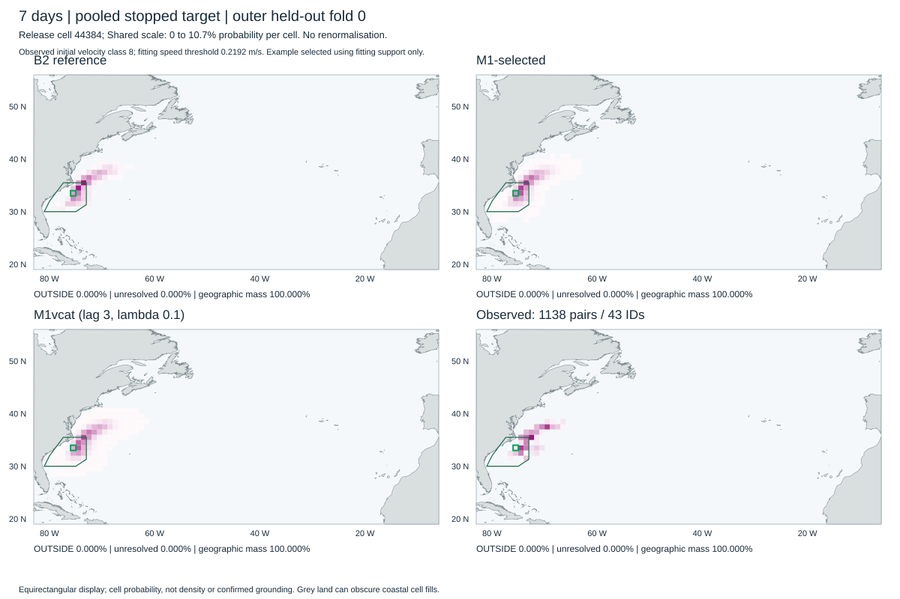
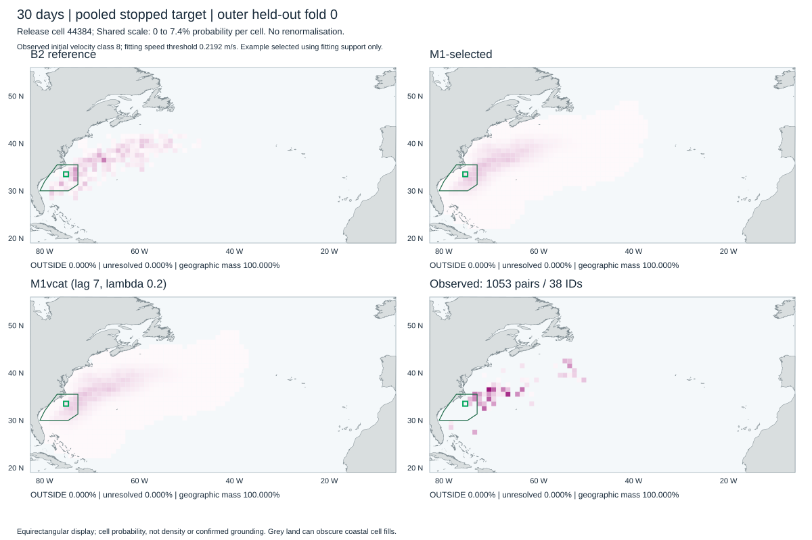

# M1vcat: annual-pooled categorical velocity transport

## Question and scope

Does retaining a compact categorical initial velocity state improve 7/30-day location distributions over the frozen cell-only M1? Inputs are the observed origin cell and velocity at release. Future held-out velocities or positions are never fed into propagation. This is a historical known-initial-velocity query; no claim is made for a release with unspecified velocity, operational rescue/oil forecasting, seasonal differences, confirmed grounding, or 365-day accuracy. No final test trajectory was accessed.

## Mathematical model

State S=(1-degree cell, velocity label). Label 0 is exact zero velocity and is not absorbing; labels 1..8 distinguish SW/SE/NW/NE and speed <= / > the fitting median. Axis ties use ve>=0, vn>=0. The median uses only positive speeds at qualified D hourly observations from fitting IDs; it is shared across every lag/remainder in that fit. The development-candidate threshold is 0.219894636293 m/s.

Local joint rows are multinomial frequency estimates. The cell-pooled joint law ignores source velocity while retaining destination velocity. Supported rows blend (1-lambda)*local + lambda*pooled. An unseen conditional row falls back to its fitting cell law; a wholly unsupported cell goes to U. Observed first exit E and unsupported U remain separate absorbing states. Exit and re-entry still produces stopped E. Missing follow-up is not an observed U outcome.

Propagation retains velocity between steps; the final map sums destination velocity probabilities within each cell. Exact remainder kernels are fitted separately with the same labels/IDs. At lambda=1 this construction degenerates to the corresponding old M1 location forecast. Raw classification is lambda=0 with the same explicit missing-row backoff.

## Estimation, selection and evidence

The empirical joint matrix maximises the row-multinomial likelihood; the CV-selected smoothed matrix is not claimed to maximise that unpenalised likelihood. The original outer-five/inner-four whole-ID folds are retained. Each horizon independently selects lag in {1,3,5,7} and lambda in {0,.1,...,1} by pooled inner-OOF, equal-hourly-pair-weighted S. Ties within 1e-12 prefer shorter lag, then larger lambda. Raw and cell-only controls select their own lag in the same inner folds. All candidate comparisons retain identical eligible physical cases.

The primary all-case score remains Brier/S, including unsupported forecast mass. The auxiliary linear + quadratic reference remains Energy/100 km + squared mean error/(100 km)^2, using the old ECEF cell-centre chord coordinates. It is available only under the unchanged complete in-domain forecast/outcome conditions. NA is not filled or silently dropped from primary scoring. Raw infinite log losses and zero-probability failures remain visible.

The cache partitions speed at the union of predeclared fit medians only to store lossless sufficient counts. A model merges those intervals using its own fitting median. Extra cache boundaries have no predictive effect. Summing velocity exactly restores the parent source counts; no canonical data column or value was changed or clipped.

## Outer held-ID results

Lower S is better. Coverage is an observed hit percentage for an issued nominal-90% probability region; S is not percentage accuracy. Regions include cutoff ties and do not renormalise U.

| horizon_days | model | brier_failure_penalized | region90_hit_pct_available | mean_region90_cells | zero_probability_pct | mean_unresolved_mass | spatial_common_pairs | linear_quadratic_reference_common |
| --- | --- | --- | --- | --- | --- | --- | --- | --- |
| 7 | B0 | 1.71002 | 14.4991 | 1 | 85.5009 | 0 | 303288 | 10.9065 |
| 7 | B1 | 0.979073 | 89.0312 | 48.5073 | 0.0675925 | 0 | 303288 | 14.1418 |
| 7 | B2 | 0.929001 | 87.439 | 18.2258 | 2.08218 | 0 | 303288 | 6.08546 |
| 7 | M1-selected | 0.927354 | 89.5429 | 19.9228 | 0.0319828 | 0 | 303288 | 6.1292 |
| 7 | M1vcat-raw | 0.921776 | 92.2189 | 20.7965 | 0.0158265 | 0 | 303288 | 5.4578 |
| 7 | M1vcat-selected | 0.921873 | 92.119 | 20.7883 | 0.024729 | 0 | 303288 | 5.49511 |
| 30 | B0 | 1.92755 | 3.6227 | 1 | 96.3773 | 0 | 263137 | 63.9618 |
| 30 | B1 | 0.991465 | 85.1798 | 136.294 | 1.09406 | 0 | 263137 | 47.8762 |
| 30 | B2 | 0.994751 | 66.3726 | 62.6083 | 17.4589 | 0 | 263137 | 34.6587 |
| 30 | M1-selected | 0.985785 | 87.3493 | 96.2339 | 0.153904 | 1.12726e-08 | 263137 | 34.8727 |
| 30 | M1vcat-raw | 0.985275 | 89.775 | 102.908 | 0.153904 | 3.79283e-09 | 263137 | 33.4839 |
| 30 | M1vcat-selected | 0.985249 | 89.6207 | 101.773 | 0.153904 | 5.19138e-09 | 263137 | 33.563 |

## Paired uncertainty

| horizon_days | comparison | delta_S | lower_95 | upper_95 |
| --- | --- | --- | --- | --- |
| 7 | M1vcat-selected minus M1-selected | -0.00548129 | -0.00667196 | -0.00436569 |
| 7 | M1vcat-selected minus M1vcat-raw | 9.72019e-05 | -0.000269479 | 0.000479249 |
| 7 | M1vcat-selected minus B2 | -0.00712785 | -0.00878613 | -0.00513041 |
| 30 | M1vcat-selected minus M1-selected | -0.000536267 | -0.000926997 | -0.000257338 |
| 30 | M1vcat-selected minus M1vcat-raw | -2.55794e-05 | -0.000114395 | 9.88085e-05 |
| 30 | M1vcat-selected minus B2 | -0.00950162 | -0.0113742 | -0.00757998 |

Intervals use 200 paired held-out-ID resamples within outer folds, conditional on saved fits and choices. They do not include refitting, model-selection or repeated-research uncertainty. These are development comparisons, not final-test results.

## Choices by outer fold

| outer_fold | model | horizon_days | lag_days | lambda_value |
| --- | --- | --- | --- | --- |
| 0 | M1vcat-selected | 7 | 3 | 0.1 |
| 0 | M1vcat-selected | 30 | 7 | 0.2 |
| 0 | M1vcat-raw | 7 | 3 | 0 |
| 0 | M1vcat-raw | 30 | 7 | 0 |
| 0 | M1-selected | 7 | 5 | 1 |
| 0 | M1-selected | 30 | 7 | 1 |
| 1 | M1vcat-selected | 7 | 3 | 0.2 |
| 1 | M1vcat-selected | 30 | 5 | 0.3 |
| 1 | M1vcat-raw | 7 | 3 | 0 |
| 1 | M1vcat-raw | 30 | 5 | 0 |
| 1 | M1-selected | 7 | 3 | 1 |
| 1 | M1-selected | 30 | 5 | 1 |
| 2 | M1vcat-selected | 7 | 5 | 0.3 |
| 2 | M1vcat-selected | 30 | 7 | 0.2 |
| 2 | M1vcat-raw | 7 | 3 | 0 |
| 2 | M1vcat-raw | 30 | 7 | 0 |
| 2 | M1-selected | 7 | 5 | 1 |
| 2 | M1-selected | 30 | 7 | 1 |
| 3 | M1vcat-selected | 7 | 3 | 0.2 |
| 3 | M1vcat-selected | 30 | 7 | 0.2 |
| 3 | M1vcat-raw | 7 | 3 | 0 |
| 3 | M1vcat-raw | 30 | 7 | 0 |
| 3 | M1-selected | 7 | 5 | 1 |
| 3 | M1-selected | 30 | 7 | 1 |
| 4 | M1vcat-selected | 7 | 3 | 0.2 |
| 4 | M1vcat-selected | 30 | 7 | 0.2 |
| 4 | M1vcat-raw | 7 | 3 | 0 |
| 4 | M1vcat-raw | 30 | 5 | 0 |
| 4 | M1-selected | 7 | 5 | 1 |
| 4 | M1-selected | 30 | 7 | 1 |

## Reusable development candidates

Selected lag/lambda by horizon: {7: (5, 0.3), 30: (7, 0.1)}. These candidates use fixed-candidate outer-OOF scores for final selection and are refitted on the development pool. The refits are not independently scored. All operator components, thresholds, ID roles and selected settings are saved.

## Interpretation and remaining limits

Compare M1vcat-selected with M1-selected and with the raw categorical model. Improvement after shrinkage does not prove every velocity category is well supported. Use row pair counts, independent IDs, dominant-ID fractions, backoff rates and U together. Continuous speed/direction information is still discretised; annual and drogue pooling remain deliberate benchmark assumptions. The observed held-out subset cannot establish calibrated exits if no positive exit outcomes are present.

Probability maps below are fitting-support-selected illustrations of the same origin cell/velocity class. Observed panels use only matching held-out release cases; a map is not the overall performance criterion. Sparse or unavailable observed panels are labelled honestly.

