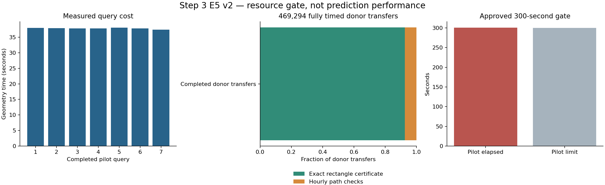

# Step 3 E5 v2 — Resource-Gate Result

**Status: CAPACITY_FAILED. Full E5 prediction experiment has not run.**

The approved resource gate stopped this attempt: `pilot_300_second_cap`. There is no basis to claim that analytic or continuous weights improved or worsened Brier, 90% region size or actual hit rate. Pilot examples are capacity measurements, not held-out scientific results.

## What was implemented

The actual-start displacement kernel, complete donor-mass/B2 fallback, conservative exact geometry certificates, standard query-level Brier, Fixed grid/analytic solvers, Adaptive grid/bounded continuous solvers, and declared finite quality search are implemented. Semantic verification covers geometry, probability conservation, objective/gradient identities and bounded selection. Full nested-CV orchestration, model comparison and complete fresh-run replay were not completed after the capacity gate failed.

## Measured resources

| Quantity | Observed |
|---|---:|
| Pilot wall time | 300.578 seconds |
| Approved pilot cap | 300 seconds |
| Peak RSS | 0.892 GiB |
| Completed / frozen pilot queries | 7 / 50 |
| Fully timed donor transfers | 469,294 |
| Mean completed-query geometry time | 37.850 seconds |
| Exact rectangle-certified transfers | 434,332 |
| Independent scalar transfer checks | 63 |
| Final-test reads / canonical training trajectory reads | 0 / 0 |

The last interrupted query is excluded from completed-query means and donor totals. Measurements include the extra donor-fold block needed by the outer cache; the inner forecast would only combine its three permitted fitting blocks. No donor sampling, rounded starts, smaller probability region or reduced CV was substituted.

Timing-only diagnostic for the measured 7-day cell 43663: 154.33 hours for that cell across outer query/donor pairs, using the observed mean rate, a factor-of-two reserve and ideal two-worker speedup. Only 7/8 planned queries in this stratum completed. This is an incomplete-sample extrapolation, not a full-run forecast, confidence interval, lower bound or measured total runtime; unmeasured strata and scoring are excluded. The actual stop is determined by the sealed capacity receipt.

## Requested prediction comparison

| Procedure | Outer Brier | Outer mean K90 | Outer H90 |
|---|---|---|---|
| Fixed grid | Not run | Not run | Not run |
| Fixed analytic | Not run | Not run | Not run |
| Adaptive grid | Not run | Not run | Not run |
| Adaptive continuous | Not run | Not run | Not run |

The full five-outer/four-inner CV, six-control regression, 72-contrast screen, 50,000 multiplier draws and prediction maps remain unperformed. No candidate was accepted or rejected on scientific quality. A resource failure does not show that displacement or off-grid weight optimisation is ineffective.

## Verification and decision

The independent audit receipt accompanies this report. Completed pilot transfers were compared with a scalar chronological geometry implementation. Synthetic tests establish implementation behaviour, not ocean prediction accuracy. The planned 5,000-real-transfer full-experiment audit and complete geometry/scoring replay were not run. Original source files and the approved plan remain protected; the stage ledger is unchanged.

The current implementation did not establish feasibility within the approved budget. Preserve the four solver implementations and measured bottleneck. The next discussion should address exact geometry acceleration or a separately approved computational design; do not rerun with wider limits, change the estimator, or proceed to full CV automatically.

## Provenance

- Approved plan: `docs/actual_origin_displacement_s3_e5_plan.md`, SHA256 `67afaa77db68bb66e924741cda3c760188be96b4b1843aa78309df11bf4d3fe3`.
- Pilot run: `actual_origin_disp_s3_e5_pilot_20261031T123704_492621Z`.
- Review run: `actual_origin_disp_s3_e5_review_20261031T124532_890893Z`.
- [Pilot capacity receipt](/Users/moonedgethug/Documents/UNSW/DATA3001/work_place/results/runs/actual_origin_disp_s3_e5_pilot_20261031T123704_492621Z/capacity.json).
- [Completed query timings](completed_query_timings.csv).
- [Frozen pilot roster](pilot_roster.csv).
- [Input workload](workload.csv).
- [Diagnostic resource projection](diagnostic_resource_projection.csv).
- [Independent review receipt](verification.json).
