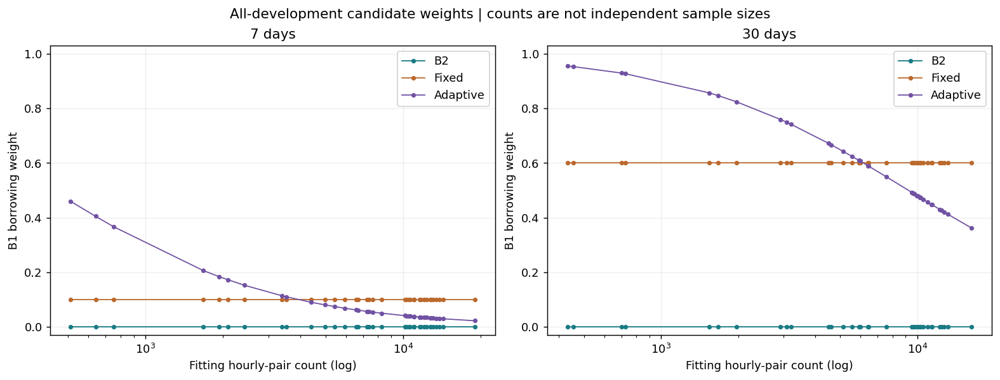
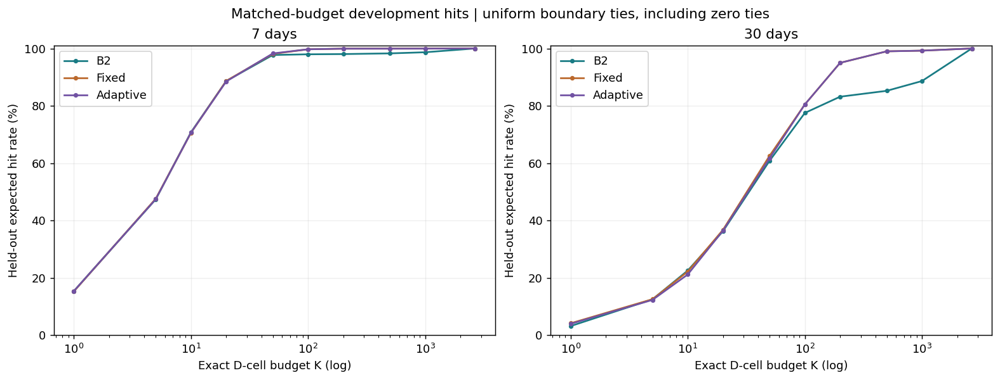
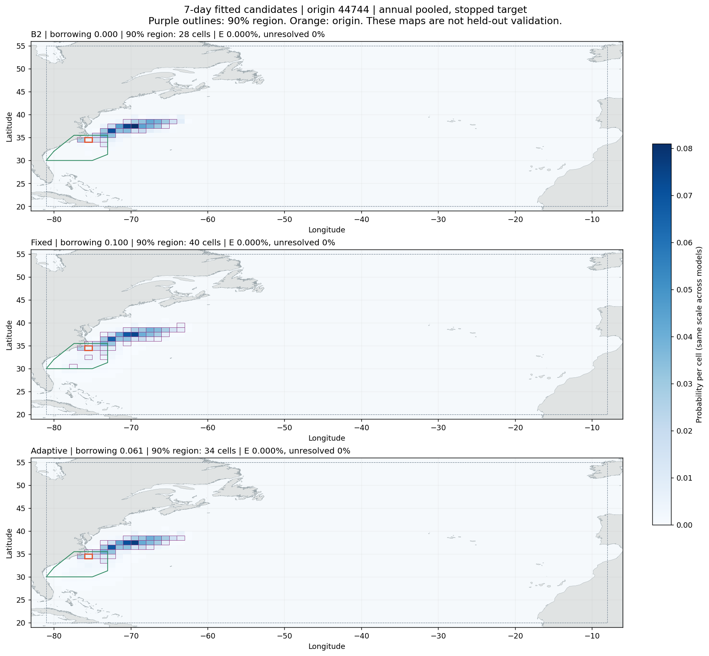
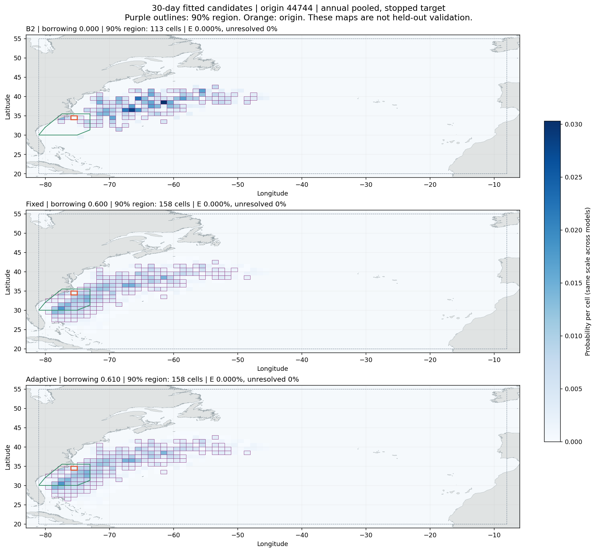

# Stage 2 — Fixed and Adaptive B2/B1 Shrinkage

Run: `adaptive_b2_b1_20261030T044950_931787Z`. E1 implementation and audit complete; scientific closure pending user review.

## Definitions

B2 uses fitting-origin frequencies. B1 pools eligible fitting-origin outcomes across R. Fixed uses one selected weight per horizon. Adaptive uses lambda_i=m*a/((1-a)*N_i+m*a), with m the fitting median positive row count. Both endpoints a=0/1 are explicit. All targets are stopped first-exit outcomes; E and missing follow-up remain distinct.

## Matched outer held-out results

| horizon_days | model | eligible_pairs | eligible_ids | brier | region90_cells | unsupported_pairs | region90_hit_pct | Brier_95_interval |
| --- | --- | --- | --- | --- | --- | --- | --- | --- |
| 7 | Adaptive | 303288 | 385 | 0.928765 | 20.9425 | 0 | 89.7939 | [0.921493, 0.936074] |
| 7 | B2 | 303288 | 385 | 0.929001 | 18.2258 | 0 | 87.439 | [0.920938, 0.936779] |
| 7 | Fixed | 303288 | 385 | 0.928607 | 25.6438 | 0 | 93.2912 | [0.921578, 0.935612] |
| 30 | Adaptive | 268998 | 337 | 0.988806 | 122.186 | 0 | 85.8426 | [0.987446, 0.990580] |
| 30 | B2 | 268998 | 337 | 0.994751 | 62.6083 | 0 | 66.3726 | [0.992129, 0.997997] |
| 30 | Fixed | 268998 | 337 | 0.988819 | 126.406 | 0 | 86.4285 | [0.987545, 0.990426] |

90% region size and hits use the same evaluable, pair-weighted cases. Hits are percentages in this table; saved numeric CSV fields use fractions.

## Paired differences

| horizon_days | comparison | metric | difference | lower_95 | upper_95 | defined_replicates | undefined_replicates |
| --- | --- | --- | --- | --- | --- | --- | --- |
| 7 | Adaptive - Fixed | brier | 0.000157482 | -0.000395041 | 0.000967364 | 200 | 0 |
| 7 | Adaptive - Fixed | region90_cells | -4.70122 | -5.04941 | -4.39402 | 200 | 0 |
| 7 | Adaptive - Fixed | region90_hit | -0.0349734 | -0.0408631 | -0.02994 | 200 | 0 |
| 7 | Adaptive - B2 | brier | -0.000235974 | -0.00121667 | 0.00104791 | 200 | 0 |
| 7 | Adaptive - B2 | region90_cells | 2.71672 | 2.3745 | 3.16553 | 200 | 0 |
| 7 | Adaptive - B2 | region90_hit | 0.0235486 | 0.0203981 | 0.0271549 | 200 | 0 |
| 30 | Adaptive - Fixed | brier | -1.26357e-05 | -0.000319204 | 0.000341412 | 200 | 0 |
| 30 | Adaptive - Fixed | region90_cells | -4.21977 | -4.79242 | -3.57335 | 200 | 0 |
| 30 | Adaptive - Fixed | region90_hit | -0.00585878 | -0.00853271 | -0.00294893 | 200 | 0 |
| 30 | Adaptive - B2 | brier | -0.00594482 | -0.00791059 | -0.00431715 | 200 | 0 |
| 30 | Adaptive - B2 | region90_cells | 59.5779 | 57.9864 | 61.1392 | 200 | 0 |
| 30 | Adaptive - B2 | region90_hit | 0.1947 | 0.179242 | 0.210438 | 200 | 0 |

Region-hit differences in the table above are fractions; multiply by 100 for percentage points. Negative Brier/cell differences favor Adaptive; positive hit differences favor Adaptive.

7 days: the prespecified joint point-estimate screen is not met. Adaptive minus Fixed: Brier +0.000157; region cells -4.701; actual hits -3.497 percentage points. Read paired intervals before interpreting strength of evidence.
30 days: the prespecified joint point-estimate screen is not met. Adaptive minus Fixed: Brier -0.000013; region cells -4.220; actual hits -0.586 percentage points. Read paired intervals before interpreting strength of evidence.

## Selected parameters

| role | horizon_days | model | parameter_a | selection_brier |
| --- | --- | --- | --- | --- |
| outer_0 | 7 | Adaptive | 0.05 | 0.930529 |
| outer_0 | 7 | Fixed | 0.15 | 0.930608 |
| outer_0 | 30 | Adaptive | 0.7 | 0.989745 |
| outer_0 | 30 | Fixed | 0.7 | 0.989804 |
| outer_1 | 7 | Adaptive | 0.05 | 0.935096 |
| outer_1 | 7 | Fixed | 0.15 | 0.934818 |
| outer_1 | 30 | Adaptive | 0.7 | 0.990413 |
| outer_1 | 30 | Fixed | 0.7 | 0.990622 |
| outer_2 | 7 | Adaptive | 0.05 | 0.927279 |
| outer_2 | 7 | Fixed | 0.1 | 0.926991 |
| outer_2 | 30 | Adaptive | 0.65 | 0.988755 |
| outer_2 | 30 | Fixed | 0.65 | 0.98876 |
| outer_3 | 7 | Adaptive | 0.05 | 0.933416 |
| outer_3 | 7 | Fixed | 0.15 | 0.933441 |
| outer_3 | 30 | Adaptive | 0.6 | 0.9898 |
| outer_3 | 30 | Fixed | 0.65 | 0.98997 |
| outer_4 | 7 | Adaptive | 0.05 | 0.931022 |
| outer_4 | 7 | Fixed | 0.1 | 0.930673 |
| outer_4 | 30 | Adaptive | 0.65 | 0.987973 |
| outer_4 | 30 | Fixed | 0.65 | 0.987982 |
| all_development_candidate | 7 | Adaptive | 0.05 | 0.928765 |
| all_development_candidate | 7 | Fixed | 0.1 | 0.928463 |
| all_development_candidate | 30 | Adaptive | 0.55 | 0.988632 |
| all_development_candidate | 30 | Fixed | 0.6 | 0.988649 |

Outer parameters come from four inner groups. All-development candidate parameters use five-fold base out-of-fold tuning; their selection scores are not final-refit validation.

## Figures

Illustration origin 44744 was selected only by fitting-ID support, using the frozen S1 rule.









## Numerical audit

{"budget_arithmetic_reproduced": true, "candidate_selection_reproduced": true, "fitting_roles_checked": 26, "frozen_s1_regression": {"historical_predictions_used_for_fitting": false, "matrix_tables": 12, "passed": true, "phase": "post_computation_audit_only", "reference_run": "empirical_b2_20261029T121555_976173Z", "sealed_artifacts_verified": 38}, "independent_counts_reconciled": true, "matched_heldout_cases_reconciled": true, "max_brier_error": 6.661338147750939e-16, "max_candidate_brier_error": 5.573738022202716e-16, "max_probability_error": 5.551115123125783e-17, "region_arithmetic_reproduced": true, "whole_ID_leakage": false}

## Limits

- Five outer / four inner whole-ID development validation on previously examined development data; not independent final-test evidence. The final test remains locked.
- Selection uses only inner pair-weighted standard Brier on a common support mask. Region size and hits do not select parameters. The two horizons have different eligible populations.
- A is selected on 21 values per family/horizon. Adaptive uses the fitting median pair count as its reference scale; no independent per-cell weights are optimized.
- Hourly and overlapping pairs are correlated. 200 paired whole-ID intervals condition on saved fits and omit refitting, parameter-selection and research-selection uncertainty; no multiplicity adjustment.
- A smaller nominal 90% region is not a gain if achieved by losing actual coverage. Brier is not an accuracy percentage or a geographic-distance measure.
- 90% regions retain cutoff ties. E is an outcome, never a geographic cell. Region counts are not square kilometres.
- Exact-budget curves average uniformly over boundary ties; zero-probability ties are uninformed allocations, not newly supported predictions. Exit truths are excluded only from these D-cell budget curves and reported in primary score denominators.
- Unsupported origin rows remain unsupported for all models, even if B1 exists. Supported rows retain all blended probability; no threshold clipping or tail renormalization.
- No observed exits establishes no exit calibration. B1 and B2 share fitting data, so this is a regularized point estimator, not a validated full Bayesian uncertainty model.
- All-development maps and selected full-development parameters are illustrative refits; their tuning scores are not independent validation. No S2 closure or next-stage work is automatic.

## Artifacts and reproduction

[summary.csv](summary.csv), [paired_differences.csv](paired_differences.csv), [bootstrap_intervals.csv](bootstrap_intervals.csv), [selected_parameters.csv](selected_parameters.csv), [parameter_search.csv](parameter_search.csv), [row_support.csv](row_support.csv), [cell_summary.csv](cell_summary.csv), [budget_boundaries.parquet](budget_boundaries.parquet), [heldout_scores.parquet](heldout_scores.parquet), [fit_roles.json](fit_roles.json), [config.json](config.json)

```sh
.venv/bin/python -B -m data3001.modelling.baselines.run_adaptive_b2_b1
.venv/bin/python -B -m data3001.modelling.baselines.run_adaptive_b2_b1 --replay-of adaptive_b2_b1_20261030T044950_931787Z
```
