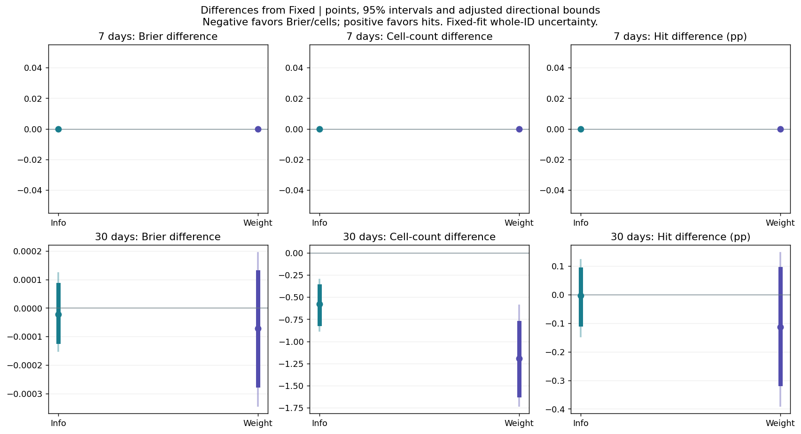
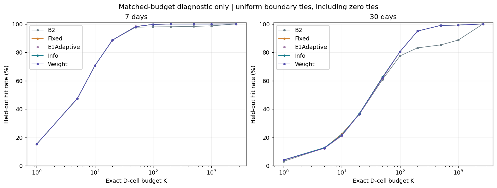
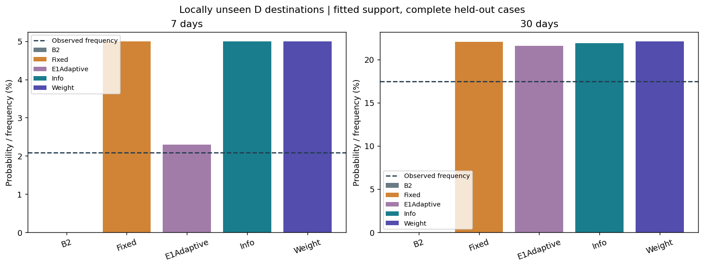
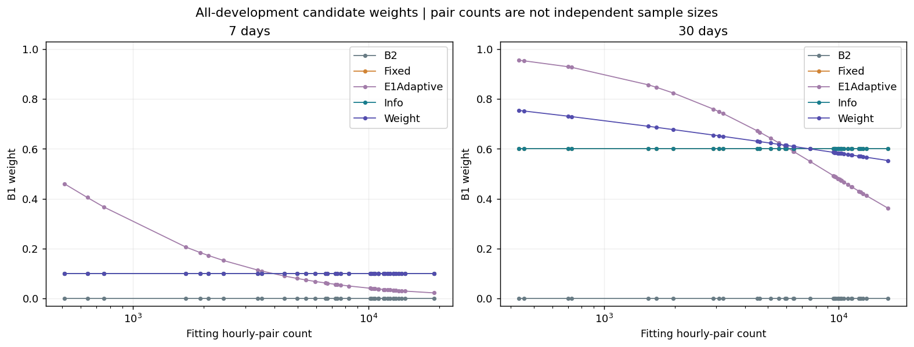
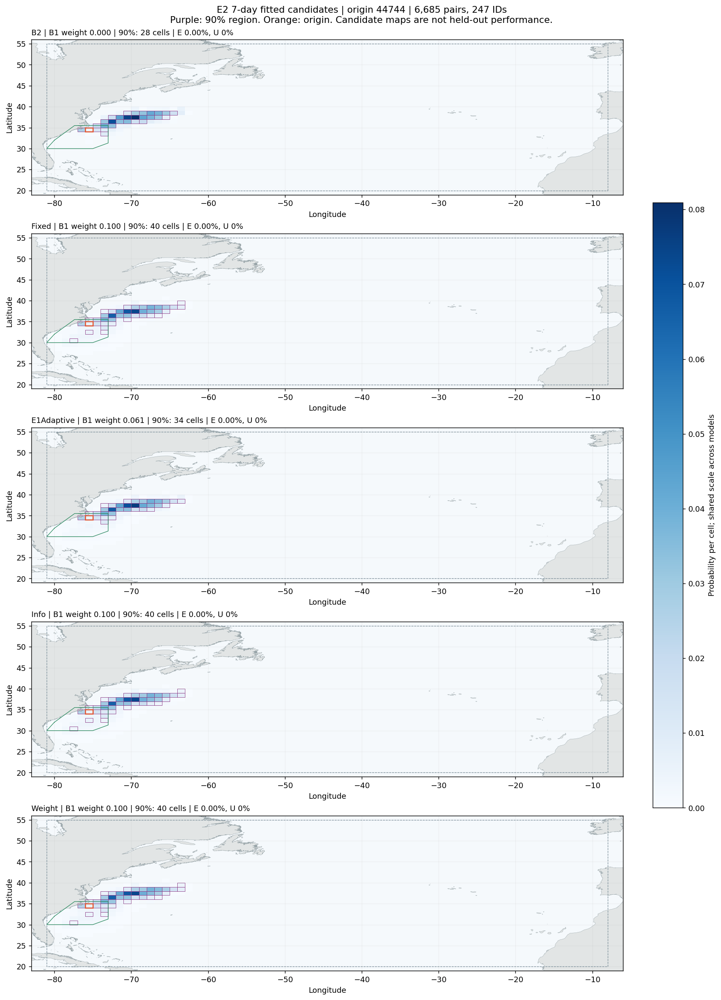
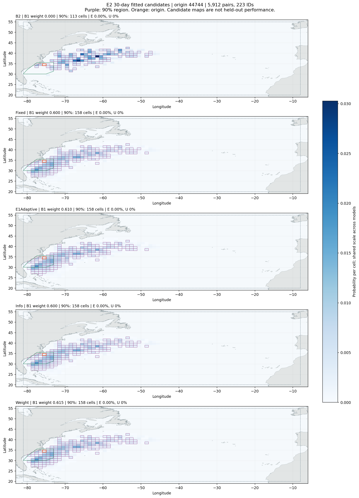

# Step 2 — E2 B1 Allocation and Weight Control

Run: `b2_b1_e2_20261030T060621_291294Z`. Executed and audited; scientific closure pending user review.

## Main findings

7 days, Info versus Fixed: no_change; Brier +0.00000000, 90% cells +0.000, actual hits +0.000 percentage points.
7 days, Weight versus Fixed: no_change; Brier +0.00000000, 90% cells +0.000, actual hits +0.000 percentage points.
30 days, Info versus Fixed: no_improvement_or_tradeoff; Brier -0.00002200, 90% cells -0.579, actual hits -0.004 percentage points.
30 days, Weight versus Fixed: no_improvement_or_tradeoff; Brier -0.00007188, 90% cells -1.193, actual hits -0.114 percentage points.

## Matched outer development results

| horizon_days | model | evaluable_pairs | evaluable_ids | brier | region90_cells | unsupported_pairs | region90_hit_percent |
| --- | --- | --- | --- | --- | --- | --- | --- |
| 7 | B2 | 303288 | 385 | 0.929001 | 18.2258 | 0 | 87.439 |
| 7 | E1Adaptive | 303288 | 385 | 0.928765 | 20.9425 | 0 | 89.7939 |
| 7 | Fixed | 303288 | 385 | 0.928607 | 25.6438 | 0 | 93.2912 |
| 7 | Info | 303288 | 385 | 0.928607 | 25.6438 | 0 | 93.2912 |
| 7 | Weight | 303288 | 385 | 0.928607 | 25.6438 | 0 | 93.2912 |
| 30 | B2 | 268998 | 337 | 0.994751 | 62.6083 | 0 | 66.3726 |
| 30 | E1Adaptive | 268998 | 337 | 0.988806 | 122.186 | 0 | 85.8426 |
| 30 | Fixed | 268998 | 337 | 0.988819 | 126.406 | 0 | 86.4285 |
| 30 | Info | 268998 | 337 | 0.988797 | 125.827 | 0 | 86.4241 |
| 30 | Weight | 268998 | 337 | 0.988747 | 125.213 | 0 | 86.314 |

Rows use the same supported cases within each horizon and retain original pair multiplicities. The two horizons have different eligible populations.

## Differences and uncertainty

| horizon_days | model | reference | metric | difference | lower_95 | upper_95 | adjusted_lower | adjusted_upper | defined_replicates | undefined_replicates |
| --- | --- | --- | --- | --- | --- | --- | --- | --- | --- | --- |
| 7 | Info | Fixed | brier | 0 | 0 | 0 | 0 | 0 | 5000 | 0 |
| 7 | Info | Fixed | region90_cells | 0 | 0 | 0 | 0 | 0 | 5000 | 0 |
| 7 | Info | Fixed | region90_hit | 0 | 0 | 0 | 0 | 0 | 5000 | 0 |
| 7 | Weight | Fixed | brier | 0 | 0 | 0 | 0 | 0 | 5000 | 0 |
| 7 | Weight | Fixed | region90_cells | 0 | 0 | 0 | 0 | 0 | 5000 | 0 |
| 7 | Weight | Fixed | region90_hit | 0 | 0 | 0 | 0 | 0 | 5000 | 0 |
| 30 | Info | Fixed | brier | -2.20042e-05 | -0.000117571 | 8.06605e-05 | -0.000150903 | 0.000122662 | 5000 | 0 |
| 30 | Info | Fixed | region90_cells | -0.579331 | -0.801476 | -0.377311 | -0.87906 | -0.303292 | 5000 | 0 |
| 30 | Info | Fixed | region90_hit | -4.461e-05 | -0.00103903 | 0.00087449 | -0.00146299 | 0.00120044 | 5000 | 0 |
| 30 | Weight | Fixed | brier | -7.18829e-05 | -0.000270899 | 0.000125537 | -0.000343041 | 0.000193522 | 5000 | 0 |
| 30 | Weight | Fixed | region90_cells | -1.19302 | -1.60667 | -0.790624 | -1.72788 | -0.595461 | 5000 | 0 |
| 30 | Weight | Fixed | region90_hit | -0.00114499 | -0.00312742 | 0.000887825 | -0.00389441 | 0.00145735 | 5000 | 0 |

Hit differences in the CSV/table are fractions; multiply by 100 for percentage points. Adjusted bounds use one-sided tail 0.05/12.

## Methods

Fixed is original B1/B2 with a Brier-selected constant weight. Info scales B1 probabilities of locally unseen D destinations by c, renormalises within the original D mass and preserves E. Weight uses lambda=a/[a+(1-a)(N/m)^beta]. B2 and E1Adaptive are fresh controls.

A={0,0.05,...,1}; C={0.5,0.75,1,1.5,2}; Beta={0,0.25,0.5,0.75,1}. Each new arm has 105 candidates. Five outer/four inner whole-ID groups isolate parameter selection. Exact Fixed fallback occurs when no candidate passes quality constraints with a strict size gain.

## Selected parameters

| role | horizon_days | model | parameter_a | parameter_c | parameter_beta | selection_status |
| --- | --- | --- | --- | --- | --- | --- |
| outer_0 | 7 | Fixed | 0.15 | 1 | 0 | brier_control |
| outer_0 | 7 | E1Adaptive | 0.05 | 1 | 1 | brier_control |
| outer_0 | 7 | Info | 0.15 | 1 | 0 | fallback_fixed |
| outer_0 | 7 | Weight | 0.15 | 1 | 0 | fallback_fixed |
| outer_0 | 30 | Fixed | 0.7 | 1 | 0 | brier_control |
| outer_0 | 30 | E1Adaptive | 0.7 | 1 | 1 | brier_control |
| outer_0 | 30 | Info | 0.7 | 1 | 0 | fallback_fixed |
| outer_0 | 30 | Weight | 0.7 | 1 | 0.5 | constrained_gain |
| outer_1 | 7 | Fixed | 0.15 | 1 | 0 | brier_control |
| outer_1 | 7 | E1Adaptive | 0.05 | 1 | 1 | brier_control |
| outer_1 | 7 | Info | 0.15 | 1 | 0 | fallback_fixed |
| outer_1 | 7 | Weight | 0.15 | 1 | 0 | fallback_fixed |
| outer_1 | 30 | Fixed | 0.7 | 1 | 0 | brier_control |
| outer_1 | 30 | E1Adaptive | 0.7 | 1 | 1 | brier_control |
| outer_1 | 30 | Info | 0.7 | 1 | 0 | fallback_fixed |
| outer_1 | 30 | Weight | 0.7 | 1 | 0.25 | constrained_gain |
| outer_2 | 7 | Fixed | 0.1 | 1 | 0 | brier_control |
| outer_2 | 7 | E1Adaptive | 0.05 | 1 | 1 | brier_control |
| outer_2 | 7 | Info | 0.1 | 1 | 0 | fallback_fixed |
| outer_2 | 7 | Weight | 0.1 | 1 | 0 | fallback_fixed |
| outer_2 | 30 | Fixed | 0.65 | 1 | 0 | brier_control |
| outer_2 | 30 | E1Adaptive | 0.65 | 1 | 1 | brier_control |
| outer_2 | 30 | Info | 0.65 | 1 | 0 | fallback_fixed |
| outer_2 | 30 | Weight | 0.65 | 1 | 0 | fallback_fixed |
| outer_3 | 7 | Fixed | 0.15 | 1 | 0 | brier_control |
| outer_3 | 7 | E1Adaptive | 0.05 | 1 | 1 | brier_control |
| outer_3 | 7 | Info | 0.15 | 1 | 0 | fallback_fixed |
| outer_3 | 7 | Weight | 0.15 | 1 | 0 | fallback_fixed |
| outer_3 | 30 | Fixed | 0.65 | 1 | 0 | brier_control |
| outer_3 | 30 | E1Adaptive | 0.6 | 1 | 1 | brier_control |
| outer_3 | 30 | Info | 0.75 | 0.75 | 0 | constrained_gain |
| outer_3 | 30 | Weight | 0.65 | 1 | 1 | constrained_gain |
| outer_4 | 7 | Fixed | 0.1 | 1 | 0 | brier_control |
| outer_4 | 7 | E1Adaptive | 0.05 | 1 | 1 | brier_control |
| outer_4 | 7 | Info | 0.1 | 1 | 0 | fallback_fixed |
| outer_4 | 7 | Weight | 0.1 | 1 | 0 | fallback_fixed |
| outer_4 | 30 | Fixed | 0.65 | 1 | 0 | brier_control |
| outer_4 | 30 | E1Adaptive | 0.65 | 1 | 1 | brier_control |
| outer_4 | 30 | Info | 0.65 | 1 | 0 | fallback_fixed |
| outer_4 | 30 | Weight | 0.65 | 1 | 0 | fallback_fixed |
| all_development_candidate | 7 | Fixed | 0.1 | 1 | 0 | brier_control |
| all_development_candidate | 7 | E1Adaptive | 0.05 | 1 | 1 | brier_control |
| all_development_candidate | 7 | Info | 0.1 | 1 | 0 | fallback_fixed |
| all_development_candidate | 7 | Weight | 0.1 | 1 | 0 | fallback_fixed |
| all_development_candidate | 30 | Fixed | 0.6 | 1 | 0 | brier_control |
| all_development_candidate | 30 | E1Adaptive | 0.55 | 1 | 1 | brier_control |
| all_development_candidate | 30 | Info | 0.6 | 1 | 0 | fallback_fixed |
| all_development_candidate | 30 | Weight | 0.6 | 1 | 0.25 | constrained_gain |

Outer selections assess the complete nested procedure. All-development selections happen only after outer predictions have been frozen, and have no independent performance score.

## Figures

Illustration origin: 44744; selected only from fitting support.

## Audit

{"bootstrap": {"adjusted_bounds_verified": true, "classification_verified": true, "maximum_draw_error": 1.4210854715202004e-14, "paired_ID_draws_reproduced": true}, "candidate_rows_checked": 12600, "complete_case_scores_verified": true, "fitting_roles_checked": 26, "frozen_regressions": {"heldout_comparators": 3, "matrix_tables_compared": 18, "passed": true, "sealed_artifacts_verified": {"adaptive_b2_b1_20261030T044950_931787Z": 129, "empirical_b2_20261029T121555_976173Z": 38}}, "independent_selection_verified": true, "maximum_candidate_metric_error": 4.2435306276585946e-16, "maximum_errors": {"brier": 6.661338147750939e-16, "diagnostics": 2.220446049250313e-16, "probability": 1.1102230246251565e-16}, "outer_predictions_unchanged_after_all_development_tuning": true, "persisted_matrices_verified": true, "regions_and_budgets_verified": true, "whole_ID_leakage": false}

## Limits

- This is development evidence on previously examined IDs, not final-test validation. No final-test trajectories were read.
- Selection uses inner Brier/hit constraints and strictly smaller 90% regions versus a Brier-selected Fixed anchor. It does not guarantee the constraints on outer cases.
- Info adjusts only B1 D allocation, preserving B1 E mass and positive support. Weight changes only the pair-count slope. The two changes were not combined.
- The 90% level is fixed; the full distribution and all eligible observed outcomes are retained. Nominal probability is not actual coverage, and cell count is not area.
- 5,000 paired whole-ID bootstrap draws hold fits and selections fixed. They omit refitting, training-overlap and research-adaptation uncertainty. Adjusted bounds are a conservative conditional development screen, not a formal population non-inferiority proof.
- A point-estimate pass with bounds allowing quality deterioration remains inconclusive. The practical Brier and hit margins are zero.
- All-development maps use a support-only selected origin and are illustrative refits. Their parameters can differ from the outer-fold procedure.
- Unsupported rows have no forecast or Brier for every model. Empirical zeros are scored normally; no B1 fallback or tail deletion is used.
- No observed exits means exit calibration remains unestablished. Later combined models and S2 closure require user review.

## Artifacts

[Summary](summary.csv) · [Differences](paired_differences.csv) · [Decisions](decisions.csv) · [Selected parameters](selected_parameters.csv) · [Candidate search](parameter_search.csv) · [Diagnostics](diagnostics.csv) · [Region changes](region_changes.csv) · [Held-out scores](heldout_scores.parquet)
