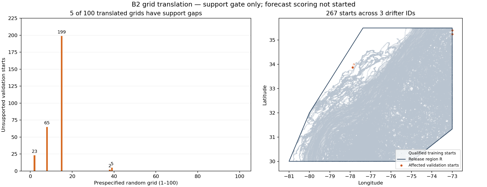
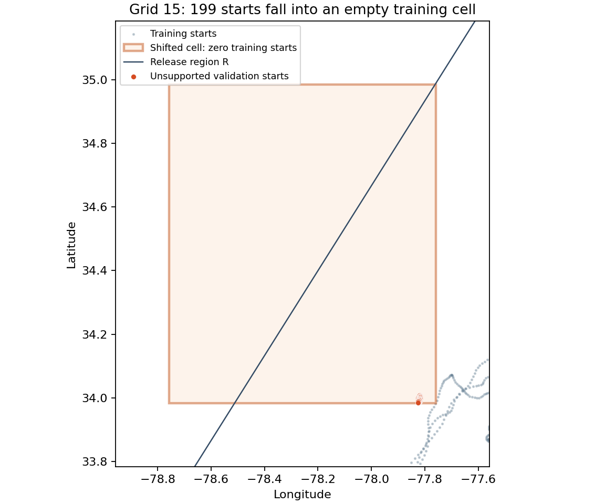

# B2 网格变换：支撑检查未通过，正式实验暂停

Run: `b2_grid_translation_20261106T224126_700036Z`。这是资源试跑前段的支撑诊断，**不是完整实验结果**。

原始 B2 对全部 33,971 个验证起点均有训练支撑。100 个平移网格中，95 个完整支撑，5 个出现缺口。跨网格去重后涉及 **267 个起点（0.7860%）/ 3 条 drifter**，占 drifter 等权评估权重 **0.5851%**。

| 平移编号 | 无支撑起点数 | 涉及 drifter 数 | 评估权重占比 |
|---|---:|---:|---:|
| 2 | 23 | 1 | 0.0496% |
| 8 | 65 | 1 | 0.1402% |
| 15 | 199 | 1 | 0.4293% |
| 38 | 2 | 2 | 0.0133% |
| 39 | 5 | 1 | 0.0108% |

表中是逐网格计数：合计 294 个“网格—起点”组合，不能当作 294 个不同起点。267 个起点中，240 个缺 1 个分量，27 个缺 2 个分量；其余平移网格并非全部失效。

## 原因与处理

网格移动后，部分验证起点被划入历史训练起点未进入的格子，因此该 B2 行的分母为零，无法形成经验概率。原始网格没有此问题。

按已批准合同第 5 节，完整支撑检查不通过时暂停正式评分：不回退、不删除样本、不重新分配 1/100 权重，也不重新抽取更有利的网格。真实验证落点和锁定最终测试数据均未读取。

**Brier、90% 实际命中率和面积尚未计算。不能据此判断随机平移改善或损害预测质量。** 几何精度与完整资源试跑也未开始，因此尚无可靠的完整实验耗时估计。

## 复核与资源

11 项基础/回归测试通过。独立实现重新构建全部 101 张计数表，核对 3,431,071 个网格—起点支撑记录，计数及支撑差异均为零；核对随机种子、评估权重及输入哈希。

独立审计首次对较大原始 drifter ID 进行整数打包时发生溢出；修正为一一对应的紧凑 ID 编码，并增加回归测试后复核通过。该修正只涉及校验实现，未改变主运行计数、ID 分组、模型或实验定义。失败记录与原代码已保留。

支撑检查与初始测试累计 **3.593 秒**；独立复核（含失败尝试和回归测试）累计 **3.354 秒**。支撑阶段峰值进程树内存 **0.381 GiB**。此阶段远低于预算，暂停原因是无支撑规则，不是耗时。

## 可视化

后续继续需要先审议无支撑规则并明确批准修改；本次没有实施替代处理。现有代码交付范围为分箱、计数、支撑门槛、独立复核及诊断报告，完整几何重映射与正式评分流程未开发/运行。
