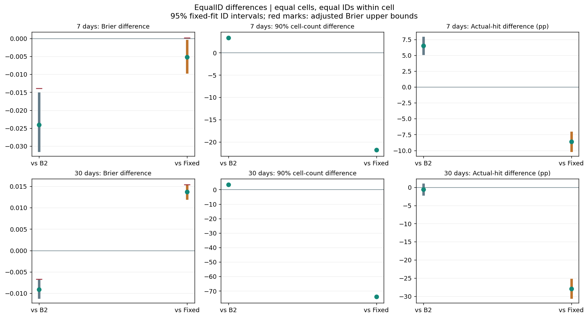
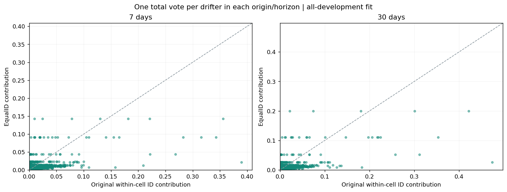
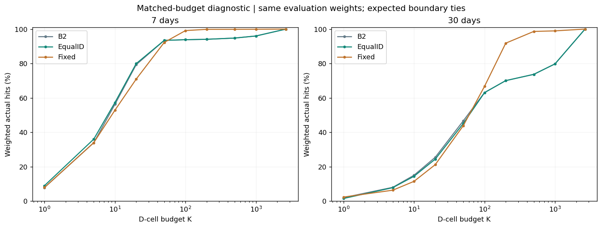
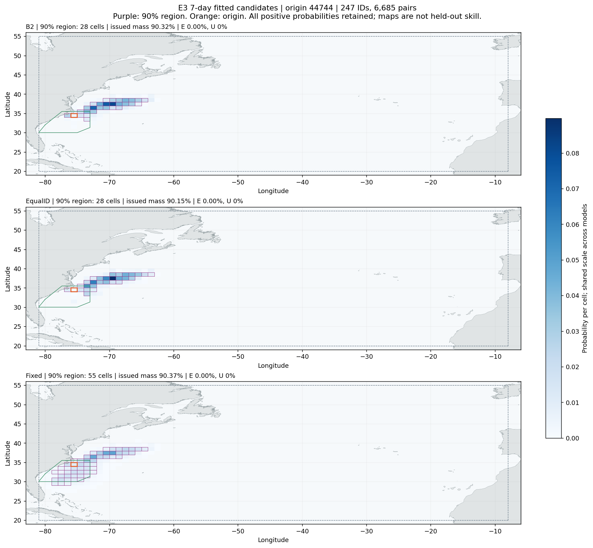
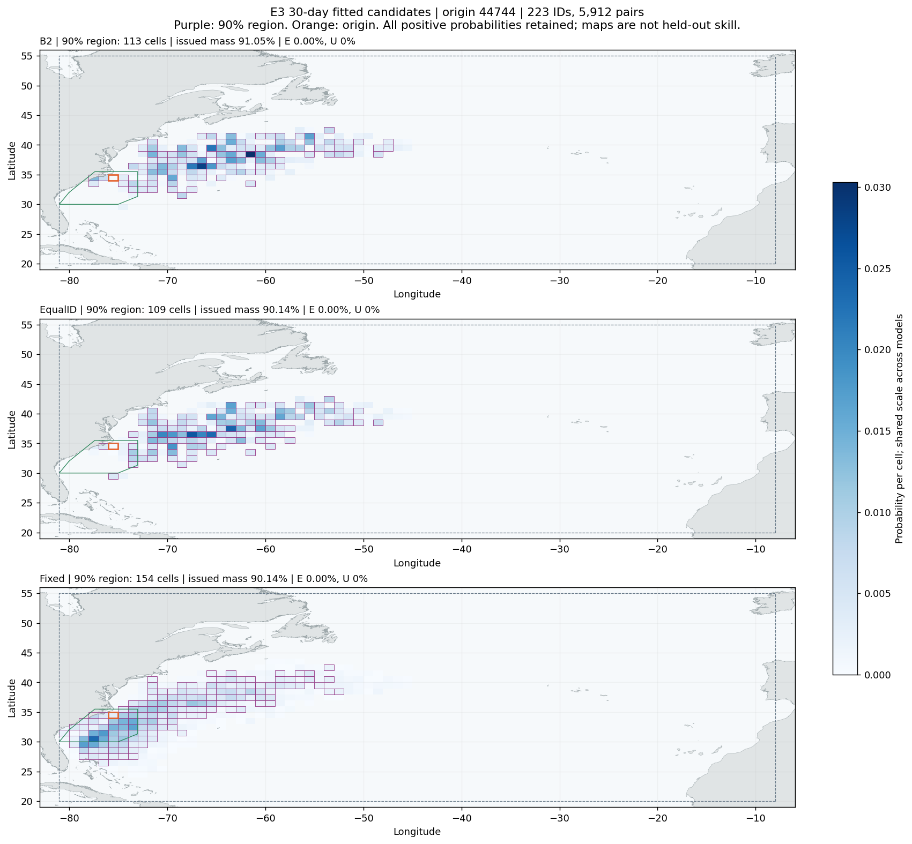

# Step 2 — E3 Equal-drifter Destination Estimation

Run: drifter_shrinkage_e3_20261030T074159_751985Z. Executed and independently audited; scientific review pending.

## Findings

7 days, EqualID versus B2: conditional_development_Brier_support. Brier change -0.02403023; 90% cells +3.348; actual hits +6.531 percentage points. Region/hit trade-off: True.
7 days, EqualID versus Fixed: point_improvement_uncertain. Brier change -0.00519088; 90% cells -21.805; actual hits -8.587 percentage points. Region/hit trade-off: True.
30 days, EqualID versus B2: conditional_development_Brier_support. Brier change -0.00911665; 90% cells +3.355; actual hits -0.598 percentage points. Region/hit trade-off: True.
30 days, EqualID versus Fixed: no_measurable_Brier_gain. Brier change +0.01376666; 90% cells -73.932; actual hits -27.908 percentage points. Region/hit trade-off: True.

## Primary held-out results

| horizon_days | model | evaluable_cells | evaluable_ids | evaluable_id_cells | evaluable_pairs | brier | region90_cells | target_availability | zero_true_probability | actual_hits_percent |
| --- | --- | --- | --- | --- | --- | --- | --- | --- | --- | --- |
| 7 | B2 | 37 | 385 | 4451 | 303288 | 0.981297 | 17.5583 | 1 | 0.0634891 | 74.8378 |
| 7 | EqualID | 37 | 385 | 4451 | 303288 | 0.957266 | 20.9063 | 1 | 0.0634891 | 81.3692 |
| 7 | Fixed | 37 | 385 | 4451 | 303288 | 0.962457 | 42.7116 | 1 | 0.00152198 | 89.9558 |
| 30 | B2 | 37 | 337 | 3974 | 268998 | 1.01781 | 56.5707 | 1 | 0.314331 | 50.2761 |
| 30 | EqualID | 37 | 337 | 3974 | 268998 | 1.0087 | 59.9257 | 1 | 0.314331 | 49.678 |
| 30 | Fixed | 37 | 337 | 3974 | 268998 | 0.994931 | 133.858 | 1 | 0.014935 | 77.5861 |

The horizons have distinct eligible populations. Evaluation is equal-cell, equal-ID within each cell.

## Paired differences and conditional uncertainty

| horizon_days | model | reference | metric | difference | lower_95 | upper_95 | adjusted_upper | defined_replicates |
| --- | --- | --- | --- | --- | --- | --- | --- | --- |
| 7 | EqualID | B2 | brier | -0.0240302 | -0.0312012 | -0.0153633 | -0.0139527 | 5000 |
| 7 | EqualID | B2 | region90_cells | 3.34803 | 3.31343 | 3.3835 | NA | 5000 |
| 7 | EqualID | B2 | region90_hit | 0.0653143 | 0.0525277 | 0.0777519 | NA | 5000 |
| 7 | EqualID | Fixed | brier | -0.00519088 | -0.00938823 | -0.000659936 | 0.000195051 | 5000 |
| 7 | EqualID | Fixed | region90_cells | -21.8053 | -21.9102 | -21.684 | NA | 5000 |
| 7 | EqualID | Fixed | region90_hit | -0.0858663 | -0.100078 | -0.0721841 | NA | 5000 |
| 7 | Fixed | B2 | brier | -0.0188394 | -0.0238566 | -0.0129536 | NA | 5000 |
| 7 | Fixed | B2 | region90_cells | 25.1534 | 25.0425 | 25.2484 | NA | 5000 |
| 7 | Fixed | B2 | region90_hit | 0.151181 | 0.136563 | 0.166269 | NA | 5000 |
| 30 | EqualID | B2 | brier | -0.00911665 | -0.0109791 | -0.00699059 | -0.00672135 | 5000 |
| 30 | EqualID | B2 | region90_cells | 3.35506 | 3.2673 | 3.44498 | NA | 5000 |
| 30 | EqualID | B2 | region90_hit | -0.00598145 | -0.0191124 | 0.00745843 | NA | 5000 |
| 30 | EqualID | Fixed | brier | 0.0137667 | 0.0121662 | 0.0152472 | 0.0154298 | 5000 |
| 30 | EqualID | Fixed | region90_cells | -73.9318 | -74.3961 | -73.432 | NA | 5000 |
| 30 | EqualID | Fixed | region90_hit | -0.279081 | -0.302927 | -0.254703 | NA | 5000 |
| 30 | Fixed | B2 | brier | -0.0228833 | -0.0252954 | -0.0200712 | NA | 5000 |
| 30 | Fixed | B2 | region90_cells | 77.2869 | 76.8205 | 77.711 | NA | 5000 |
| 30 | Fixed | B2 | region90_hit | 0.2731 | 0.250628 | 0.295745 | NA | 5000 |

Hit differences above are fractions; multiply by 100 for percentage points. Brier adjusted_upper is the 98.75th percentile for the four prespecified EqualID contrasts.

## Secondary original-pair sensitivity

| horizon_days | model | evaluable_cells | evaluable_ids | evaluable_id_cells | evaluable_pairs | brier | region90_cells | target_availability | zero_true_probability | actual_hits_percent |
| --- | --- | --- | --- | --- | --- | --- | --- | --- | --- | --- |
| 7 | B2 | 37 | 385 | 4451 | 303288 | 0.929001 | 18.2258 | 1 | 0.0208218 | 87.439 |
| 7 | EqualID | 37 | 385 | 4451 | 303288 | 0.947769 | 21.7154 | 1 | 0.0208218 | 88.5736 |
| 7 | Fixed | 37 | 385 | 4451 | 303288 | 0.93824 | 42.0308 | 1 | 0.000675925 | 95.5188 |
| 30 | B2 | 37 | 337 | 3974 | 268998 | 0.994751 | 62.6083 | 1 | 0.174589 | 66.3726 |
| 30 | EqualID | 37 | 337 | 3974 | 268998 | 0.99556 | 65.8871 | 1 | 0.174589 | 62.0726 |
| 30 | Fixed | 37 | 337 | 3974 | 268998 | 0.989841 | 133.549 | 1 | 0.0109406 | 86.9111 |

These scores use the same newly selected predictions; they did not select Fixed's parameter.

## Fixed parameter selection

| role | horizon_days | parameter_a | brier | selection_status |
| --- | --- | --- | --- | --- |
| outer_0 | 7 | 0.5 | 0.964552 | new_target_Brier_minimum |
| outer_0 | 30 | 0.85 | 0.995537 | new_target_Brier_minimum |
| outer_1 | 7 | 0.5 | 0.963685 | new_target_Brier_minimum |
| outer_1 | 30 | 0.9 | 0.9957 | new_target_Brier_minimum |
| outer_2 | 7 | 0.5 | 0.963413 | new_target_Brier_minimum |
| outer_2 | 30 | 0.8 | 0.995294 | new_target_Brier_minimum |
| outer_3 | 7 | 0.5 | 0.96601 | new_target_Brier_minimum |
| outer_3 | 30 | 0.85 | 0.995338 | new_target_Brier_minimum |
| outer_4 | 7 | 0.45 | 0.962549 | new_target_Brier_minimum |
| outer_4 | 30 | 0.8 | 0.99517 | new_target_Brier_minimum |
| all_development_candidate | 7 | 0.45 | 0.962333 | new_target_Brier_minimum |
| all_development_candidate | 30 | 0.8 | 0.994816 | new_target_Brier_minimum |

## Assumptions and interpretation

- Where Things End Up: predict the destination distribution from a given current origin cell at 7 or 30 days. The start is not first entry. Exact positions map to 1-degree cells; other elapsed days are not validated here.
- EqualID averages each fitting drifter's within-cell endpoint distribution. All records are retained; raw B2 and Fixed retain pair-count fitting. Fixed selects its constant weight using the new target, not historical parameters.
- Primary evaluation averages eligible times within ID/cell, then IDs within cell, then cells equally. It conditions on common available support. Secondary original-pair metrics describe a different population and cannot select the model.
- These are nested whole-ID development results on previously examined data. Final-test trajectories remain locked. All-development fitted maps are illustrative and cannot establish held-out performance.
- The complete probability distribution is retained. Nominal 90% mass need not achieve 90% observed hits; cutoff ties may issue more mass. Cell counts are not physical area.
- EqualID has exactly B2's positive support. It cannot repair unseen-destination zeros or unsupported origin rows. E means first observed exit; U is unavailable support, not beaching.
- 5,000 paired Exp(1) whole-ID multiplier resamples keep cells and fits fixed. Intervals omit refitting, shared training and research-adaptation uncertainty. Four-contrast adjusted Brier bounds are conditional evidence, not a guarantee.
- One observed ID in a cell is not sufficient to validate its uncertainty. Cross-ID shared ocean conditions are not captured by ID-level resampling.
- No observed exits would leave exit calibration unvalidated. Drifter transport is a proxy for spills/objects; windage, spreading, oil weathering and object-type transfer are outside this experiment.
- A Brier gain with lower hits or a larger region is a disclosed application trade-off. A gain against B2 alone does not establish a gain against Fixed. Retention and Step 2 closure await user review.

## Engineering verification

All 26 fitting roles and 1,150 candidate identities are independently reconstructed; every numerical table is compared in the separate replay.
The current run's verification receipt identifies whether it is the primary run or replay. Source, input and outer-freeze hashes are checked before sealing.

## Figures

Support-only illustration origin: 44744.

## Artifact guide

summary.csv: primary target; pair_weighted_summary.csv: secondary target; paired_differences.csv: paired comparisons; heldout_id_cells.parquet: numerator/mass sufficient scores; heldout_scores.parquet: explicit case weights; candidate_id_cells.parquet: all selection cases; fit_roles.json: whole-ID isolation; multiplier_identity.json: reproducible resampling; weighting_definitions.json: denominator semantics.
