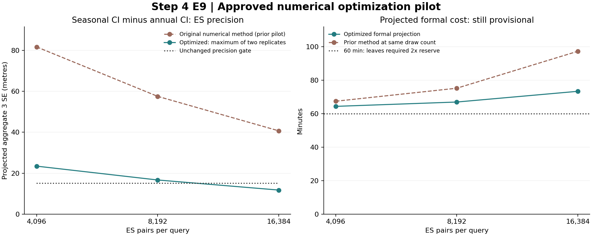

# Step 4 E9 — ES optimization pilot

Status: **PILOT PRECHECK NOT PASSED — FORMAL RUN NOT STARTED**. Independent review passed on all 128 internal cases. No outer validation endpoint or final-test data was accessed.

## Numerical precision and runtime

| ES pairs/query | Point contrast 3 SE (m) | CI contrast 3 SE (m) | Formal projection (min) | Required 2x reserve (min) |
|---:|---:|---:|---:|---:|
| 4,096 | 23.431 | 23.432 | 64.41 | 128.82 |
| 8,192 | 16.673 | 16.675 | 67.00 | 134.00 |
| 16,384 | 11.756 | 11.757 | 73.40 | 146.81 |

The numerical precision gate remains 0.0001 times the reference annual mean, about 15.060 m here. Values are conservative full-roster projections from the fixed internal pilot, not measured full-validation uncertainty or drifter position errors. Both independent seed checks are recorded in the gate receipt. The smallest passing precision level was 16384; no draw beyond the registered ladder was used.

At 4,096 draws, the same-session p95 case time was 0.105570 s for the original computation and 0.092043 s for exact reuse: **1.15x**. These timings include the same measured search, lineage and packet I/O costs. Controlled integration changes numerical realizations, so the speedup compares the zero-control exact-reuse stage only. Historical higher-count runtimes are shown as context, not a same-session benchmark.

At the final level the total-case p95 is 0.107682 s and the sum of component p95 costs is 0.116095 s. Projection uses the larger, charges cold work and actual output costs, and retains the original 10% allowance and 2x reserve. Independent full-roster support, storage and audit feasibility remain unmeasured; this is a provisional projection, not a formal go decision.

## Definition and audit

All four models, donors, votes, CI construction, seasonal rule, fallback rules, evaluation weights and region definitions remain unchanged. Every original ES draw stream is preserved; the 1,024-pair coefficient calibration uses a distinct outcome-free stream. All stored raw ES scores reconcile to the original pilot. Region/hit/area checks agree with the original forecast and independent replay.

32 semantic/regression tests passed. Independent review reconstructed all 128 neighbour sets by full WGS84 scans, checked UTC season labels, recomputed coefficients and both scoring replicates, replayed the four-arm regions, and reconstructed every aggregate uncertainty/time gate. Maximum independently reconstructed ES discrepancy: 5.68e-14 km. The control-variate coefficient affects integration only; it is not a prediction weight.

## Budget and next gate

New execution through report generation: approximately 58.92 s; prior pilot: 167.25 s. Final exact totals are in review_resources.json. Caps remain 420 new seconds and 600 cumulative pilot seconds. No formal experiment was started or scheduled.

Return this pilot to the user. A later formal decision requires full-roster outcome-blind support/storage/audit preflight and a frozen forecast definition before endpoint access. No extra optimization search, resampling level, model change or automatic continuation is authorized.

Files: ../pilot_summary.csv (internal pilot values only), ../component_profile.csv, ../independent_checks.csv, all per-level scores/timings and the provenance gate/resource/approval receipts. Run: e9_esopt_20261106T133844_947508Z.
