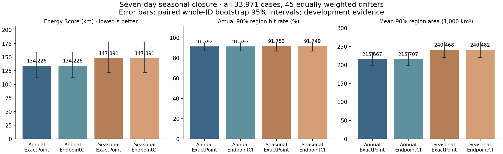
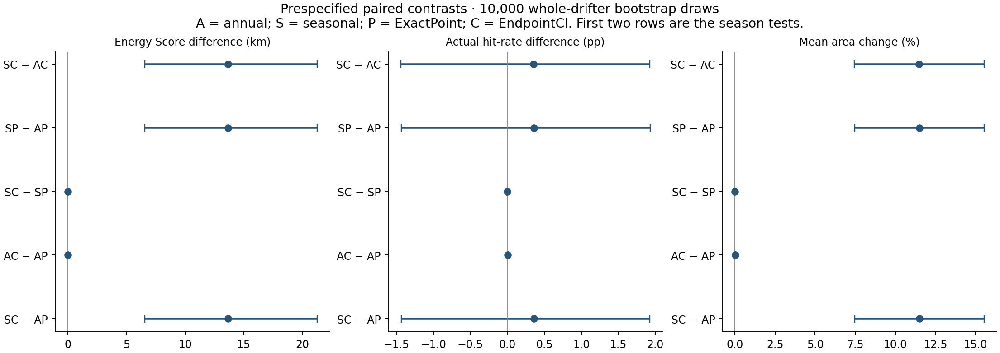
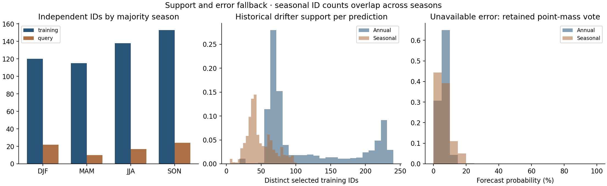
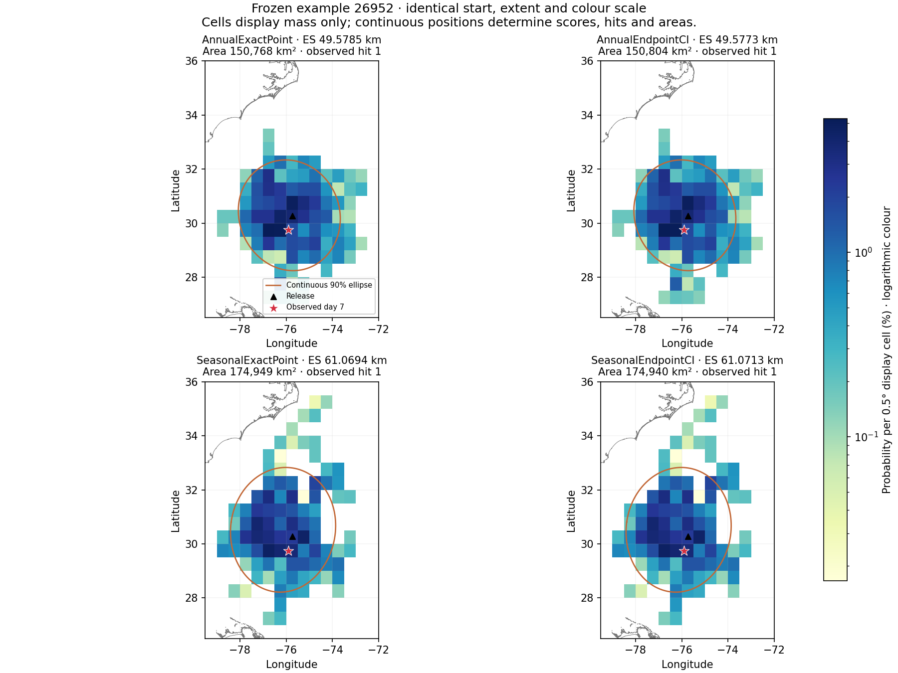
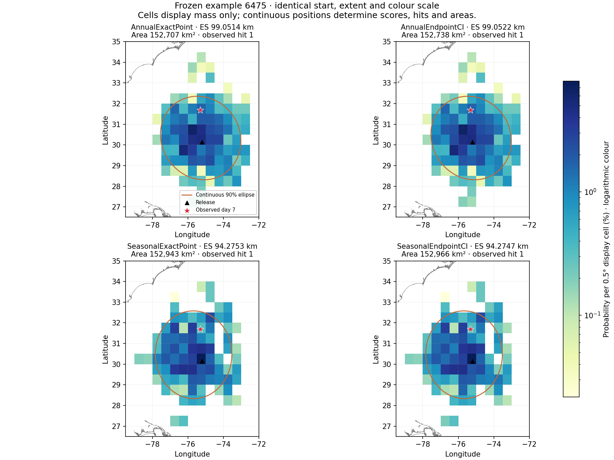
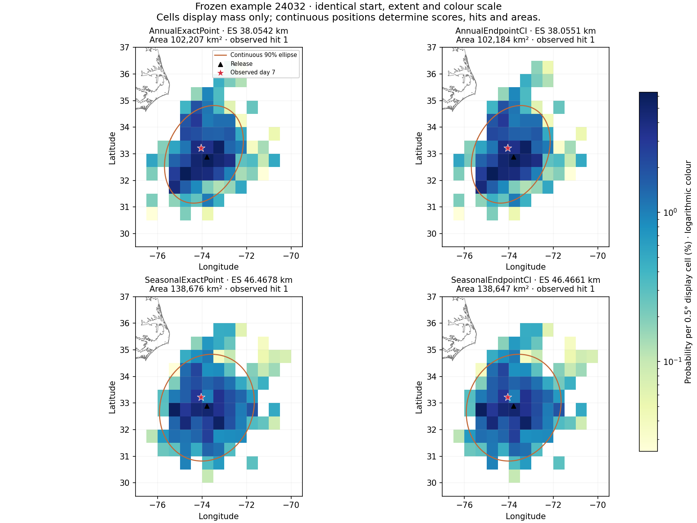
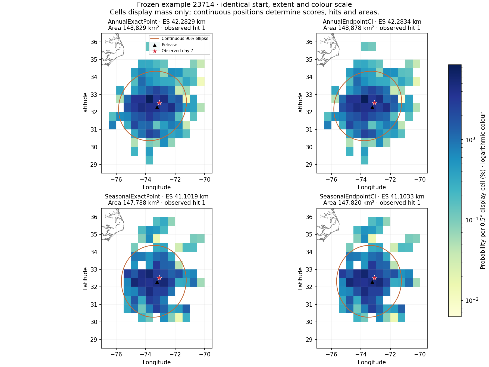
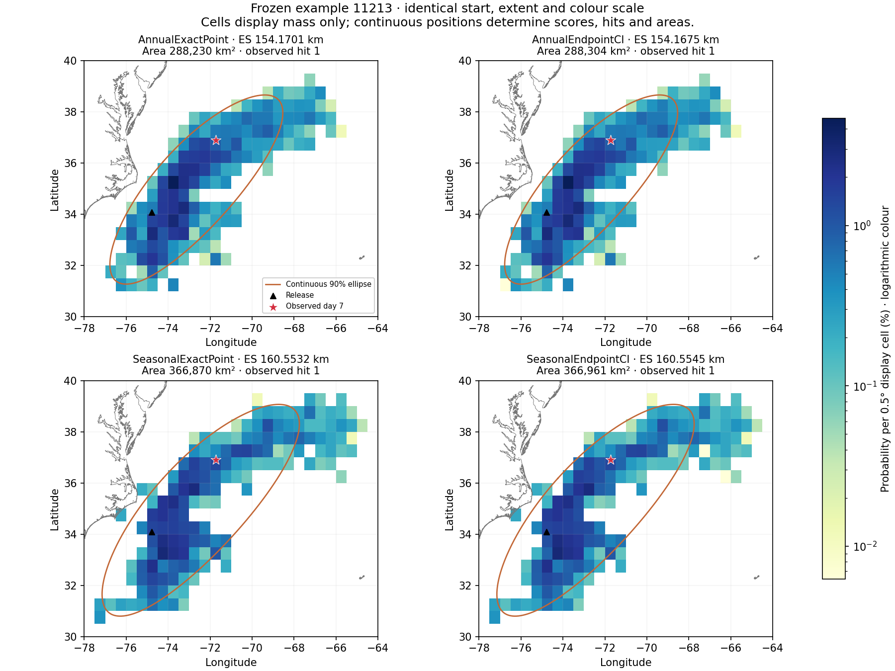
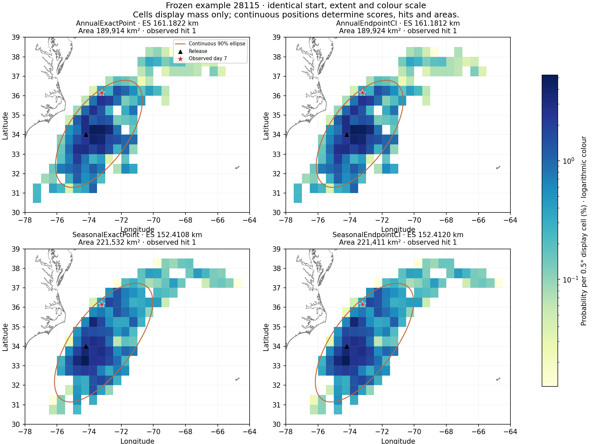

# Step 4 E9 — Exact-position seasonal closure

## Material Passport

- Mode: execution and computational validation.
- Status: complete four-arm development comparison; scientific acceptance is reported separately below.
- Run: `e9_formal_20261106T140607_806462Z`.
- Authority: user-approved E9 contract and ES optimization; subsequent explicit authorizations waived the twofold runtime precheck and the 2.5 GiB storage precheck, while retaining actual phase caps and the 5 GiB hard storage budget.

## Findings

SeasonalEndpointCI versus AnnualEndpointCI: **DOES_NOT_MEET_REGISTERED_CRITERIA**. ES changes by +13.665237 km (+10.181%), H90 by +0.3521 percentage points, and mean area by +11.4857%.

SeasonalExactPoint versus AnnualExactPoint: **DOES_NOT_MEET_REGISTERED_CRITERIA**. ES changes by +13.665290 km (+10.181%), H90 by +0.3605 percentage points, and mean area by +11.4998%.

No seasonal candidate meets all registered acceptance criteria. This closes the specified seasonal comparison; it does not establish that ocean dynamics have no seasonality. No model replacement or additional tuning is performed.

The CI seasonal model has higher mean ES in 4 of four season subgroups and 3 of three calendar-year subgroups. Leaving out each validation ID in turn gives an SC-minus-AC ES difference from 11.932 to 15.048 km. The evaluation-weighted mean number of selected training IDs changes from 114.4 to 48.1; the corresponding mean of each query's farthest selected-start distance changes from 60.0 to 97.9 km. These are registered descriptive diagnostics, not additional significance tests. Season filtering changes both sample support and selected-neighbour distances; this experiment does not isolate their causal contributions.

| Model | ES (km) | Actual H90 | Mean area (km²) |
| --- | --- | --- | --- |
| AnnualExactPoint | 134.225735 | 91.3921% | 215,666.89 |
| AnnualEndpointCI | 134.225740 | 91.3973% | 215,706.73 |
| SeasonalExactPoint | 147.891025 | 91.7526% | 240,468.13 |
| SeasonalEndpointCI | 147.890977 | 91.7494% | 240,482.18 |

| Comparison | ES difference (km) | ES 95% interval | H90 change (pp) | Area change |
| --- | --- | --- | --- | --- |
| SeasonalEndpointCI − AnnualEndpointCI | +13.665237 | [+6.574529, +21.259693] | +0.3521 | +11.4857% |
| SeasonalExactPoint − AnnualExactPoint | +13.665290 | [+6.574584, +21.259741] | +0.3605 | +11.4998% |
| SeasonalEndpointCI − SeasonalExactPoint | -0.000048 | [-0.000085, -0.000011] | -0.0032 | +0.0058% |
| AnnualEndpointCI − AnnualExactPoint | +0.000005 | [-0.000033, +0.000046] | +0.0051 | +0.0185% |
| SeasonalEndpointCI − AnnualExactPoint | +13.665242 | [+6.574537, +21.259704] | +0.3573 | +11.5063% |

## Frozen methods

Training: 265,393 pairs from 338 IDs, 2001–2019. Development validation: all 33,971 pairs from 45 non-overlapping IDs, 2020–2022. Seven days exactly; elapsed-duration majority UTC season, exact half-and-half ties assigned to departure season. Same-season filtering precedes the 100 km, nearest-8,000-with-ties search. Every selected pair retains one equal vote. No annual/seasonal blending, trajectory translation, new predictors, probability clipping or sample removal. EndpointCI uses the accepted repaired marginal location errors with the inherited E8 construction; unavailable errors retain the original point. CI denotes measurement uncertainty, not a fitted Gaussian transport law.

Energy Score uses exponent-one ECEF chord distances in km. H90 and area use the corrected distribution-quantile LAEA ellipse; 0.5° cells are display only. Times are averaged within each drifter, then the 45 drifters are equally weighted. The 10,000 whole-ID paired bootstrap draws use the frozen seed 20261106. The two season claims share a nominal Bonferroni family level of 0.05. Subgroup tables retain and renormalize the original evaluation weights.

## Fallbacks

Empty-season fallback: 0 / 33,971 queries (0.0000% of queries; 0.0000% of evaluation weight; 0 IDs). Error fallback is separate: Annual: 6.2127% mean probability retained at the original endpoint; Seasonal: 6.3045% mean probability retained at the original endpoint. These percentages are not added.

## Verification and limits

Numerical gates passed: True. All 135,884 primary region hit/area records were independently replayed; all 33,971 queries received a second numerical stream. Full-distance neighbours were independently reconstructed for 128 frozen outer queries, in addition to the previously verified 128 pilot queries. Separate 65,536-pair ES calculations checked 128 frozen outer queries. Maximum same-stream ES reconstruction error: 5.68e-14 km. Complete donor lineage, all region definitions, streams, per-case scores and bootstrap outputs are retained.

This is reused development evidence. The forecasts are held fixed in the bootstrap; its intervals do not include training-set uncertainty, shared ocean forcing or all effects of repeated analysis of this validation period. The ellipse can bridge low-density gaps and is not a minimum-area region. Available 2022 observations do not cover a complete year. No final-test IDs or validation-endpoint errors were accessed.

## Figures

Example positions were frozen before scoring: [26952, 6475, 24032, 23714, 11213, 28115]. Represented season indices: [0, 3] (0 DJF, 1 MAM, 2 JJA, 3 SON); cross-season examples: 0. Missing categories are not replaced by outcome-selected examples.

## Evidence files

- `summary.csv`, `contrasts.csv`, `case_scores.parquet`, `per_id_scores.csv`.
- `subgroups.csv`, `leave_one_id_out.csv`, `season_support.csv`, `fallback_summary.csv`.
- `energy_precision.csv`, `numerical_stability.csv`, `independent_es_65536.csv`, `independent_neighbours.csv`.
- `forecasts.jsonl`, `donor_lineage.zst`, `lineage_offsets.parquet`, `fit_keys_seasons.parquet`.
- Matching provenance: approval, forecast freeze, independent audit, decision and phase resource receipts.
