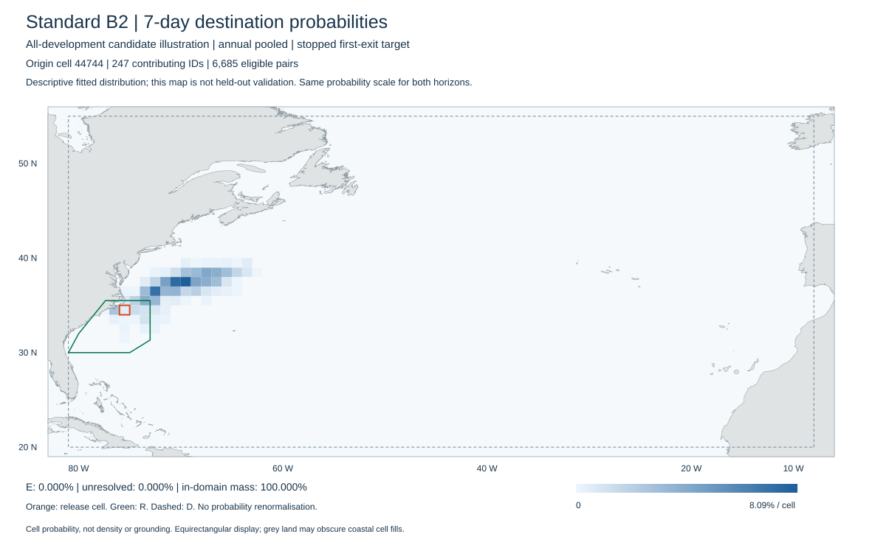
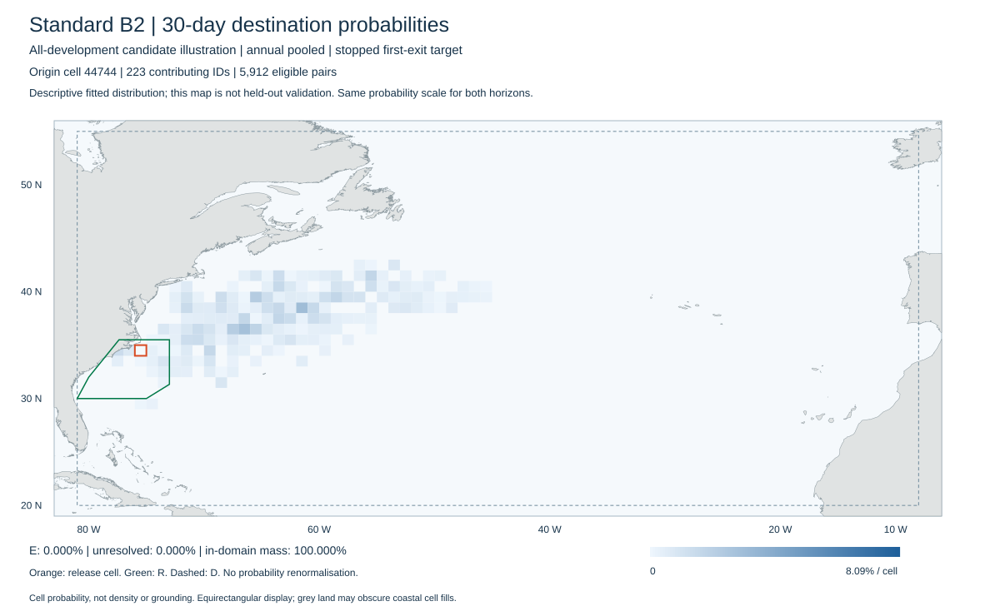

# Stage 1 — Independent Standard B2

Run: `empirical_b2_20261029T121555_976173Z`. Engineering plan E2. Result submitted for user review; S1 closure is pending.

## Model and evaluation

B2 estimates a separate empirical row for each origin cell and horizon, P_h(i,j)=N_h(i,j)/sum_k N_h(i,k). Only fitting IDs contribute counts. There is no smoothing, fallback, optimisation, propagation or velocity/environmental conditioning. The target is first observed exit from D followed by absorption in E; missing follow-up is not an exit.

The frozen indexes contain 54 source rows and 2665 physical destination states (2664 D cells plus E). Ten fold matrices and two all-development matrices are saved under `matrices/`. Unresolved is separate metadata, never a physical column.

All predictions and scores were generated in this run. Reused artifacts are limited to verified qualified counts/labels, geometry and ID folds; no historical fitted models, predictions or scores were input.

## Held-out development results

| horizon_days | eligible_pairs | eligible_ids | evaluable_pairs | unsupported_pairs | brier | Brier_95_interval |
| --- | --- | --- | --- | --- | --- | --- |
| 7 | 303288 | 385 | 303288 | 0 | 0.929001 | [0.921631, 0.937923] |
| 30 | 268998 | 337 | 268998 | 0 | 0.994751 | [0.991777, 0.998311] |

Brier intervals are 2.5/97.5 percentiles of fixed-fit whole-ID bootstrap draws. Pair-weighted scores are pooled across folds, never averaged as five equally weighted fold means.

| horizon_days | availability | zero_true_probability_pairs | zero_true_probability_fraction | observed_exit_pairs | mean_predicted_exit_probability |
| --- | --- | --- | --- | --- | --- |
| 7 | 1 | 6315 | 0.0208218 | 0 | 0 |
| 30 | 1 | 46964 | 0.174589 | 0 | 0 |

Fractions use 0–1 units. Zero-true-probability fractions use evaluable pairs; exit counts cover all eligible pairs. Full denominators, IDs and unavailable counts are in `summary.csv`.

## Training support in the all-development candidates

| horizon_days | indexed_source_rows | supported_rows | unsupported_rows | unsupported_positive_area_rows | boundary_only_rows |
| --- | --- | --- | --- | --- | --- |
| 7 | 54 | 37 | 17 | 4 | 13 |
| 30 | 54 | 37 | 17 | 4 | 13 |

## Descriptive probability maps

Selected origin: 44744. Selection used the largest minimum unique-ID support across 7/30 days, then ascending cell ID; no held-out scores were consulted.





## Audit and limitations

Independent arithmetic audit: {"heldout_cases_reconciled": true, "matrix_count": 12, "matrix_count_reconciliation": true, "max_brier_error": 6.661338147750939e-16, "max_probability_error": 0.0, "whole_ID_leakage": false}

- These are five-fold whole-ID development results on previously used development data, not an independent final-test evaluation. The final test remains locked.
- Brier is the unnormalised multiclass score (range 0 to 2). It is not an accuracy percentage and does not measure geographic distance. No spatial or combined loss is included.
- The mean Brier denominator contains only evaluable pairs. Unsupported cases are retained in availability reporting with missing Brier. Zero probability at a true destination is scored normally.
- Hourly and overlapping pairs are correlated. Confidence intervals use 200 whole-ID resamples with fixed fitted forecasts; they do not include refitting or model-selection uncertainty.
- Sparse empirical zeros mean unobserved transitions in the fitting sample, not physical impossibility. Do not interpret a small training count as strong evidence.
- No observed exits means exit calibration cannot be established. E remains in the state universe even if its count is zero.
- Source rows include boundary-only R intersections. Empty index rows are distinct from unsupported forecasts on actual held-out cases; neither is hidden.
- All-development matrices and maps are fitted candidates. They have no separate validation score and do not demonstrate geographic accuracy or superiority to another model.

## Artifacts and reproduction

[summary.csv](summary.csv), [cell_summary.csv](cell_summary.csv), [fold_summary.csv](fold_summary.csv), [row_support.csv](row_support.csv), [candidate_support_summary.csv](candidate_support_summary.csv), [source_index.csv](source_index.csv), [destination_index.csv](destination_index.csv), [heldout_predictions.parquet](heldout_predictions.parquet), [heldout_scores.parquet](heldout_scores.parquet), [bootstrap_intervals.csv](bootstrap_intervals.csv), [bootstrap_draws.csv](bootstrap_draws.csv), [counts_by_id.parquet](counts_by_id.parquet), [folds.csv](folds.csv), [fitting_ids.json](fitting_ids.json), [config.json](config.json)

Grouped held-out score rows retain `pair_count` as multiplicity; they are arithmetically equivalent to scoring every eligible hourly pair. Matrix tables contain positive entries; indexes and row-support masks define zero entries and undefined rows.

```sh
.venv/bin/python -B -m data3001.modelling.baselines.run_empirical_b2
```

To verify a fresh replay, add `--replay-of empirical_b2_20261029T121555_976173Z`. Each invocation creates a new immutable run. Provenance, input/code hashes and runtime verification are in the matching `provenance/runs/` directory.
