# Step 3 E2 — Adaptive LocalEndpoint borrowing

**Status: independently executed and audited; scientific retention awaits user review.**

Where Things End Up: direct 7/30-day stopped destination distributions from an arbitrary qualified origin-cell time. Pooled v7, 1-degree cells, unchanged eight-neighbour R-only raw pair references. The locked final test remains unread.

## Held-out results

| horizon_days | model | brier | region90_cells | region90_hit | region90_mass | outside_local_union | zero_true_probability | evaluable_ids | evaluable_pairs |
| --- | --- | --- | --- | --- | --- | --- | --- | --- | --- |
| 7 | Adaptive | 0.966486 | 37.552 | 0.885722 | 0.903166 | 0.00292746 | 0.00152198 | 385 | 303288 |
| 7 | B2 | 0.981297 | 17.5583 | 0.748378 | 0.91035 | 0.00292746 | 0.0634891 | 385 | 303288 |
| 7 | Fixed | 0.962457 | 42.7116 | 0.899558 | 0.902641 | 0.00292746 | 0.00152198 | 385 | 303288 |
| 7 | LocalEndpoint | 0.958288 | 27.3581 | 0.88191 | 0.904131 | 0.00292746 | 0.00292746 | 385 | 303288 |
| 7 | LocalEndpointAdaptive | 0.959104 | 27.2173 | 0.882367 | 0.904356 | 0.00292746 | 0.00292746 | 385 | 303288 |
| 30 | Adaptive | 0.995303 | 130.933 | 0.777365 | 0.90095 | 0.0560436 | 0.014935 | 337 | 268998 |
| 30 | B2 | 1.01781 | 56.5707 | 0.502761 | 0.908223 | 0.0560436 | 0.314331 | 337 | 268998 |
| 30 | Fixed | 0.994931 | 133.858 | 0.775861 | 0.900926 | 0.0560436 | 0.014935 | 337 | 268998 |
| 30 | LocalEndpoint | 0.993751 | 104.679 | 0.762831 | 0.90197 | 0.0560436 | 0.0560436 | 337 | 268998 |
| 30 | LocalEndpointAdaptive | 0.993452 | 105.34 | 0.768356 | 0.901701 | 0.0560436 | 0.0560436 | 337 | 268998 |

Primary weighting: eligible times within drifter/cell, equal drifters within cell, equal cells. Brier is not percentage accuracy. K90 counts geographic cells, not square-kilometre area. E contributes mass/hits but no cell. The nominal region remains 90%; probabilities outside it remain stored.

## New weight and retained controls

LocalEndpointAdaptive uses lambda=a*z^gamma/(1-a+a*z^gamma), where z=(neighbour distinct IDs/local distinct IDs) divided by its fitting-only median. The same ID in several neighbour cells counts once in that union. Raw pair-frequency training remains unchanged. Gamma=0 exactly contains constant LocalEndpoint. Fixed and Adaptive still borrow global B1; global Adaptive retains its original pair-count schedule. No trajectories are translated.

## Prespecified comparisons

| horizon_days | model | reference | metric | difference | lower_95 | upper_95 | adjusted_directional_bound | primary_comparison | defined_replicates |
| --- | --- | --- | --- | --- | --- | --- | --- | --- | --- |
| 7 | LocalEndpointAdaptive | B2 | brier | -0.022193 | -0.0297057 | -0.0131055 | NA | False | 10000 |
| 7 | LocalEndpointAdaptive | B2 | region90_cells | 9.65907 | 9.59751 | 9.71952 | NA | False | 10000 |
| 7 | LocalEndpointAdaptive | B2 | region90_hit | 0.13399 | 0.119317 | 0.149821 | NA | False | 10000 |
| 7 | LocalEndpointAdaptive | Fixed | brier | -0.00335364 | -0.00645813 | 0.000218208 | 0.00143782 | True | 10000 |
| 7 | LocalEndpointAdaptive | Fixed | region90_cells | -15.4943 | -15.5958 | -15.3885 | -15.3543 | True | 10000 |
| 7 | LocalEndpointAdaptive | Fixed | region90_hit | -0.0171911 | -0.0271245 | -0.00630367 | -0.0304652 | True | 10000 |
| 7 | LocalEndpointAdaptive | Adaptive | brier | -0.00738223 | -0.00922036 | -0.00549351 | NA | False | 10000 |
| 7 | LocalEndpointAdaptive | Adaptive | region90_cells | -10.3347 | -10.4703 | -10.196 | NA | False | 10000 |
| 7 | LocalEndpointAdaptive | Adaptive | region90_hit | -0.00335485 | -0.0143922 | 0.0100327 | NA | False | 10000 |
| 7 | LocalEndpointAdaptive | LocalEndpoint | brier | 0.000815899 | -0.000112371 | 0.00213029 | 0.0025688 | True | 10000 |
| 7 | LocalEndpointAdaptive | LocalEndpoint | region90_cells | -0.140799 | -0.189565 | -0.0915801 | -0.0769951 | True | 10000 |
| 7 | LocalEndpointAdaptive | LocalEndpoint | region90_hit | 0.000457382 | -0.00067001 | 0.00190519 | -0.00103498 | True | 10000 |
| 30 | LocalEndpointAdaptive | B2 | brier | -0.0243623 | -0.0268942 | -0.0214449 | NA | False | 10000 |
| 30 | LocalEndpointAdaptive | B2 | region90_cells | 48.7696 | 48.5693 | 48.9577 | NA | False | 10000 |
| 30 | LocalEndpointAdaptive | B2 | region90_hit | 0.265595 | 0.24707 | 0.283449 | NA | False | 10000 |
| 30 | LocalEndpointAdaptive | Fixed | brier | -0.00147899 | -0.00244871 | -0.000593055 | -0.000327386 | True | 10000 |
| 30 | LocalEndpointAdaptive | Fixed | region90_cells | -28.5173 | -28.8858 | -28.1039 | -27.9473 | True | 10000 |
| 30 | LocalEndpointAdaptive | Fixed | region90_hit | -0.00750421 | -0.0275361 | 0.011994 | -0.0340109 | True | 10000 |
| 30 | LocalEndpointAdaptive | Adaptive | brier | -0.00185114 | -0.00282096 | -0.000933488 | NA | False | 10000 |
| 30 | LocalEndpointAdaptive | Adaptive | region90_cells | -25.593 | -25.9289 | -25.253 | NA | False | 10000 |
| 30 | LocalEndpointAdaptive | Adaptive | region90_hit | -0.00900871 | -0.0280683 | 0.0100609 | NA | False | 10000 |
| 30 | LocalEndpointAdaptive | LocalEndpoint | brier | -0.00029875 | -0.000424863 | -0.000159193 | -9.94462e-05 | True | 10000 |
| 30 | LocalEndpointAdaptive | LocalEndpoint | region90_cells | 0.660773 | 0.597685 | 0.740307 | 0.76942 | True | 10000 |
| 30 | LocalEndpointAdaptive | LocalEndpoint | region90_hit | 0.0055256 | 0.00217839 | 0.00913086 | 0.00108532 | True | 10000 |

| horizon_days | model | reference | point_Brier_gain | conditional_Brier_support | conditional_coverage_preserving | conditional_quality_preserving | conditional_smaller_region | joint_point_benefit | application_tradeoff | delta_brier | delta_region90_cells | delta_region90_hit |
| --- | --- | --- | --- | --- | --- | --- | --- | --- | --- | --- | --- | --- |
| 7 | LocalEndpointAdaptive | Fixed | True | False | False | False | False | False | True | -0.00335364 | -15.4943 | -0.0171911 |
| 7 | LocalEndpointAdaptive | LocalEndpoint | False | False | False | False | False | False | False | 0.000815899 | -0.140799 | 0.000457382 |
| 30 | LocalEndpointAdaptive | Fixed | True | True | False | False | False | False | True | -0.00147899 | -28.5173 | -0.00750421 |
| 30 | LocalEndpointAdaptive | LocalEndpoint | True | True | True | False | False | False | True | -0.00029875 | 0.660773 | 0.0055256 |

All changes are adaptive local minus reference. Ordinary 95% intervals and 12 adjusted directional screens use 10,000 paired PCG64 Exp(1) whole-ID multipliers, seed 20261031. Fits are held fixed. These omit refitting, shared-training dependence, prior research adaptation and common ocean forcing; they are conditional development evidence, not final-test guarantees. Non-significance is not proof of non-deterioration.

The LocalEndpoint comparison tests adaptation. The Fixed comparison tests overall quality and region size. A preferred adaptive candidate needs an actual adaptive forecast change, lower Brier and preserved coverage against LocalEndpoint, plus lower Brier/preserved coverage/no larger region against Fixed. Smaller regions alone never pass.

## Selection and mechanism

| role | horizon_days | model | parameter_a | parameter_gamma |
| --- | --- | --- | --- | --- |
| outer_0 | 7 | Fixed | 0.5 | 0 |
| outer_0 | 7 | Adaptive | 0.3 | 0 |
| outer_0 | 7 | LocalEndpoint | 0.7 | 0 |
| outer_0 | 7 | LocalEndpointAdaptive | 0.6 | 0.5 |
| outer_0 | 30 | Fixed | 0.85 | 0 |
| outer_0 | 30 | Adaptive | 0.75 | 0 |
| outer_0 | 30 | LocalEndpoint | 0.95 | 0 |
| outer_0 | 30 | LocalEndpointAdaptive | 0.85 | 2 |
| outer_1 | 7 | Fixed | 0.5 | 0 |
| outer_1 | 7 | Adaptive | 0.3 | 0 |
| outer_1 | 7 | LocalEndpoint | 0.7 | 0 |
| outer_1 | 7 | LocalEndpointAdaptive | 0.7 | 0 |
| outer_1 | 30 | Fixed | 0.9 | 0 |
| outer_1 | 30 | Adaptive | 0.8 | 0 |
| outer_1 | 30 | LocalEndpoint | 0.95 | 0 |
| outer_1 | 30 | LocalEndpointAdaptive | 0.9 | 2 |
| outer_2 | 7 | Fixed | 0.5 | 0 |
| outer_2 | 7 | Adaptive | 0.35 | 0 |
| outer_2 | 7 | LocalEndpoint | 0.7 | 0 |
| outer_2 | 7 | LocalEndpointAdaptive | 0.7 | 0 |
| outer_2 | 30 | Fixed | 0.8 | 0 |
| outer_2 | 30 | Adaptive | 0.75 | 0 |
| outer_2 | 30 | LocalEndpoint | 0.95 | 0 |
| outer_2 | 30 | LocalEndpointAdaptive | 0.9 | 2 |
| outer_3 | 7 | Fixed | 0.5 | 0 |
| outer_3 | 7 | Adaptive | 0.3 | 0 |
| outer_3 | 7 | LocalEndpoint | 0.7 | 0 |
| outer_3 | 7 | LocalEndpointAdaptive | 0.6 | 0.5 |
| outer_3 | 30 | Fixed | 0.85 | 0 |
| outer_3 | 30 | Adaptive | 0.7 | 0 |
| outer_3 | 30 | LocalEndpoint | 0.95 | 0 |
| outer_3 | 30 | LocalEndpointAdaptive | 0.9 | 2 |
| outer_4 | 7 | Fixed | 0.45 | 0 |
| outer_4 | 7 | Adaptive | 0.25 | 0 |
| outer_4 | 7 | LocalEndpoint | 0.65 | 0 |
| outer_4 | 7 | LocalEndpointAdaptive | 0.65 | 0 |
| outer_4 | 30 | Fixed | 0.8 | 0 |
| outer_4 | 30 | Adaptive | 0.75 | 0 |
| outer_4 | 30 | LocalEndpoint | 0.95 | 0 |
| outer_4 | 30 | LocalEndpointAdaptive | 0.85 | 2 |
| all_development_candidate | 7 | Fixed | 0.45 | 0 |
| all_development_candidate | 7 | Adaptive | 0.3 | 0 |
| all_development_candidate | 7 | LocalEndpoint | 0.65 | 0 |
| all_development_candidate | 7 | LocalEndpointAdaptive | 0.65 | 0 |
| all_development_candidate | 30 | Fixed | 0.8 | 0 |
| all_development_candidate | 30 | Adaptive | 0.7 | 0 |
| all_development_candidate | 30 | LocalEndpoint | 0.9 | 0 |
| all_development_candidate | 30 | LocalEndpointAdaptive | 0.85 | 2 |

| role | horizon_days | cells | minimum_weight | median_weight | maximum_weight | changed_from_constant | mean_total_variation |
| --- | --- | --- | --- | --- | --- | --- | --- |
| all_development_candidate | 7 | 37 | 0.65 | 0.65 | 0.65 | 0 | 0 |
| all_development_candidate | 30 | 37 | 0.591627 | 0.85 | 0.999467 | 36 | 0.0506927 |
| outer_0 | 7 | 37 | 0.515848 | 0.6 | 0.848866 | 36 | 0.0302635 |
| outer_0 | 30 | 37 | 0.587667 | 0.85 | 0.999181 | 36 | 0.0531877 |
| outer_1 | 7 | 37 | 0.7 | 0.7 | 0.7 | 0 | 0 |
| outer_1 | 30 | 37 | 0.66039 | 0.9 | 0.999755 | 36 | 0.0424092 |
| outer_2 | 7 | 37 | 0.7 | 0.7 | 0.7 | 0 | 0 |
| outer_2 | 30 | 37 | 0.708126 | 0.9 | 0.99951 | 36 | 0.0362869 |
| outer_3 | 7 | 37 | 0.509421 | 0.6 | 0.860032 | 36 | 0.0312035 |
| outer_3 | 30 | 37 | 0.702588 | 0.9 | 0.999831 | 36 | 0.0393639 |
| outer_4 | 7 | 37 | 0.65 | 0.65 | 0.65 | 0 | 0 |
| outer_4 | 30 | 37 | 0.609872 | 0.85 | 0.99949 | 36 | 0.0514226 |

Weight summaries are unweighted across supported fitted rows, not held-out case-weighted estimates. Support ratios are heuristics: identical IDs may occur locally and in donors, and raw pairs may still be concentrated in a few IDs. Gamma>0 is meaningful only when it changes forecasts. The outside-local-union rate is a structural limit on this two-distribution mixture, not a reason to discard those truths.

## Support and boundary diagnostics

| horizon_days | model | stratum | primary_weight_mass | ids | cells | brier | region90_cells | region90_hit | stratum_type |
| --- | --- | --- | --- | --- | --- | --- | --- | --- | --- |
| 7 | Adaptive | 1-9 fitting IDs | 0.0761671 | 20 | 3 | 0.930726 | 44.3825 | 0.874209 | support_stratum |
| 7 | Adaptive | 10-49 fitting IDs | 0.0946287 | 115 | 6 | 0.97636 | 44.1213 | 0.826651 | support_stratum |
| 7 | Adaptive | 50+ fitting IDs | 0.829204 | 385 | 31 | 0.968644 | 36.1749 | 0.893521 | support_stratum |
| 7 | B2 | 1-9 fitting IDs | 0.0761671 | 20 | 3 | 0.957777 | 4.18894 | 0.712758 | support_stratum |
| 7 | B2 | 10-49 fitting IDs | 0.0946287 | 115 | 6 | 1.03834 | 10.5561 | 0.58407 | support_stratum |
| 7 | B2 | 50+ fitting IDs | 0.829204 | 385 | 31 | 0.976947 | 19.5854 | 0.770401 | support_stratum |
| 7 | Fixed | 1-9 fitting IDs | 0.0761671 | 20 | 3 | 0.898567 | 37.6267 | 0.887285 | support_stratum |
| 7 | Fixed | 10-49 fitting IDs | 0.0946287 | 115 | 6 | 0.973164 | 41.4926 | 0.833412 | support_stratum |
| 7 | Fixed | 50+ fitting IDs | 0.829204 | 385 | 31 | 0.967104 | 43.3178 | 0.908235 | support_stratum |
| 7 | LocalEndpoint | 1-9 fitting IDs | 0.0761671 | 20 | 3 | 0.879911 | 22.1659 | 0.982398 | support_stratum |
| 7 | LocalEndpoint | 10-49 fitting IDs | 0.0946287 | 115 | 6 | 0.952824 | 24.1131 | 0.87213 | support_stratum |
| 7 | LocalEndpoint | 50+ fitting IDs | 0.829204 | 385 | 31 | 0.966111 | 28.2054 | 0.873796 | support_stratum |
| 7 | LocalEndpointAdaptive | 1-9 fitting IDs | 0.0761671 | 20 | 3 | 0.893877 | 22.7281 | 0.982398 | support_stratum |
| 7 | LocalEndpointAdaptive | 10-49 fitting IDs | 0.0946287 | 115 | 6 | 0.952292 | 24.4032 | 0.87213 | support_stratum |
| 7 | LocalEndpointAdaptive | 50+ fitting IDs | 0.829204 | 385 | 31 | 0.965872 | 27.9509 | 0.874347 | support_stratum |
| 30 | Adaptive | 1-9 fitting IDs | 0.0810811 | 18 | 3 | 1.0005 | 135.111 | 0.78687 | support_stratum |
| 30 | Adaptive | 10-49 fitting IDs | 0.144507 | 158 | 6 | 0.997967 | 133.763 | 0.684007 | support_stratum |
| 30 | Adaptive | 50+ fitting IDs | 0.774412 | 336 | 31 | 0.994262 | 129.968 | 0.793791 | support_stratum |
| 30 | B2 | 1-9 fitting IDs | 0.0810811 | 18 | 3 | 1.09951 | 10.2148 | 0.315252 | support_stratum |
| 30 | B2 | 10-49 fitting IDs | 0.144507 | 158 | 6 | 1.0591 | 23.3472 | 0.270761 | support_stratum |
| 30 | B2 | 50+ fitting IDs | 0.774412 | 336 | 31 | 1.00156 | 67.6237 | 0.565685 | support_stratum |
| 30 | Fixed | 1-9 fitting IDs | 0.0810811 | 18 | 3 | 0.996259 | 128.333 | 0.753888 | support_stratum |
| 30 | Fixed | 10-49 fitting IDs | 0.144507 | 158 | 6 | 0.997507 | 130.822 | 0.674935 | support_stratum |
| 30 | Fixed | 50+ fitting IDs | 0.774412 | 336 | 31 | 0.994311 | 135.002 | 0.796994 | support_stratum |
| 30 | LocalEndpoint | 1-9 fitting IDs | 0.0810811 | 18 | 3 | 0.987538 | 97.2519 | 0.864572 | support_stratum |
| 30 | LocalEndpoint | 10-49 fitting IDs | 0.144507 | 158 | 6 | 0.9939 | 98.9477 | 0.724972 | support_stratum |
| 30 | LocalEndpoint | 50+ fitting IDs | 0.774412 | 336 | 31 | 0.994373 | 106.527 | 0.759243 | support_stratum |
| 30 | LocalEndpointAdaptive | 1-9 fitting IDs | 0.0810811 | 18 | 3 | 0.987979 | 98.4 | 0.864572 | support_stratum |
| 30 | LocalEndpointAdaptive | 10-49 fitting IDs | 0.144507 | 158 | 6 | 0.993574 | 99.4476 | 0.731188 | support_stratum |
| 30 | LocalEndpointAdaptive | 50+ fitting IDs | 0.774412 | 336 | 31 | 0.994002 | 107.166 | 0.765218 | support_stratum |
| 7 | Adaptive | coastal grid polygon | 0.189189 | 122 | 7 | 0.969667 | 45.7553 | 0.804921 | boundary_stratum |
| 7 | Adaptive | offshore grid polygon | 0.810811 | 384 | 30 | 0.965744 | 35.6379 | 0.904576 | boundary_stratum |
| 7 | B2 | coastal grid polygon | 0.189189 | 122 | 7 | 1.01996 | 10.1103 | 0.609992 | boundary_stratum |
| 7 | B2 | offshore grid polygon | 0.810811 | 384 | 30 | 0.972274 | 19.2961 | 0.780668 | boundary_stratum |
| 7 | Fixed | coastal grid polygon | 0.189189 | 122 | 7 | 0.953459 | 42.4869 | 0.818421 | boundary_stratum |
| 7 | Fixed | offshore grid polygon | 0.810811 | 384 | 30 | 0.964557 | 42.7641 | 0.918491 | boundary_stratum |
| 7 | LocalEndpoint | coastal grid polygon | 0.189189 | 122 | 7 | 0.934139 | 27.5574 | 0.904722 | boundary_stratum |
| 7 | LocalEndpoint | offshore grid polygon | 0.810811 | 384 | 30 | 0.963922 | 27.3116 | 0.876587 | boundary_stratum |
| 7 | LocalEndpointAdaptive | coastal grid polygon | 0.189189 | 122 | 7 | 0.939626 | 27.9115 | 0.904743 | boundary_stratum |
| 7 | LocalEndpointAdaptive | offshore grid polygon | 0.810811 | 384 | 30 | 0.963648 | 27.0554 | 0.877146 | boundary_stratum |
| 30 | Adaptive | coastal grid polygon | 0.189189 | 100 | 7 | 1.00198 | 134.682 | 0.672022 | boundary_stratum |
| 30 | Adaptive | offshore grid polygon | 0.810811 | 336 | 30 | 0.993746 | 130.059 | 0.801945 | boundary_stratum |
| 30 | B2 | coastal grid polygon | 0.189189 | 100 | 7 | 1.08582 | 18.1828 | 0.249475 | boundary_stratum |
| 30 | B2 | offshore grid polygon | 0.810811 | 336 | 30 | 1.00195 | 65.5278 | 0.561861 | boundary_stratum |
| 30 | Fixed | coastal grid polygon | 0.189189 | 100 | 7 | 1.00005 | 130.393 | 0.64517 | boundary_stratum |
| 30 | Fixed | offshore grid polygon | 0.810811 | 336 | 30 | 0.993737 | 134.666 | 0.806355 | boundary_stratum |
| 30 | LocalEndpoint | coastal grid polygon | 0.189189 | 100 | 7 | 0.992836 | 110.475 | 0.761995 | boundary_stratum |
| 30 | LocalEndpoint | offshore grid polygon | 0.810811 | 336 | 30 | 0.993964 | 103.327 | 0.763026 | boundary_stratum |
| 30 | LocalEndpointAdaptive | coastal grid polygon | 0.189189 | 100 | 7 | 0.992839 | 111.527 | 0.76021 | boundary_stratum |
| 30 | LocalEndpointAdaptive | offshore grid polygon | 0.810811 | 336 | 30 | 0.993595 | 103.897 | 0.770257 | boundary_stratum |

Support bands 1-9 / 10-49 / 50+ use actual outer fitting IDs. Coastal classification is grid-polygon intersection with the pinned high land mask. Subsets retain/renormalise original case weights. None selected parameters.

## Pair-weighted sensitivity

| horizon_days | model | brier | region90_cells | region90_hit | region90_mass | outside_local_union | zero_true_probability | evaluable_ids | evaluable_pairs |
| --- | --- | --- | --- | --- | --- | --- | --- | --- | --- |
| 7 | Adaptive | 0.933234 | 33.342 | 0.948818 | 0.903161 | 0.00141779 | 0.000675925 | 385 | 303288 |
| 7 | B2 | 0.929001 | 18.2258 | 0.87439 | 0.908146 | 0.00141779 | 0.0208218 | 385 | 303288 |
| 7 | Fixed | 0.93824 | 42.0308 | 0.955188 | 0.902729 | 0.00141779 | 0.000675925 | 385 | 303288 |
| 7 | LocalEndpoint | 0.936574 | 26.8208 | 0.935705 | 0.9041 | 0.00141779 | 0.00141779 | 385 | 303288 |
| 7 | LocalEndpointAdaptive | 0.936236 | 26.5538 | 0.936094 | 0.904249 | 0.00141779 | 0.00141779 | 385 | 303288 |
| 30 | Adaptive | 0.98911 | 127.33 | 0.865839 | 0.900953 | 0.0335653 | 0.0109406 | 337 | 268998 |
| 30 | B2 | 0.994751 | 62.6083 | 0.663726 | 0.905589 | 0.0335653 | 0.174589 | 337 | 268998 |
| 30 | Fixed | 0.989841 | 133.549 | 0.869111 | 0.900895 | 0.0335653 | 0.0109406 | 337 | 268998 |
| 30 | LocalEndpoint | 0.987851 | 102.247 | 0.838805 | 0.901526 | 0.0335653 | 0.0335653 | 337 | 268998 |
| 30 | LocalEndpointAdaptive | 0.987517 | 102.384 | 0.84133 | 0.901286 | 0.0335653 | 0.0335653 | 337 | 268998 |

These are the same forecasts under secondary weights; they did not select the parameters.

## Audit

- Independently reconstructed 26 fitting roles, 7400 candidate/horizon/role identities, 6234500 candidate ID-cell rows.
- Maximum absolute reconstruction errors: {'probability': 1.6653345369377348e-16, 'candidate': 6.661338147750939e-16, 'score': np.float64(4.440892098500626e-16), 'summary': np.float64(3.694822225952521e-13), 'support': 3.552713678800501e-15, 'weight': 3.3306690738754696e-16}.
- All four controls reproduce S3 E1, including selected matrices, parameters, case weights and metrics.
- Gamma-zero nesting, ID union counting, weight rules, uncertainty and acceptance decisions passed independent checks.
- Source, approved-plan, config and input hashes are frozen. Outer predictions/support were frozen before all-development tuning.
- No final-test trajectories, displacement path cache, old stopped run or unrelated model were accessed.

## Visual comparison

Predetermined support/geometry illustration roster: [('high_support', 44744), ('low_support', 44742), ('coastal', 44382)]. All-development maps are illustrations; held-out scores provide the performance evidence.

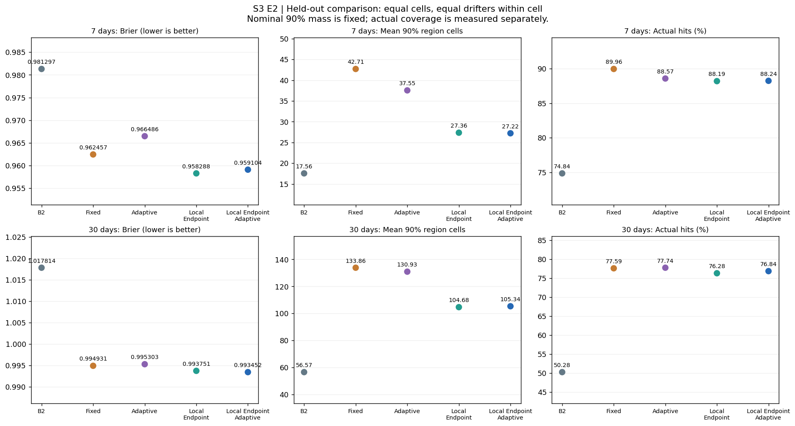

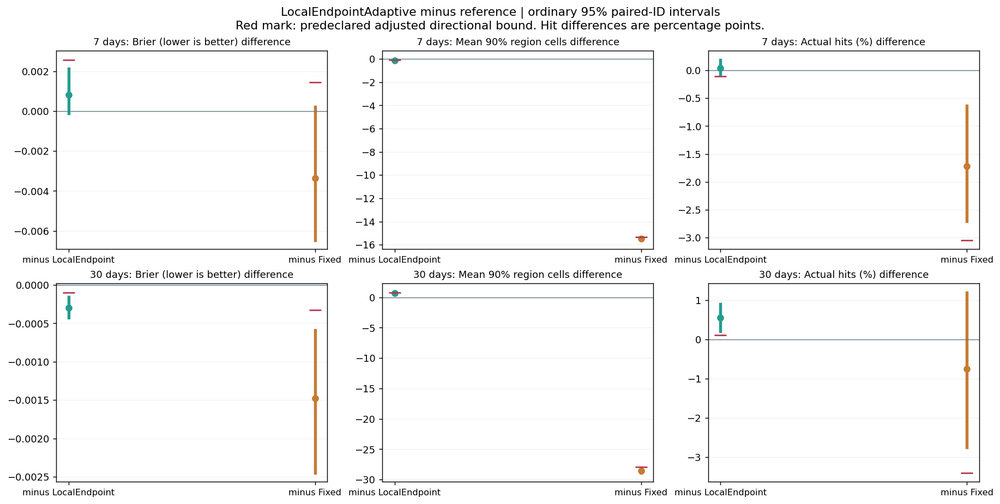

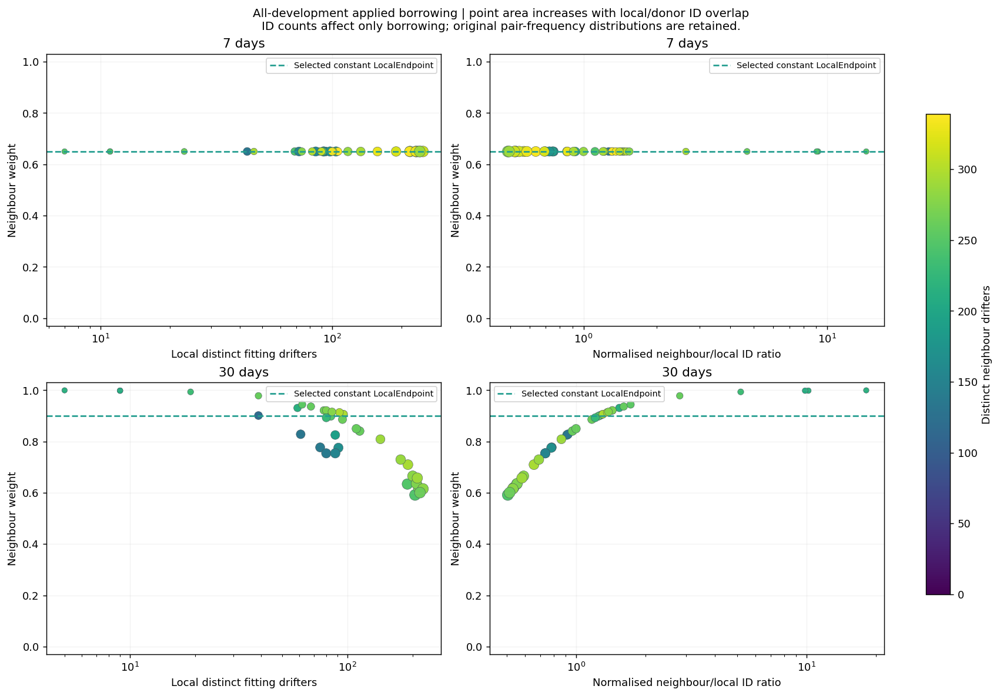

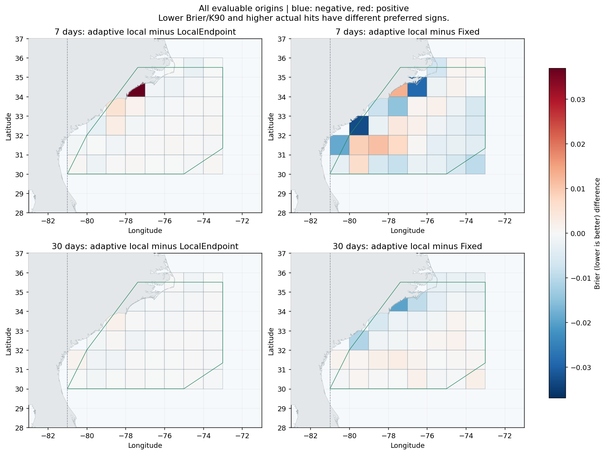

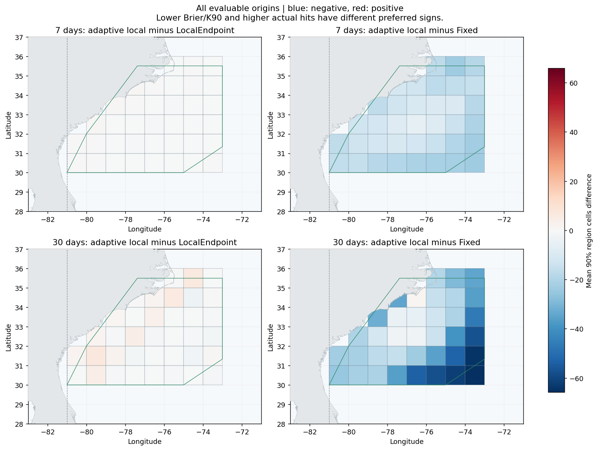

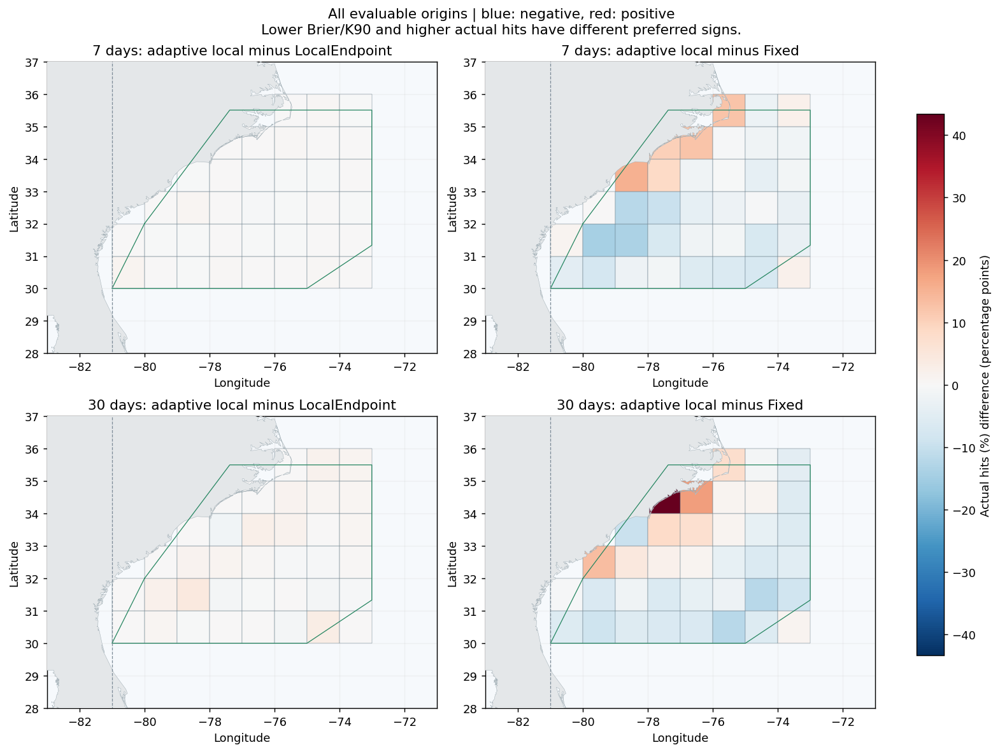

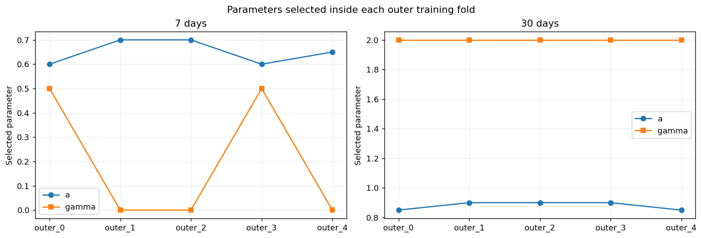

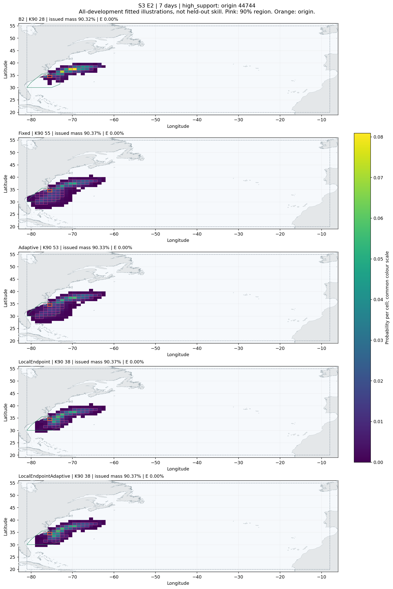

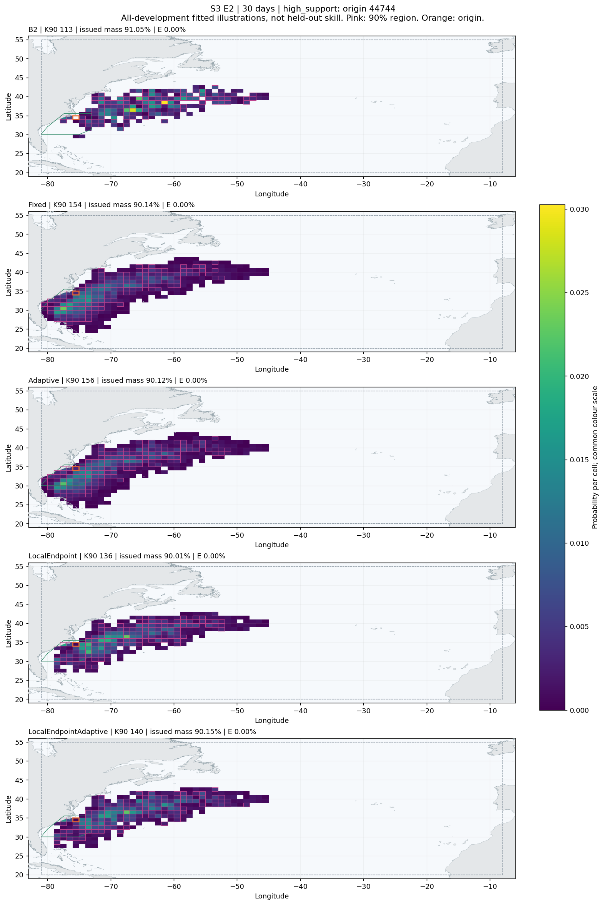

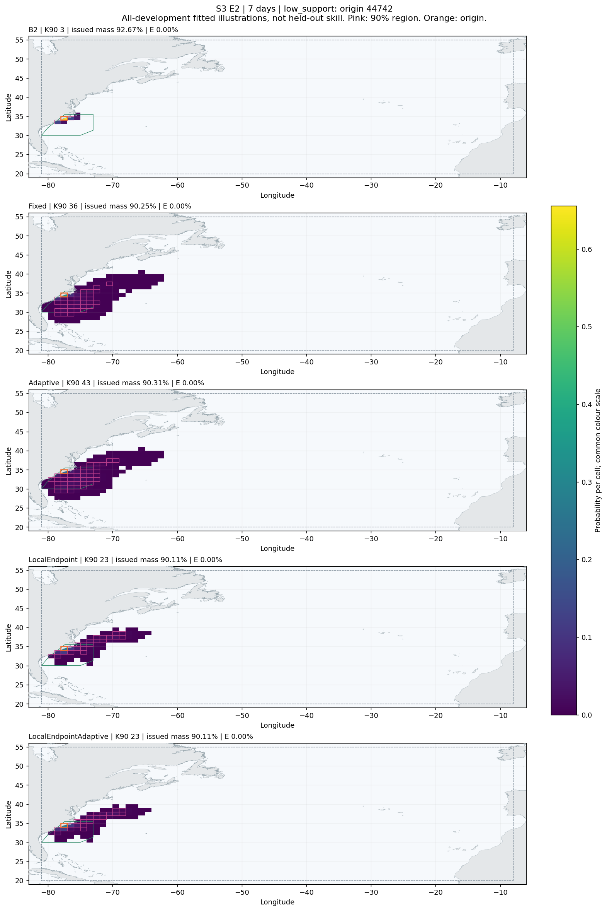

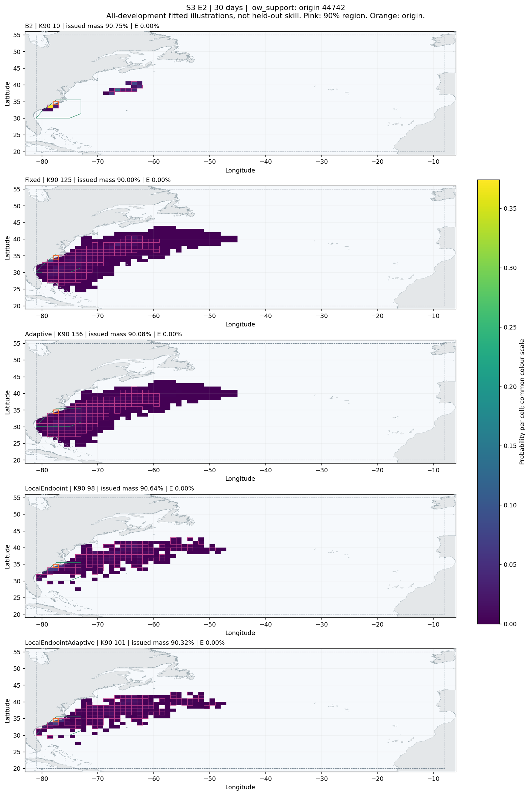

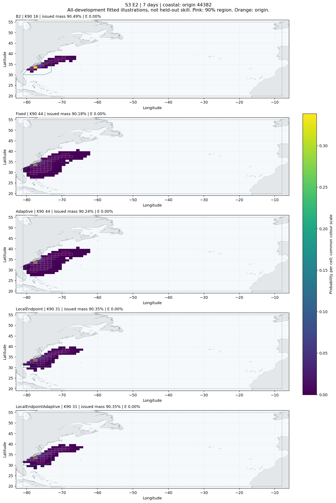

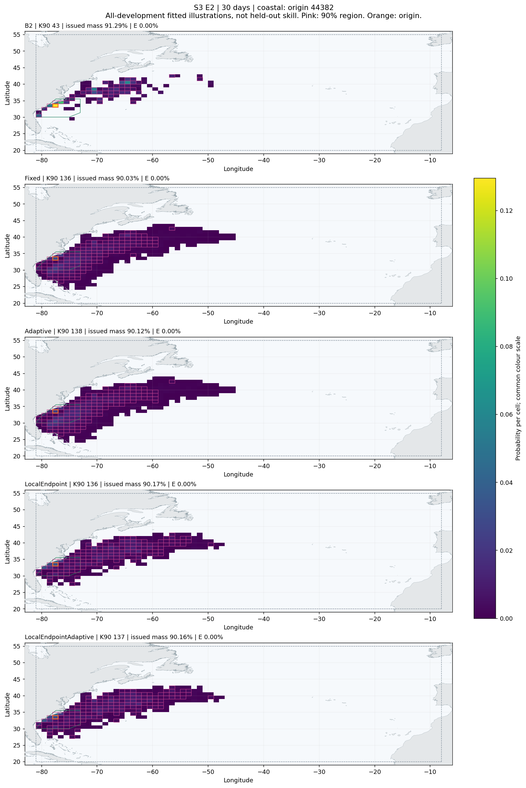
