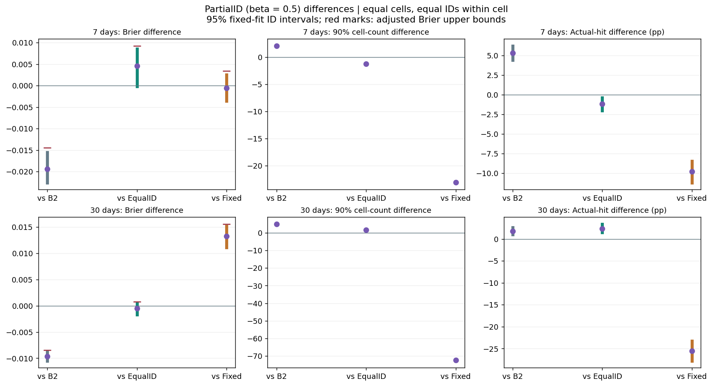
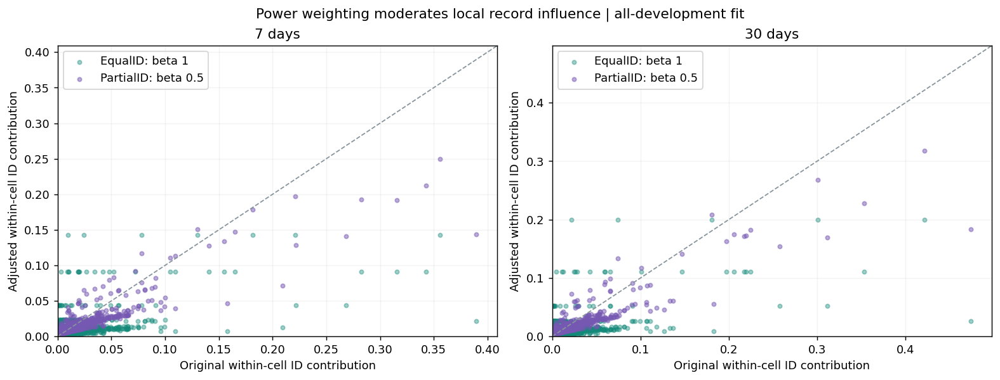
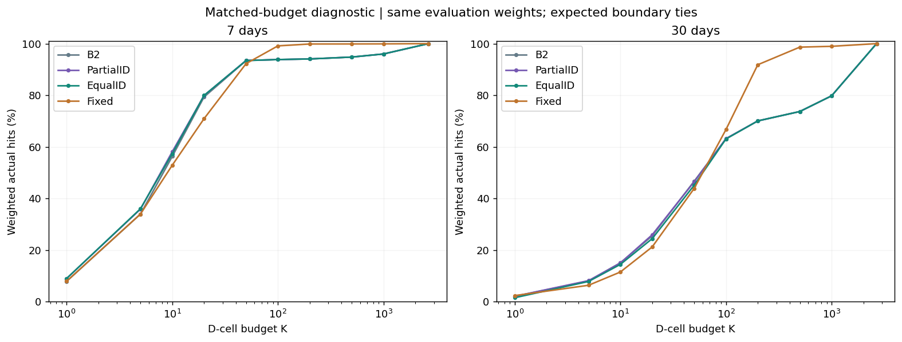
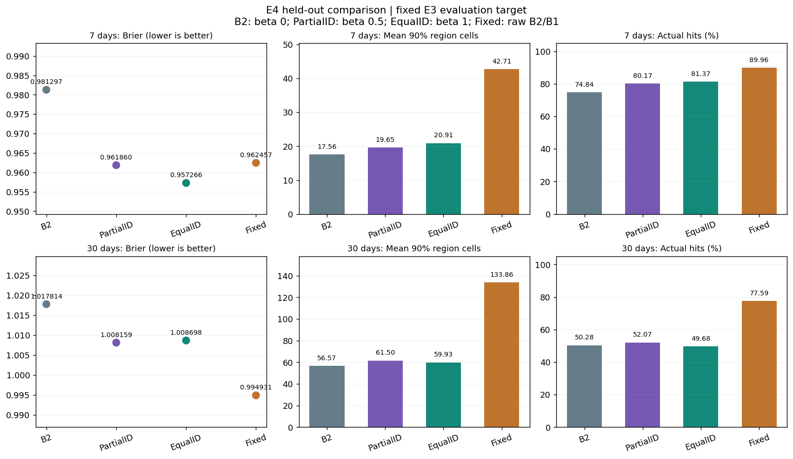
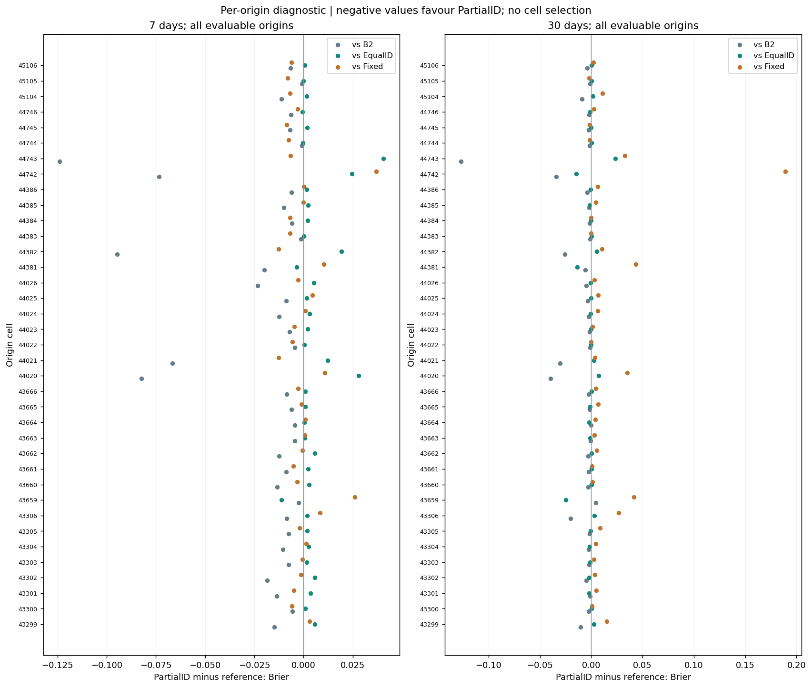
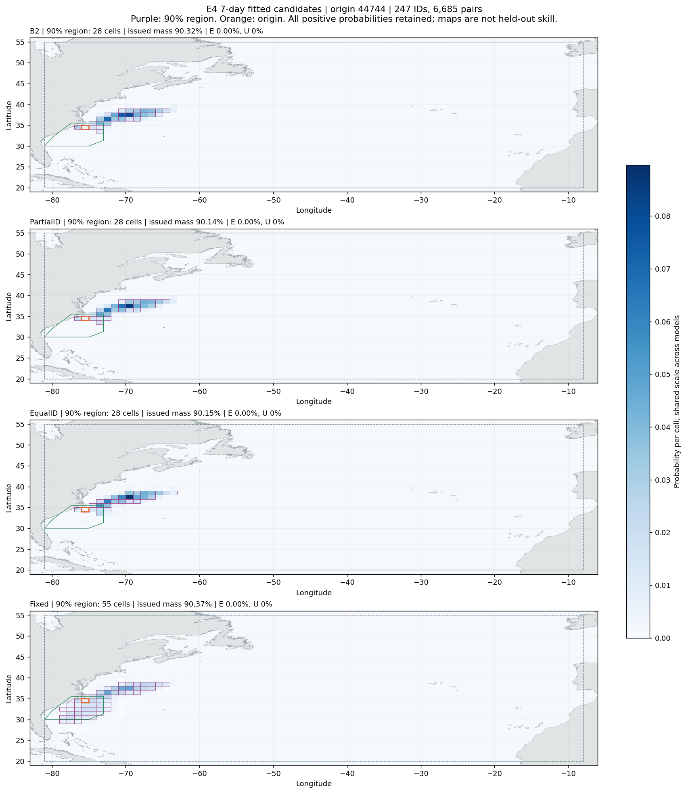
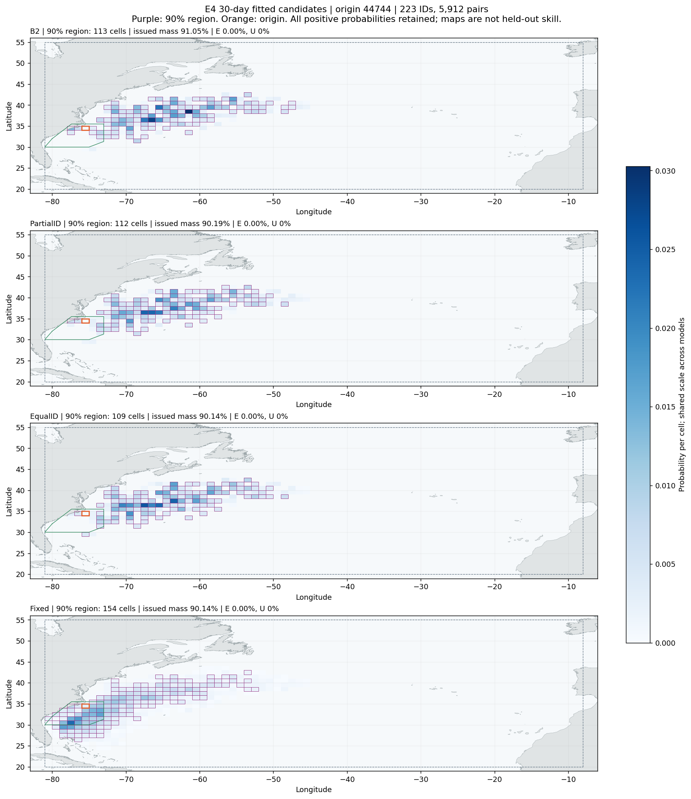

# Step 2 — E4 Partial Drifter Contribution Weighting

Run: partial_weighting_e4_20261030T082826_141410Z. Executed and independently audited; scientific review pending.

## Findings

7 days, PartialID versus B2: conditional_development_Brier_support. Brier change -0.01943665; 90% cells +2.093; actual hits +5.336 percentage points. Region/hit trade-off: True.
7 days, PartialID versus EqualID: no_measurable_Brier_gain. Brier change +0.00459358; 90% cells -1.255; actual hits -1.195 percentage points. Region/hit trade-off: True.
7 days, PartialID versus Fixed: point_improvement_uncertain. Brier change -0.00059729; 90% cells -23.060; actual hits -9.782 percentage points. Region/hit trade-off: True.
30 days, PartialID versus B2: conditional_development_Brier_support. Brier change -0.00965528; 90% cells +4.928; actual hits +1.790 percentage points. Region/hit trade-off: True.
30 days, PartialID versus EqualID: point_improvement_uncertain. Brier change -0.00053863; 90% cells +1.573; actual hits +2.388 percentage points. Region/hit trade-off: True.
30 days, PartialID versus Fixed: no_measurable_Brier_gain. Brier change +0.01322803; 90% cells -72.359; actual hits -25.520 percentage points. Region/hit trade-off: True.

## Primary held-out results

| horizon_days | model | evaluable_cells | evaluable_ids | evaluable_id_cells | evaluable_pairs | brier | region90_cells | target_availability | zero_true_probability | actual_hits_percent |
| --- | --- | --- | --- | --- | --- | --- | --- | --- | --- | --- |
| 7 | B2 | 37 | 385 | 4451 | 303288 | 0.981297 | 17.5583 | 1 | 0.0634891 | 74.8378 |
| 7 | EqualID | 37 | 385 | 4451 | 303288 | 0.957266 | 20.9063 | 1 | 0.0634891 | 81.3692 |
| 7 | Fixed | 37 | 385 | 4451 | 303288 | 0.962457 | 42.7116 | 1 | 0.00152198 | 89.9558 |
| 7 | PartialID | 37 | 385 | 4451 | 303288 | 0.96186 | 19.6513 | 1 | 0.0634891 | 80.1741 |
| 30 | B2 | 37 | 337 | 3974 | 268998 | 1.01781 | 56.5707 | 1 | 0.314331 | 50.2761 |
| 30 | EqualID | 37 | 337 | 3974 | 268998 | 1.0087 | 59.9257 | 1 | 0.314331 | 49.678 |
| 30 | Fixed | 37 | 337 | 3974 | 268998 | 0.994931 | 133.858 | 1 | 0.014935 | 77.5861 |
| 30 | PartialID | 37 | 337 | 3974 | 268998 | 1.00816 | 61.4987 | 1 | 0.314331 | 52.0657 |

The horizons have distinct eligible populations. Evaluation is equal-cell, equal-ID within each cell.

## Paired differences and conditional uncertainty

| horizon_days | model | reference | metric | difference | lower_95 | upper_95 | adjusted_upper | defined_replicates |
| --- | --- | --- | --- | --- | --- | --- | --- | --- |
| 7 | PartialID | B2 | brier | -0.0194366 | -0.022588 | -0.0155227 | -0.0144945 | 5000 |
| 7 | PartialID | B2 | region90_cells | 2.09306 | 2.06455 | 2.12096 | NA | 5000 |
| 7 | PartialID | B2 | region90_hit | 0.0533632 | 0.0439171 | 0.0624089 | NA | 5000 |
| 7 | PartialID | EqualID | brier | 0.00459358 | -0.000216791 | 0.00857818 | 0.00929232 | 5000 |
| 7 | PartialID | EqualID | region90_cells | -1.25497 | -1.28552 | -1.2273 | NA | 5000 |
| 7 | PartialID | EqualID | region90_hit | -0.0119511 | -0.0202488 | -0.00394462 | NA | 5000 |
| 7 | PartialID | Fixed | brier | -0.000597293 | -0.00361568 | 0.00259342 | 0.00341384 | 5000 |
| 7 | PartialID | Fixed | region90_cells | -23.0603 | -23.1526 | -22.9532 | NA | 5000 |
| 7 | PartialID | Fixed | region90_hit | -0.0978175 | -0.112127 | -0.0843958 | NA | 5000 |
| 30 | PartialID | B2 | brier | -0.00965528 | -0.0105172 | -0.00869413 | -0.00849275 | 5000 |
| 30 | PartialID | B2 | region90_cells | 4.92807 | 4.86096 | 4.99691 | NA | 5000 |
| 30 | PartialID | B2 | region90_hit | 0.0178961 | 0.0097018 | 0.0264891 | NA | 5000 |
| 30 | PartialID | EqualID | brier | -0.000538631 | -0.0017261 | 0.000537104 | 0.000774112 | 5000 |
| 30 | PartialID | EqualID | region90_cells | 1.573 | 1.53377 | 1.61341 | NA | 5000 |
| 30 | PartialID | EqualID | region90_hit | 0.0238776 | 0.0143982 | 0.0340385 | NA | 5000 |
| 30 | PartialID | Fixed | brier | 0.013228 | 0.0111019 | 0.0151659 | 0.0155622 | 5000 |
| 30 | PartialID | Fixed | region90_cells | -72.3588 | -72.8088 | -71.8744 | NA | 5000 |
| 30 | PartialID | Fixed | region90_hit | -0.255203 | -0.278059 | -0.232714 | NA | 5000 |

Hit differences above are fractions; multiply by 100 for percentage points. Brier adjusted_upper is the 99.1667th percentile for the six prespecified PartialID contrasts.

## Secondary original-pair sensitivity

| horizon_days | model | evaluable_cells | evaluable_ids | evaluable_id_cells | evaluable_pairs | brier | region90_cells | target_availability | zero_true_probability | actual_hits_percent |
| --- | --- | --- | --- | --- | --- | --- | --- | --- | --- | --- |
| 7 | B2 | 37 | 385 | 4451 | 303288 | 0.929001 | 18.2258 | 1 | 0.0208218 | 87.439 |
| 7 | EqualID | 37 | 385 | 4451 | 303288 | 0.947769 | 21.7154 | 1 | 0.0208218 | 88.5736 |
| 7 | Fixed | 37 | 385 | 4451 | 303288 | 0.93824 | 42.0308 | 1 | 0.000675925 | 95.5188 |
| 7 | PartialID | 37 | 385 | 4451 | 303288 | 0.933394 | 20.2478 | 1 | 0.0208218 | 89.3342 |
| 30 | B2 | 37 | 337 | 3974 | 268998 | 0.994751 | 62.6083 | 1 | 0.174589 | 66.3726 |
| 30 | EqualID | 37 | 337 | 3974 | 268998 | 0.99556 | 65.8871 | 1 | 0.174589 | 62.0726 |
| 30 | Fixed | 37 | 337 | 3974 | 268998 | 0.989841 | 133.549 | 1 | 0.0109406 | 86.9111 |
| 30 | PartialID | 37 | 337 | 3974 | 268998 | 0.992651 | 67.7429 | 1 | 0.174589 | 66.6548 |

These scores use the same newly selected predictions; they did not select Fixed's parameter.

## Fixed parameter selection

| role | horizon_days | parameter_a | brier | selection_status |
| --- | --- | --- | --- | --- |
| outer_0 | 7 | 0.5 | 0.964552 | new_target_Brier_minimum |
| outer_0 | 30 | 0.85 | 0.995537 | new_target_Brier_minimum |
| outer_1 | 7 | 0.5 | 0.963685 | new_target_Brier_minimum |
| outer_1 | 30 | 0.9 | 0.9957 | new_target_Brier_minimum |
| outer_2 | 7 | 0.5 | 0.963413 | new_target_Brier_minimum |
| outer_2 | 30 | 0.8 | 0.995294 | new_target_Brier_minimum |
| outer_3 | 7 | 0.5 | 0.96601 | new_target_Brier_minimum |
| outer_3 | 30 | 0.85 | 0.995338 | new_target_Brier_minimum |
| outer_4 | 7 | 0.45 | 0.962549 | new_target_Brier_minimum |
| outer_4 | 30 | 0.8 | 0.99517 | new_target_Brier_minimum |
| all_development_candidate | 7 | 0.45 | 0.962333 | new_target_Brier_minimum |
| all_development_candidate | 30 | 0.8 | 0.994816 | new_target_Brier_minimum |

## Assumptions and interpretation

- Where Things End Up: predict the destination distribution from a given current origin cell at 7 or 30 days. The start is not first entry. Exact positions map to 1-degree cells; other elapsed days are not validated here.
- PartialID uses per-pair weight n_id^(-0.5), locally within fitting ID/origin/horizon. Beta 0 is raw B2; beta 1 is EqualID. All hourly pairs and internal endpoint proportions remain. Fixed retains raw B2/B1 and selects a by the unchanged E3 score. No beta is selected.
- Primary evaluation averages eligible times within ID/cell, then IDs within cell, then cells equally. It conditions on common available support. Secondary original-pair metrics describe a different population and cannot select the model.
- These are nested whole-ID development results on previously examined data. Final-test trajectories remain locked. All-development fitted maps are illustrative and cannot establish held-out performance.
- The complete probability distribution is retained. Nominal 90% mass need not achieve 90% observed hits; cutoff ties may issue more mass. Cell counts are not physical area.
- PartialID and EqualID have exactly B2's positive support. It cannot repair unseen-destination zeros or unsupported origin rows. E means first observed exit; U is unavailable support, not beaching.
- 5,000 paired Exp(1) whole-ID multiplier resamples keep cells and fits fixed. Intervals omit refitting, shared training and research-adaptation uncertainty. Six-contrast adjusted Brier bounds are conditional evidence, not a guarantee.
- Partial weighting is a fitting-population sensitivity experiment under one fixed evaluation target. It is not Bayesian inference or proof that record length measures independent information.
- One observed ID in a cell is not sufficient to validate its uncertainty. Cross-ID shared ocean conditions are not captured by ID-level resampling.
- No observed exits would leave exit calibration unvalidated. Drifter transport is a proxy for spills/objects; windage, spreading, oil weathering and object-type transfer are outside this experiment.
- A Brier gain with lower hits or a larger region is a disclosed application trade-off. A gain against B2 alone does not establish a gain against Fixed. Retention and Step 2 closure await user review.

## Engineering verification

All 26 fitting roles and 1,200 candidate identities are independently reconstructed; every numerical table is compared in the separate replay.
The current run's verification receipt identifies whether it is the primary run or replay. Source, input and outer-freeze hashes are checked before sealing.

## Figures

Support-only illustration origin: 44744.

## Artifact guide

summary.csv: primary target; pair_weighted_summary.csv: secondary target; paired_differences.csv: paired comparisons; heldout_id_cells.parquet: numerator/mass sufficient scores; heldout_scores.parquet: explicit case weights; candidate_id_cells.parquet: all selection cases; fit_roles.json: whole-ID isolation; multiplier_identity.json: reproducible resampling; weighting_definitions.json: denominator semantics.
