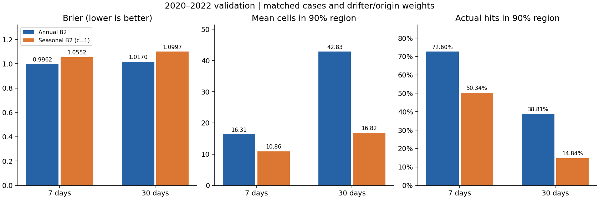
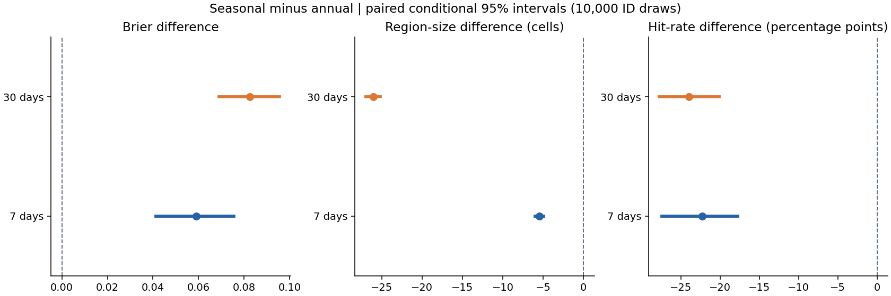
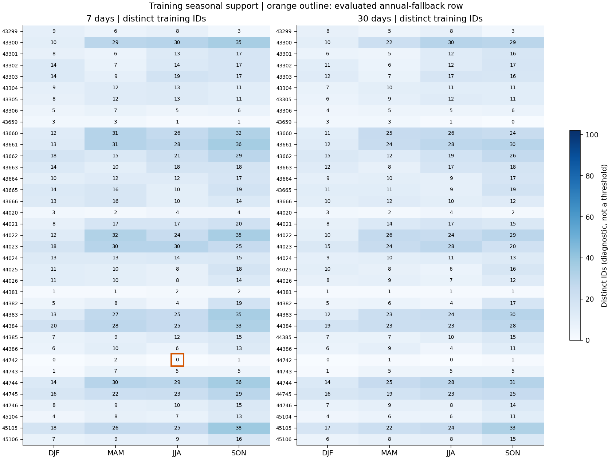
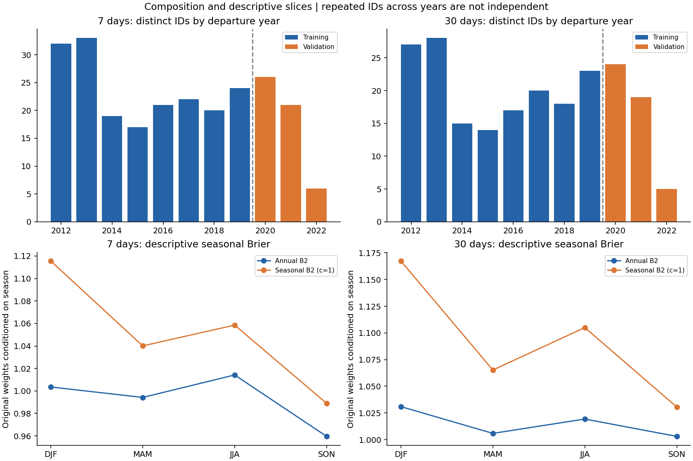
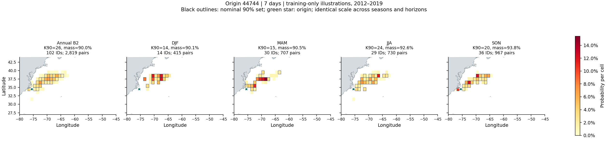
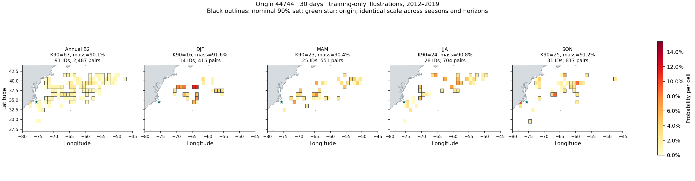
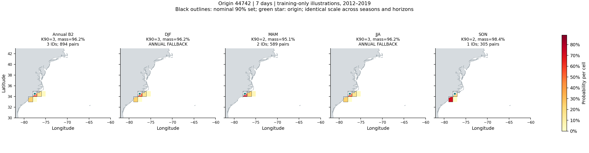
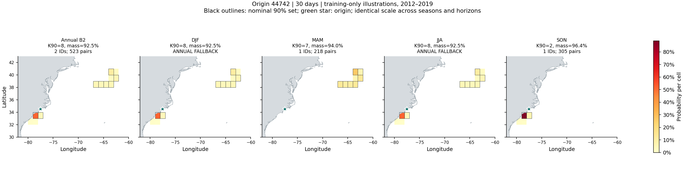
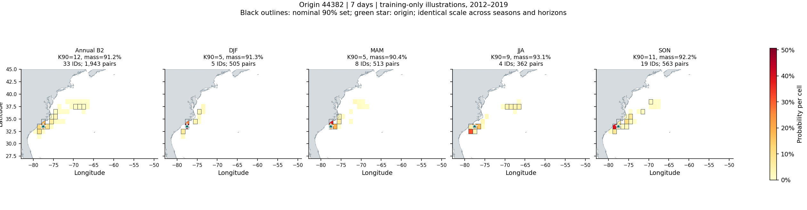
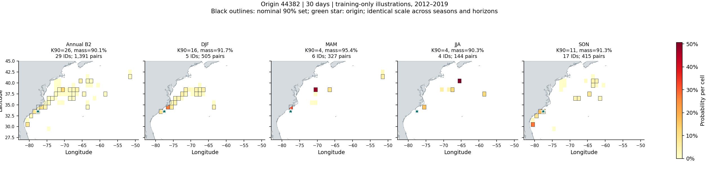

# Step 4 E1 v2 — Chronological Seasonal B2 Comparison

Run: `seasonal_conditioning_s4_e1_primary_20261102T005104_943407Z`. Results submitted for user review; model retention remains undecided.

## Design

Training: 2012–2019, with labels requiring observations at/after 2020 removed, then all validation IDs removed at both horizons. Validation: available 2020–2022 departures. Standard Brier and fixed 90% regions. Two untuned models only.

## Results

horizon_days,model,brier,K90 (cells),H90 (%),fallback_pairs,Fallback weight (%)
7,B2Annual,0.996224370939787,16.305555555555554,72.59681919793577,0,0.0
7,B2SeasonalC1,1.0551792916634255,10.864405599982241,50.34174638499571,41,2.777777777777778
30,B2Annual,1.0170313756611447,42.8285714285716,38.81020384094748,0,0.0
30,B2SeasonalC1,1.0996870635741178,16.819743732533908,14.839924811073162,0,0.0

7 days: NO_BRIER_POINT_GAIN; 30 days: NO_BRIER_POINT_GAIN

Complete exact values: [summary.csv](summary.csv), [contrasts.csv](contrasts.csv), [uncertainty.csv](uncertainty.csv), [descriptive_slices.csv](descriptive_slices.csv).

## Visual comparison

## Limitations

- Chronological development backtest, not a new untouched final test. Earlier project use of development data remains a limitation.
- Both fits use permitted 2012–2019 pairs only. Validation is available 2020–2022 data, with 45 / 42 IDs at 7 / 30 days; 2022 is incomplete.
- Training uses raw pairs. Evaluation averages times within ID/origin, then IDs within origin, then origins equally. Seasons are not given extra full votes.
- The nominal region contains at least 90% fitted probability with cutoff ties; this is not a guarantee of 90% observed coverage. K90 counts cells, not physical area.
- Conditional paired intervals hold fitted models fixed and omit training uncertainty and shared ocean forcing. Six directional screens are approximate resampling evidence.
- Sparse seasonal empirical rows may be noisy. Failure of c=1 does not establish that season, SST or other features cannot help.
- Annual fallback preserves unsupported-season cases. It is not model-level fallback after observing validation quality. No future window or weight was searched.

## Verification

{"counts_probabilities_regions_independent": true, "final_test_access": false, "forecast_keys_checked": 506, "independent_scores_weights_fallback": true, "max_probability_error": 0.0, "maximum_case_score_error": 6.661338147750939e-16, "maximum_draw_error": 1.7763568394002505e-14, "paired_uncertainty_and_flags": true, "source_roles_independent": true, "synthetic_targets": false}

Scientific input roles, forecasts and original weights were frozen before validation scoring. Independent arithmetic checks and fresh-replay status are in the matching provenance directory. The successful deliverable alias is created only after replay verification.
