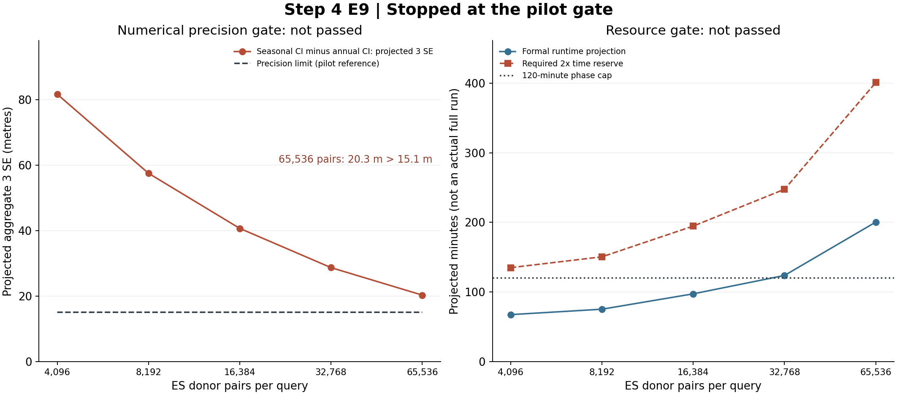

# Step 4 E9 — stopped at the pilot gate

Status: PARTIAL; formal experiment not started. Run: `seasonal_exact_position_s4_e9_20261106T124835_392309Z`.

The four approved model definitions are implemented. No fusion, new weights, endpoint translation, CI rescaling, radius adjustment or scientific-definition amendment was made. No outer endpoints or locked final-test records were read by this E9 run.

## Decision and resources

- Highest registered ES budget: 65,536 donor pairs per query.
- Projected aggregate 3-SE uncertainty: 20.300 m; required threshold: 15.062 m. Both seasonal comparisons fail.
- Projected formal time: 200.37 min; with required twofold reserve: 400.73 min; formal cap: 120 min. These are projections, not consumed runtime.
- Actual cumulative pilot/check runtime: 167.25 s of 600 s. Peak observed process RSS through review: 1.024 GiB.
- Formal four-model results, acceptance tests, and formal fallback rates: unavailable.

Region stability passed at 16,384 quadrature points: maximum independent mass discrepancy 0.0584 percentage points (limit 0.5); weighted hit disagreement 0 percentage points (limit 0.1); largest weighted absolute area change 0.0473% (limit 0.5%). These are numerical repeatability checks, not evidence of predictive coverage.

## Why this is an engineering stop

The new seasonal-minus-annual comparison involves different donor distributions. Their Monte Carlo self-distance uncertainty is much larger than the tiny CI-minus-point perturbation assessed in E8. The current pilot uses separate annual and seasonal numerical streams and includes uncertainty from both. The 3-SE projection applies each pilot season's largest observed per-case variance to the full query weights. It is a conservative planning estimate, not a measured outer error or a guaranteed mathematical upper bound. Runtime uses the pilot's 95th-percentile case time, all 33,971 cases, fixed overhead and 10% allowance; the contract additionally requires a factor-of-two reserve. A full support/storage inventory was not started after these preliminary gates failed.

## Internal pilot values only

128 fixed internal pilot cases, 44 distinct drifter IDs, 64 cases per training role. These are not the 33,971 outer validation cases. ES, hit and area average times within each ID and then average IDs. No bootstrap significance or acceptance claim is made. Numeric ES uses 65,536 pairs; CI region quadrature uses 16,384 points. The table is supplied for traceability, not as a substitute for formal results.

| Model | ES (km) | Actual hit rate | Mean 90% area (km2) |
|---|---:|---:|---:|
| AnnualExactPoint | 150.618883 | 81.780% | 228,327.61 |
| AnnualEndpointCI | 150.618566 | 81.780% | 228,374.57 |
| SeasonalExactPoint | 157.104347 | 69.652% | 218,390.92 |
| SeasonalEndpointCI | 157.104135 | 69.652% | 218,396.54 |

The pilot is inconclusive about the seasonal scientific hypothesis. The seasonal pilot scores are worse, but this fixed engineering roster is not the full validation population. No scientific rejection, model selection, or seasonal stopping conclusion follows from this table.

## Fallback and support

Season-to-annual fallback: 0/128 pilot queries for both seasonal arms. Missing-error point fallback appears in 64/128 annual-CI cases and 25/128 seasonal-CI cases. Its ID-weighted probability mass is 0.0702% and 0.0937%, respectively. These are two different fallback definitions. Neither deletes observations or changes their vote. All four seasons are represented; 7 cases cross a season boundary and 0 are exact ties. Tie behaviour passed synthetic tests. Outer fallback rates remain unmeasured.

## Independent verification and limits

24 semantic/regression tests passed. The review independently reconstructed the 128 neighbour selections using full WGS84 distance scans, recomputed UTC quarter overlaps and all five gate calculations, and verified 492 protected file hashes. The original seasonal donor vectors were not retained by the pilot; this is a deterministic reconstruction audit. Formal forecast freeze, whole-population score audit, bootstrap inference and six outer example maps were not performed.

The majority-season definition is seven elapsed UTC days, with ties assigned to the departure season. Season filtering precedes the 100-km/8,000-neighbour selection; all kth-distance ties remain. Every selected historical pair retains the same vote. CI unavailable records remain point components. No nonempty low-support seasonal pool was blended with annual data.

## Next decision

Stop under the approved contract. A continuation would first need a reviewed computational plan for reducing ES estimator variance and repeated work while preserving all four probability laws and the original scores. This report does not authorize or implement that change, a larger budget, extra sampling levels, or a weaker threshold.

Evidence: `../pilot/`, `../pilot_audit/`, and the matching provenance run's `pilot_gate.json`, `pilot_independent_review.json`, `semantic_tests.txt` and resource receipts. Approved contract SHA256: `dd6ba68f48359440b84fa2d4ba847925891ffed0f1ce96333034de16e9993f69`.
