# Step 3 E1 — Local spatial borrowing

**Status: independently executed and audited; submitted for user review. Stage closure is pending.**

This is the first benchmark under the approved S3 grid-path transfer definition. Historical favourable neighbourhood results do not establish success here. All skill values below are nested whole-ID development results, not locked-final-test performance.

## Model definitions

B2 uses local raw pair frequencies. Fixed borrows the global B1 reference with a constant per-horizon weight. Adaptive uses the original support-count schedule, retuned under the current target. LocalEndpoint borrows neighbours' observed stopped destinations. LocalDisplacement translates complete hourly paths in the 1-degree longitude-latitude grid; failed transfer weights return to target B2. The eight-cell neighbourhood excludes self and only contains qualified fitting R-origin records.

The shift preserves grid-relative increments, not exact geodesic distances. Land and intermediate-hour paths are checked; first observed exits are absorbing E. Endpoint-versus-displacement differences include the geometry/fallback safeguard. No state, probability or failed proposal is deleted to improve the map.

## Primary held-out comparison

| horizon_days | model | brier | region90_cells | region90_hit | zero_true_probability | predicted_exit_probability | evaluable_ids | evaluable_pairs |
| --- | --- | --- | --- | --- | --- | --- | --- | --- |
| 7 | Adaptive | 0.966486 | 37.552 | 0.885722 | 0.00152198 | 0 | 385 | 303288 |
| 7 | B2 | 0.981297 | 17.5583 | 0.748378 | 0.0634891 | 0 | 385 | 303288 |
| 7 | Fixed | 0.962457 | 42.7116 | 0.899558 | 0.00152198 | 0 | 385 | 303288 |
| 7 | LocalDisplacement | 0.975131 | 23.1296 | 0.822021 | 0.0065322 | 4.41865e-05 | 385 | 303288 |
| 7 | LocalEndpoint | 0.958288 | 27.3581 | 0.88191 | 0.00292746 | 0 | 385 | 303288 |
| 30 | Adaptive | 0.995303 | 130.933 | 0.777365 | 0.014935 | 0 | 337 | 268998 |
| 30 | B2 | 1.01781 | 56.5707 | 0.502761 | 0.314331 | 0 | 337 | 268998 |
| 30 | Fixed | 0.994931 | 133.858 | 0.775861 | 0.014935 | 0 | 337 | 268998 |
| 30 | LocalDisplacement | 1.00701 | 96.1726 | 0.699607 | 0.0832278 | 0.000517336 | 337 | 268998 |
| 30 | LocalEndpoint | 0.993751 | 104.679 | 0.762831 | 0.0560436 | 0 | 337 | 268998 |

Primary aggregation: eligible times within each ID/cell, equal IDs within cell, equal cells. Brier is unnormalised multiclass Brier and is not accuracy. K90 counts geographic cells, not area. H90 includes the stopped outcome E; nominal probability 0.90 need not equal observed coverage. The complete distribution remains stored.

## Differences and uncertainty

| horizon_days | model | reference | metric | difference | lower_95 | upper_95 | adjusted_directional_bound | primary_comparison | defined_replicates |
| --- | --- | --- | --- | --- | --- | --- | --- | --- | --- |
| 7 | LocalDisplacement | B2 | brier | -0.00616554 | -0.00738544 | -0.00490321 | NA | False | 5000 |
| 7 | LocalDisplacement | B2 | region90_cells | 5.57128 | 5.52572 | 5.61685 | NA | False | 5000 |
| 7 | LocalDisplacement | B2 | region90_hit | 0.0736437 | 0.063294 | 0.085115 | NA | False | 5000 |
| 7 | LocalDisplacement | Fixed | brier | 0.0126738 | 0.00745494 | 0.0171275 | 0.0178306 | True | 5000 |
| 7 | LocalDisplacement | Fixed | region90_cells | -19.5821 | -19.6726 | -19.4854 | -19.4673 | True | 5000 |
| 7 | LocalDisplacement | Fixed | region90_hit | -0.077537 | -0.0910465 | -0.0645461 | -0.0942421 | True | 5000 |
| 7 | LocalDisplacement | Adaptive | brier | 0.00864522 | 0.00128473 | 0.0148647 | NA | False | 5000 |
| 7 | LocalDisplacement | Adaptive | region90_cells | -14.4224 | -14.5594 | -14.2822 | NA | False | 5000 |
| 7 | LocalDisplacement | Adaptive | region90_hit | -0.0637007 | -0.0786158 | -0.048738 | NA | False | 5000 |
| 7 | LocalEndpoint | B2 | brier | -0.0230089 | -0.0298215 | -0.0151306 | NA | False | 5000 |
| 7 | LocalEndpoint | B2 | region90_cells | 9.79986 | 9.76166 | 9.83669 | NA | False | 5000 |
| 7 | LocalEndpoint | B2 | region90_hit | 0.133532 | 0.118752 | 0.150026 | NA | False | 5000 |
| 7 | LocalEndpoint | Fixed | brier | -0.00416954 | -0.00661259 | -0.00176496 | NA | False | 5000 |
| 7 | LocalEndpoint | Fixed | region90_cells | -15.3535 | -15.4453 | -15.2505 | NA | False | 5000 |
| 7 | LocalEndpoint | Fixed | region90_hit | -0.0176485 | -0.0275216 | -0.00682075 | NA | False | 5000 |
| 7 | LocalEndpoint | Adaptive | brier | -0.00819813 | -0.00957962 | -0.00680094 | NA | False | 5000 |
| 7 | LocalEndpoint | Adaptive | region90_cells | -10.1939 | -10.324 | -10.0552 | NA | False | 5000 |
| 7 | LocalEndpoint | Adaptive | region90_hit | -0.00381223 | -0.0150984 | 0.0100536 | NA | False | 5000 |
| 7 | LocalDisplacement | LocalEndpoint | brier | 0.0168434 | 0.00955479 | 0.0230669 | NA | False | 5000 |
| 7 | LocalDisplacement | LocalEndpoint | region90_cells | -4.22858 | -4.26987 | -4.18522 | NA | False | 5000 |
| 7 | LocalDisplacement | LocalEndpoint | region90_hit | -0.0598885 | -0.0722153 | -0.0474464 | NA | False | 5000 |
| 30 | LocalDisplacement | B2 | brier | -0.0108023 | -0.0115754 | -0.0100061 | NA | False | 5000 |
| 30 | LocalDisplacement | B2 | region90_cells | 39.6019 | 39.4204 | 39.7811 | NA | False | 5000 |
| 30 | LocalDisplacement | B2 | region90_hit | 0.196846 | 0.180148 | 0.213591 | NA | False | 5000 |
| 30 | LocalDisplacement | Fixed | brier | 0.012081 | 0.00978029 | 0.014137 | 0.0145588 | True | 5000 |
| 30 | LocalDisplacement | Fixed | region90_cells | -37.685 | -38.0335 | -37.2856 | -37.1837 | True | 5000 |
| 30 | LocalDisplacement | Fixed | region90_hit | -0.0762532 | -0.0951559 | -0.0578855 | -0.0998426 | True | 5000 |
| 30 | LocalDisplacement | Adaptive | brier | 0.0117089 | 0.00901884 | 0.0140265 | NA | False | 5000 |
| 30 | LocalDisplacement | Adaptive | region90_cells | -34.7607 | -35.0698 | -34.4477 | NA | False | 5000 |
| 30 | LocalDisplacement | Adaptive | region90_hit | -0.0777577 | -0.0981096 | -0.0582769 | NA | False | 5000 |
| 30 | LocalEndpoint | B2 | brier | -0.0240636 | -0.0264551 | -0.0212903 | NA | False | 5000 |
| 30 | LocalEndpoint | B2 | region90_cells | 48.1088 | 47.9167 | 48.2866 | NA | False | 5000 |
| 30 | LocalEndpoint | B2 | region90_hit | 0.26007 | 0.24092 | 0.279459 | NA | False | 5000 |
| 30 | LocalEndpoint | Fixed | brier | -0.00118024 | -0.00216513 | -0.000310252 | NA | False | 5000 |
| 30 | LocalEndpoint | Fixed | region90_cells | -29.1781 | -29.5232 | -28.8103 | NA | False | 5000 |
| 30 | LocalEndpoint | Fixed | region90_hit | -0.0130298 | -0.0332214 | 0.00704373 | NA | False | 5000 |
| 30 | LocalEndpoint | Adaptive | brier | -0.00155239 | -0.00256331 | -0.000631735 | NA | False | 5000 |
| 30 | LocalEndpoint | Adaptive | region90_cells | -26.2538 | -26.568 | -25.9453 | NA | False | 5000 |
| 30 | LocalEndpoint | Adaptive | region90_hit | -0.0145343 | -0.0340205 | 0.00497667 | NA | False | 5000 |
| 30 | LocalDisplacement | LocalEndpoint | brier | 0.0132613 | 0.0109045 | 0.0153778 | NA | False | 5000 |
| 30 | LocalDisplacement | LocalEndpoint | region90_cells | -8.50689 | -8.69537 | -8.32037 | NA | False | 5000 |
| 30 | LocalDisplacement | LocalEndpoint | region90_hit | -0.0632234 | -0.0802803 | -0.0469647 | NA | False | 5000 |

| horizon_days | model | reference | point_Brier_gain | conditional_Brier_support | conditional_quality_preserving | conditional_smaller_region | joint_point_benefit | application_tradeoff | delta_brier | delta_region90_cells | delta_region90_hit |
| --- | --- | --- | --- | --- | --- | --- | --- | --- | --- | --- | --- |
| 7 | LocalDisplacement | Fixed | False | False | False | False | False | True | 0.0126738 | -19.5821 | -0.077537 |
| 30 | LocalDisplacement | Fixed | False | False | False | False | False | True | 0.012081 | -37.685 | -0.0762532 |

Ordinary 95% paired ID intervals condition on saved fits. The six primary metric/horizon screens use directional 0.05/6 tails. These omit model refitting, shared-training dependence, earlier research adaptation and common ocean forcing. Non-significance is not proof of non-deterioration. Improvement at one horizon does not imply improvement at the other.

## Selected parameters

| role | horizon_days | model | parameter_a |
| --- | --- | --- | --- |
| outer_0 | 7 | Fixed | 0.5 |
| outer_0 | 7 | Adaptive | 0.3 |
| outer_0 | 7 | LocalEndpoint | 0.7 |
| outer_0 | 7 | LocalDisplacement | 0.65 |
| outer_0 | 30 | Fixed | 0.85 |
| outer_0 | 30 | Adaptive | 0.75 |
| outer_0 | 30 | LocalEndpoint | 0.95 |
| outer_0 | 30 | LocalDisplacement | 1 |
| outer_1 | 7 | Fixed | 0.5 |
| outer_1 | 7 | Adaptive | 0.3 |
| outer_1 | 7 | LocalEndpoint | 0.7 |
| outer_1 | 7 | LocalDisplacement | 0.7 |
| outer_1 | 30 | Fixed | 0.9 |
| outer_1 | 30 | Adaptive | 0.8 |
| outer_1 | 30 | LocalEndpoint | 0.95 |
| outer_1 | 30 | LocalDisplacement | 1 |
| outer_2 | 7 | Fixed | 0.5 |
| outer_2 | 7 | Adaptive | 0.35 |
| outer_2 | 7 | LocalEndpoint | 0.7 |
| outer_2 | 7 | LocalDisplacement | 0.6 |
| outer_2 | 30 | Fixed | 0.8 |
| outer_2 | 30 | Adaptive | 0.75 |
| outer_2 | 30 | LocalEndpoint | 0.95 |
| outer_2 | 30 | LocalDisplacement | 1 |
| outer_3 | 7 | Fixed | 0.5 |
| outer_3 | 7 | Adaptive | 0.3 |
| outer_3 | 7 | LocalEndpoint | 0.7 |
| outer_3 | 7 | LocalDisplacement | 0.7 |
| outer_3 | 30 | Fixed | 0.85 |
| outer_3 | 30 | Adaptive | 0.7 |
| outer_3 | 30 | LocalEndpoint | 0.95 |
| outer_3 | 30 | LocalDisplacement | 1 |
| outer_4 | 7 | Fixed | 0.45 |
| outer_4 | 7 | Adaptive | 0.25 |
| outer_4 | 7 | LocalEndpoint | 0.65 |
| outer_4 | 7 | LocalDisplacement | 0.6 |
| outer_4 | 30 | Fixed | 0.8 |
| outer_4 | 30 | Adaptive | 0.75 |
| outer_4 | 30 | LocalEndpoint | 0.95 |
| outer_4 | 30 | LocalDisplacement | 1 |
| all_development_candidate | 7 | Fixed | 0.45 |
| all_development_candidate | 7 | Adaptive | 0.3 |
| all_development_candidate | 7 | LocalEndpoint | 0.65 |
| all_development_candidate | 7 | LocalDisplacement | 0.6 |
| all_development_candidate | 30 | Fixed | 0.8 |
| all_development_candidate | 30 | Adaptive | 0.7 |
| all_development_candidate | 30 | LocalEndpoint | 0.9 |
| all_development_candidate | 30 | LocalDisplacement | 1 |

## Transfer safeguards

| horizon_days | cells | mean_row_fallback | maximum_row_fallback | mean_row_effective_borrowing |
| --- | --- | --- | --- | --- |
| 7 | 37 | 0.191 | 0.898149 | 0.4854 |
| 30 | 37 | 0.244386 | 0.965837 | 0.755614 |

The table above is an unweighted mean over supported all-development fitted rows, not held-out case weighting. Effective borrowing is a*(1-fallback fraction). These weights describe the guarded estimator and must not be mistaken for additional independent observations.

| horizon_days | resolved_transfers | mean_absolute_distance_change_m | maximum_absolute_distance_change_m | mean_absolute_azimuth_change_deg |
| --- | --- | --- | --- | --- |
| 7 | 1769404 | 864.967 | 13835.9 | 0.1688 |
| 30 | 1503976 | 3179.36 | 34397 | 0.180634 |

Geodesic distortion is descriptive across resolved transfers, which can reuse the same donor for several target cells. It neither selects donors nor provides extra statistical sample size.

## Support and boundary diagnostics

| horizon_days | model | stratum | primary_weight_mass | ids | cells | brier | region90_cells | region90_hit | stratum_type |
| --- | --- | --- | --- | --- | --- | --- | --- | --- | --- |
| 7 | Adaptive | 1-9 fitting IDs | 0.0761671 | 20 | 3 | 0.930726 | 44.3825 | 0.874209 | support_stratum |
| 7 | Adaptive | 10-49 fitting IDs | 0.0946287 | 115 | 6 | 0.97636 | 44.1213 | 0.826651 | support_stratum |
| 7 | Adaptive | 50+ fitting IDs | 0.829204 | 385 | 31 | 0.968644 | 36.1749 | 0.893521 | support_stratum |
| 7 | B2 | 1-9 fitting IDs | 0.0761671 | 20 | 3 | 0.957777 | 4.18894 | 0.712758 | support_stratum |
| 7 | B2 | 10-49 fitting IDs | 0.0946287 | 115 | 6 | 1.03834 | 10.5561 | 0.58407 | support_stratum |
| 7 | B2 | 50+ fitting IDs | 0.829204 | 385 | 31 | 0.976947 | 19.5854 | 0.770401 | support_stratum |
| 7 | Fixed | 1-9 fitting IDs | 0.0761671 | 20 | 3 | 0.898567 | 37.6267 | 0.887285 | support_stratum |
| 7 | Fixed | 10-49 fitting IDs | 0.0946287 | 115 | 6 | 0.973164 | 41.4926 | 0.833412 | support_stratum |
| 7 | Fixed | 50+ fitting IDs | 0.829204 | 385 | 31 | 0.967104 | 43.3178 | 0.908235 | support_stratum |
| 7 | LocalDisplacement | 1-9 fitting IDs | 0.0761671 | 20 | 3 | 0.944025 | 5.30415 | 0.748287 | support_stratum |
| 7 | LocalDisplacement | 10-49 fitting IDs | 0.0946287 | 115 | 6 | 1.0001 | 14.7964 | 0.757468 | support_stratum |
| 7 | LocalDisplacement | 50+ fitting IDs | 0.829204 | 385 | 31 | 0.975138 | 25.7179 | 0.836161 | support_stratum |
| 7 | LocalEndpoint | 1-9 fitting IDs | 0.0761671 | 20 | 3 | 0.879911 | 22.1659 | 0.982398 | support_stratum |
| 7 | LocalEndpoint | 10-49 fitting IDs | 0.0946287 | 115 | 6 | 0.952824 | 24.1131 | 0.87213 | support_stratum |
| 7 | LocalEndpoint | 50+ fitting IDs | 0.829204 | 385 | 31 | 0.966111 | 28.2054 | 0.873796 | support_stratum |
| 30 | Adaptive | 1-9 fitting IDs | 0.0810811 | 18 | 3 | 1.0005 | 135.111 | 0.78687 | support_stratum |
| 30 | Adaptive | 10-49 fitting IDs | 0.144507 | 158 | 6 | 0.997967 | 133.763 | 0.684007 | support_stratum |
| 30 | Adaptive | 50+ fitting IDs | 0.774412 | 336 | 31 | 0.994262 | 129.968 | 0.793791 | support_stratum |
| 30 | B2 | 1-9 fitting IDs | 0.0810811 | 18 | 3 | 1.09951 | 10.2148 | 0.315252 | support_stratum |
| 30 | B2 | 10-49 fitting IDs | 0.144507 | 158 | 6 | 1.0591 | 23.3472 | 0.270761 | support_stratum |
| 30 | B2 | 50+ fitting IDs | 0.774412 | 336 | 31 | 1.00156 | 67.6237 | 0.565685 | support_stratum |
| 30 | Fixed | 1-9 fitting IDs | 0.0810811 | 18 | 3 | 0.996259 | 128.333 | 0.753888 | support_stratum |
| 30 | Fixed | 10-49 fitting IDs | 0.144507 | 158 | 6 | 0.997507 | 130.822 | 0.674935 | support_stratum |
| 30 | Fixed | 50+ fitting IDs | 0.774412 | 336 | 31 | 0.994311 | 135.002 | 0.796994 | support_stratum |
| 30 | LocalDisplacement | 1-9 fitting IDs | 0.0810811 | 18 | 3 | 1.08097 | 16.2519 | 0.342166 | support_stratum |
| 30 | LocalDisplacement | 10-49 fitting IDs | 0.144507 | 158 | 6 | 1.02375 | 62.2522 | 0.530389 | support_stratum |
| 30 | LocalDisplacement | 50+ fitting IDs | 0.774412 | 336 | 31 | 0.996146 | 110.87 | 0.768608 | support_stratum |
| 30 | LocalEndpoint | 1-9 fitting IDs | 0.0810811 | 18 | 3 | 0.987538 | 97.2519 | 0.864572 | support_stratum |
| 30 | LocalEndpoint | 10-49 fitting IDs | 0.144507 | 158 | 6 | 0.9939 | 98.9477 | 0.724972 | support_stratum |
| 30 | LocalEndpoint | 50+ fitting IDs | 0.774412 | 336 | 31 | 0.994373 | 106.527 | 0.759243 | support_stratum |
| 7 | Adaptive | coastal grid polygon | 0.189189 | 122 | 7 | 0.969667 | 45.7553 | 0.804921 | boundary_stratum |
| 7 | Adaptive | offshore grid polygon | 0.810811 | 384 | 30 | 0.965744 | 35.6379 | 0.904576 | boundary_stratum |
| 7 | B2 | coastal grid polygon | 0.189189 | 122 | 7 | 1.01996 | 10.1103 | 0.609992 | boundary_stratum |
| 7 | B2 | offshore grid polygon | 0.810811 | 384 | 30 | 0.972274 | 19.2961 | 0.780668 | boundary_stratum |
| 7 | Fixed | coastal grid polygon | 0.189189 | 122 | 7 | 0.953459 | 42.4869 | 0.818421 | boundary_stratum |
| 7 | Fixed | offshore grid polygon | 0.810811 | 384 | 30 | 0.964557 | 42.7641 | 0.918491 | boundary_stratum |
| 7 | LocalDisplacement | coastal grid polygon | 0.189189 | 122 | 7 | 0.990163 | 14.3121 | 0.731397 | boundary_stratum |
| 7 | LocalDisplacement | offshore grid polygon | 0.810811 | 384 | 30 | 0.971623 | 25.187 | 0.843167 | boundary_stratum |
| 7 | LocalEndpoint | coastal grid polygon | 0.189189 | 122 | 7 | 0.934139 | 27.5574 | 0.904722 | boundary_stratum |
| 7 | LocalEndpoint | offshore grid polygon | 0.810811 | 384 | 30 | 0.963922 | 27.3116 | 0.876587 | boundary_stratum |
| 30 | Adaptive | coastal grid polygon | 0.189189 | 100 | 7 | 1.00198 | 134.682 | 0.672022 | boundary_stratum |
| 30 | Adaptive | offshore grid polygon | 0.810811 | 336 | 30 | 0.993746 | 130.059 | 0.801945 | boundary_stratum |
| 30 | B2 | coastal grid polygon | 0.189189 | 100 | 7 | 1.08582 | 18.1828 | 0.249475 | boundary_stratum |
| 30 | B2 | offshore grid polygon | 0.810811 | 336 | 30 | 1.00195 | 65.5278 | 0.561861 | boundary_stratum |
| 30 | Fixed | coastal grid polygon | 0.189189 | 100 | 7 | 1.00005 | 130.393 | 0.64517 | boundary_stratum |
| 30 | Fixed | offshore grid polygon | 0.810811 | 336 | 30 | 0.993737 | 134.666 | 0.806355 | boundary_stratum |
| 30 | LocalDisplacement | coastal grid polygon | 0.189189 | 100 | 7 | 1.05245 | 46.796 | 0.440674 | boundary_stratum |
| 30 | LocalDisplacement | offshore grid polygon | 0.810811 | 336 | 30 | 0.996409 | 107.694 | 0.760025 | boundary_stratum |
| 30 | LocalEndpoint | coastal grid polygon | 0.189189 | 100 | 7 | 0.992836 | 110.475 | 0.761995 | boundary_stratum |
| 30 | LocalEndpoint | offshore grid polygon | 0.810811 | 336 | 30 | 0.993964 | 103.327 | 0.763026 | boundary_stratum |

Support uses distinct fitting IDs in the actual outer role: 1-9, 10-49, or 50+. Boundary classes use intersection of the origin grid polygon with the pinned high-resolution land mask. These descriptive subsets retain and renormalise the original primary case weights; their weight-mass mixture reproduces the overall score. No strata select models or parameters.

## Pair-weighted sensitivity

| horizon_days | model | brier | region90_cells | region90_hit | zero_true_probability | predicted_exit_probability | evaluable_ids | evaluable_pairs |
| --- | --- | --- | --- | --- | --- | --- | --- | --- |
| 7 | Adaptive | 0.933234 | 33.342 | 0.948818 | 0.000675925 | 0 | 385 | 303288 |
| 7 | B2 | 0.929001 | 18.2258 | 0.87439 | 0.0208218 | 0 | 385 | 303288 |
| 7 | Fixed | 0.93824 | 42.0308 | 0.955188 | 0.000675925 | 0 | 385 | 303288 |
| 7 | LocalDisplacement | 0.930376 | 24.2838 | 0.921108 | 0.00193545 | 1.14412e-05 | 385 | 303288 |
| 7 | LocalEndpoint | 0.936574 | 26.8208 | 0.935705 | 0.00141779 | 0 | 385 | 303288 |
| 30 | Adaptive | 0.98911 | 127.33 | 0.865839 | 0.0109406 | 0 | 337 | 268998 |
| 30 | B2 | 0.994751 | 62.6083 | 0.663726 | 0.174589 | 0 | 337 | 268998 |
| 30 | Fixed | 0.989841 | 133.549 | 0.869111 | 0.0109406 | 0 | 337 | 268998 |
| 30 | LocalDisplacement | 0.990162 | 106.163 | 0.844341 | 0.0272716 | 0.000289047 | 337 | 268998 |
| 30 | LocalEndpoint | 0.987851 | 102.247 | 0.838805 | 0.0335653 | 0 | 337 | 268998 |

These secondary scores use the same newly selected forecasts. They do not choose parameters, replace the primary target, or reproduce the old E1 procedure.

## Audit and scope

- Fitting roles: 26; candidate identities: 4250; candidate ID-cell rows: 3580625.
- Maximum independently reconstructed probability/score errors: {'probability': 1.6653345369377348e-16, 'candidate': np.float64(6.661338147750939e-16), 'score': np.float64(4.440892098500626e-16), 'summary': np.float64(3.694822225952521e-13)}.
- Path/ledger check: {'independent_scalar_paths': 53, 'all_observed_reasons_covered': True, 'all_observed_outcome_classes_covered': True, 'resolved_exit_paths_checked': 6, 'transfer_count_rows_reconciled': 149482}.
- B2 and Fixed matrices, held-out metrics and weights reproduce E4 under the same target. Adaptive is newly tuned. Outer forecasts were frozen before all-development tuning.
- Final-test trajectories were not read. The model does not validate beaching, oil spreading/weathering, seasons, other object types or intermediate horizons.
- Retain all outcomes, including negative or inconclusive results. This run does not automatically select a production model or close Step 3.

## Visual review

Illustration roster (training support only): [('high_support', 44744), ('low_support', 44742), ('coastal', 44382)]. Path examples are selected by source keys, not forecast success.

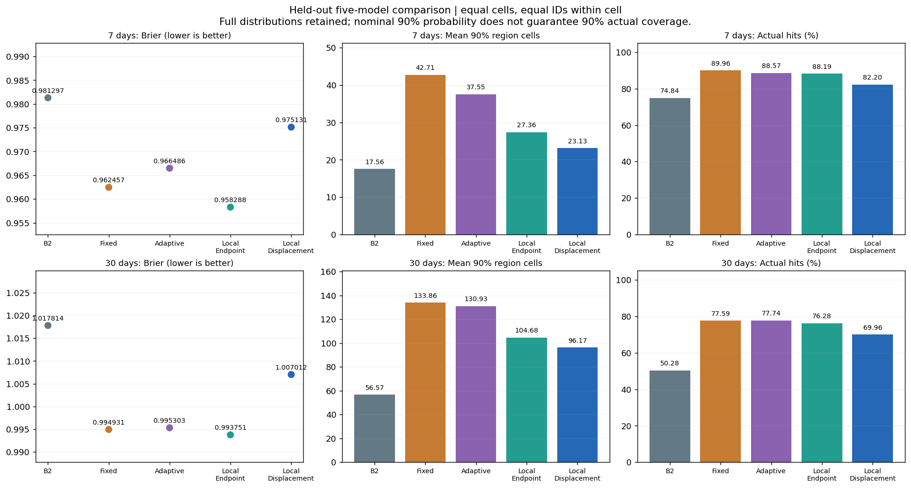

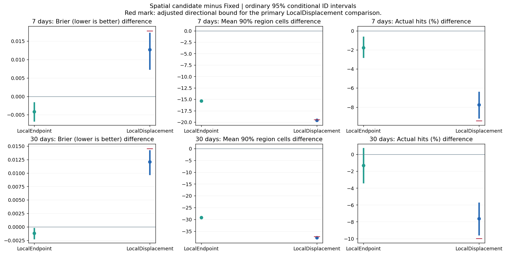

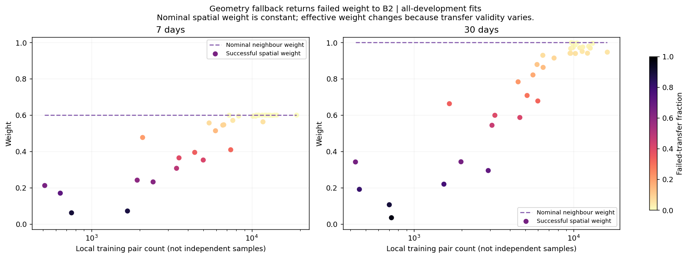

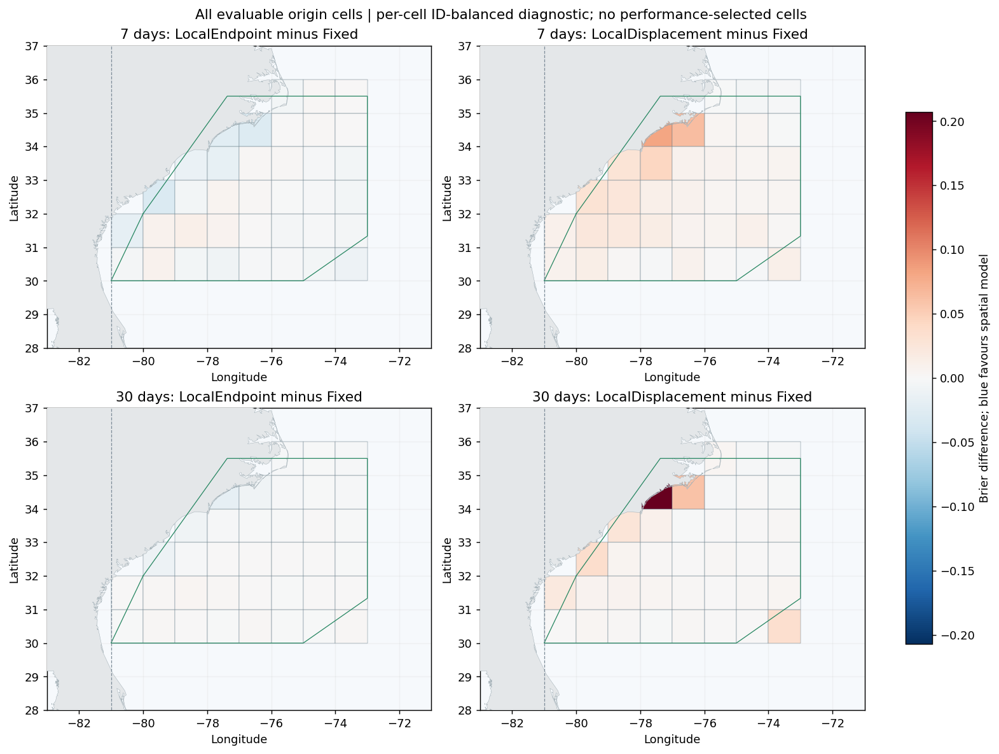

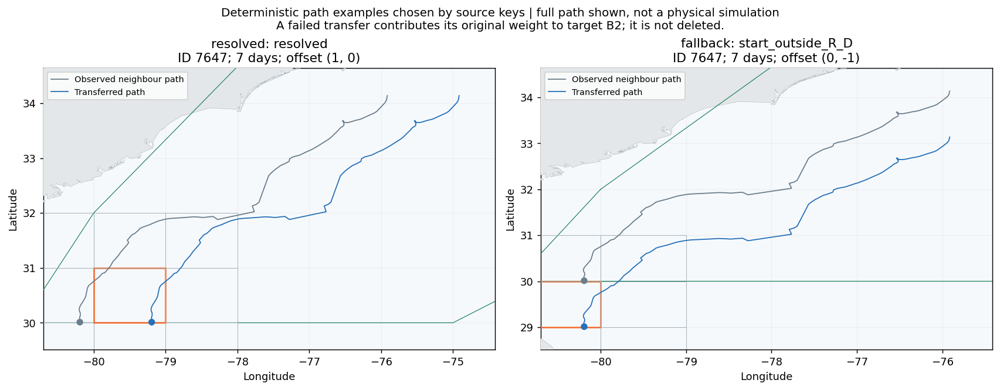

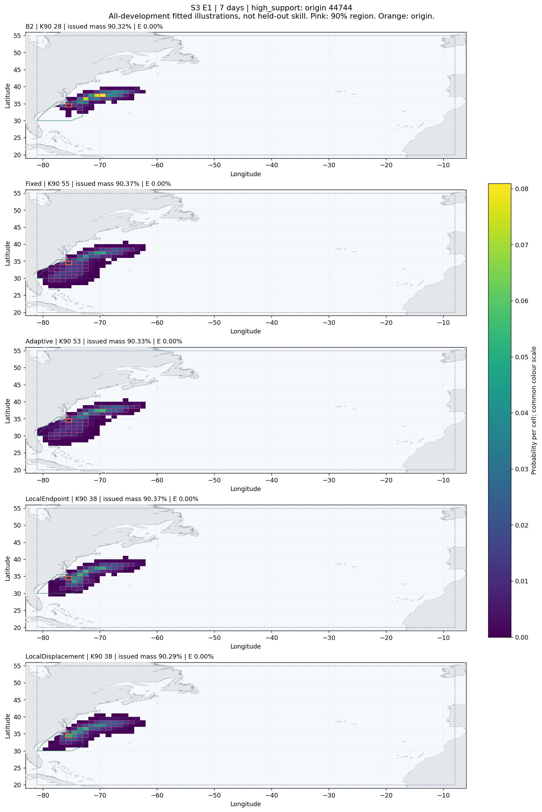

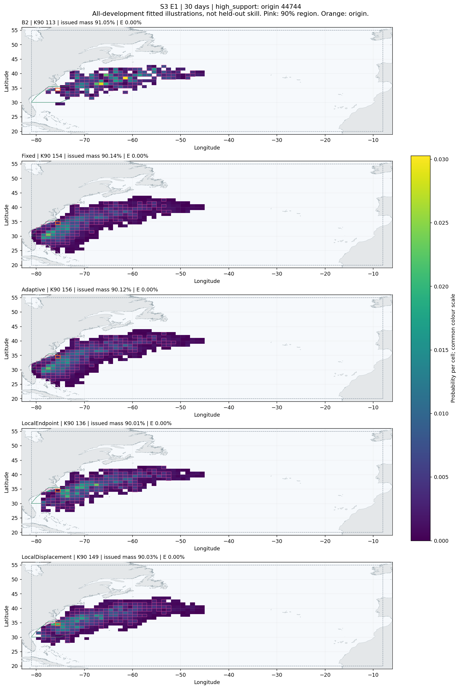

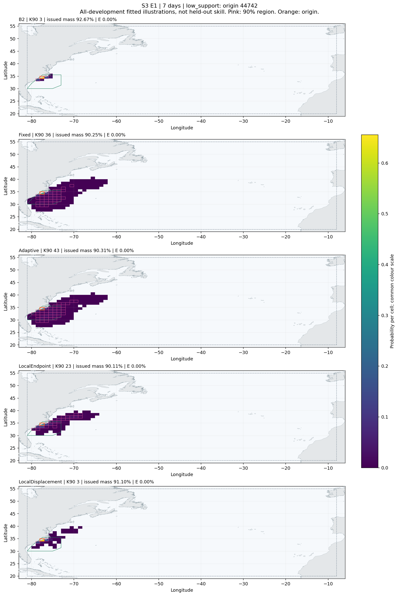

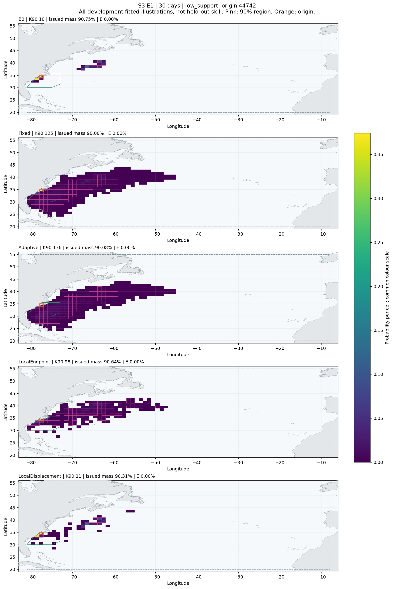

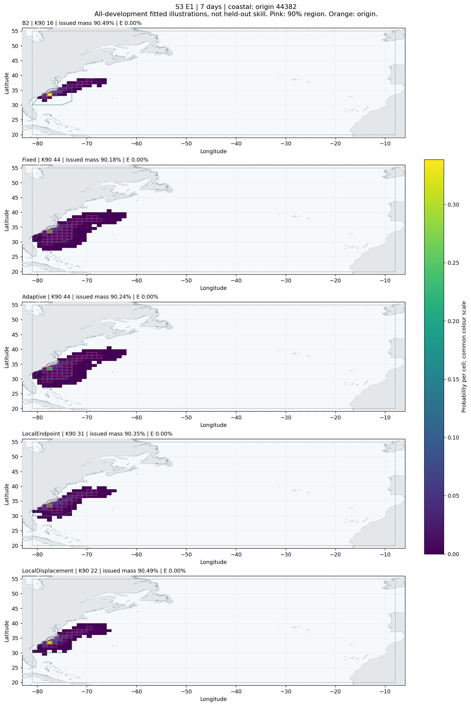

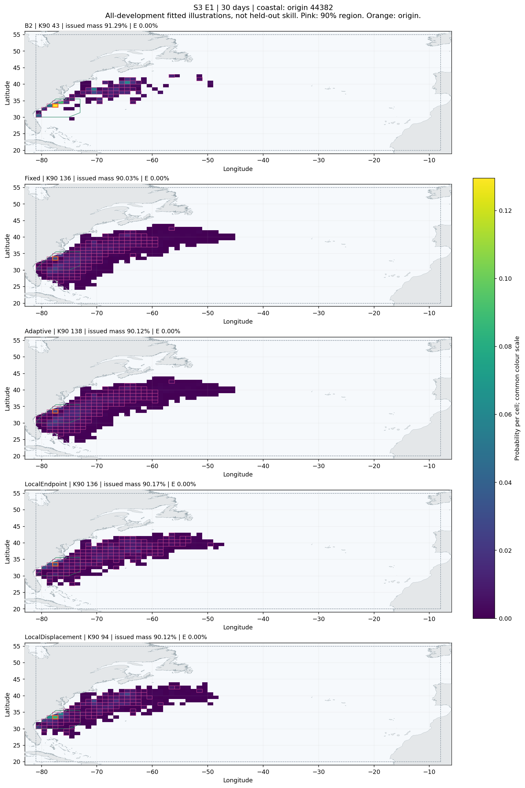
